# Boulet 前四章 × Lathi：第 2 组 20 道练习

**每章 5 题 · 共 20 个独立题号 · 原题与必要附图 · 无答案**

[下载第 2 组 PDF（21 页）](../../assets/lathi-boulet-batch-02/Lathi_20_Exercises_Boulet_Chapters_1-4_Batch_02_No_Solutions.pdf){ .md-button .md-button--primary download }

按 Boulet 前四章的知识主题选择 Lathi 第三版习题。本组与第 1 组不重复。下方保留原题图像，避免公式转写丢失；点击图片可打开原图放大查看。这里只按知识点匹配，不表示两书的习题一一等价。

[第 1 组 20 题](lathi-20-exercises.md) · [Boulet 总览](index.md)

## 快速索引

| Boulet 章节 | Lathi 题号 |
| --- | --- |
| 第 1 章：信号与系统基础 | [1.1-9](#exercise-1-1-9)、[1.4-4](#exercise-1-4-4)、[1.5-3](#exercise-1-5-3)、[1.7-2](#exercise-1-7-2)、[3.3-9](#exercise-3-3-9) |
| 第 2 章：线性时不变系统与卷积 | [2.4-11](#exercise-2-4-11)、[2.4-14](#exercise-2-4-14)、[2.4-21](#exercise-2-4-21)、[3.8-6](#exercise-3-8-6)、[3.8-16](#exercise-3-8-16) |
| 第 3 章：微分方程、差分方程与系统响应 | [2.2-3](#exercise-2-2-3)、[2.2-4](#exercise-2-2-4)、[3.5-2](#exercise-3-5-2)、[3.8-15](#exercise-3-8-15)、[3.9-2](#exercise-3-9-2) |
| 第 4 章：连续时间傅里叶级数 | [6.3-3](#exercise-6-3-3)、[6.3-5](#exercise-6-3-5)、[6.3-10](#exercise-6-3-10)、[6.4-2](#exercise-6-4-2)、[6.5-7](#exercise-6-5-7) |

## 第 1 章：信号与系统基础

### 01 · Lathi 1.1-9：能量与幅度、时间平移及尺度变换 {#exercise-1-1-9}

**对应主题：** Boulet 第1章：Finite-Energy and Finite-Power Signals，p.21；Transformations of the Time Variable，p.4

Lathi 印刷页：137、138；原 PDF 页序：157、158

[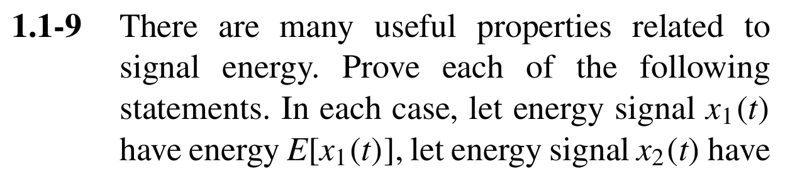{ .lathi-original loading="lazy" }](../../assets/lathi-boulet-batch-02/1.1-9_0.png)

[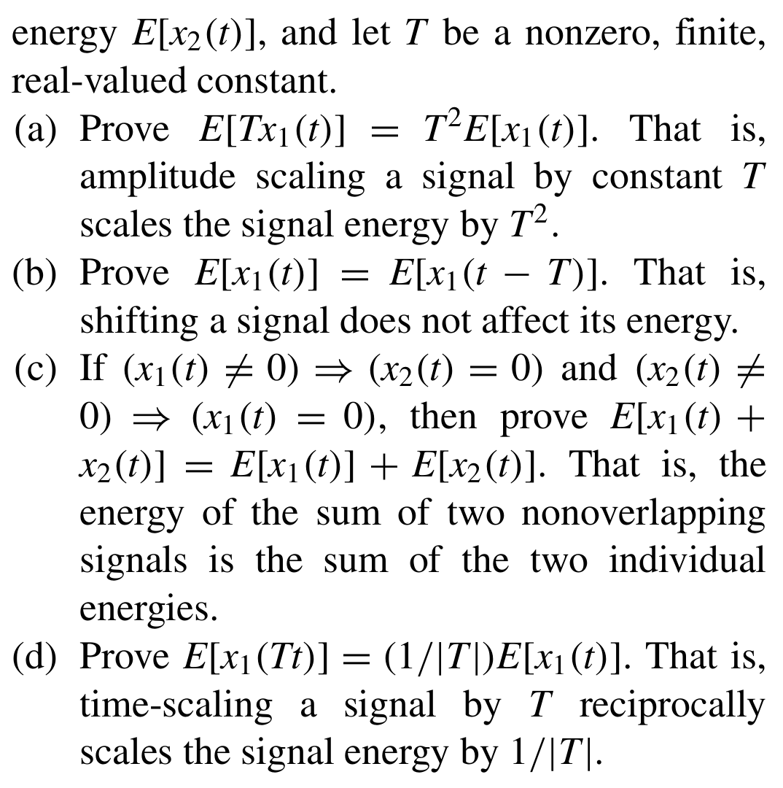{ .lathi-original loading="lazy" }](../../assets/lathi-boulet-batch-02/1.1-9_1.png)

### 02 · Lathi 1.4-4：阶跃与冲激的积分、有限能量和信号支集 {#exercise-1-4-4}

**对应主题：** Boulet 第1章：Generalized Functions，p.26；Finite-Energy and Finite-Power Signals，p.21

Lathi 印刷页：141；原 PDF 页序：161

[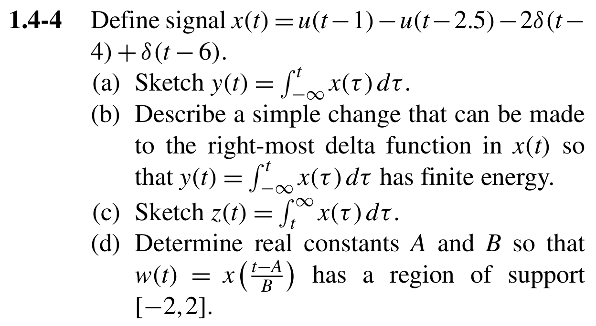{ .lathi-original loading="lazy" }](../../assets/lathi-boulet-batch-02/1.4-4_0.png)

### 03 · Lathi 1.5-3：连续信号的奇偶分解与能量分配 {#exercise-1-5-3}

**对应主题：** Boulet 第1章：Even and Odd Signals，p.23；Finite-Energy and Finite-Power Signals，p.21

Lathi 印刷页：143；原 PDF 页序：163

[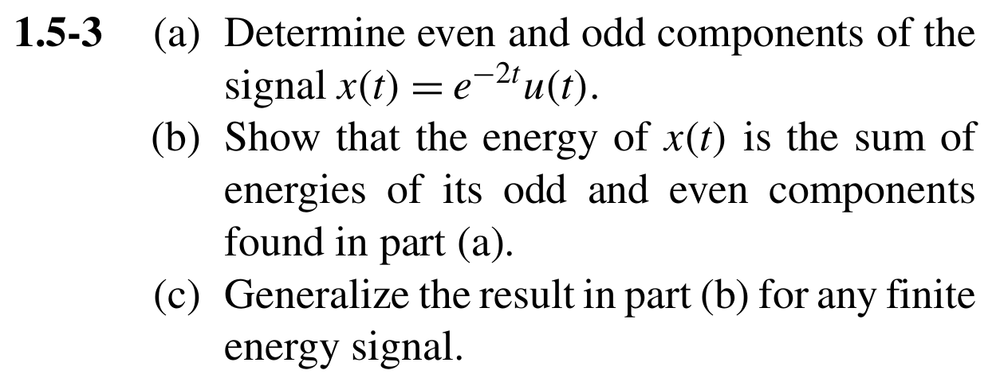{ .lathi-original loading="lazy" }](../../assets/lathi-boulet-batch-02/1.5-3_0.png)

### 04 · Lathi 1.7-2：时间不变系统与时变系统的判断 {#exercise-1-7-2}

**对应主题：** Boulet 第1章：System Models and Basic Properties，p.34

Lathi 印刷页：144；原 PDF 页序：164

[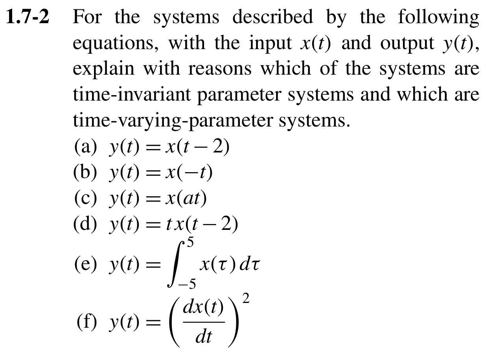{ .lathi-original loading="lazy" }](../../assets/lathi-boulet-batch-02/1.7-2_0.png)

### 05 · Lathi 3.3-9：离散信号的奇偶分解 {#exercise-3-3-9}

**对应主题：** Boulet 第1章：Even and Odd Signals，p.23；Discrete-Time Impulse and Step Signals，p.25

Lathi 印刷页：317；原 PDF 页序：337

**阅读说明：** 题干提到第1.5节，是说明奇偶分解概念与连续时间相同；不依赖其他习题。

[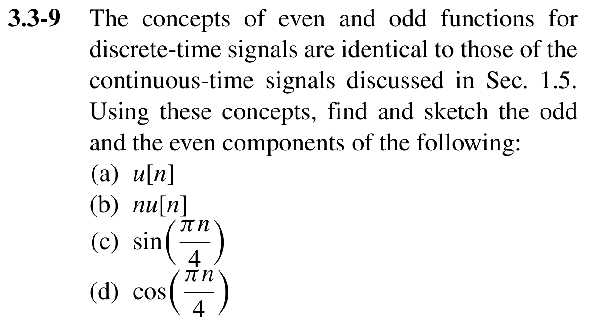{ .lathi-original loading="lazy" }](../../assets/lathi-boulet-batch-02/3.3-9_0.png)

## 第 2 章：线性时不变系统与卷积

### 06 · Lathi 2.4-11：卷积结果的奇偶性 {#exercise-2-4-11}

**对应主题：** Boulet 第2章：Continuous-Time LTI Systems: The Convolution Integral，p.67；Properties of Linear Time-Invariant Systems，p.74

Lathi 印刷页：227；原 PDF 页序：247

**阅读说明：** 提示所引用2.4-10的性质：若 x(t)*g(t)=c(t)，则 x(at)*g(at)=c(at)/|a|（a≠0）。这里只展开可用性质，不追加一道题。

[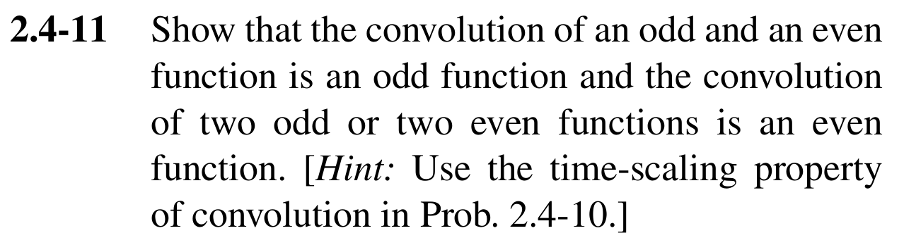{ .lathi-original loading="lazy" }](../../assets/lathi-boulet-batch-02/2.4-11_0.png)

### 07 · Lathi 2.4-14：阶跃、重复指数与斜坡的连续卷积 {#exercise-2-4-14}

**对应主题：** Boulet 第2章：Continuous-Time LTI Systems: The Convolution Integral，p.67

Lathi 印刷页：227；原 PDF 页序：247

[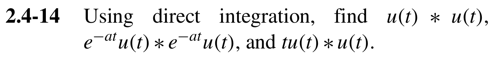{ .lathi-original loading="lazy" }](../../assets/lathi-boulet-batch-02/2.4-14_0.png)

### 08 · Lathi 2.4-21：含冲激的连续系统零状态响应 {#exercise-2-4-21}

**对应主题：** Boulet 第2章：Continuous-Time LTI Systems: The Convolution Integral，p.67

Lathi 印刷页：227；原 PDF 页序：247

[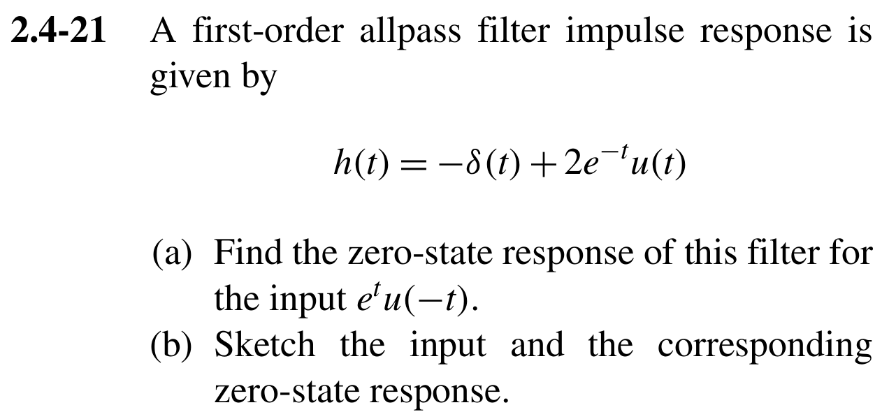{ .lathi-original loading="lazy" }](../../assets/lathi-boulet-batch-02/2.4-21_0.png)

### 09 · Lathi 3.8-6：含时移指数和冲激的离散卷积 {#exercise-3-8-6}

**对应主题：** Boulet 第2章：Discrete-Time LTI Systems: The Convolution Sum，p.54

Lathi 印刷页：322；原 PDF 页序：342

[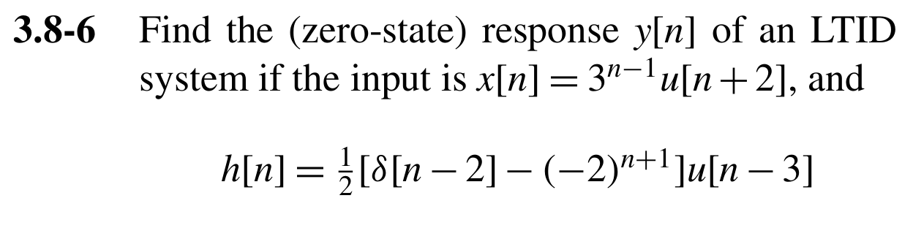{ .lathi-original loading="lazy" }](../../assets/lathi-boulet-batch-02/3.8-6_0.png)

### 10 · Lathi 3.8-16：离散指数输入与卷积时移 {#exercise-3-8-16}

**对应主题：** Boulet 第2章：Discrete-Time LTI Systems: The Convolution Sum，p.54；Properties of Linear Time-Invariant Systems，p.74

Lathi 印刷页：322；原 PDF 页序：342

**阅读说明：** 提示中的式(3.32)为卷积的时移性质：若 x[n]*h[n]=y[n]，则 x[n−n0]*h[n]=y[n−n0]。

[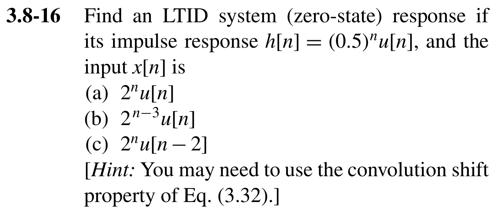{ .lathi-original loading="lazy" }](../../assets/lathi-boulet-batch-02/3.8-16_0.png)

## 第 3 章：微分方程、差分方程与系统响应

### 11 · Lathi 2.2-3：微分系统的特征模态与零输入响应 {#exercise-2-2-3}

**对应主题：** Boulet 第3章：Causal LTI Systems Described by Differential Equations，p.92；Characteristic Polynomials and Stability，p.112

Lathi 印刷页：224；原 PDF 页序：244

[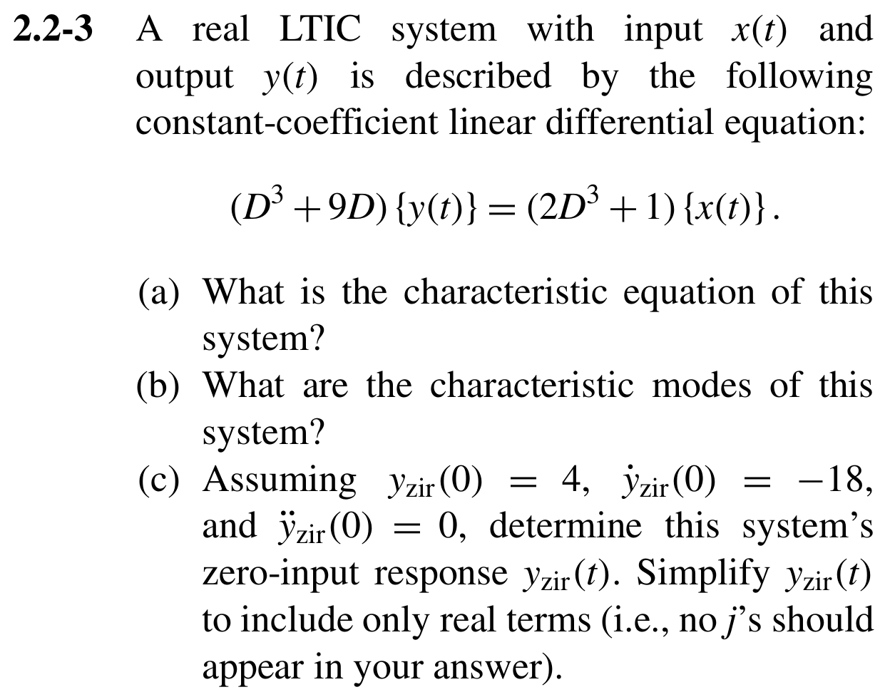{ .lathi-original loading="lazy" }](../../assets/lathi-boulet-batch-02/2.2-3_0.png)

### 12 · Lathi 2.2-4：二阶微分系统与初始条件响应 {#exercise-2-2-4}

**对应主题：** Boulet 第3章：Causal LTI Systems Described by Differential Equations，p.92

Lathi 印刷页：224；原 PDF 页序：244

[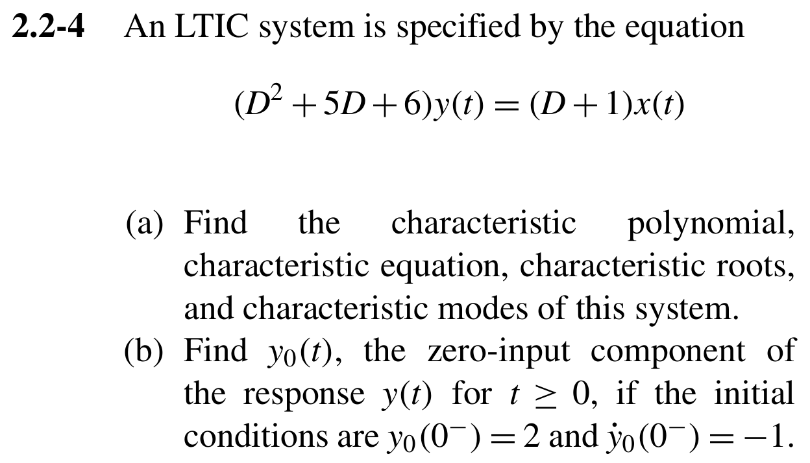{ .lathi-original loading="lazy" }](../../assets/lathi-boulet-batch-02/2.2-4_0.png)

### 13 · Lathi 3.5-2：差分方程的前三项递推求解 {#exercise-3-5-2}

**对应主题：** Boulet 第3章：Causal LTI Systems Described by Difference Equations，p.96

Lathi 印刷页：319；原 PDF 页序：339

[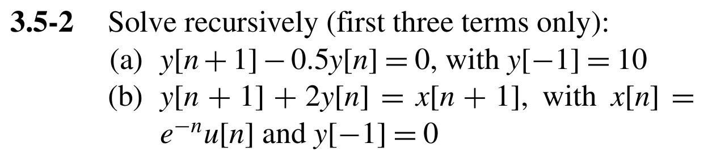{ .lathi-original loading="lazy" }](../../assets/lathi-boulet-batch-02/3.5-2_0.png)

### 14 · Lathi 3.8-15：非零初始条件下的离散系统全响应 {#exercise-3-8-15}

**对应主题：** Boulet 第3章：Causal LTI Systems Described by Difference Equations，p.96

Lathi 印刷页：322；原 PDF 页序：342

**阅读说明：** 与本批第13题的(b)小题使用相同方程及输入，但本题初值为 y[-1]=10，第13题(b)为 y[-1]=0；本题要求全响应，而第13题只要求递推前三项。

[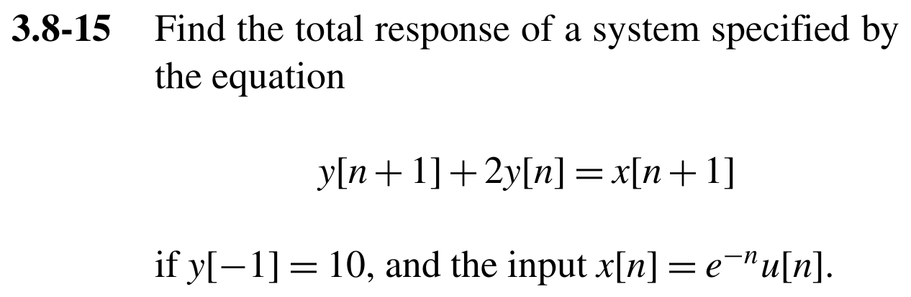{ .lathi-original loading="lazy" }](../../assets/lathi-boulet-batch-02/3.8-15_0.png)

### 15 · Lathi 3.9-2：离散系统的BIBO稳定性与内部稳定性 {#exercise-3-9-2}

**对应主题：** Boulet 第3章：Characteristic Polynomials and Stability of Differential and Difference Systems，p.112

Lathi 印刷页：327；原 PDF 页序：347

[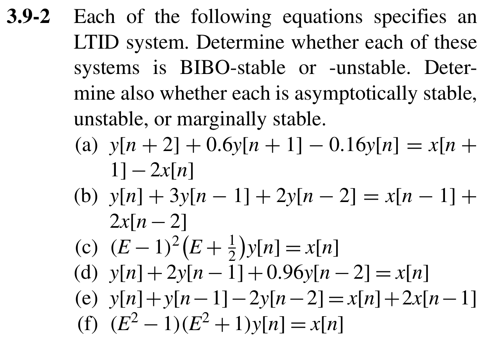{ .lathi-original loading="lazy" }](../../assets/lathi-boulet-batch-02/3.9-2_0.png)

## 第 4 章：连续时间傅里叶级数

### 16 · Lathi 6.3-3：三角与复指数傅里叶频谱的相互转换 {#exercise-6-3-3}

**对应主题：** Boulet 第4章：Determination of the Fourier Series Representation，p.134；Graph of the Fourier Series Coefficients: The Line Spectrum，p.137

Lathi 印刷页：672；原 PDF 页序：692

[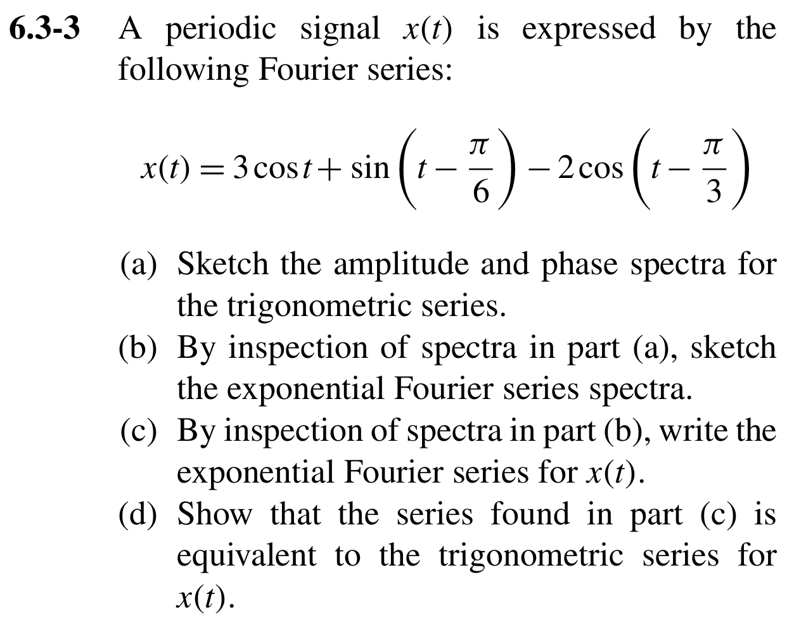{ .lathi-original loading="lazy" }](../../assets/lathi-boulet-batch-02/6.3-3_0.png)

### 17 · Lathi 6.3-5：由复指数级数求三角频谱与带宽 {#exercise-6-3-5}

**对应主题：** Boulet 第4章：Graph of the Fourier Series Coefficients: The Line Spectrum，p.137

Lathi 印刷页：672、673；原 PDF 页序：692、693

[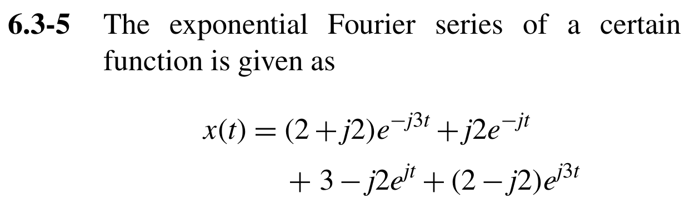{ .lathi-original loading="lazy" }](../../assets/lathi-boulet-batch-02/6.3-5_0.png)

[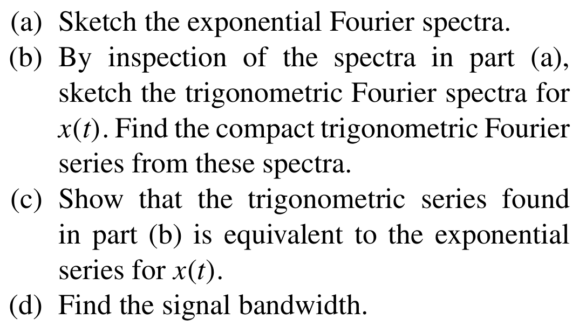{ .lathi-original loading="lazy" }](../../assets/lathi-boulet-batch-02/6.3-5_1.png)

### 18 · Lathi 6.3-10：周期信号时移和时间尺度变换的频谱性质 {#exercise-6-3-10}

**对应主题：** Boulet 第4章：Properties of Continuous-Time Fourier Series，p.139

Lathi 印刷页：674；原 PDF 页序：694

[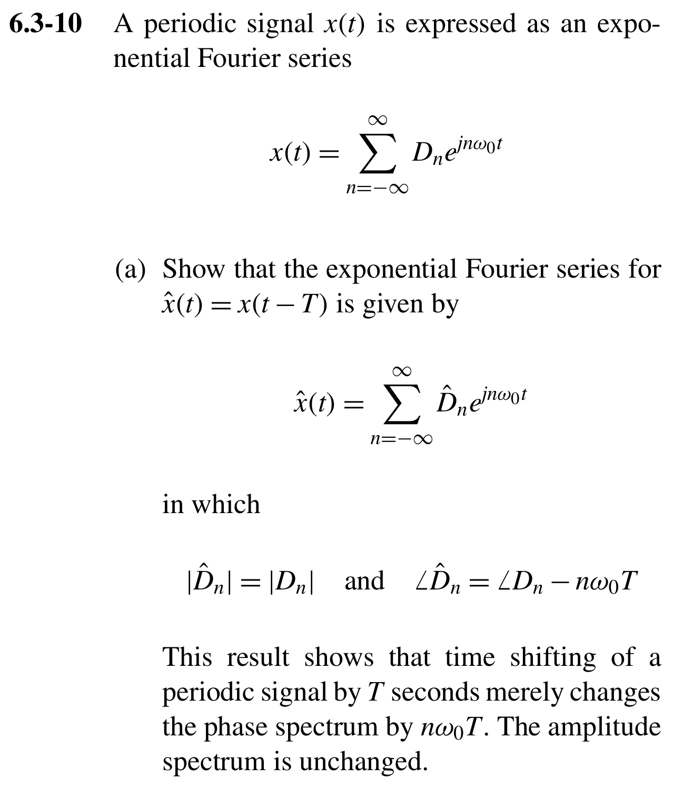{ .lathi-original loading="lazy" }](../../assets/lathi-boulet-batch-02/6.3-10_0.png)

[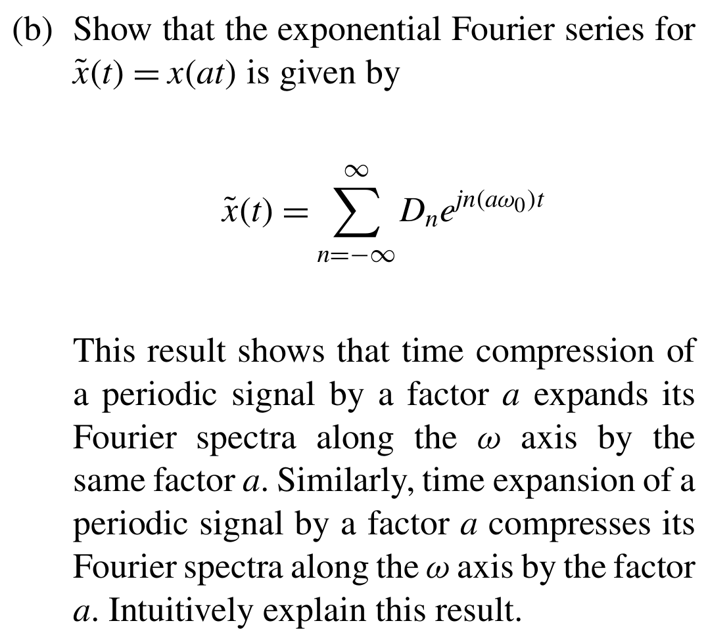{ .lathi-original loading="lazy" }](../../assets/lathi-boulet-batch-02/6.3-10_1.png)

### 19 · Lathi 6.4-2：谐波分量通过低通、高通、带通与带阻滤波器 {#exercise-6-4-2}

**对应主题：** Boulet 第4章：Steady-State Response of an LTI System to a Periodic Signal，p.155

Lathi 印刷页：675；原 PDF 页序：695

[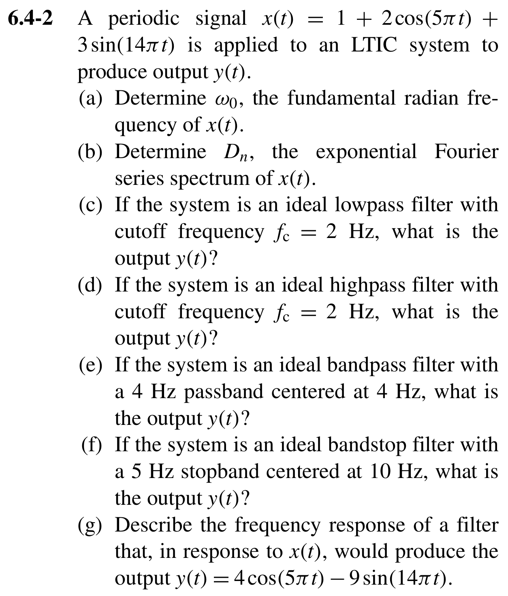{ .lathi-original loading="lazy" }](../../assets/lathi-boulet-batch-02/6.4-2_0.png)

### 20 · Lathi 6.5-7：同一有限区间信号的不同傅里叶级数表示 {#exercise-6-5-7}

**对应主题：** Boulet 第4章：Determination of the Fourier Series Representation，p.134；Optimality and Convergence of the Fourier Series，p.144

Lathi 印刷页：677；原 PDF 页序：697

[{ .lathi-original loading="lazy" }](../../assets/lathi-boulet-batch-02/6.5-7_0.png)

## 来源与使用说明

- B. P. Lathi & R. A. Green, *Linear Systems and Signals*, Third Edition, Oxford University Press, 2018：题号、题干与所需附图按原 PDF 核对
- Benoit Boulet, *Fundamentals of Signals and Systems*：第 1–4 章的主题与印刷页码用于中文学习索引
- Lathi 原 PDF 页序比印刷页码大 20；页面同时列出两种页码，便于回查
- 原题中的必要引用或附图见各题阅读说明；本页与下载 PDF 均不含解答

[第 1 组 20 题](lathi-20-exercises.md) · [Boulet 总览](index.md) · [前三章全部对应题号](lathi-exercise-map.md)
