# Boulet 前四章 × Lathi：第 3 组 20 道练习

**每章 5 题 · 共 20 个独立题号 · 原题与必要附图 · 无答案**

[下载第 3 组 PDF（21 页）](../../assets/lathi-boulet-batch-03/Lathi_20_Exercises_Boulet_Chapters_1-4_Batch_03_No_Solutions.pdf){ .md-button .md-button--primary download }

按 Boulet 前四章的知识主题选择 Lathi 第三版习题。本组与此前各组不重复。下方保留原题图像，避免公式转写丢失；点击图片可打开原图放大查看。这里只按知识点匹配，不表示两书的习题一一等价。

[第 1 组 20 题](lathi-20-exercises.md) · [第 2 组 20 题](lathi-20-exercises-batch-02.md) · [Boulet 总览](index.md)

## 快速索引

| Boulet 章节 | Lathi 题号 |
| --- | --- |
| 第 1 章：信号与系统基础 | [1.3-8](#exercise-1-3-8)、[1.4-12](#exercise-1-4-12)、[1.4-13](#exercise-1-4-13)、[1.7-10](#exercise-1-7-10)、[3.3-1](#exercise-3-3-1) |
| 第 2 章：线性时不变系统与卷积 | [2.4-15](#exercise-2-4-15)、[2.4-24](#exercise-2-4-24)、[3.8-20](#exercise-3-8-20)、[3.8-21](#exercise-3-8-21)、[3.8-25](#exercise-3-8-25) |
| 第 3 章：微分方程、差分方程与系统响应 | [2.2-11](#exercise-2-2-11)、[2.3-7](#exercise-2-3-7)、[3.6-1](#exercise-3-6-1)、[3.6-6](#exercise-3-6-6)、[3.6-9](#exercise-3-6-9) |
| 第 4 章：连续时间傅里叶级数 | [6.1-8](#exercise-6-1-8)、[6.3-14](#exercise-6-3-14)、[6.3-15](#exercise-6-3-15)、[6.4-4](#exercise-6-4-4)、[6.5-4](#exercise-6-5-4) |

## 第 1 章：信号与系统基础

### 01 · Lathi 1.3-8：奇偶周期延拓与复信号功率 {#exercise-1-3-8}

**对应主题：** Boulet 第1章：Periodic Signals，p.8；Finite-Energy and Finite-Power Signals，p.21；Even and Odd Signals，p.23

Lathi 印刷页：141；原 PDF 页序：161

[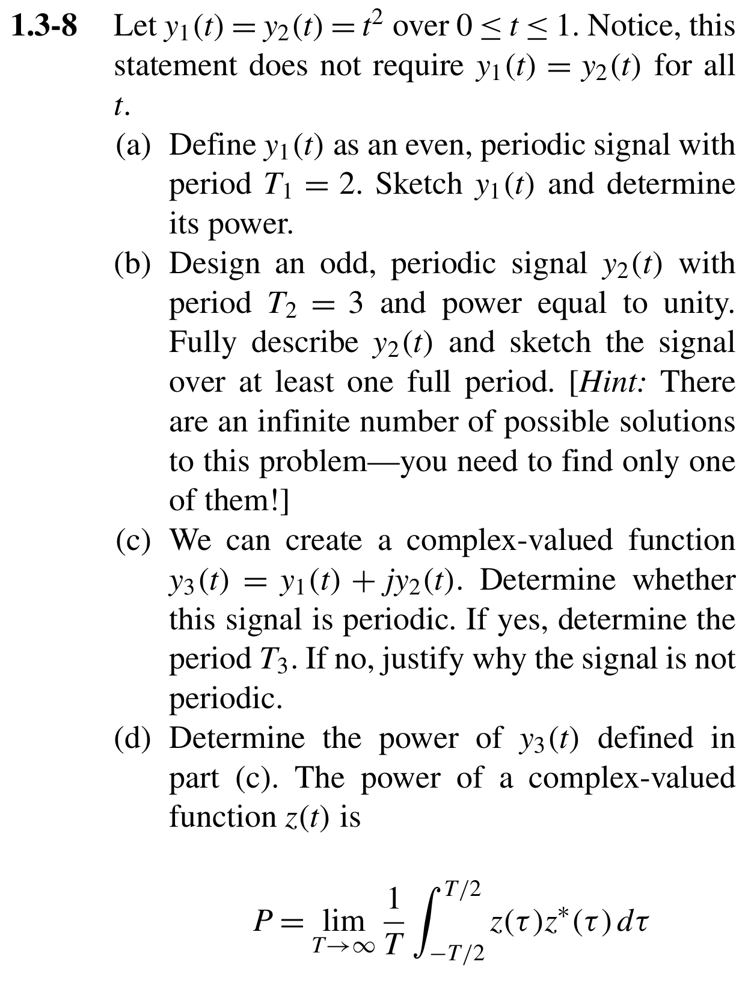{ .lathi-original loading="lazy" }](../../assets/lathi-boulet-batch-03/1.3-8_0.png)

### 02 · Lathi 1.4-12：冲激导数的广义函数性质 {#exercise-1-4-12}

**对应主题：** Boulet 第1章：Generalized Functions，p.26

Lathi 印刷页：142；原 PDF 页序：162

[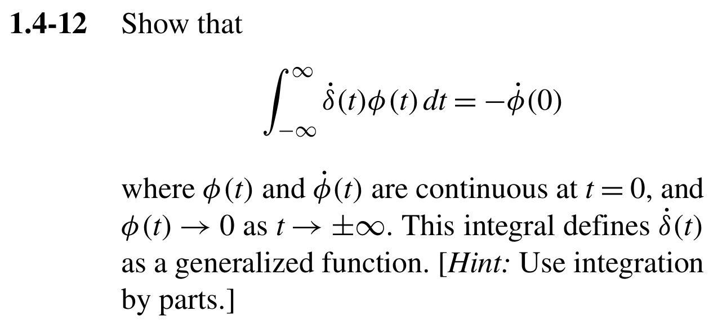{ .lathi-original loading="lazy" }](../../assets/lathi-boulet-batch-03/1.4-12_0.png)

### 03 · Lathi 1.4-13：指数正弦信号的复频率 {#exercise-1-4-13}

**对应主题：** Boulet 第1章：Exponential Signals，p.9；Periodic Complex Exponential and Sinusoidal Signals，p.17

Lathi 印刷页：142；原 PDF 页序：162

**阅读说明：** 原题首句的指数记号与随后列出的复频率不一致；按其明确写出的两复频率 sigma+j*omega 和 sigma-j*omega 理解，两项指数分别为 exp((sigma+j*omega)t) 与 exp((sigma-j*omega)t)。原题截图未改写。

[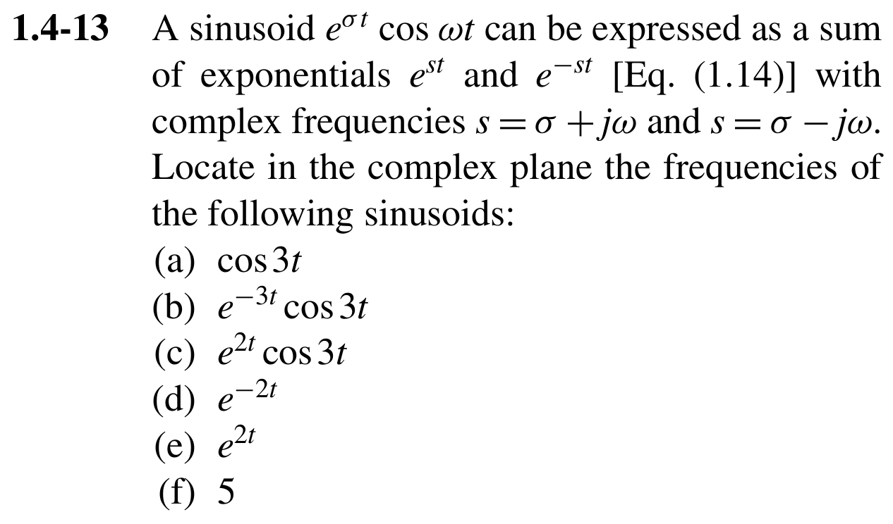{ .lathi-original loading="lazy" }](../../assets/lathi-boulet-batch-03/1.4-13_0.png)

### 04 · Lathi 1.7-10：冲激核定义系统的基本性质 {#exercise-1-7-10}

**对应主题：** Boulet 第1章：System Models and Basic Properties，p.34

Lathi 印刷页：145；原 PDF 页序：165

[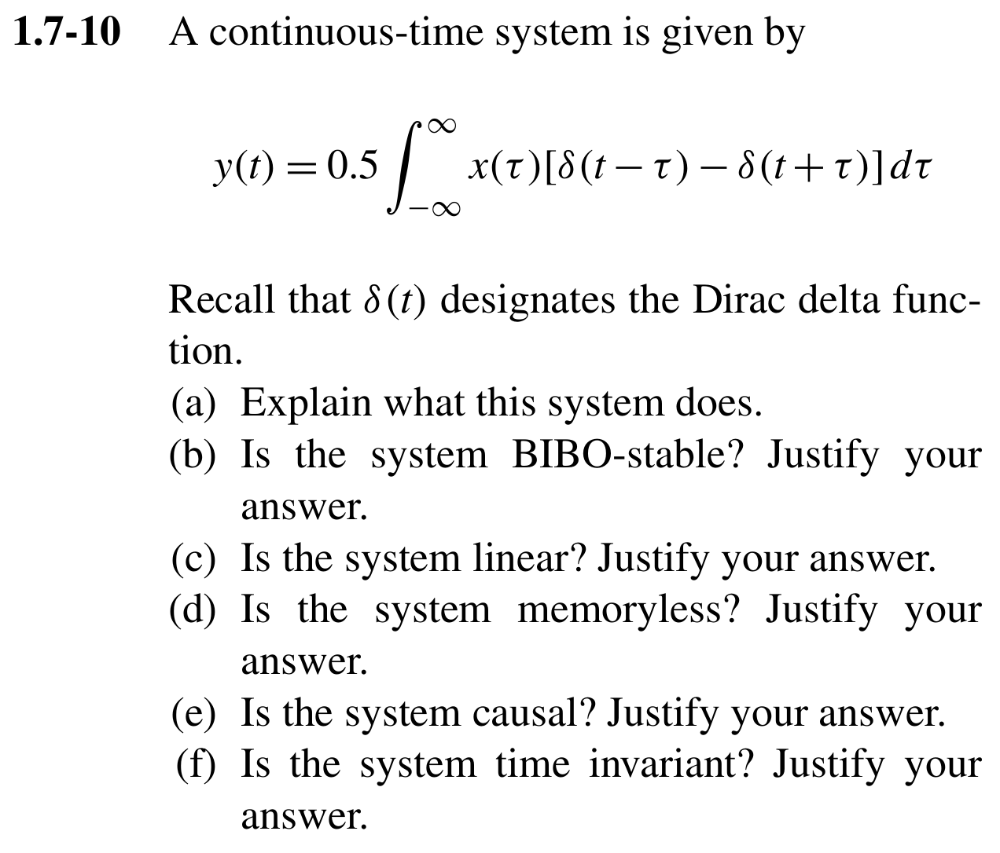{ .lathi-original loading="lazy" }](../../assets/lathi-boulet-batch-03/1.7-10_0.png)

### 05 · Lathi 3.3-1：离散信号的作图与平均功率 {#exercise-3-3-1}

**对应主题：** Boulet 第1章：Finite-Energy and Finite-Power Signals，p.21；Discrete-Time Impulse and Step Signals，p.25

Lathi 印刷页：316；原 PDF 页序：336

[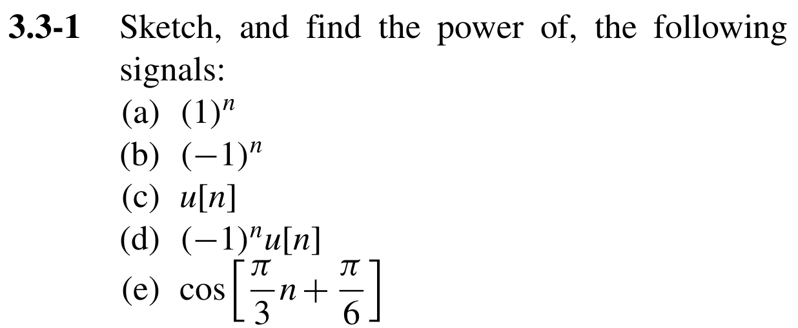{ .lathi-original loading="lazy" }](../../assets/lathi-boulet-batch-03/3.3-1_0.png)

## 第 2 章：线性时不变系统与卷积

### 06 · Lathi 2.4-15：因果正弦、余弦与单位阶跃的卷积 {#exercise-2-4-15}

**对应主题：** Boulet 第2章：Continuous-Time LTI Systems: The Convolution Integral，p.67

Lathi 印刷页：227；原 PDF 页序：247

[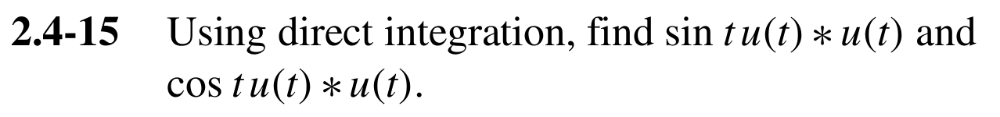{ .lathi-original loading="lazy" }](../../assets/lathi-boulet-batch-03/2.4-15_0.png)

### 07 · Lathi 2.4-24：非因果有理信号与阶跃的卷积 {#exercise-2-4-24}

**对应主题：** Boulet 第2章：Continuous-Time LTI Systems: The Convolution Integral，p.67

Lathi 印刷页：228；原 PDF 页序：248

[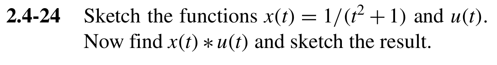{ .lathi-original loading="lazy" }](../../assets/lathi-boulet-batch-03/2.4-24_0.png)

### 08 · Lathi 3.8-20：有限冲激响应系统对反因果输入的卷积 {#exercise-3-8-20}

**对应主题：** Boulet 第2章：Discrete-Time LTI Systems: The Convolution Sum，p.54

Lathi 印刷页：323；原 PDF 页序：343

[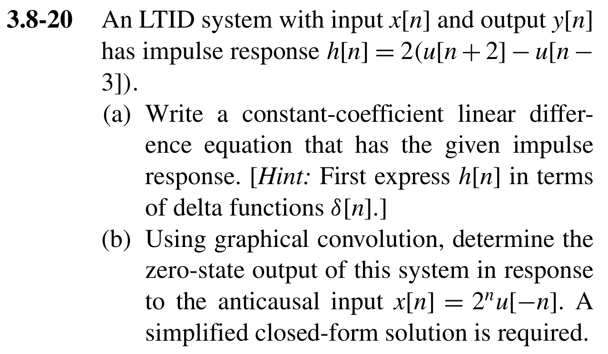{ .lathi-original loading="lazy" }](../../assets/lathi-boulet-batch-03/3.8-20_0.png)

### 09 · Lathi 3.8-21：离散LTI系统的串并联与零状态响应 {#exercise-3-8-21}

**对应主题：** Boulet 第2章：Discrete-Time LTI Systems: The Convolution Sum，p.54；Properties of Linear Time-Invariant Systems，p.74

Lathi 印刷页：323；原 PDF 页序：343

[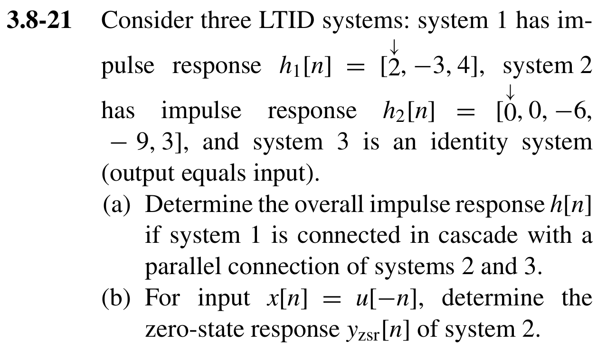{ .lathi-original loading="lazy" }](../../assets/lathi-boulet-batch-03/3.8-21_0.png)

### 10 · Lathi 3.8-25：有限序列卷积与滑动法 {#exercise-3-8-25}

**对应主题：** Boulet 第2章：Discrete-Time LTI Systems: The Convolution Sum，p.54

Lathi 印刷页：323；原 PDF 页序：343

[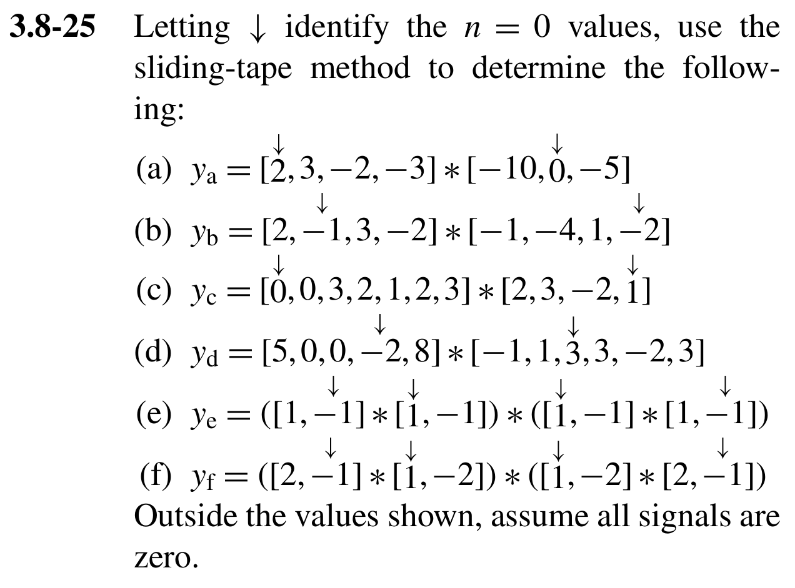{ .lathi-original loading="lazy" }](../../assets/lathi-boulet-batch-03/3.8-25_0.png)

## 第 3 章：微分方程、差分方程与系统响应

### 11 · Lathi 2.2-11：从零输入响应判断可能的特征方程 {#exercise-2-2-11}

**对应主题：** Boulet 第3章：Causal LTI Systems Described by Differential Equations，p.92；Characteristic Polynomials and Stability，p.112

Lathi 印刷页：224；原 PDF 页序：244

[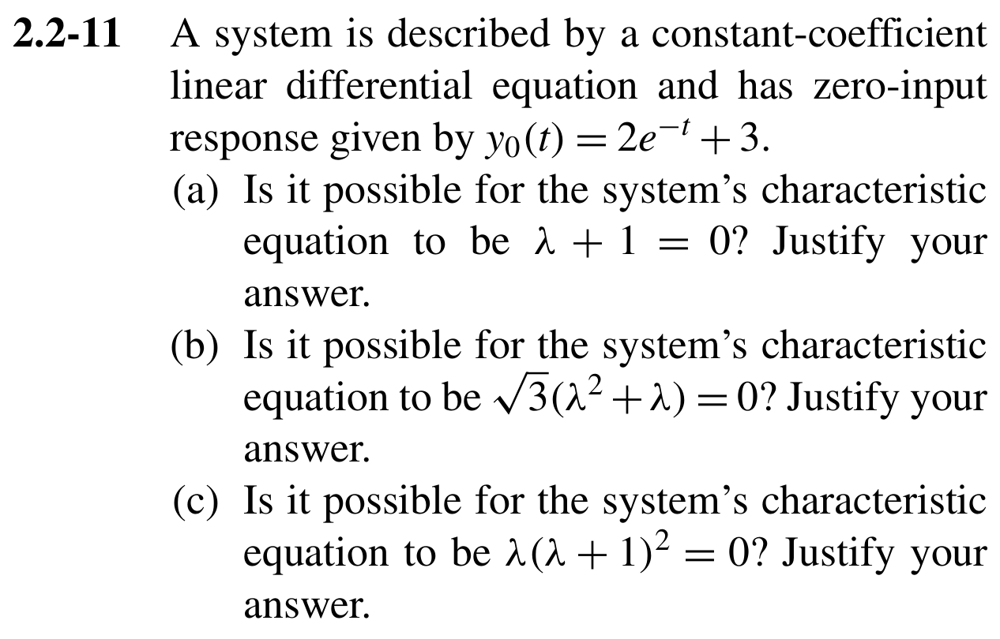{ .lathi-original loading="lazy" }](../../assets/lathi-boulet-batch-03/2.2-11_0.png)

### 12 · Lathi 2.3-7：从积分方程建立微分系统并求冲激响应 {#exercise-2-3-7}

**对应主题：** Boulet 第3章：Causal LTI Systems Described by Differential Equations，p.92；Impulse Response of a Differential LTI System，p.101

Lathi 印刷页：225；原 PDF 页序：245

[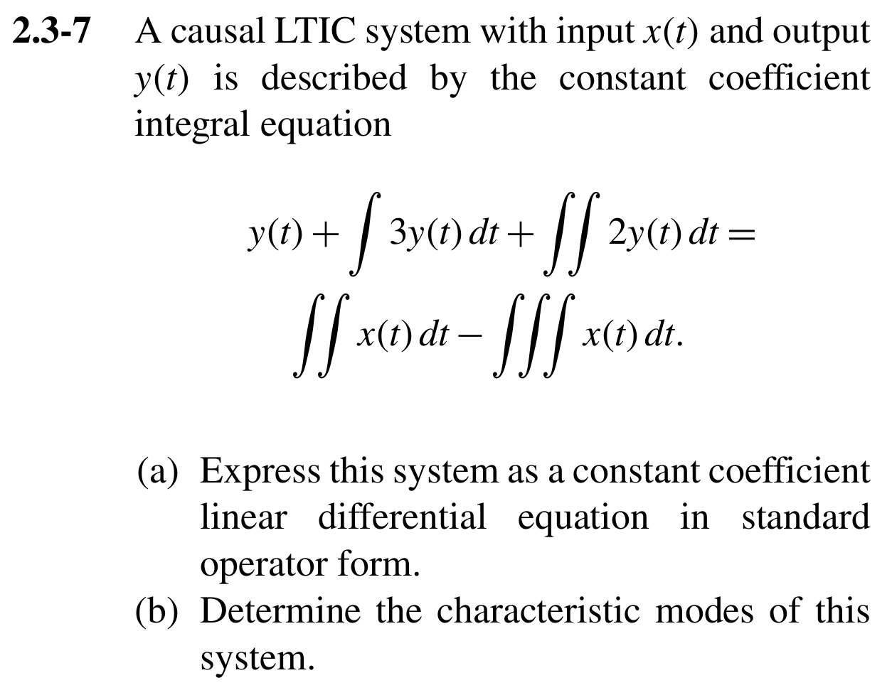{ .lathi-original loading="lazy" }](../../assets/lathi-boulet-batch-03/2.3-7_0.png)

[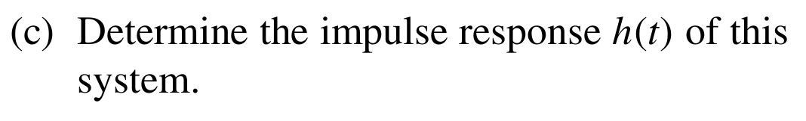{ .lathi-original loading="lazy" }](../../assets/lathi-boulet-batch-03/2.3-7_1.png)

### 13 · Lathi 3.6-1：离散系统零输入响应的闭式表达 {#exercise-3-6-1}

**对应主题：** Boulet 第3章：Causal LTI Systems Described by Difference Equations，p.96

Lathi 印刷页：320；原 PDF 页序：340

[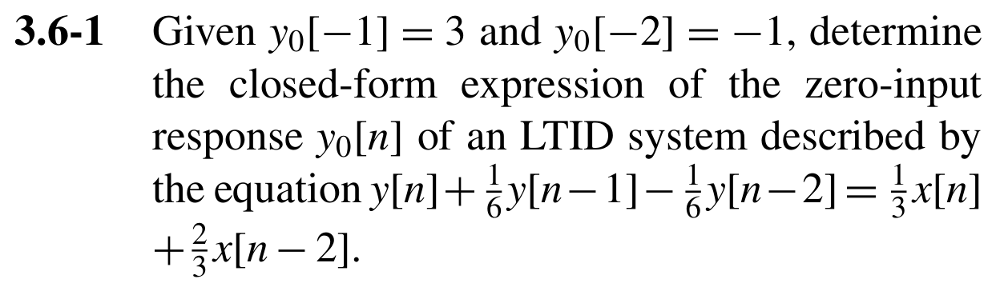{ .lathi-original loading="lazy" }](../../assets/lathi-boulet-batch-03/3.6-1_0.png)

### 14 · Lathi 3.6-6：Fibonacci数列的差分模型、特征根与稳定性 {#exercise-3-6-6}

**对应主题：** Boulet 第3章：Causal LTI Systems Described by Difference Equations，p.96；Characteristic Polynomials and Stability，p.112

Lathi 印刷页：320；原 PDF 页序：340

[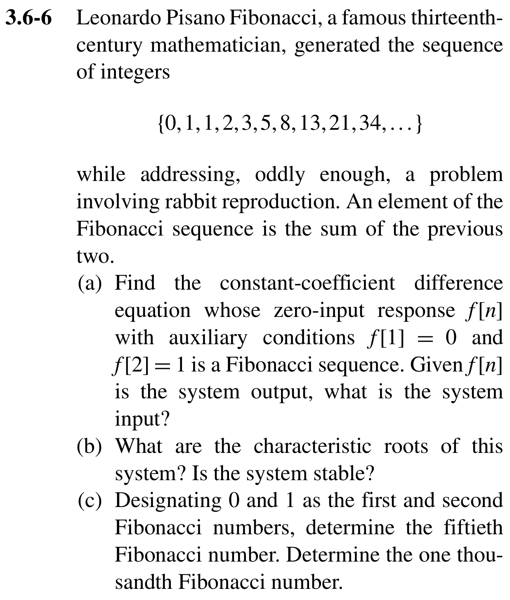{ .lathi-original loading="lazy" }](../../assets/lathi-boulet-batch-03/3.6-6_0.png)

### 15 · Lathi 3.6-9：连续与离散系统稳定区域的对照设计 {#exercise-3-6-9}

**对应主题：** Boulet 第3章：Characteristic Polynomials and Stability of Differential and Difference Systems，p.112

Lathi 印刷页：320；原 PDF 页序：340

[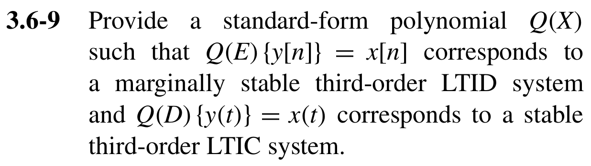{ .lathi-original loading="lazy" }](../../assets/lathi-boulet-batch-03/3.6-9_0.png)

## 第 4 章：连续时间傅里叶级数

### 16 · Lathi 6.1-8：周期性、基周期与谐波组成 {#exercise-6-1-8}

**对应主题：** Boulet 第4章：Linear Combinations of Harmonically Related Complex Exponentials，p.132

Lathi 印刷页：672；原 PDF 页序：692

[{ .lathi-original loading="lazy" }](../../assets/lathi-boulet-batch-03/6.1-8_0.png)

### 17 · Lathi 6.3-14：反转、平移、调制与线性组合的级数系数 {#exercise-6-3-14}

**对应主题：** Boulet 第4章：Properties of Continuous-Time Fourier Series，p.139

Lathi 印刷页：675；原 PDF 页序：695

**阅读说明：** 原题先记输入频谱为 D1[n]，后文又写 X1[n]；两者均指同一输入 x1(t) 的傅里叶级数系数。原题截图保留原记号，作答时统一记号即可。

[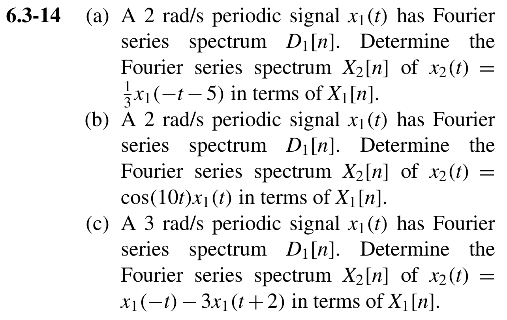{ .lathi-original loading="lazy" }](../../assets/lathi-boulet-batch-03/6.3-14_0.png)

### 18 · Lathi 6.3-15：分段二次周期信号的傅里叶级数与幅度谱 {#exercise-6-3-15}

**对应主题：** Boulet 第4章：Determination of the Fourier Series Representation，p.134；Graph of the Fourier Series Coefficients: The Line Spectrum，p.137；Properties of Continuous-Time Fourier Series，p.139

Lathi 印刷页：675；原 PDF 页序：695

**阅读说明：** 原文对例6.11的引用是方法提示：使用傅里叶级数性质求非直流系数，不能直接积分；本题的信号条件已全部给出，不依赖该例题的数据。

[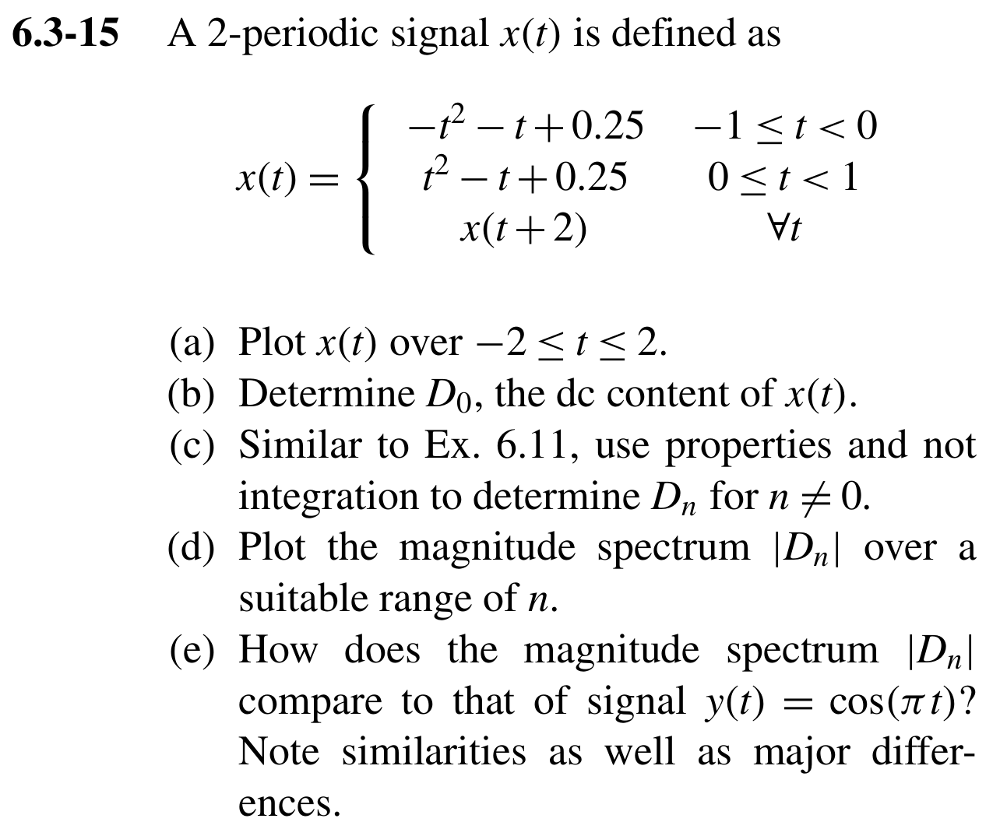{ .lathi-original loading="lazy" }](../../assets/lathi-boulet-batch-03/6.3-15_0.png)

### 19 · Lathi 6.4-4：正弦乘积的级数频谱与理想滤波 {#exercise-6-4-4}

**对应主题：** Boulet 第4章：Properties of Continuous-Time Fourier Series，p.139；Steady-State Response of an LTI System to a Periodic Signal，p.155

Lathi 印刷页：675、676；原 PDF 页序：695、696

**阅读说明：** 本题跨两页；(c)小题所需原图 P6.4-4 已完整附上。

[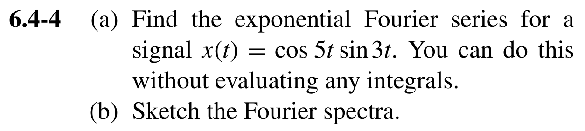{ .lathi-original loading="lazy" }](../../assets/lathi-boulet-batch-03/6.4-4_0.png)

[{ .lathi-original loading="lazy" }](../../assets/lathi-boulet-batch-03/6.4-4_1.png)

### 20 · Lathi 6.5-4：信号的最优投影、误差能量与正交性 {#exercise-6-5-4}

**对应主题：** Boulet 第4章：Optimality and Convergence of the Fourier Series，p.144；Parseval Theorem，p.150

Lathi 印刷页：677；原 PDF 页序：697

**阅读说明：** 本题所需原图 P6.5-4(a)、(b)均已附上。

[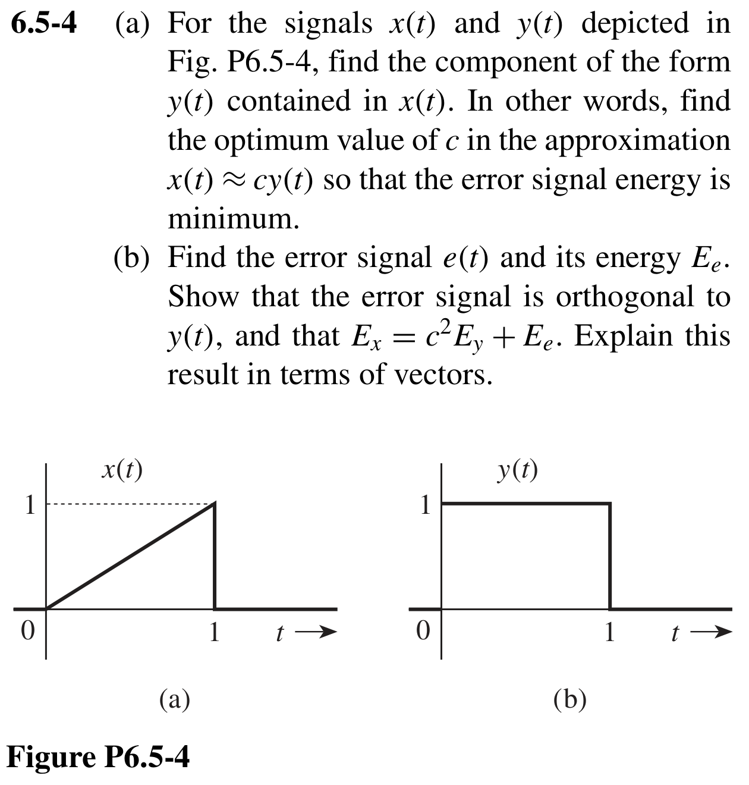{ .lathi-original loading="lazy" }](../../assets/lathi-boulet-batch-03/6.5-4_0.png)

## 来源与使用说明

- B. P. Lathi & R. A. Green, *Linear Systems and Signals*, Third Edition, Oxford University Press, 2018：题号、题干与所需附图按原 PDF 核对
- Benoit Boulet, *Fundamentals of Signals and Systems*：第 1–4 章的主题与印刷页码用于中文学习索引
- Lathi 原 PDF 页序比印刷页码大 20；页面同时列出两种页码，便于回查
- 原题中的必要引用或附图见各题阅读说明；本页与下载 PDF 均不含解答

[第 1 组 20 题](lathi-20-exercises.md) · [第 2 组 20 题](lathi-20-exercises-batch-02.md) · [Boulet 总览](index.md) · [前三章全部对应题号](lathi-exercise-map.md)
