# Boulet 前四章 × Lathi：第 4 组 20 道练习

**每章 5 题 · 共 20 个独立题号 · 原题与必要附图 · 无答案**

[下载第 4 组 PDF（21 页）](../../assets/lathi-boulet-batch-04/Lathi_20_Exercises_Boulet_Chapters_1-4_Batch_04_No_Solutions.pdf){ .md-button .md-button--primary download }

按 Boulet 前四章的知识主题选择 Lathi 第三版习题。本组与此前各组不重复。下方保留原题图像，避免公式转写丢失；点击图片可打开原图放大查看。这里只按知识点匹配，不表示两书的习题一一等价。

[第 1 组 20 题](lathi-20-exercises.md) · [第 2 组 20 题](lathi-20-exercises-batch-02.md) · [第 3 组 20 题](lathi-20-exercises-batch-03.md) · [Boulet 总览](index.md)

## 快速索引

| Boulet 章节 | Lathi 题号 |
| --- | --- |
| 第 1 章：信号与系统基础 | [1.2-5](#exercise-1-2-5)、[1.4-1](#exercise-1-4-1)、[1.4-11](#exercise-1-4-11)、[1.5-7](#exercise-1-5-7)、[3.2-4](#exercise-3-2-4) |
| 第 2 章：线性时不变系统与卷积 | [2.4-5](#exercise-2-4-5)、[2.4-8](#exercise-2-4-8)、[2.4-25](#exercise-2-4-25)、[3.8-1](#exercise-3-8-1)、[3.8-2](#exercise-3-8-2) |
| 第 3 章：微分方程、差分方程与系统响应 | [2.2-2](#exercise-2-2-2)、[2.3-3](#exercise-2-3-3)、[3.5-5](#exercise-3-5-5)、[3.6-4](#exercise-3-6-4)、[3.7-2](#exercise-3-7-2) |
| 第 4 章：连续时间傅里叶级数 | [6.3-4](#exercise-6-3-4)、[6.3-6](#exercise-6-3-6)、[6.3-16](#exercise-6-3-16)、[6.4-5](#exercise-6-4-5)、[6.5-3](#exercise-6-5-3) |

## 第 1 章：信号与系统基础

### 01 · Lathi 1.2-5：由变换后信号反求原信号并作图 {#exercise-1-2-5}

**对应主题：** Boulet 第1章：Transformations of the Time Variable，p.4

Lathi 印刷页：139；原 PDF 页序：159

[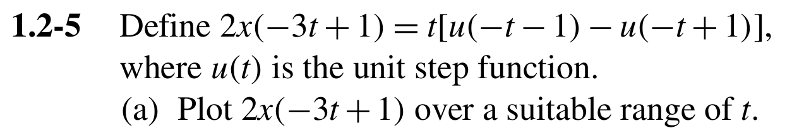{ .lathi-original loading="lazy" }](../../assets/lathi-boulet-batch-04/1.2-5_0.png)

[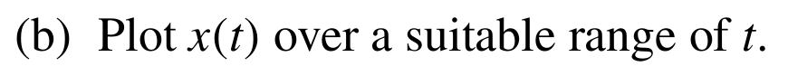{ .lathi-original loading="lazy" }](../../assets/lathi-boulet-batch-04/1.2-5_1.png)

### 02 · Lathi 1.4-1：利用单位阶跃构造分段信号 {#exercise-1-4-1}

**对应主题：** Boulet 第1章：Generalized Functions，p.26

Lathi 印刷页：141；原 PDF 页序：161

[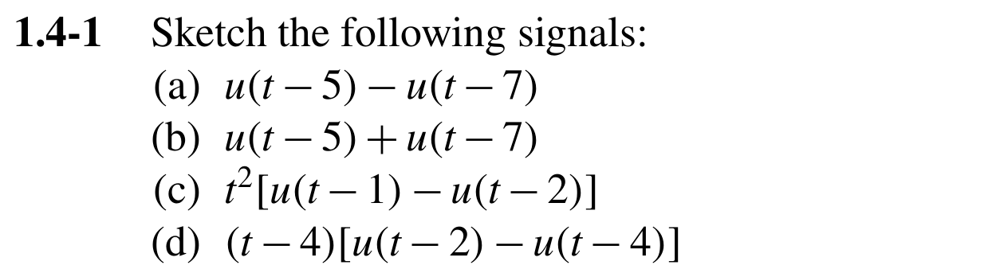{ .lathi-original loading="lazy" }](../../assets/lathi-boulet-batch-04/1.4-1_0.png)

### 03 · Lathi 1.4-11：用广义函数定义证明冲激缩放性质 {#exercise-1-4-11}

**对应主题：** Boulet 第1章：Generalized Functions，p.26

Lathi 印刷页：142、87；原 PDF 页序：162、107

**阅读说明：** 所引用的定义式(1.11)已附，取 T=0；测试函数在冲激所在位置连续。缩放参数 a 非零。

[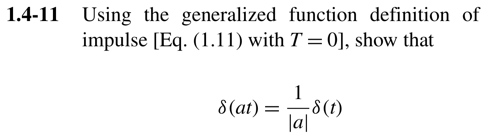{ .lathi-original loading="lazy" }](../../assets/lathi-boulet-batch-04/1.4-11_0.png)

[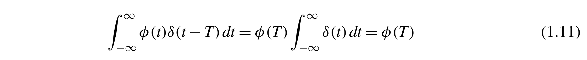{ .lathi-original loading="lazy" }](../../assets/lathi-boulet-batch-04/1.4-11_1.png)

### 04 · Lathi 1.5-7：图示信号的时间变换、能量与奇偶分解 {#exercise-1-5-7}

**对应主题：** Boulet 第1章：Transformations of the Time Variable，p.4；Finite-Energy and Finite-Power Signals，p.21；Even and Odd Signals，p.23

Lathi 印刷页：143；原 PDF 页序：163

**阅读说明：** 本题所需原图 P1.5-7 已包含在题干中。

[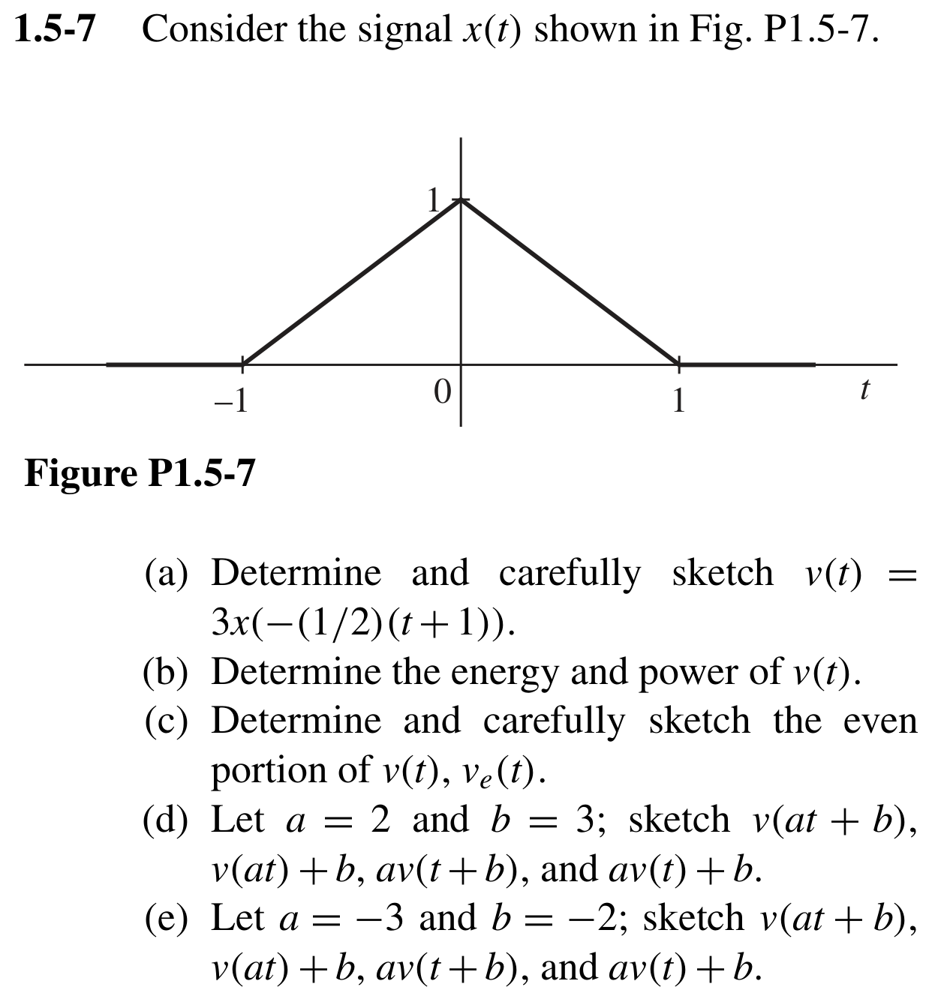{ .lathi-original loading="lazy" }](../../assets/lathi-boulet-batch-04/1.5-7_0.png)

### 05 · Lathi 3.2-4：离散有限序列的能量、抽取与扩展 {#exercise-3-2-4}

**对应主题：** Boulet 第1章：Transformations of the Time Variable，p.4；Finite-Energy and Finite-Power Signals，p.21

Lathi 印刷页：316；原 PDF 页序：336

**阅读说明：** 依照Lathi第3.2节的离散时间扩展约定，扩展后下标非整数的位置补零；向下箭头标出原序列的 n=0。

[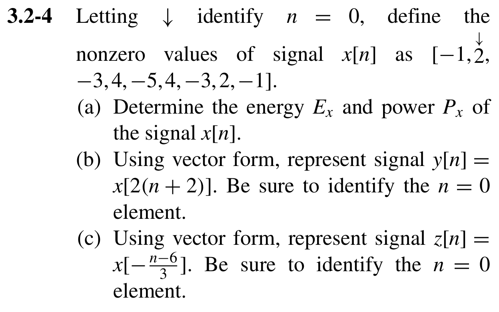{ .lathi-original loading="lazy" }](../../assets/lathi-boulet-batch-04/3.2-4_0.png)

## 第 2 章：线性时不变系统与卷积

### 06 · Lathi 2.4-5：辨认冲激响应时移并作图解卷积 {#exercise-2-4-5}

**对应主题：** Boulet 第2章：Continuous-Time LTI Systems: The Convolution Integral，p.67；Properties of Linear Time-Invariant Systems，p.74

Lathi 印刷页：226；原 PDF 页序：246

**阅读说明：** 原图画的是 h(t+1)，不是 h(t)；题干及原图 P2.4-5 已完整保留。

[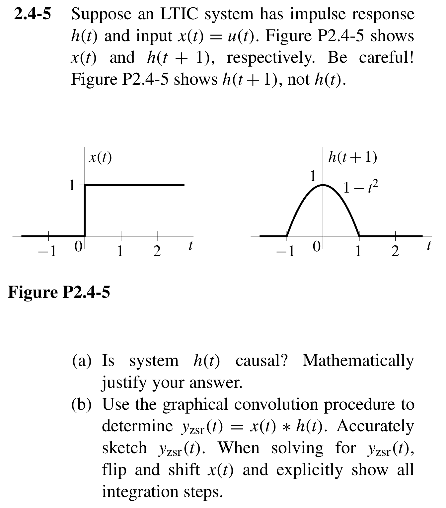{ .lathi-original loading="lazy" }](../../assets/lathi-boulet-batch-04/2.4-5_0.png)

### 07 · Lathi 2.4-8：反因果阶跃输入的两种图解卷积 {#exercise-2-4-8}

**对应主题：** Boulet 第2章：Continuous-Time LTI Systems: The Convolution Integral，p.67

Lathi 印刷页：226、227；原 PDF 页序：246、247

**阅读说明：** 所需原图 P2.4-8 位于下一原书页，已附。

[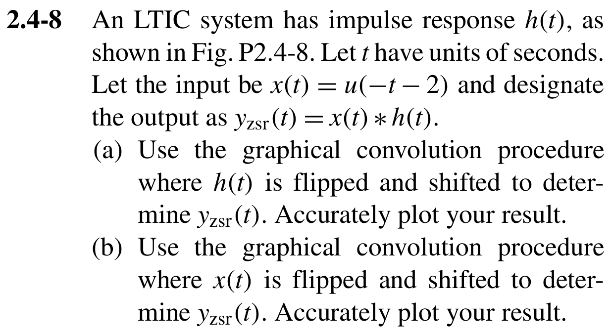{ .lathi-original loading="lazy" }](../../assets/lathi-boulet-batch-04/2.4-8_0.png)

[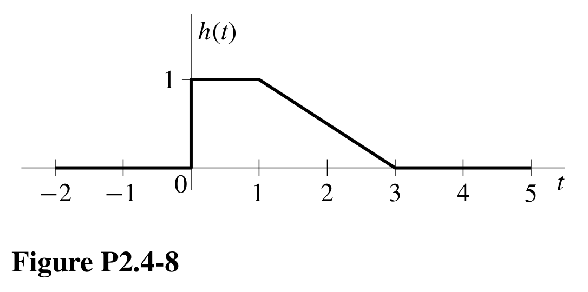{ .lathi-original loading="lazy" }](../../assets/lathi-boulet-batch-04/2.4-8_1.png)

### 08 · Lathi 2.4-25：有限正弦脉冲与阶跃信号的卷积 {#exercise-2-4-25}

**对应主题：** Boulet 第2章：Continuous-Time LTI Systems: The Convolution Integral，p.67

Lathi 印刷页：228；原 PDF 页序：248

**阅读说明：** 所需原图 P2.4-25 的 x(t) 和 g(t) 均已附。

[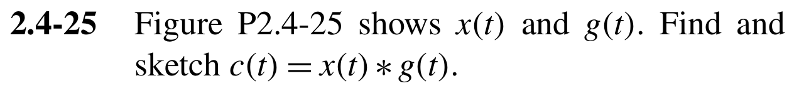{ .lathi-original loading="lazy" }](../../assets/lathi-boulet-batch-04/2.4-25_0.png)

[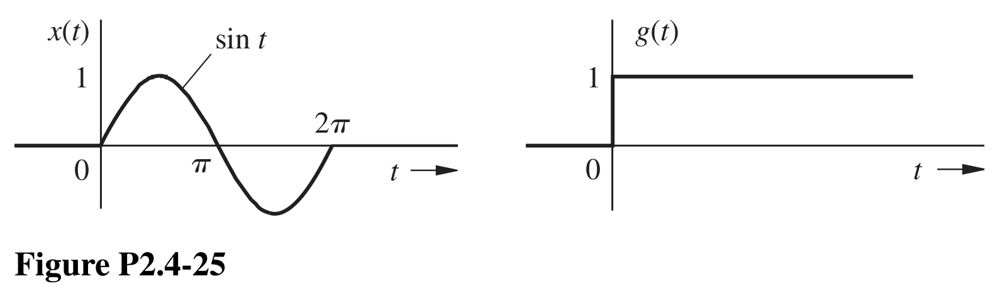{ .lathi-original loading="lazy" }](../../assets/lathi-boulet-batch-04/2.4-25_1.png)

### 09 · Lathi 3.8-1：离散指数卷积的分段表达与临界点 {#exercise-3-8-1}

**对应主题：** Boulet 第2章：Discrete-Time LTI Systems: The Convolution Sum，p.54

Lathi 印刷页：321；原 PDF 页序：341

[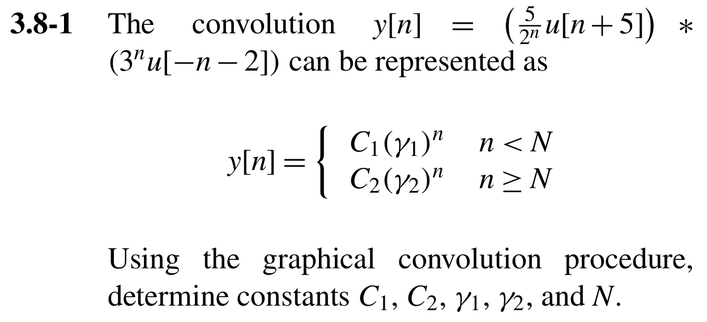{ .lathi-original loading="lazy" }](../../assets/lathi-boulet-batch-04/3.8-1_0.png)

### 10 · Lathi 3.8-2：阶跃、时移与双边指数的离散卷积 {#exercise-3-8-2}

**对应主题：** Boulet 第2章：Discrete-Time LTI Systems: The Convolution Sum，p.54

Lathi 印刷页：321；原 PDF 页序：341

[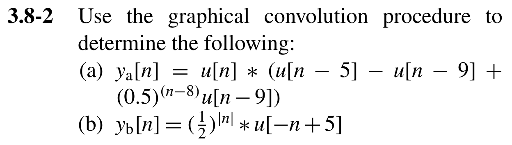{ .lathi-original loading="lazy" }](../../assets/lathi-boulet-batch-04/3.8-2_0.png)

## 第 3 章：微分方程、差分方程与系统响应

### 11 · Lathi 2.2-2：由微分系统求阶数、特征根与零输入响应 {#exercise-2-2-2}

**对应主题：** Boulet 第3章：Causal LTI Systems Described by Differential Equations，p.92；Characteristic Polynomials and Stability，p.112

Lathi 印刷页：223、224；原 PDF 页序：243、244

[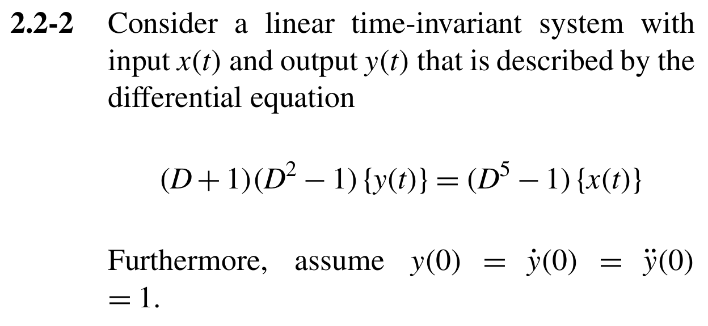{ .lathi-original loading="lazy" }](../../assets/lathi-boulet-batch-04/2.2-2_0.png)

[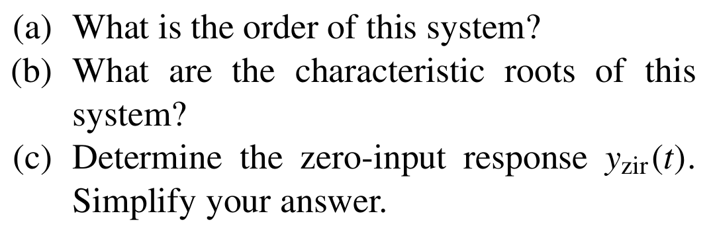{ .lathi-original loading="lazy" }](../../assets/lathi-boulet-batch-04/2.2-2_1.png)

### 12 · Lathi 2.3-3：二阶微分系统的单位冲激响应 {#exercise-2-3-3}

**对应主题：** Boulet 第3章：Impulse Response of a Differential LTI System，p.101

Lathi 印刷页：225；原 PDF 页序：245

**阅读说明：** 按原题引用的2.3-2要求，求给定系统的单位冲激响应 h(t)。这里只展开作答要求，不追加一道题。

[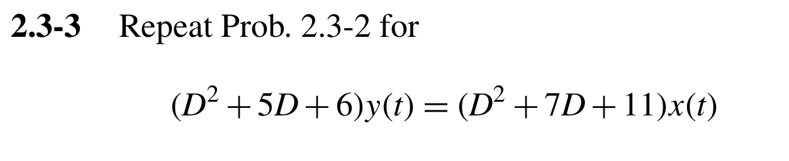{ .lathi-original loading="lazy" }](../../assets/lathi-boulet-batch-04/2.3-3_0.png)

### 13 · Lathi 3.5-5：二阶差分系统的带输入递推 {#exercise-3-5-5}

**对应主题：** Boulet 第3章：Causal LTI Systems Described by Difference Equations，p.96

Lathi 印刷页：320；原 PDF 页序：340

[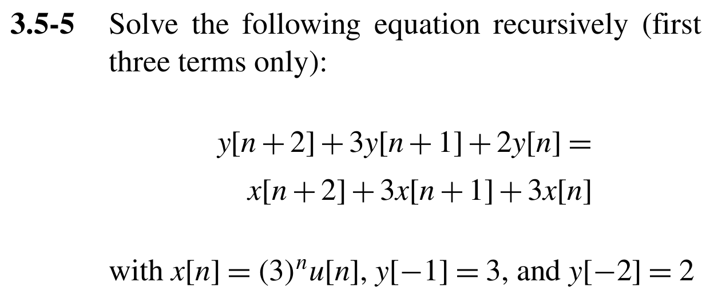{ .lathi-original loading="lazy" }](../../assets/lathi-boulet-batch-04/3.5-5_0.png)

### 14 · Lathi 3.6-4：具有振荡模态的离散零输入响应 {#exercise-3-6-4}

**对应主题：** Boulet 第3章：Causal LTI Systems Described by Difference Equations，p.96

Lathi 印刷页：320；原 PDF 页序：340

[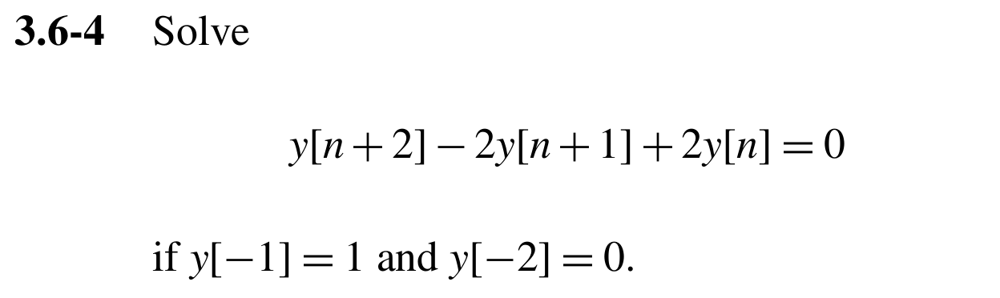{ .lathi-original loading="lazy" }](../../assets/lathi-boulet-batch-04/3.6-4_0.png)

### 15 · Lathi 3.7-2：离散冲激响应的闭式求解与递推校验 {#exercise-3-7-2}

**对应主题：** Boulet 第3章：Impulse Response of a Difference LTI System，p.109

Lathi 印刷页：320、321；原 PDF 页序：340、341

**阅读说明：** 本题原书跨页，(a)-(h)八个小题均已附；每个系统还需递推核验 n=3 的冲激响应值。

[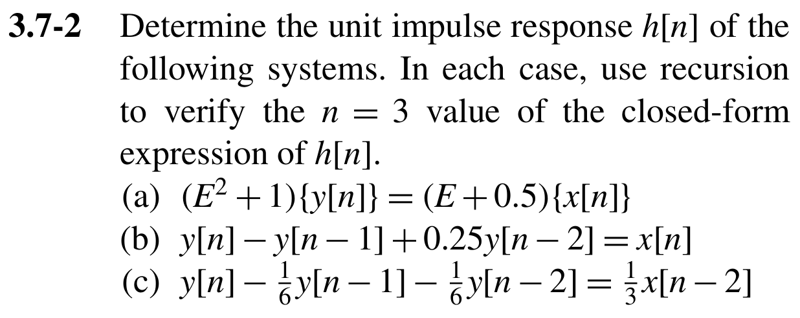{ .lathi-original loading="lazy" }](../../assets/lathi-boulet-batch-04/3.7-2_0.png)

[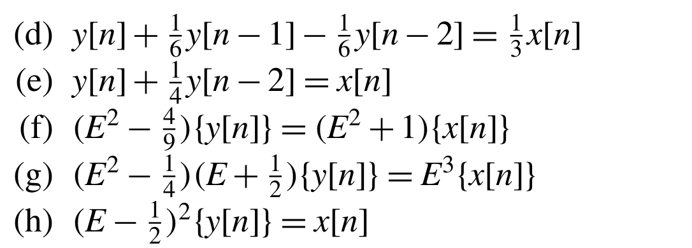{ .lathi-original loading="lazy" }](../../assets/lathi-boulet-batch-04/3.7-2_1.png)

## 第 4 章：连续时间傅里叶级数

### 16 · Lathi 6.3-4：多谐波三角级数与复指数频谱 {#exercise-6-3-4}

**对应主题：** Boulet 第4章：Determination of the Fourier Series Representation，p.134；Graph of the Fourier Series Coefficients: The Line Spectrum，p.137

Lathi 印刷页：672；原 PDF 页序：692

[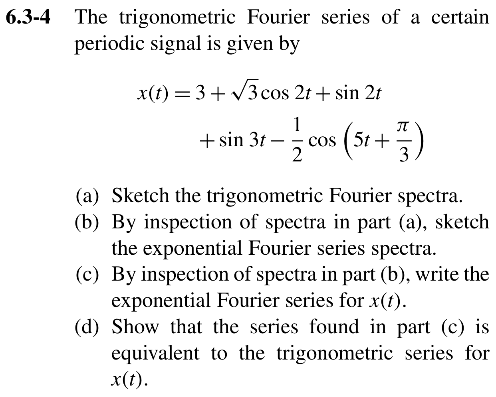{ .lathi-original loading="lazy" }](../../assets/lathi-boulet-batch-04/6.3-4_0.png)

### 17 · Lathi 6.3-6：由三角幅相谱重建信号并转为复指数谱 {#exercise-6-3-6}

**对应主题：** Boulet 第4章：Graph of the Fourier Series Coefficients: The Line Spectrum，p.137

Lathi 印刷页：673；原 PDF 页序：693

**阅读说明：** 所需原图 P6.3-6 的幅度谱、相位谱均已附。

[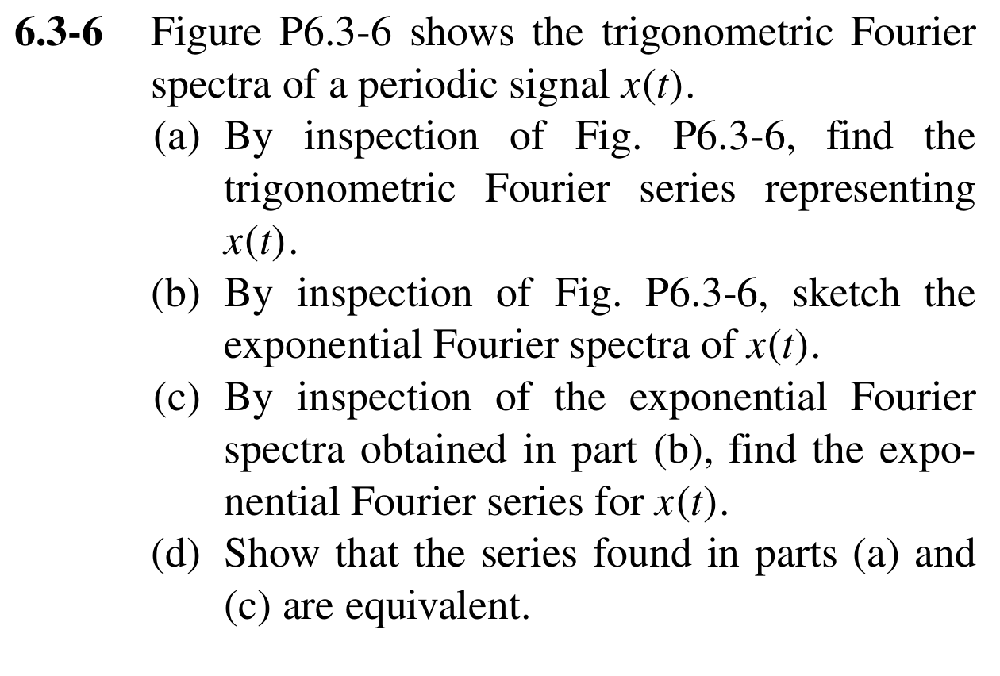{ .lathi-original loading="lazy" }](../../assets/lathi-boulet-batch-04/6.3-6_0.png)

[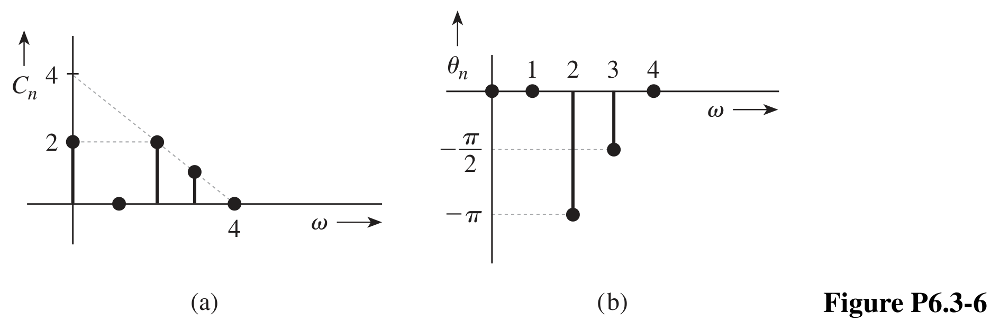{ .lathi-original loading="lazy" }](../../assets/lathi-boulet-batch-04/6.3-6_1.png)

### 18 · Lathi 6.3-16：分段绝对值周期信号的傅里叶级数 {#exercise-6-3-16}

**对应主题：** Boulet 第4章：Determination of the Fourier Series Representation，p.134；Properties of Continuous-Time Fourier Series，p.139

Lathi 印刷页：675；原 PDF 页序：695

**阅读说明：** 本题同页跨栏，(a)-(d)均已附。对例6.11的引用是方法提示：用傅里叶级数性质求非直流系数，而不直接积分；信号条件已完整给出。

[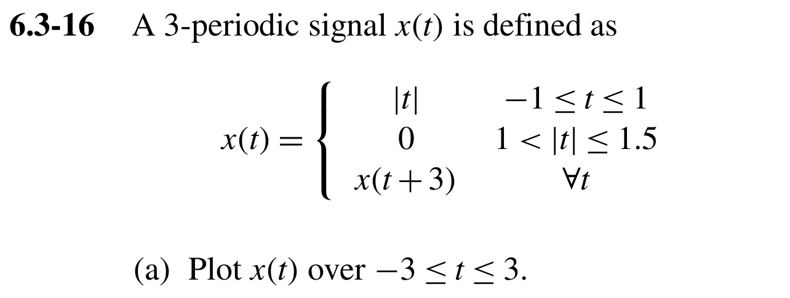{ .lathi-original loading="lazy" }](../../assets/lathi-boulet-batch-04/6.3-16_0.png)

[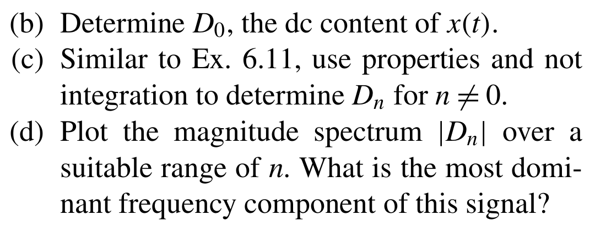{ .lathi-original loading="lazy" }](../../assets/lathi-boulet-batch-04/6.3-16_1.png)

### 19 · Lathi 6.4-5：周期指数信号经过RC系统的响应 {#exercise-6-4-5}

**对应主题：** Boulet 第4章：Steady-State Response of an LTI System to a Periodic Signal，p.155

Lathi 印刷页：676；原 PDF 页序：696

**阅读说明：** 所需原图 P6.4-5(a)的周期输入和(b)的RC电路均已附，图中 C=1 F、R=1 ohm。

[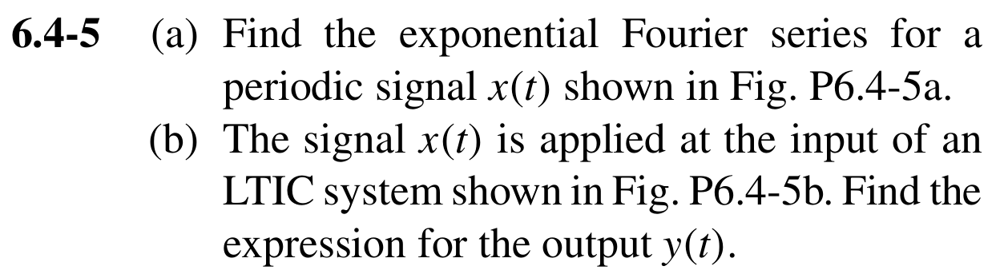{ .lathi-original loading="lazy" }](../../assets/lathi-boulet-batch-04/6.4-5_0.png)

[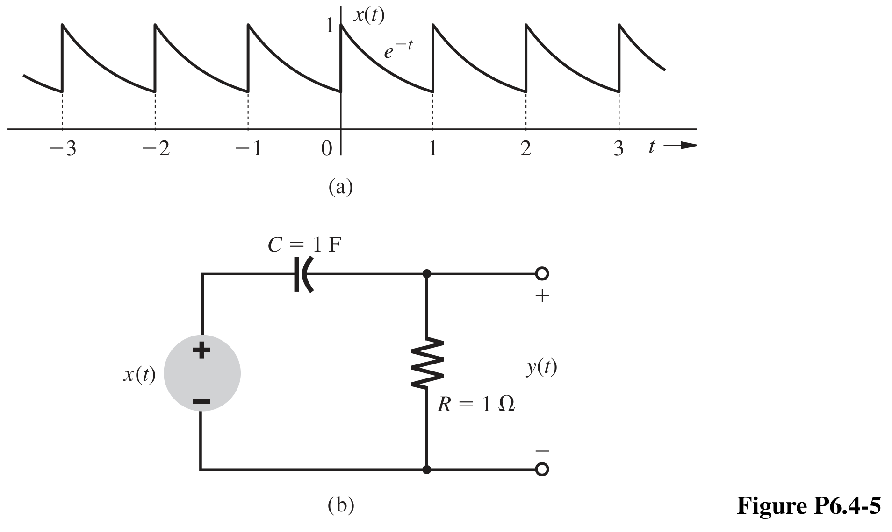{ .lathi-original loading="lazy" }](../../assets/lathi-boulet-batch-04/6.4-5_1.png)

### 20 · Lathi 6.5-3：正交信号的能量可加性与向量类比 {#exercise-6-5-3}

**对应主题：** Boulet 第4章：Optimality and Convergence of the Fourier Series，p.144；Parseval Theorem，p.150

Lathi 印刷页：677；原 PDF 页序：697

[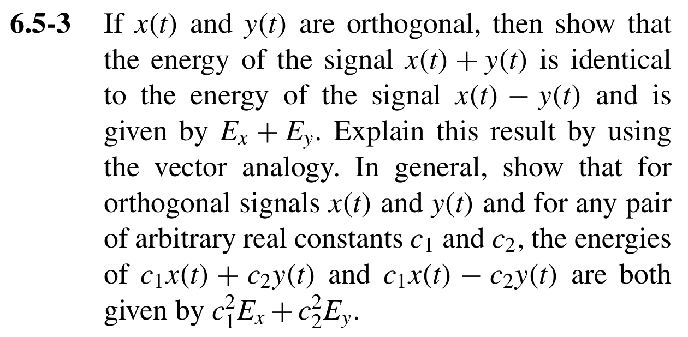{ .lathi-original loading="lazy" }](../../assets/lathi-boulet-batch-04/6.5-3_0.png)

## 来源与使用说明

- B. P. Lathi & R. A. Green, *Linear Systems and Signals*, Third Edition, Oxford University Press, 2018：题号、题干与所需附图按原 PDF 核对
- Benoit Boulet, *Fundamentals of Signals and Systems*：第 1–4 章的主题与印刷页码用于中文学习索引
- Lathi 原 PDF 页序比印刷页码大 20；页面同时列出两种页码，便于回查
- 原题中的必要引用或附图见各题阅读说明；本页与下载 PDF 均不含解答

[第 1 组 20 题](lathi-20-exercises.md) · [第 2 组 20 题](lathi-20-exercises-batch-02.md) · [第 3 组 20 题](lathi-20-exercises-batch-03.md) · [Boulet 总览](index.md) · [前三章全部对应题号](lathi-exercise-map.md)
