# Boulet 前四章 × Lathi：第 5 组 20 道练习

**每章 5 题 · 共 20 个独立题号 · 原题与必要附图 · 无答案**

[下载第 5 组 PDF（21 页）](../../assets/lathi-boulet-batch-05/Lathi_20_Exercises_Boulet_Chapters_1-4_Batch_05_No_Solutions.pdf){ .md-button .md-button--primary download }

按 Boulet 前四章的知识主题选择 Lathi 第三版习题。本组与此前各组不重复。下方保留原题图像，避免公式转写丢失；点击图片可打开原图放大查看。这里只按知识点匹配，不表示两书的习题一一等价。

[第 1 组 20 题](lathi-20-exercises.md) · [第 2 组 20 题](lathi-20-exercises-batch-02.md) · [第 3 组 20 题](lathi-20-exercises-batch-03.md) · [第 4 组 20 题](lathi-20-exercises-batch-04.md) · [Boulet 总览](index.md)

## 快速索引

| Boulet 章节 | Lathi 题号 |
| --- | --- |
| 第 1 章：信号与系统基础 | [1.4-5](#exercise-1-4-5)、[1.5-1](#exercise-1-5-1)、[1.7-4](#exercise-1-7-4)、[3.2-6](#exercise-3-2-6)、[3.3-2](#exercise-3-3-2) |
| 第 2 章：线性时不变系统与卷积 | [2.4-6](#exercise-2-4-6)、[2.4-7](#exercise-2-4-7)、[2.4-26](#exercise-2-4-26)、[3.8-8](#exercise-3-8-8)、[3.9-6](#exercise-3-9-6) |
| 第 3 章：微分方程、差分方程与系统响应 | [2.2-5](#exercise-2-2-5)、[2.5-2](#exercise-2-5-2)、[3.5-3](#exercise-3-5-3)、[3.6-8](#exercise-3-6-8)、[3.7-5](#exercise-3-7-5) |
| 第 4 章：连续时间傅里叶级数 | [6.1-6](#exercise-6-1-6)、[6.3-7](#exercise-6-3-7)、[6.3-9](#exercise-6-3-9)、[6.4-1](#exercise-6-4-1)、[6.5-5](#exercise-6-5-5) |

## 第 1 章：信号与系统基础

### 01 · Lathi 1.4-5：冲激乘积的化简与极限 {#exercise-1-4-5}

**对应主题：** Boulet 第1章：Generalized Functions，p.26

Lathi 印刷页：141、142、87；原 PDF 页序：161、162、107

**阅读说明：** (a)-(f)完整附上。提示所引式(1.10)已附；该式要求相乘函数在冲激位置连续，(f)按原提示用极限理解。

[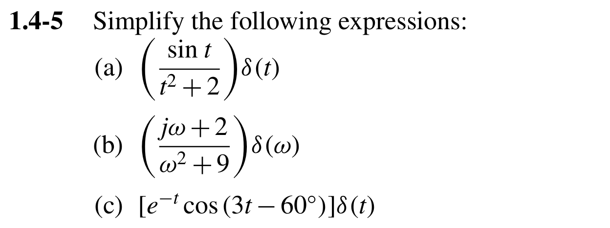{ .lathi-original loading="lazy" }](../../assets/lathi-boulet-batch-05/1.4-5_0.png)

[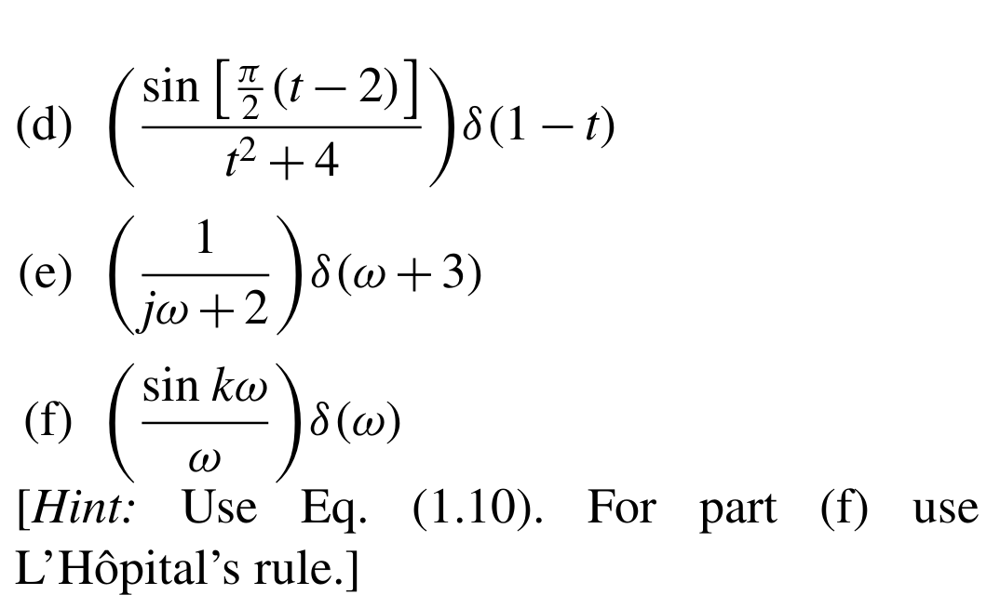{ .lathi-original loading="lazy" }](../../assets/lathi-boulet-batch-05/1.4-5_1.png)

[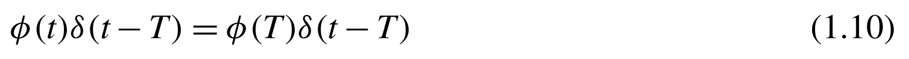{ .lathi-original loading="lazy" }](../../assets/lathi-boulet-batch-05/1.4-5_2.png)

### 02 · Lathi 1.5-1：连续基本信号的奇偶分解与作图 {#exercise-1-5-1}

**对应主题：** Boulet 第1章：Even and Odd Signals，p.23

Lathi 印刷页：142；原 PDF 页序：162

[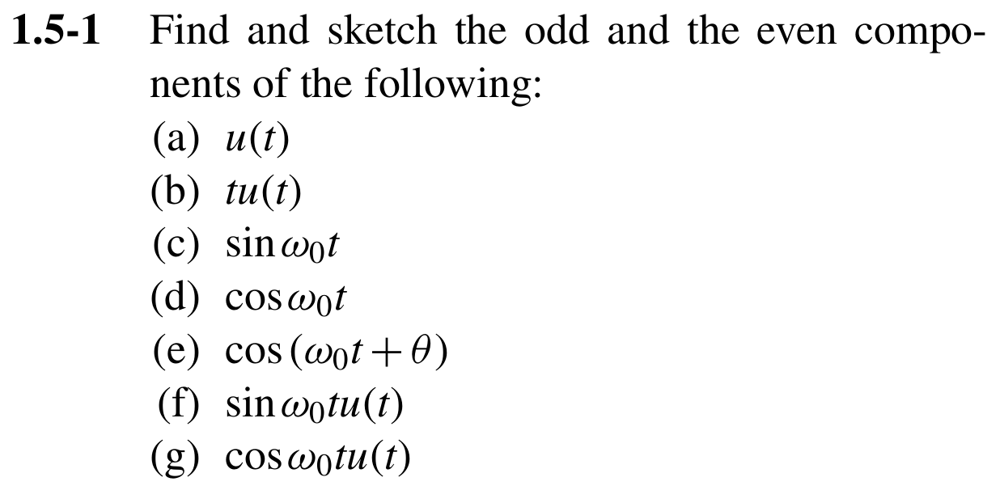{ .lathi-original loading="lazy" }](../../assets/lathi-boulet-batch-05/1.5-1_0.png)

### 03 · Lathi 1.7-4：带饱和与延迟的系统性质判断 {#exercise-1-7-4}

**对应主题：** Boulet 第1章：System Models and Basic Properties，p.34

Lathi 印刷页：145；原 PDF 页序：165

[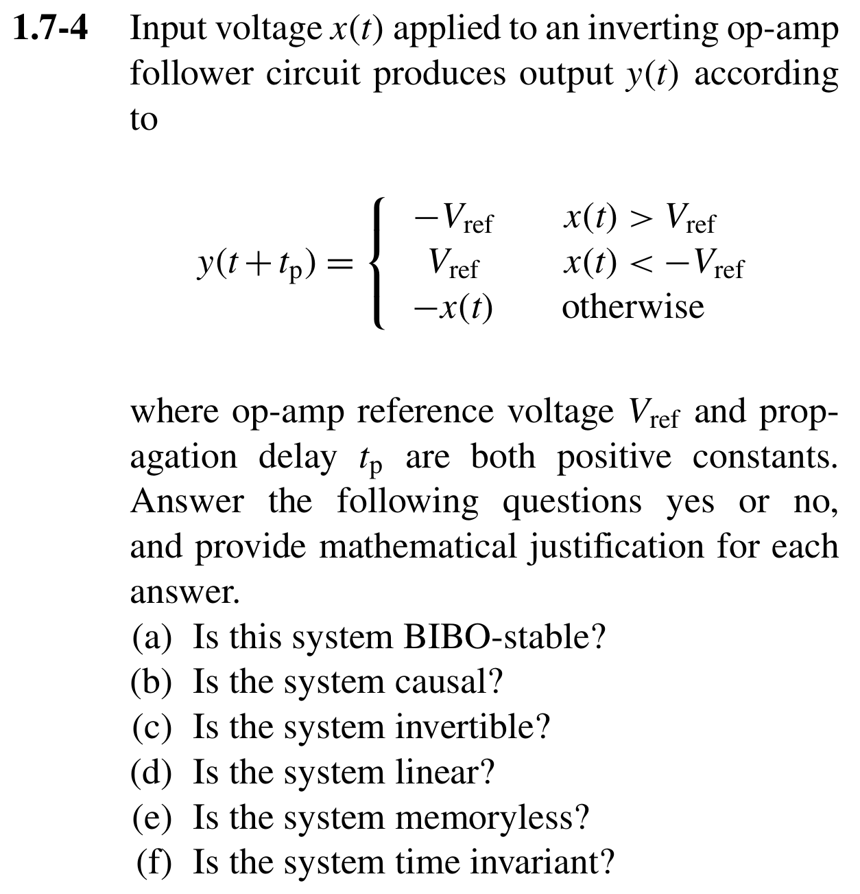{ .lathi-original loading="lazy" }](../../assets/lathi-boulet-batch-05/1.7-4_0.png)

### 04 · Lathi 3.2-6：离散序列的时间变换、周期复制与能量功率 {#exercise-3-2-6}

**对应主题：** Boulet 第1章：Transformations of the Time Variable，p.4；Periodic Signals，p.8；Finite-Energy and Finite-Power Signals，p.21

Lathi 印刷页：316；原 PDF 页序：336

**阅读说明：** 按原书离散时间扩展约定，扩展后下标非整数的位置补零。

[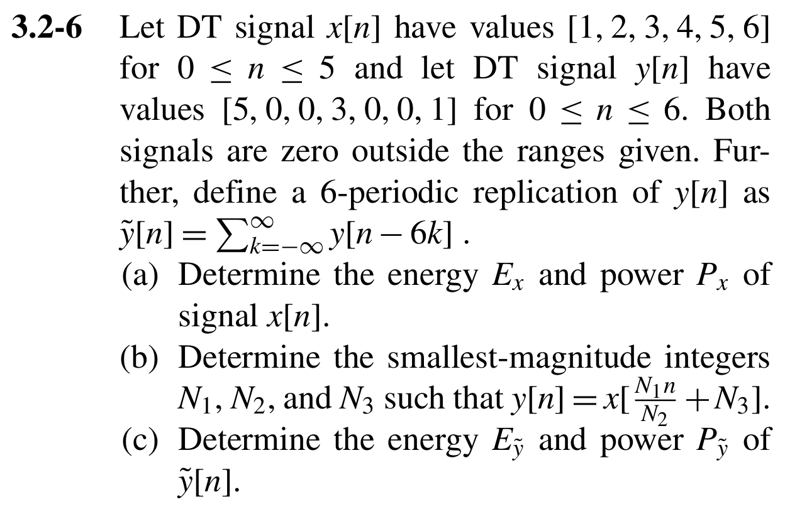{ .lathi-original loading="lazy" }](../../assets/lathi-boulet-batch-05/3.2-6_0.png)

### 05 · Lathi 3.3-2：离散冲激、阶跃与指数正弦恒等式 {#exercise-3-3-2}

**对应主题：** Boulet 第1章：Discrete-Time Impulse and Step Signals，p.25；Periodic Complex Exponential and Sinusoidal Signals，p.17

Lathi 印刷页：316；原 PDF 页序：336

[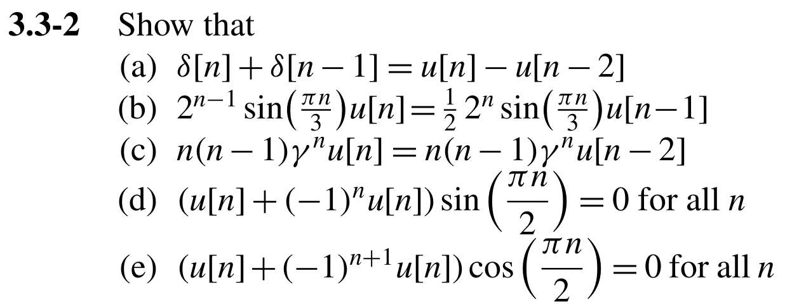{ .lathi-original loading="lazy" }](../../assets/lathi-boulet-batch-05/3.3-2_0.png)

## 第 2 章：线性时不变系统与卷积

### 06 · Lathi 2.4-6：由延迟冲激响应图判断因果性并卷积 {#exercise-2-4-6}

**对应主题：** Boulet 第2章：Continuous-Time LTI Systems: The Convolution Integral，p.67；Properties of Linear Time-Invariant Systems，p.74

Lathi 印刷页：226；原 PDF 页序：246

**阅读说明：** 展开原题对2.4-5的引用：(a)判断系统是否因果并用数学说明；(b)用图解卷积求零状态响应 y_zsr(t)=x(t)*h(t)，反转并平移 x(t)，写出所有积分步骤并准确作图。本题图示为 h(t-1)，不是 h(t)。

[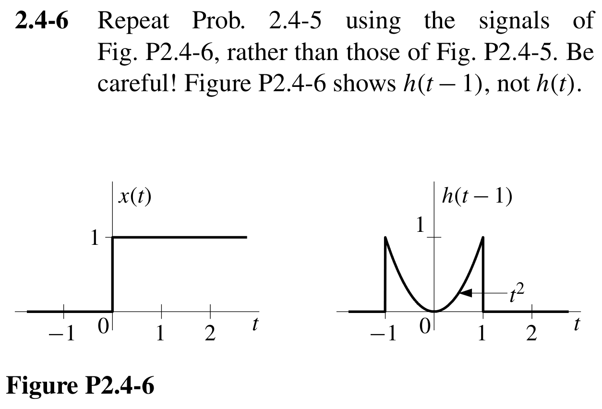{ .lathi-original loading="lazy" }](../../assets/lathi-boulet-batch-05/2.4-6_0.png)

### 07 · Lathi 2.4-7：分段常数信号的图解卷积 {#exercise-2-4-7}

**对应主题：** Boulet 第2章：Continuous-Time LTI Systems: The Convolution Integral，p.67

Lathi 印刷页：226；原 PDF 页序：246

**阅读说明：** 原图 P2.4-7 中的 x(t)、h(t) 均已附。

[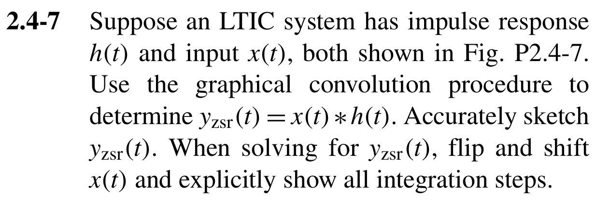{ .lathi-original loading="lazy" }](../../assets/lathi-boulet-batch-05/2.4-7_0.png)

[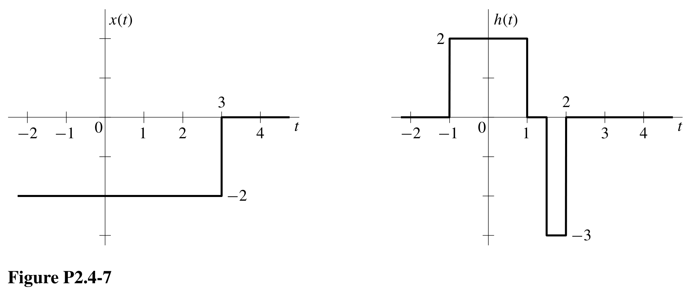{ .lathi-original loading="lazy" }](../../assets/lathi-boulet-batch-05/2.4-7_1.png)

### 08 · Lathi 2.4-26：有限正弦脉冲与矩形脉冲的卷积 {#exercise-2-4-26}

**对应主题：** Boulet 第2章：Continuous-Time LTI Systems: The Convolution Integral，p.67

Lathi 印刷页：228；原 PDF 页序：248

**阅读说明：** 所需原图 P2.4-26 的两个信号已完整附上。

[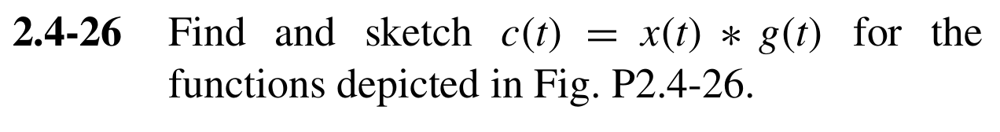{ .lathi-original loading="lazy" }](../../assets/lathi-boulet-batch-05/2.4-26_0.png)

[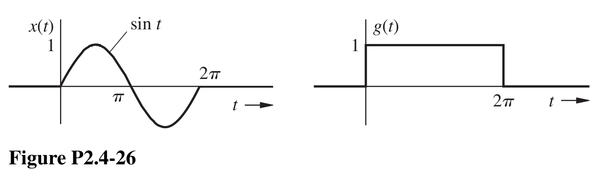{ .lathi-original loading="lazy" }](../../assets/lathi-boulet-batch-05/2.4-26_1.png)

### 09 · Lathi 3.8-8：时移指数与带多项式因子的离散卷积 {#exercise-3-8-8}

**对应主题：** Boulet 第2章：Discrete-Time LTI Systems: The Convolution Sum，p.54

Lathi 印刷页：322；原 PDF 页序：342

[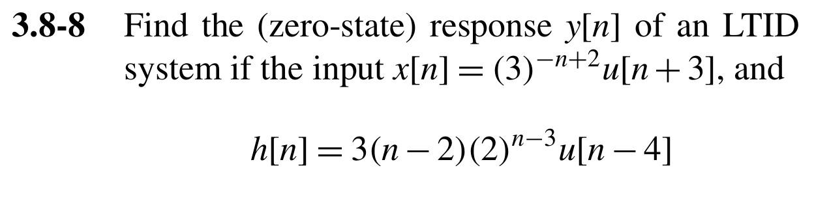{ .lathi-original loading="lazy" }](../../assets/lathi-boulet-batch-05/3.8-8_0.png)

### 10 · Lathi 3.9-6：双边离散冲激响应的因果性、稳定性与卷积输出 {#exercise-3-9-6}

**对应主题：** Boulet 第2章：Discrete-Time LTI Systems: The Convolution Sum，p.54；Properties of Linear Time-Invariant Systems，p.74

Lathi 印刷页：327；原 PDF 页序：347

[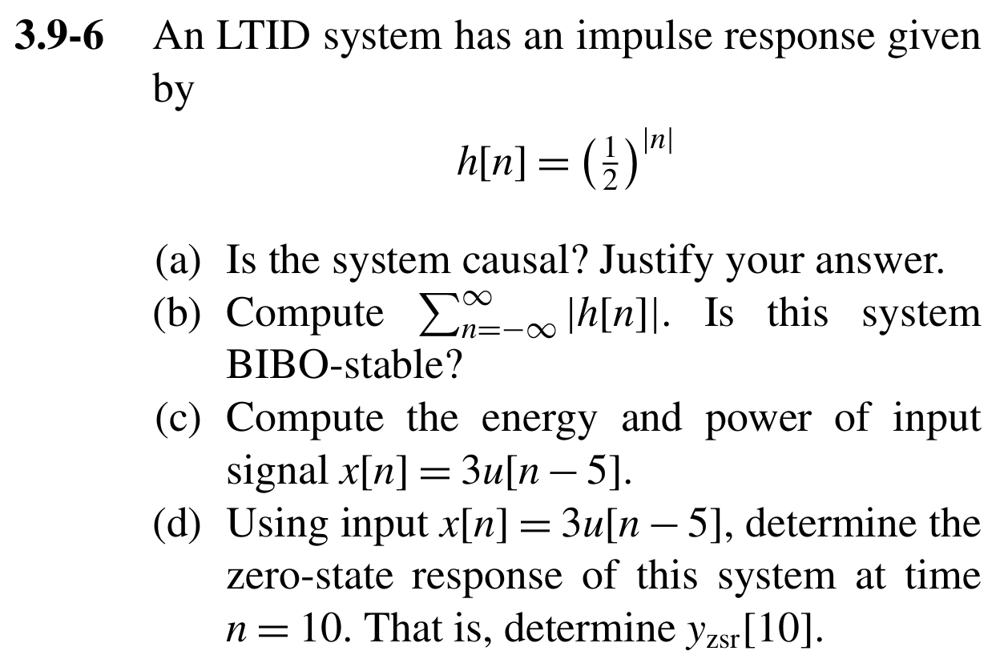{ .lathi-original loading="lazy" }](../../assets/lathi-boulet-batch-05/3.9-6_0.png)

## 第 3 章：微分方程、差分方程与系统响应

### 11 · Lathi 2.2-5：二阶系统特征模态与初始条件响应 {#exercise-2-2-5}

**对应主题：** Boulet 第3章：Causal LTI Systems Described by Differential Equations，p.92；Characteristic Polynomials and Stability，p.112

Lathi 印刷页：224；原 PDF 页序：244

**阅读说明：** 展开所引用2.2-4的要求：(a)求特征多项式、特征方程、特征根和特征模态；(b)按本题给出的初值求 t>=0 的零输入响应。

[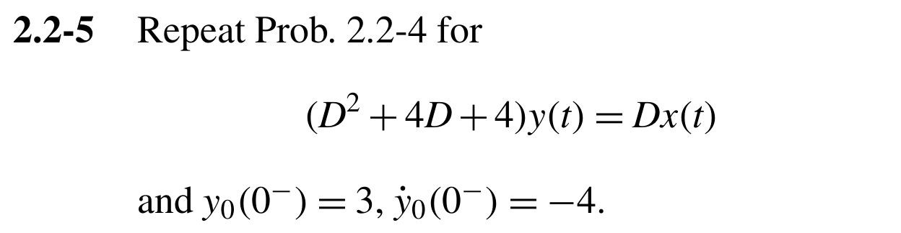{ .lathi-original loading="lazy" }](../../assets/lathi-boulet-batch-05/2.2-5_0.png)

### 12 · Lathi 2.5-2：连续系统的BIBO与内部稳定性分类 {#exercise-2-5-2}

**对应主题：** Boulet 第3章：Characteristic Polynomials and Stability of Differential and Difference Systems，p.112

Lathi 印刷页：233；原 PDF 页序：253

**阅读说明：** 展开所引用2.5-1的要求：说明各系统在BIBO意义下稳定或不稳定，并判断其渐近稳定、不稳定或临界稳定；假设系统均可控且可观。

[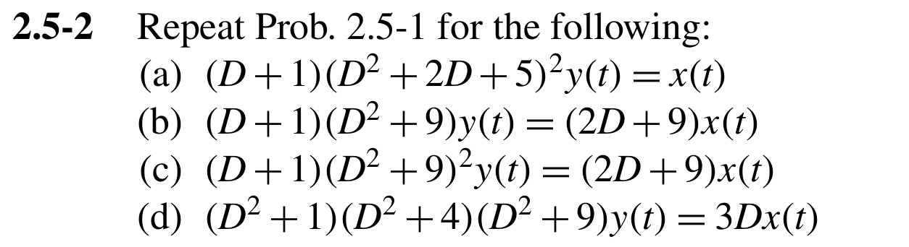{ .lathi-original loading="lazy" }](../../assets/lathi-boulet-batch-05/2.5-2_0.png)

### 13 · Lathi 3.5-3：二阶差分方程的初值递推 {#exercise-3-5-3}

**对应主题：** Boulet 第3章：Causal LTI Systems Described by Difference Equations，p.96

Lathi 印刷页：319；原 PDF 页序：339

[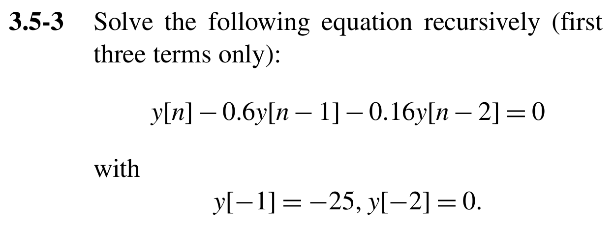{ .lathi-original loading="lazy" }](../../assets/lathi-boulet-batch-05/3.5-3_0.png)

### 14 · Lathi 3.6-8：非相邻辅助条件下的离散零输入响应 {#exercise-3-6-8}

**对应主题：** Boulet 第3章：Causal LTI Systems Described by Difference Equations，p.96

Lathi 印刷页：320；原 PDF 页序：340

**阅读说明：** 注意：原题两个辅助条件分别给在 n=-1 和 n=1。

[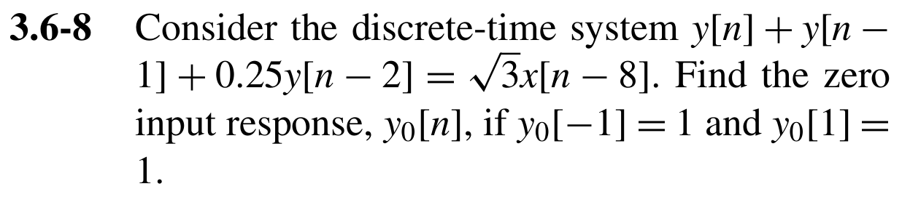{ .lathi-original loading="lazy" }](../../assets/lathi-boulet-batch-05/3.6-8_0.png)

### 15 · Lathi 3.7-5：重特征根离散系统的单位冲激响应 {#exercise-3-7-5}

**对应主题：** Boulet 第3章：Impulse Response of a Difference LTI System，p.109

Lathi 印刷页：321；原 PDF 页序：341

**阅读说明：** 展开所引用3.7-1的要求：求方程所描述系统的单位冲激响应 h[n]。

[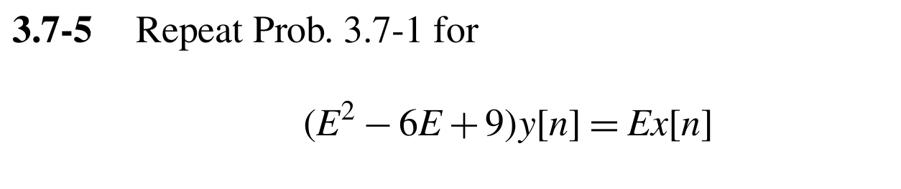{ .lathi-original loading="lazy" }](../../assets/lathi-boulet-batch-05/3.7-5_0.png)

## 第 4 章：连续时间傅里叶级数

### 16 · Lathi 6.1-6：半波对称性、奇次谐波与周期信号级数 {#exercise-6-1-6}

**对应主题：** Boulet 第4章：Properties of Continuous-Time Fourier Series，p.139；Determination of the Fourier Series Representation，p.134

Lathi 印刷页：669、671；原 PDF 页序：689、691

**阅读说明：** 半波对称命题、两个待证系数公式和原图 P6.1-6(a)、(b)均已附；系数公式是原题要求证明的命题。

[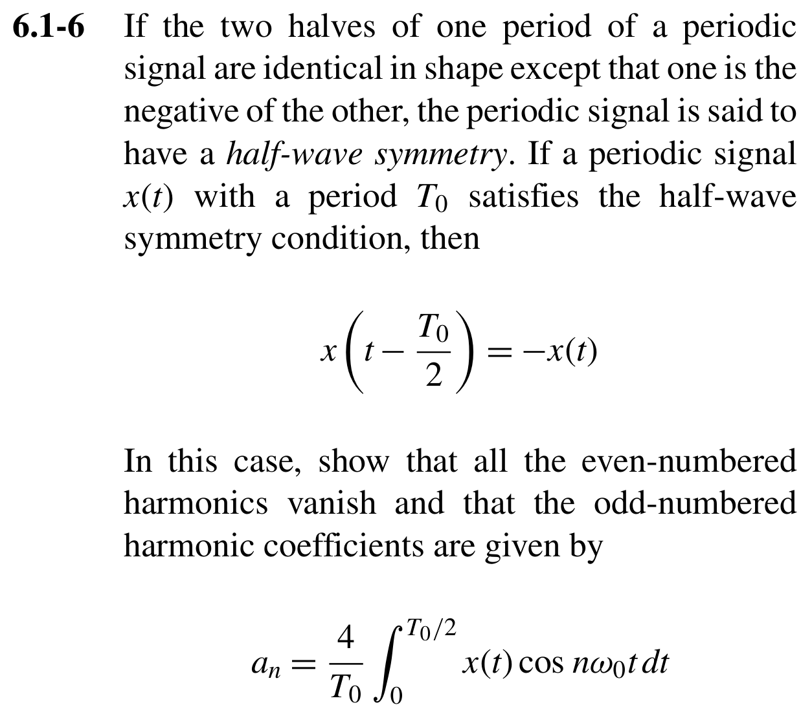{ .lathi-original loading="lazy" }](../../assets/lathi-boulet-batch-05/6.1-6_0.png)

[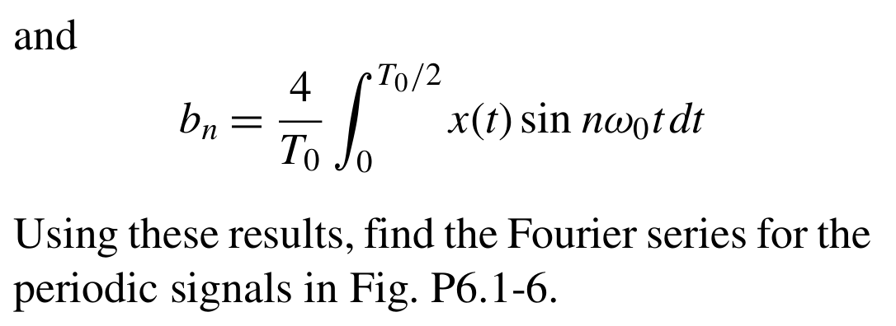{ .lathi-original loading="lazy" }](../../assets/lathi-boulet-batch-05/6.1-6_1.png)

[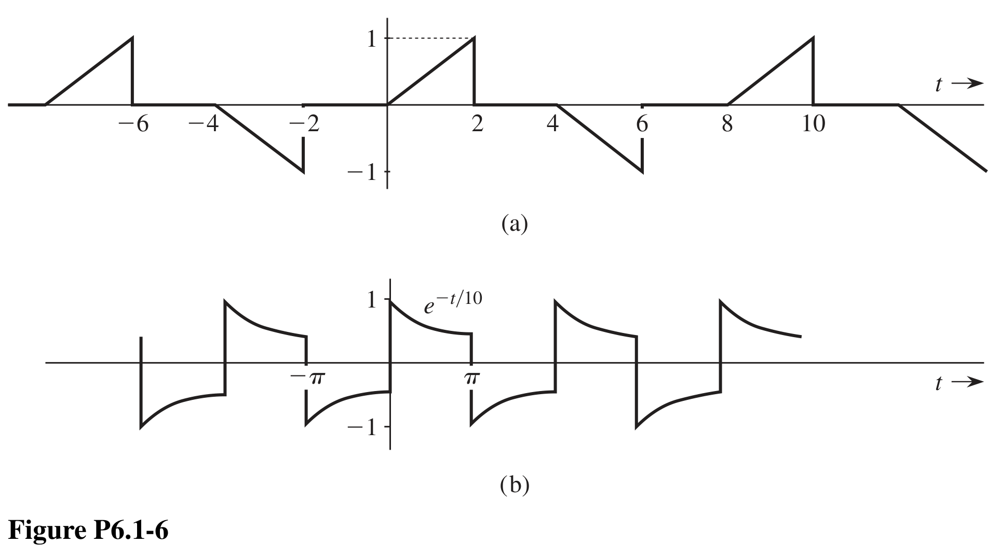{ .lathi-original loading="lazy" }](../../assets/lathi-boulet-batch-05/6.1-6_2.png)

### 17 · Lathi 6.3-7：由复指数幅相谱重建三角级数 {#exercise-6-3-7}

**对应主题：** Boulet 第4章：Graph of the Fourier Series Coefficients: The Line Spectrum，p.137

Lathi 印刷页：673；原 PDF 页序：693

**阅读说明：** 原题同页跨栏，(a)-(d)与原图 P6.3-7 的两幅频谱均已附。

[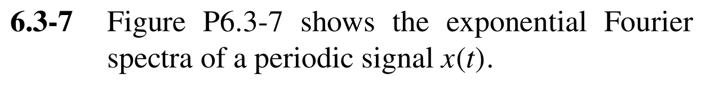{ .lathi-original loading="lazy" }](../../assets/lathi-boulet-batch-05/6.3-7_0.png)

[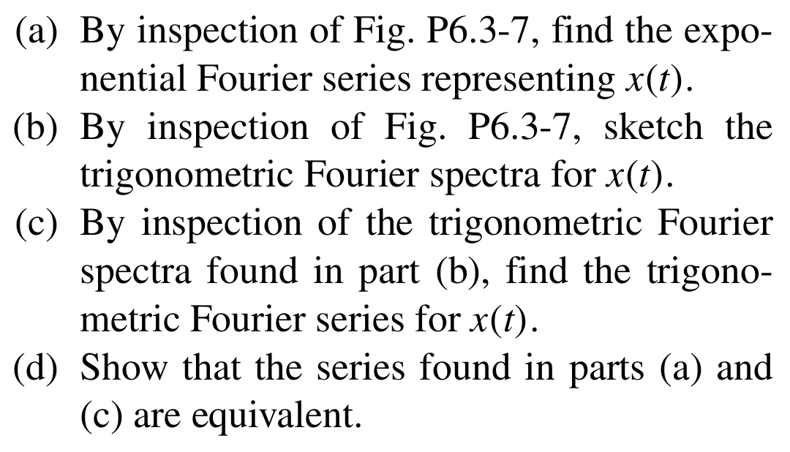{ .lathi-original loading="lazy" }](../../assets/lathi-boulet-batch-05/6.3-7_1.png)

[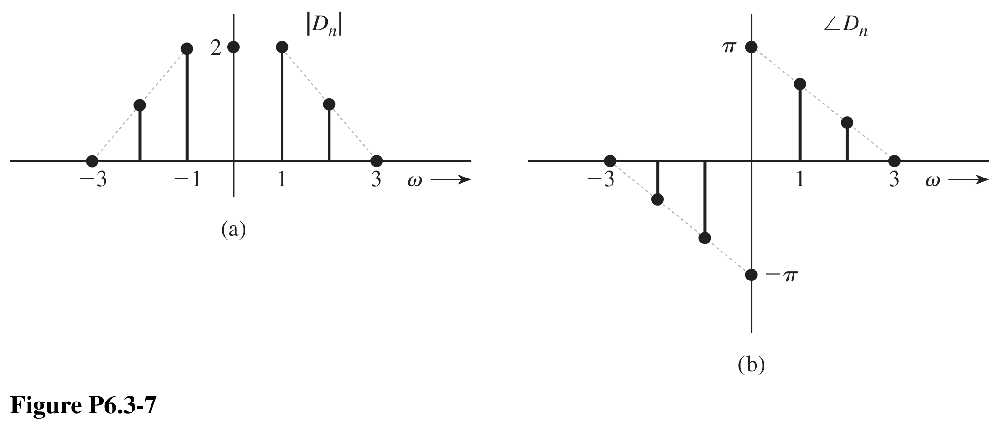{ .lathi-original loading="lazy" }](../../assets/lathi-boulet-batch-05/6.3-7_2.png)

### 18 · Lathi 6.3-9：三角波级数及其时移、尺度变换 {#exercise-6-3-9}

**对应主题：** Boulet 第4章：Determination of the Fourier Series Representation，p.134；Properties of Continuous-Time Fourier Series，p.139

Lathi 印刷页：673、674；原 PDF 页序：693、694

**阅读说明：** 本题原书跨页；原图 P6.3-9(a)、(b)、(c)已完整附上。

[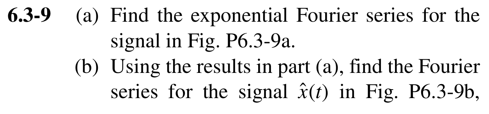{ .lathi-original loading="lazy" }](../../assets/lathi-boulet-batch-05/6.3-9_0.png)

[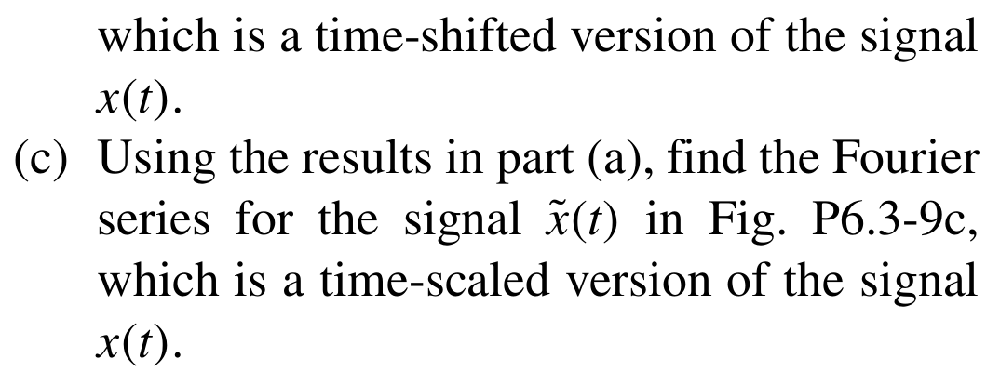{ .lathi-original loading="lazy" }](../../assets/lathi-boulet-batch-05/6.3-9_1.png)

[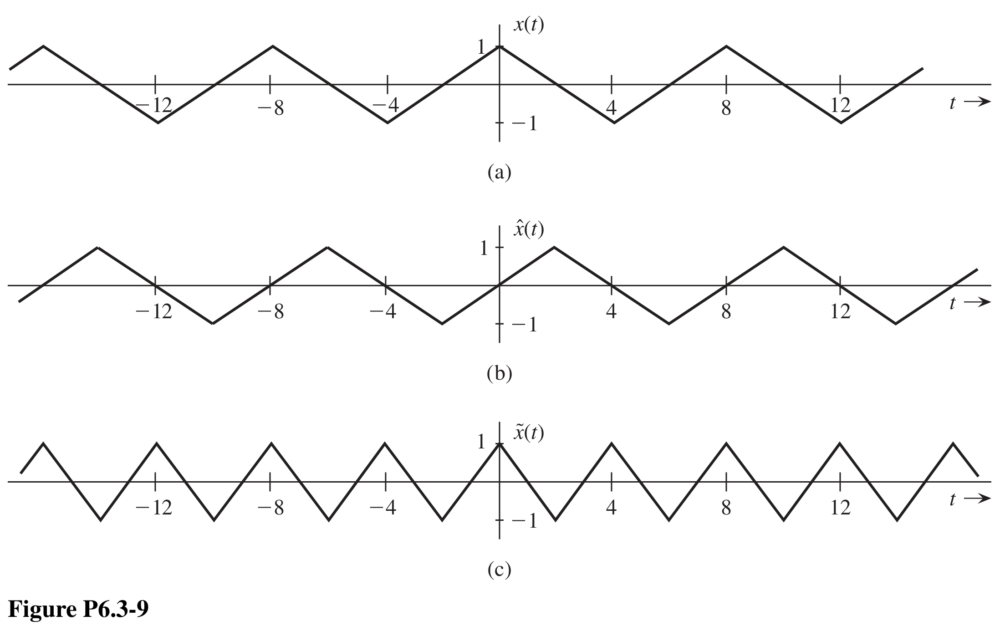{ .lathi-original loading="lazy" }](../../assets/lathi-boulet-batch-05/6.3-9_2.png)

### 19 · Lathi 6.4-1：给定传递函数的周期指数输入响应 {#exercise-6-4-1}

**对应主题：** Boulet 第4章：Steady-State Response of an LTI System to a Periodic Signal，p.155

Lathi 印刷页：675、599；原 PDF 页序：695、619

**阅读说明：** 所需输入原图6.2(a)已附。该图的一个周期为从 t=0 到 t=pi 的 exp(-t/2) 段。

[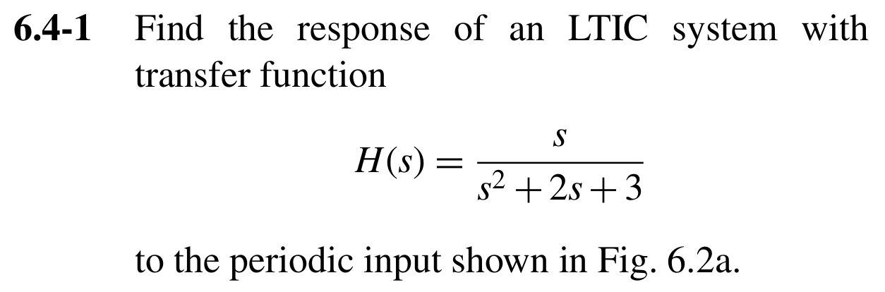{ .lathi-original loading="lazy" }](../../assets/lathi-boulet-batch-05/6.4-1_0.png)

[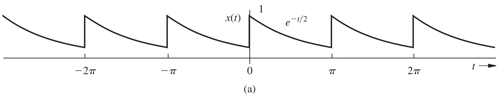{ .lathi-original loading="lazy" }](../../assets/lathi-boulet-batch-05/6.4-1_1.png)

### 20 · Lathi 6.5-5：最小误差能量下的反向信号投影 {#exercise-6-5-5}

**对应主题：** Boulet 第4章：Optimality and Convergence of the Fourier Series，p.144；Parseval Theorem，p.150

Lathi 印刷页：677；原 PDF 页序：697

**阅读说明：** 所需原图 P6.5-4 的 x(t)、y(t)均已附。本题用 c*x(t) 逼近 y(t)。

[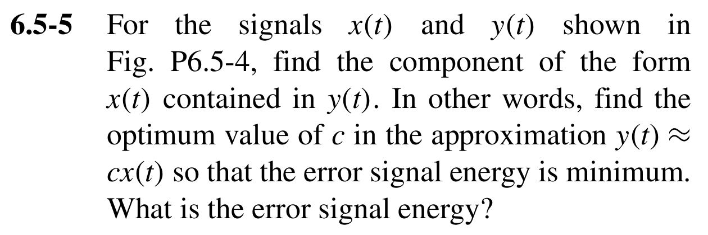{ .lathi-original loading="lazy" }](../../assets/lathi-boulet-batch-05/6.5-5_0.png)

[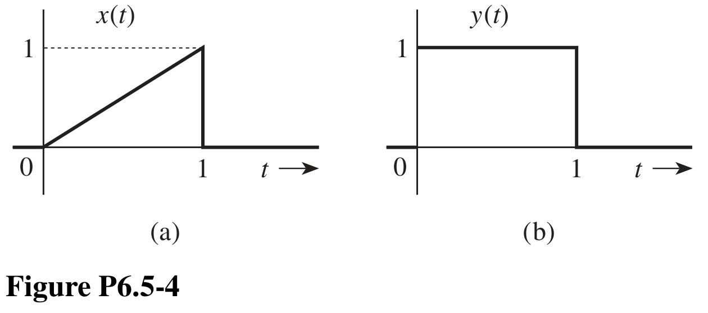{ .lathi-original loading="lazy" }](../../assets/lathi-boulet-batch-05/6.5-5_1.png)

## 来源与使用说明

- B. P. Lathi & R. A. Green, *Linear Systems and Signals*, Third Edition, Oxford University Press, 2018：题号、题干与所需附图按原 PDF 核对
- Benoit Boulet, *Fundamentals of Signals and Systems*：第 1–4 章的主题与印刷页码用于中文学习索引
- Lathi 原 PDF 页序比印刷页码大 20；页面同时列出两种页码，便于回查
- 原题中的必要引用或附图见各题阅读说明；本页与下载 PDF 均不含解答

[第 1 组 20 题](lathi-20-exercises.md) · [第 2 组 20 题](lathi-20-exercises-batch-02.md) · [第 3 组 20 题](lathi-20-exercises-batch-03.md) · [第 4 组 20 题](lathi-20-exercises-batch-04.md) · [Boulet 总览](index.md) · [前三章全部对应题号](lathi-exercise-map.md)
