# Boulet 前四章 × Lathi：第 6 组 20 道练习

**每章 5 题 · 共 20 个独立题号 · 原题与必要附图 · 无答案**

[下载第 6 组 PDF（22 页）](../../assets/lathi-boulet-batch-06/Lathi_20_Exercises_Boulet_Chapters_1-4_Batch_06_No_Solutions.pdf){ .md-button .md-button--primary download }

按 Boulet 前四章的知识主题选择 Lathi 第三版习题。本组与此前各组不重复。下方保留原题图像，避免公式转写丢失；点击图片可打开原图放大查看。这里只按知识点匹配，不表示两书的习题一一等价。

[第 1 组 20 题](lathi-20-exercises.md) · [第 2 组 20 题](lathi-20-exercises-batch-02.md) · [第 3 组 20 题](lathi-20-exercises-batch-03.md) · [第 4 组 20 题](lathi-20-exercises-batch-04.md) · [第 5 组 20 题](lathi-20-exercises-batch-05.md) · [Boulet 总览](index.md)

## 快速索引

| Boulet 章节 | Lathi 题号 |
| --- | --- |
| 第 1 章：信号与系统基础 | [1.1-5](#exercise-1-1-5)、[1.3-4](#exercise-1-3-4)、[1.4-3](#exercise-1-4-3)、[1.7-16](#exercise-1-7-16)、[3.3-7](#exercise-3-3-7) |
| 第 2 章：线性时不变系统与卷积 | [2.4-1](#exercise-2-4-1)、[2.4-2](#exercise-2-4-2)、[2.4-23](#exercise-2-4-23)、[3.8-4](#exercise-3-8-4)、[3.8-18](#exercise-3-8-18) |
| 第 3 章：微分方程、差分方程与系统响应 | [2.2-6](#exercise-2-2-6)、[2.3-6](#exercise-2-3-6)、[3.6-2](#exercise-3-6-2)、[3.7-4](#exercise-3-7-4)、[3.9-4](#exercise-3-9-4) |
| 第 4 章：连续时间傅里叶级数 | [6.1-1](#exercise-6-1-1)、[6.1-7](#exercise-6-1-7)、[6.3-1](#exercise-6-3-1)、[6.5-1](#exercise-6-5-1)、[6.5-2](#exercise-6-5-2) |

## 第 1 章：信号与系统基础

### 01 · Lathi 1.1-5：等能量软启动脉冲的持续时间 {#exercise-1-1-5}

**对应主题：** Boulet 第1章：Finite-Energy and Finite-Power Signals，p.21

Lathi 印刷页：136；原 PDF 页序：156

[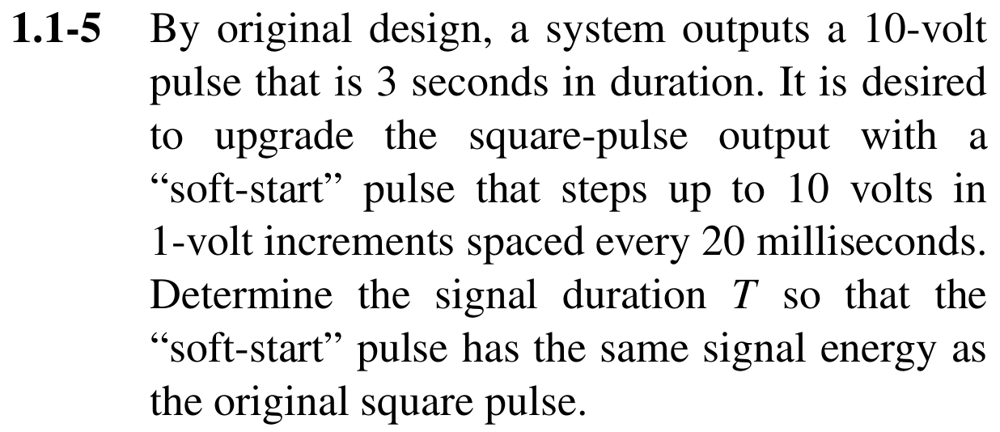{ .lathi-original loading="lazy" }](../../assets/lathi-boulet-batch-06/1.1-5_0.png)

### 02 · Lathi 1.3-4：周期、功率与时间缩放性质辨析 {#exercise-1-3-4}

**对应主题：** Boulet 第1章：Periodic Signals，p.8；Finite-Energy and Finite-Power Signals，p.21

Lathi 印刷页：140；原 PDF 页序：160

**阅读说明：** 原题同页跨栏，题干与(a)-(d)已完整拼接。

[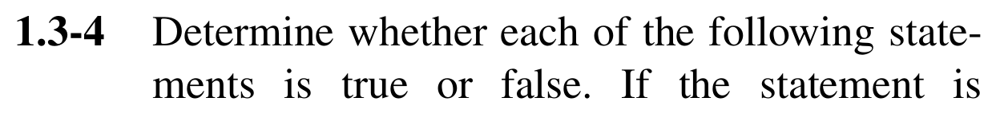{ .lathi-original loading="lazy" }](../../assets/lathi-boulet-batch-06/1.3-4_0.png)

[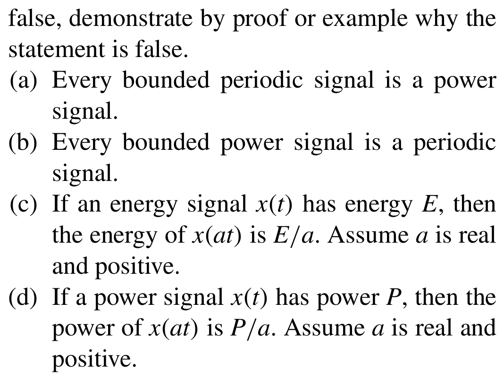{ .lathi-original loading="lazy" }](../../assets/lathi-boulet-batch-06/1.3-4_1.png)

### 03 · Lathi 1.4-3：周期拼接信号的变换、微分与能量功率 {#exercise-1-4-3}

**对应主题：** Boulet 第1章：Transformations of the Time Variable，p.4；Periodic Signals，p.8；Generalized Functions，p.26

Lathi 印刷页：141；原 PDF 页序：161

[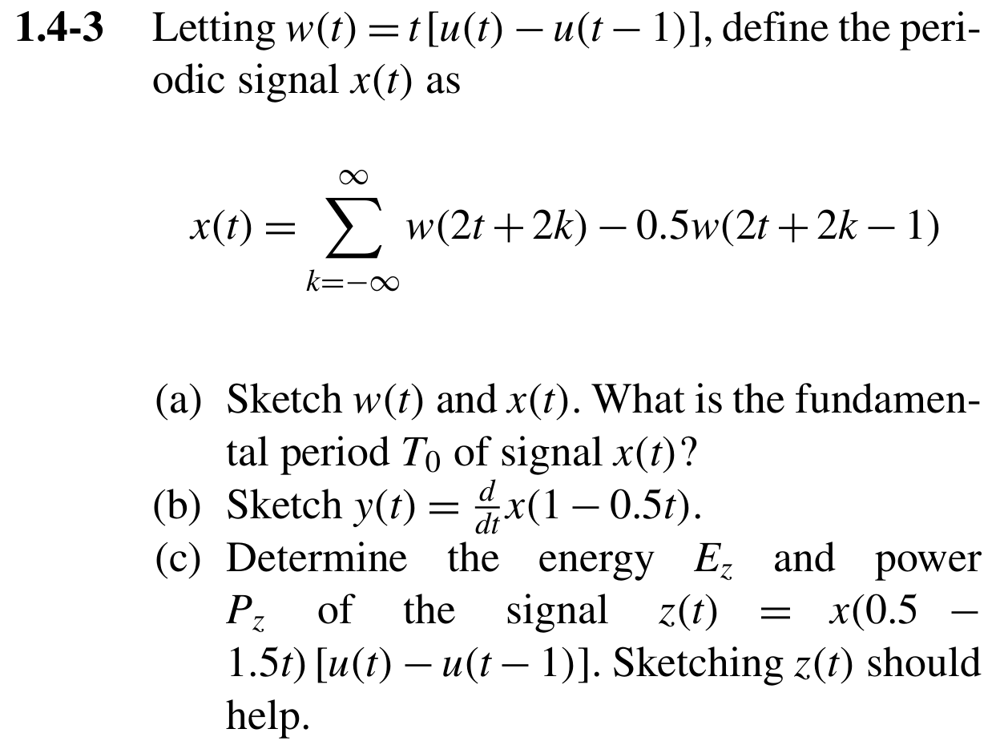{ .lathi-original loading="lazy" }](../../assets/lathi-boulet-batch-06/1.4-3_0.png)

### 04 · Lathi 1.7-16：系统可逆性与逆系统关系 {#exercise-1-7-16}

**对应主题：** Boulet 第1章：System Models and Basic Properties，p.34

Lathi 印刷页：146；原 PDF 页序：166

[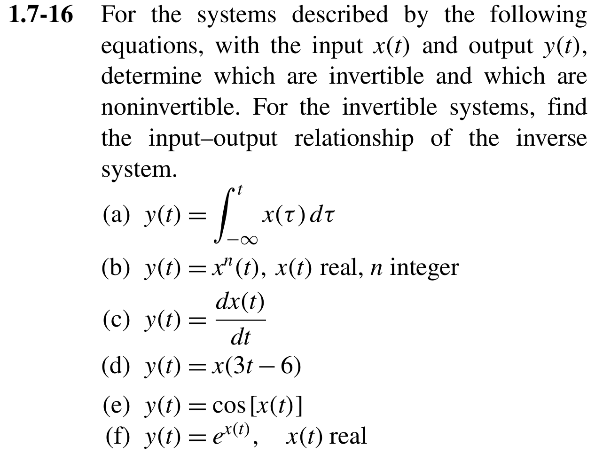{ .lathi-original loading="lazy" }](../../assets/lathi-boulet-batch-06/1.7-16_0.png)

### 05 · Lathi 3.3-7：离散指数信号与复平面位置 {#exercise-3-3-7}

**对应主题：** Boulet 第1章：Exponential Signals，p.9；Periodic Complex Exponential and Sinusoidal Signals，p.17

Lathi 印刷页：317；原 PDF 页序：337

[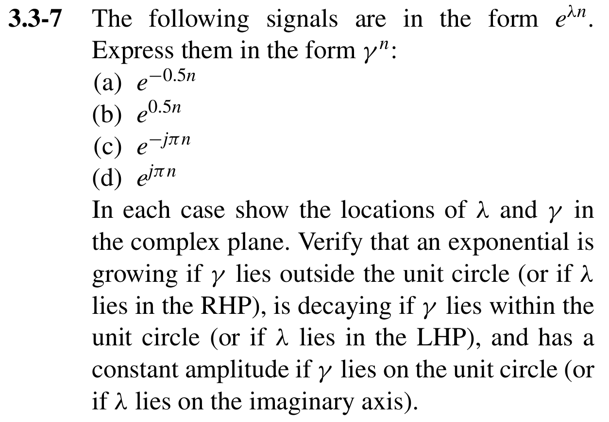{ .lathi-original loading="lazy" }](../../assets/lathi-boulet-batch-06/3.3-7_0.png)

## 第 2 章：线性时不变系统与卷积

### 06 · Lathi 2.4-1：图解卷积的分段积分与指定时刻值 {#exercise-2-4-1}

**对应主题：** Boulet 第2章：Continuous-Time LTI Systems: The Convolution Integral，p.67

Lathi 印刷页：225；原 PDF 页序：245

**阅读说明：** 原图 P2.4-1 的两个信号已附；(b)只要求列积分，(c)要求给出数值。

[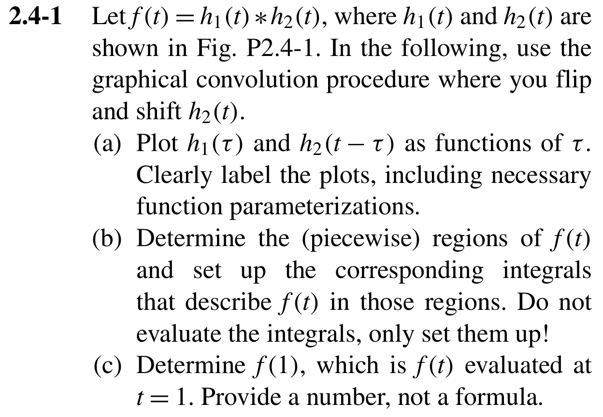{ .lathi-original loading="lazy" }](../../assets/lathi-boulet-batch-06/2.4-1_0.png)

[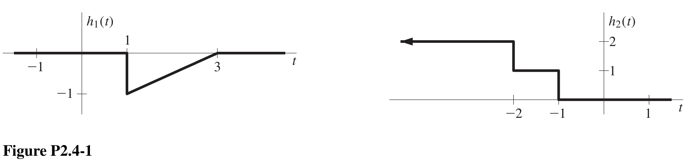{ .lathi-original loading="lazy" }](../../assets/lathi-boulet-batch-06/2.4-1_1.png)

### 07 · Lathi 2.4-2：卷积输出的支撑终点与极值位置 {#exercise-2-4-2}

**对应主题：** Boulet 第2章：Continuous-Time LTI Systems: The Convolution Integral，p.67

Lathi 印刷页：225；原 PDF 页序：245

[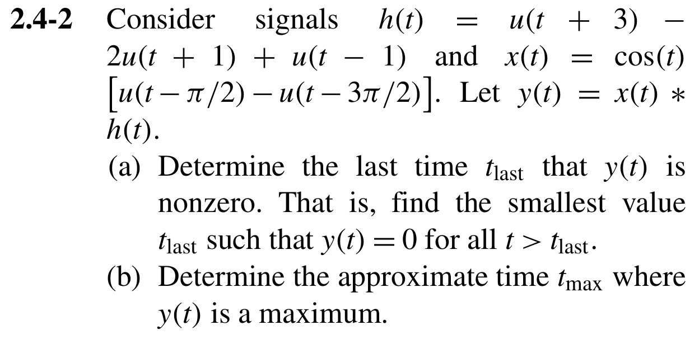{ .lathi-original loading="lazy" }](../../assets/lathi-boulet-batch-06/2.4-2_0.png)

### 08 · Lathi 2.4-23：由输入输出反求连续系统冲激响应 {#exercise-2-4-23}

**对应主题：** Boulet 第2章：Continuous-Time LTI Systems: The Convolution Integral，p.67；Properties of Linear Time-Invariant Systems，p.74

Lathi 印刷页：228；原 PDF 页序：248

[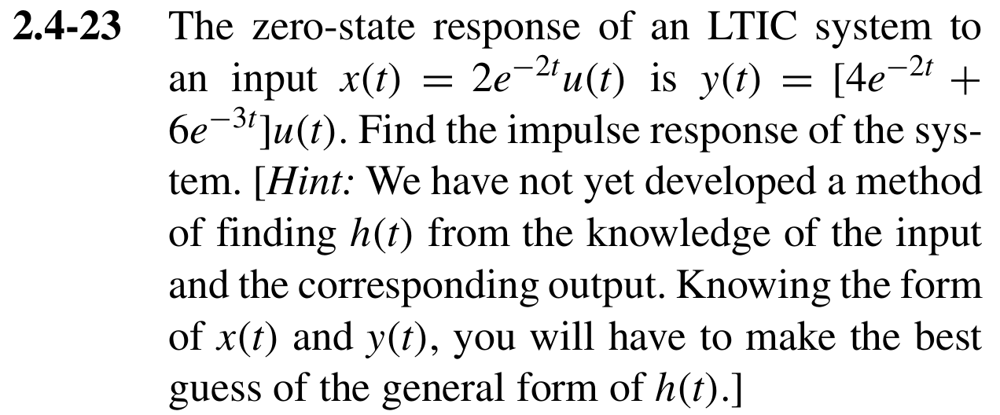{ .lathi-original loading="lazy" }](../../assets/lathi-boulet-batch-06/2.4-23_0.png)

### 09 · Lathi 3.8-4：非因果有限响应系统的周期序列卷积 {#exercise-3-8-4}

**对应主题：** Boulet 第2章：Discrete-Time LTI Systems: The Convolution Sum，p.54；Properties of Linear Time-Invariant Systems，p.74

Lathi 印刷页：321、322；原 PDF 页序：341、342

**阅读说明：** 原题跨页，冲激响应、完整六周期输入定义及(a)、(b)均已附。

[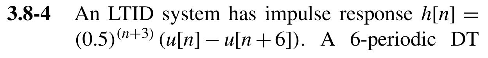{ .lathi-original loading="lazy" }](../../assets/lathi-boulet-batch-06/3.8-4_0.png)

[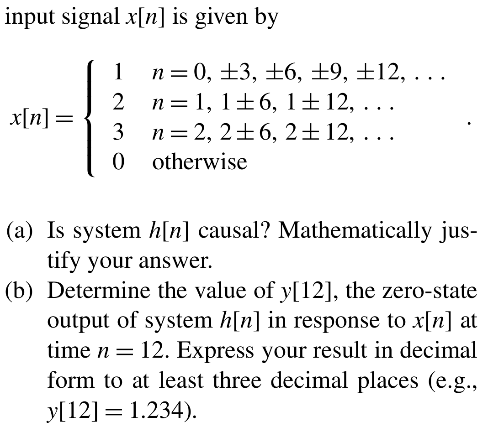{ .lathi-original loading="lazy" }](../../assets/lathi-boulet-batch-06/3.8-4_1.png)

### 10 · Lathi 3.8-18：离散LTI系统互联及逆系统 {#exercise-3-8-18}

**对应主题：** Boulet 第2章：Properties of Linear Time-Invariant Systems，p.74

Lathi 印刷页：322、323；原 PDF 页序：342、343

**阅读说明：** 所需原图 P3.8-18 已完整附上。

[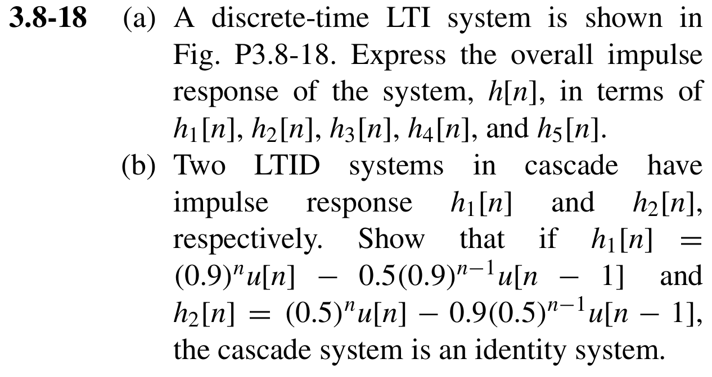{ .lathi-original loading="lazy" }](../../assets/lathi-boulet-batch-06/3.8-18_0.png)

[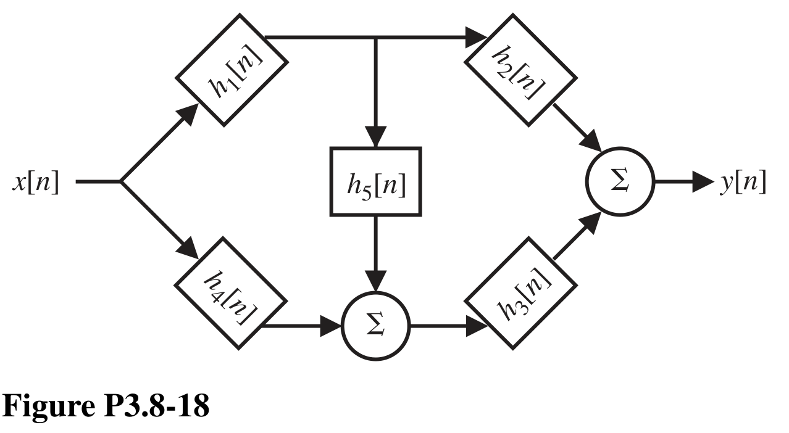{ .lathi-original loading="lazy" }](../../assets/lathi-boulet-batch-06/3.8-18_1.png)

## 第 3 章：微分方程、差分方程与系统响应

### 11 · Lathi 2.2-6：含零特征根的连续系统零输入响应 {#exercise-2-2-6}

**对应主题：** Boulet 第3章：Causal LTI Systems Described by Differential Equations，p.92；Characteristic Polynomials and Stability，p.112

Lathi 印刷页：224；原 PDF 页序：244

**阅读说明：** 展开所引用2.2-4的要求：(a)求特征多项式、特征方程、特征根和特征模态；(b)按给定初值求 t>=0 的零输入响应。

[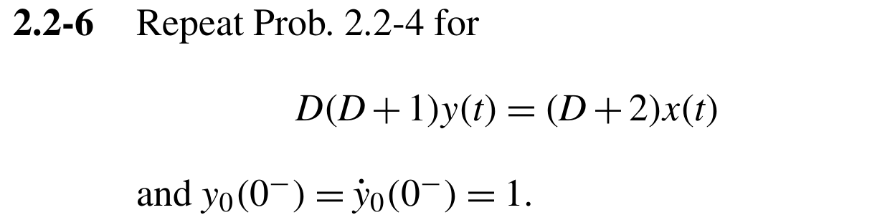{ .lathi-original loading="lazy" }](../../assets/lathi-boulet-batch-06/2.2-6_0.png)

### 12 · Lathi 2.3-6：运放RC电路的单位冲激响应 {#exercise-2-3-6}

**对应主题：** Boulet 第3章：Impulse Response of a Differential LTI System，p.101

Lathi 印刷页：225、224；原 PDF 页序：245、244

**阅读说明：** 所引用原图 P2.2-12 已附，元件数值以本题题干为准。

[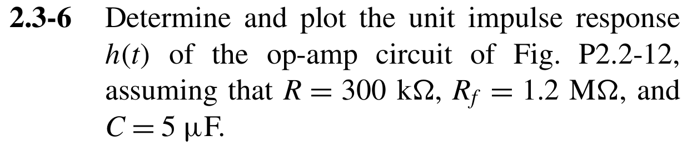{ .lathi-original loading="lazy" }](../../assets/lathi-boulet-batch-06/2.3-6_0.png)

[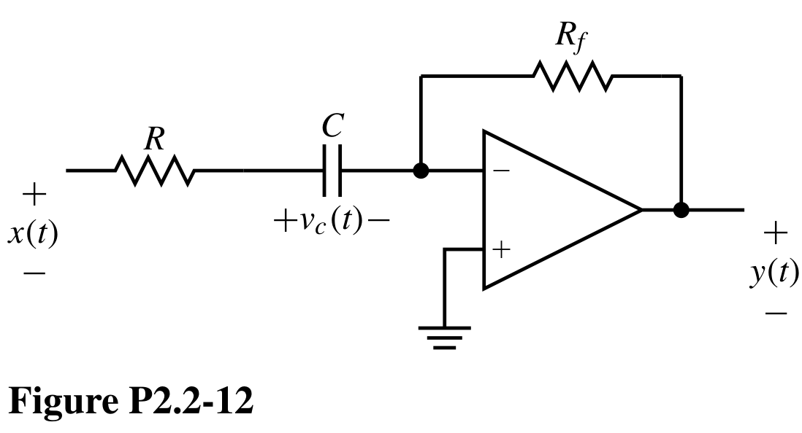{ .lathi-original loading="lazy" }](../../assets/lathi-boulet-batch-06/2.3-6_1.png)

### 13 · Lathi 3.6-2：二阶齐次差分方程与辅助条件 {#exercise-3-6-2}

**对应主题：** Boulet 第3章：Causal LTI Systems Described by Difference Equations，p.96

Lathi 印刷页：320；原 PDF 页序：340

[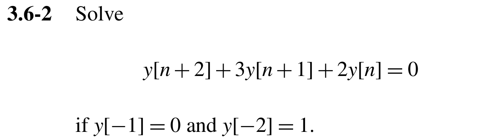{ .lathi-original loading="lazy" }](../../assets/lathi-boulet-batch-06/3.6-2_0.png)

### 14 · Lathi 3.7-4：超前下标差分系统的模态与冲激响应 {#exercise-3-7-4}

**对应主题：** Boulet 第3章：Impulse Response of a Difference LTI System，p.109；Characteristic Polynomials and Stability，p.112

Lathi 印刷页：321；原 PDF 页序：341

**阅读说明：** 展开所引用3.7-3的要求：(a)判断系统阶数；(b)确定特征模态；(c)求单位冲激响应 h[n] 的闭式表达式。

[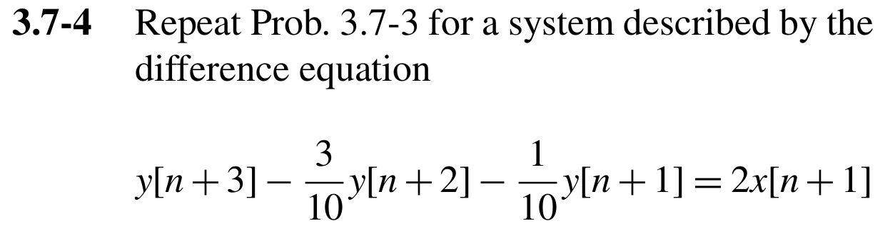{ .lathi-original loading="lazy" }](../../assets/lathi-boulet-batch-06/3.7-4_0.png)

### 15 · Lathi 3.9-4：由特征根图判断离散系统模态与稳定性 {#exercise-3-9-4}

**对应主题：** Boulet 第3章：Characteristic Polynomials and Stability of Differential and Difference Systems，p.112

Lathi 印刷页：327；原 PDF 页序：347

**阅读说明：** 同页跨栏的(a)-(e)及A-J共十幅原图全部附上；各图按比例绘制，单位圆为参考。

[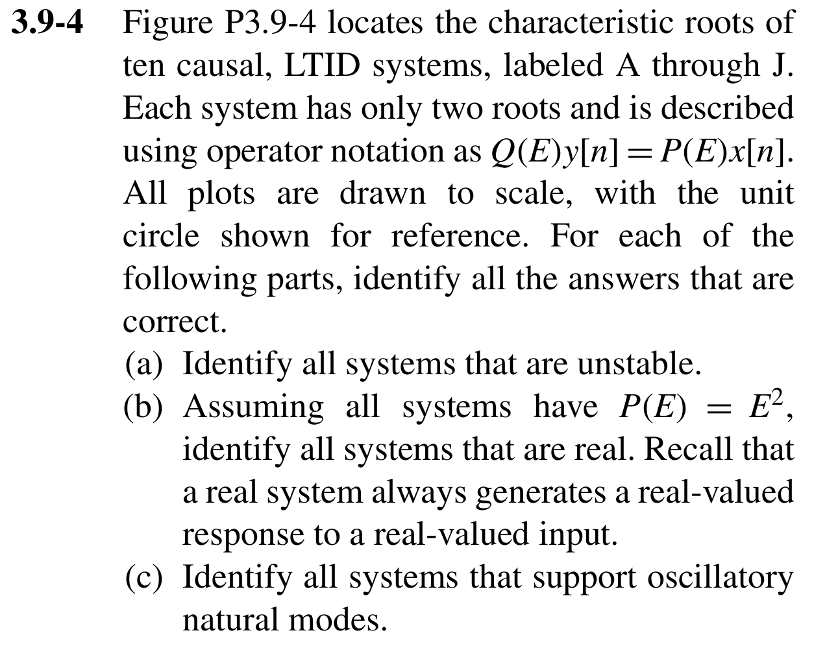{ .lathi-original loading="lazy" }](../../assets/lathi-boulet-batch-06/3.9-4_0.png)

[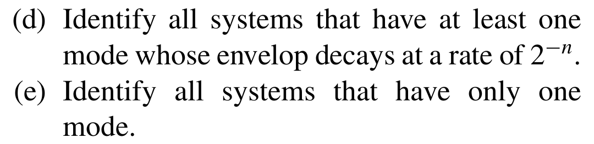{ .lathi-original loading="lazy" }](../../assets/lathi-boulet-batch-06/3.9-4_1.png)

[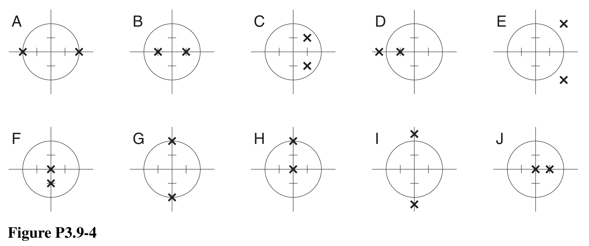{ .lathi-original loading="lazy" }](../../assets/lathi-boulet-batch-06/3.9-4_2.png)

## 第 4 章：连续时间傅里叶级数

### 16 · Lathi 6.1-1：六种周期波形的三角傅里叶级数与幅相谱 {#exercise-6-1-1}

**对应主题：** Boulet 第4章：Determination of the Fourier Series Representation of a Continuous-Time Periodic Signal，p.134；Graph of the Fourier Series Coefficients: The Line Spectrum，p.137

Lathi 印刷页：669、670；原 PDF 页序：689、690

**阅读说明：** 所需原图 P6.1-1(a)至(f)六幅均已完整附上。本题要求紧凑三角式及其幅相谱。

[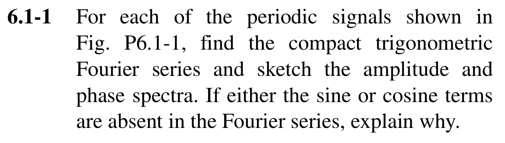{ .lathi-original loading="lazy" }](../../assets/lathi-boulet-batch-06/6.1-1_0.png)

[{ .lathi-original loading="lazy" }](../../assets/lathi-boulet-batch-06/6.1-1_1.png)

### 17 · Lathi 6.1-7：按基频、奇偶性与半波对称性构造周期延拓 {#exercise-6-1-7}

**对应主题：** Boulet 第4章：Linear Combinations of Harmonically Related Complex Exponentials，p.132；Properties of Continuous-Time Fourier Series，p.139

Lathi 印刷页：671、672；原 PDF 页序：691、692

**阅读说明：** 原题跨栏、跨页，(a)至(f)及示意原图 P6.1-7均已附。展开提示中6.1-6的定义：半波对称是 x(t−T0/2)=−x(t)。只需画出满足条件的周期信号，不要求计算傅里叶系数。

[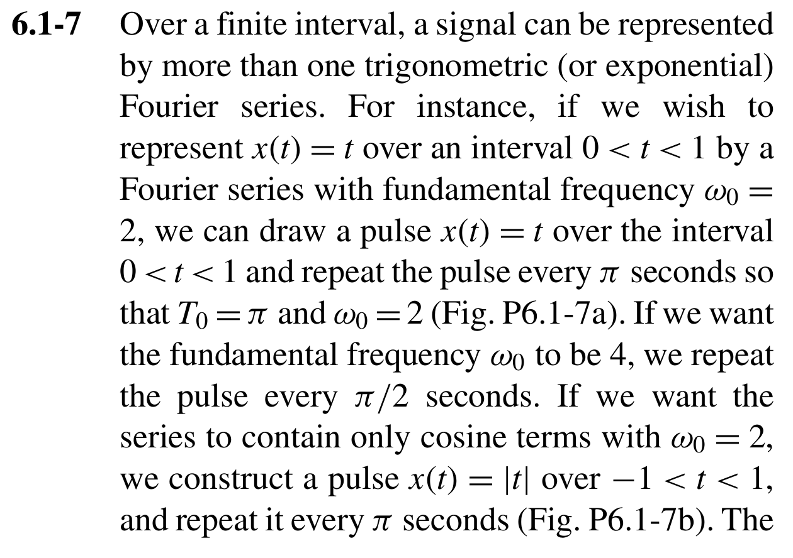{ .lathi-original loading="lazy" }](../../assets/lathi-boulet-batch-06/6.1-7_0.png)

[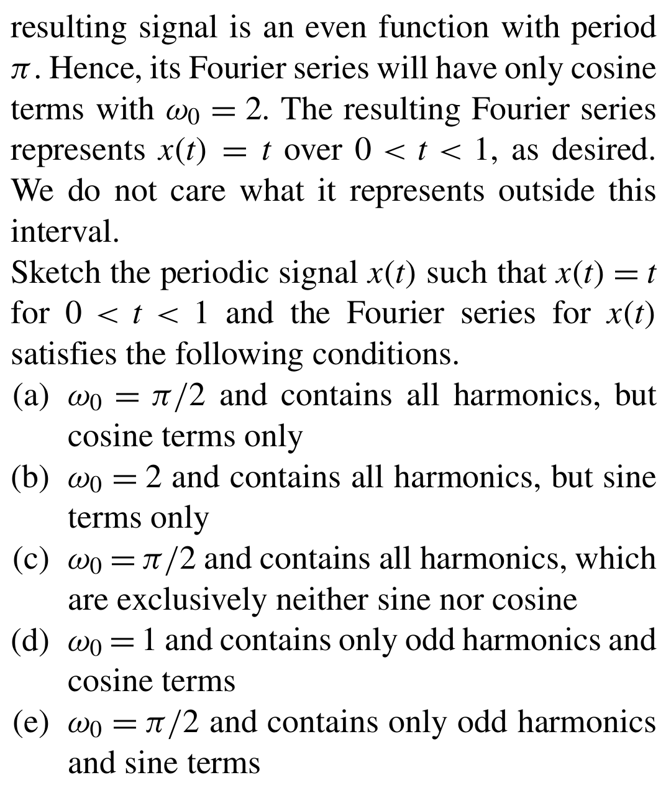{ .lathi-original loading="lazy" }](../../assets/lathi-boulet-batch-06/6.1-7_1.png)

[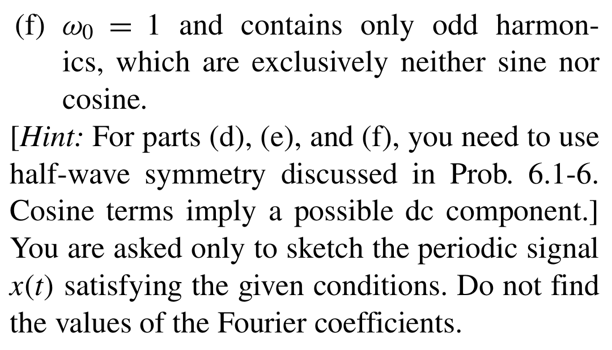{ .lathi-original loading="lazy" }](../../assets/lathi-boulet-batch-06/6.1-7_2.png)

[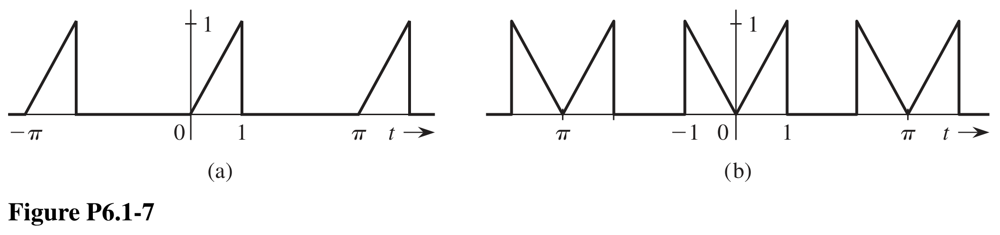{ .lathi-original loading="lazy" }](../../assets/lathi-boulet-batch-06/6.1-7_3.png)

### 18 · Lathi 6.3-1：六种周期波形的复指数傅里叶级数与频谱 {#exercise-6-3-1}

**对应主题：** Boulet 第4章：Determination of the Fourier Series Representation of a Continuous-Time Periodic Signal，p.134；Graph of the Fourier Series Coefficients: The Line Spectrum，p.137

Lathi 印刷页：672、670；原 PDF 页序：692、690

**阅读说明：** 所需原图 P6.1-1(a)至(f)六幅均已完整附上；虽与6.1-1共用波形，本题要求复指数式及其频谱，是原书另一道独立习题。

[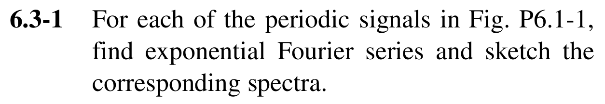{ .lathi-original loading="lazy" }](../../assets/lathi-boulet-batch-06/6.3-1_0.png)

[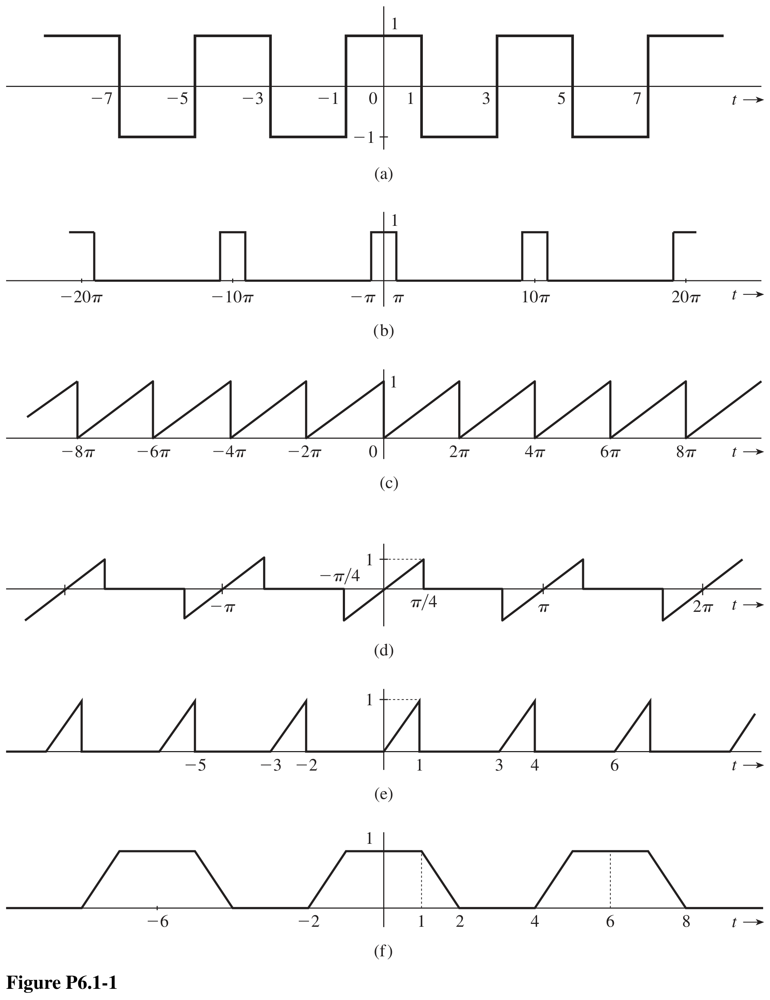{ .lathi-original loading="lazy" }](../../assets/lathi-boulet-batch-06/6.3-1_1.png)

### 19 · Lathi 6.5-1：由误差平方推导向量最优投影系数 {#exercise-6-5-1}

**对应主题：** Boulet 第4章：Optimality and Convergence of the Fourier Series，p.144

Lathi 印刷页：676、643；原 PDF 页序：696、663

**阅读说明：** 本题是傅里叶级数最优逼近的向量基础练习。原题所引用的式(6.32)已附，属于待推导命题，不是解答；其中x、y为实向量，y非零，c取使误差向量x−cy的长度平方最小的实数。

[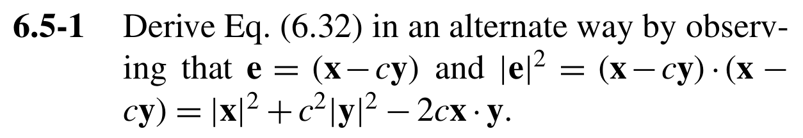{ .lathi-original loading="lazy" }](../../assets/lathi-boulet-batch-06/6.5-1_0.png)

[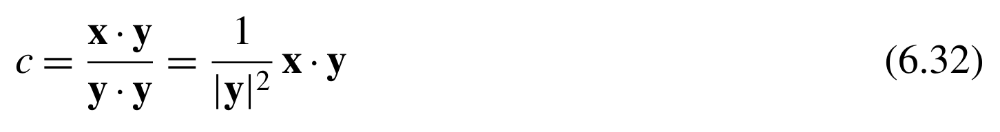{ .lathi-original loading="lazy" }](../../assets/lathi-boulet-batch-06/6.5-1_1.png)

### 20 · Lathi 6.5-2：最小误差逼近的正交性与方波正弦分量 {#exercise-6-5-2}

**对应主题：** Boulet 第4章：Optimality and Convergence of the Fourier Series，p.144

Lathi 印刷页：676、677、645；原 PDF 页序：696、697、665

**阅读说明：** 原题跨页，(a)至(c)均已附。所需原图6.23已附，未附例题演算；(c)的比较区间为0<t<2π，图中方波在0<t<π为1、在π<t<2π为−1，比较信号为sin(t)。

[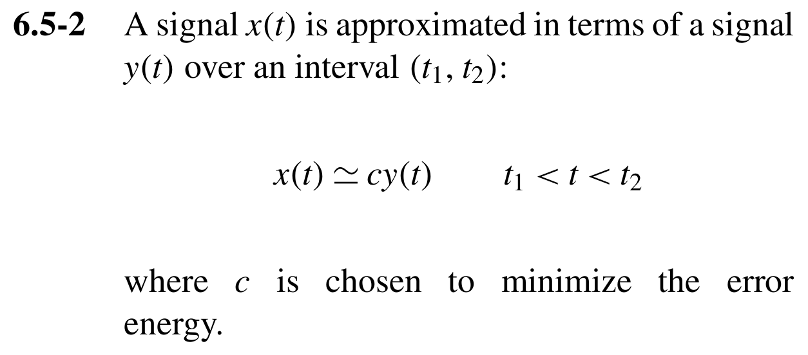{ .lathi-original loading="lazy" }](../../assets/lathi-boulet-batch-06/6.5-2_0.png)

[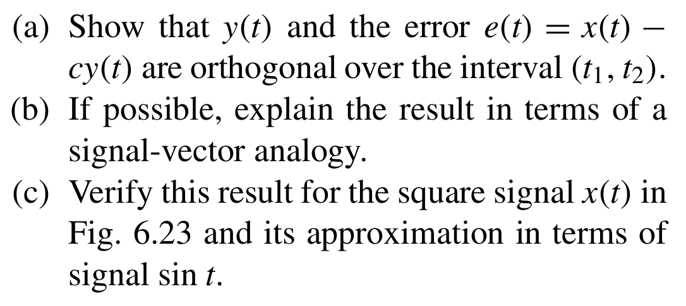{ .lathi-original loading="lazy" }](../../assets/lathi-boulet-batch-06/6.5-2_1.png)

[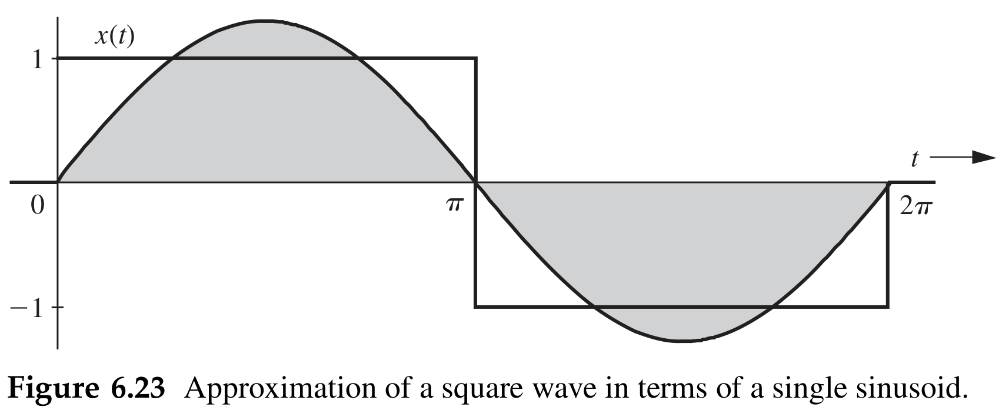{ .lathi-original loading="lazy" }](../../assets/lathi-boulet-batch-06/6.5-2_2.png)

## 来源与使用说明

- B. P. Lathi & R. A. Green, *Linear Systems and Signals*, Third Edition, Oxford University Press, 2018：题号、题干与所需附图按原 PDF 核对
- Benoit Boulet, *Fundamentals of Signals and Systems*：第 1–4 章的主题与印刷页码用于中文学习索引
- Lathi 原 PDF 页序比印刷页码大 20；页面同时列出两种页码，便于回查
- 原题中的必要引用或附图见各题阅读说明；本页与下载 PDF 均不含解答

[第 1 组 20 题](lathi-20-exercises.md) · [第 2 组 20 题](lathi-20-exercises-batch-02.md) · [第 3 组 20 题](lathi-20-exercises-batch-03.md) · [第 4 组 20 题](lathi-20-exercises-batch-04.md) · [第 5 组 20 题](lathi-20-exercises-batch-05.md) · [Boulet 总览](index.md) · [前三章全部对应题号](lathi-exercise-map.md)
