# Boulet 前四章 × Lathi：第 7 组 20 道练习

**每章 5 题 · 共 20 个独立题号 · 原题与必要附图 · 无答案**

[下载第 7 组 PDF（22 页）](../../assets/lathi-boulet-batch-07/Lathi_20_Exercises_Boulet_Chapters_1-4_Batch_07_No_Solutions.pdf){ .md-button .md-button--primary download }

按 Boulet 前四章的知识主题选择 Lathi 第三版习题。本组与此前各组不重复。下方保留原题图像，避免公式转写丢失；点击图片可打开原图放大查看。这里只按知识点匹配，不表示两书的习题一一等价。

[第 1 组 20 题](lathi-20-exercises.md) · [第 2 组 20 题](lathi-20-exercises-batch-02.md) · [第 3 组 20 题](lathi-20-exercises-batch-03.md) · [第 4 组 20 题](lathi-20-exercises-batch-04.md) · [第 5 组 20 题](lathi-20-exercises-batch-05.md) · [第 6 组 20 题](lathi-20-exercises-batch-06.md) · [Boulet 总览](index.md)

## 快速索引

| Boulet 章节 | Lathi 题号 |
| --- | --- |
| 第 1 章：信号与系统基础 | [1.1-8](#exercise-1-1-8)、[1.2-1](#exercise-1-2-1)、[1.5-2](#exercise-1-5-2)、[1.7-5](#exercise-1-7-5)、[3.3-3](#exercise-3-3-3) |
| 第 2 章：线性时不变系统与卷积 | [2.4-3](#exercise-2-4-3)、[2.4-22](#exercise-2-4-22)、[2.4-31](#exercise-2-4-31)、[3.8-3](#exercise-3-8-3)、[3.8-19](#exercise-3-8-19) |
| 第 3 章：微分方程、差分方程与系统响应 | [2.2-7](#exercise-2-2-7)、[2.2-12](#exercise-2-2-12)、[3.5-6](#exercise-3-5-6)、[3.6-3](#exercise-3-6-3)、[3.7-1](#exercise-3-7-1) |
| 第 4 章：连续时间傅里叶级数 | [6.1-2](#exercise-6-1-2)、[6.1-3](#exercise-6-1-3)、[6.1-4](#exercise-6-1-4)、[6.3-11](#exercise-6-3-11)、[6.3-12](#exercise-6-3-12) |

## 第 1 章：信号与系统基础

### 01 · Lathi 1.1-8：正交相位方波及复信号的能量与功率 {#exercise-1-1-8}

**对应主题：** Boulet 第1章：Periodic Signals，p.8；Finite-Energy and Finite-Power Signals，p.21

Lathi 印刷页：137；原 PDF 页序：157

**阅读说明：** 原题同页跨栏，两个信号的定义及(a)-(d)完整附上。

[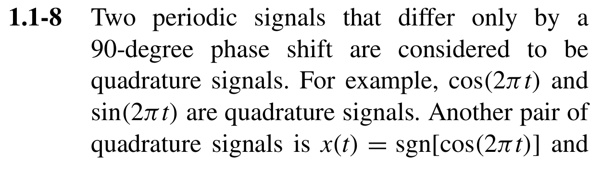{ .lathi-original loading="lazy" }](../../assets/lathi-boulet-batch-07/1.1-8_0.png)

[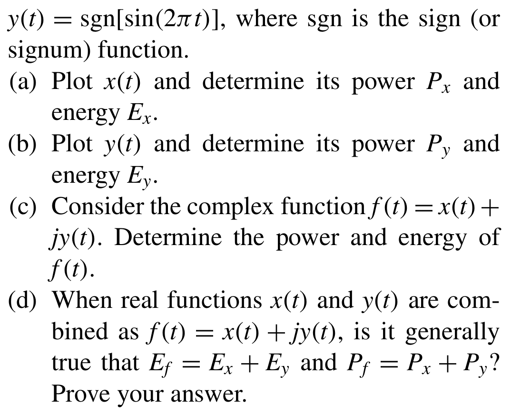{ .lathi-original loading="lazy" }](../../assets/lathi-boulet-batch-07/1.1-8_1.png)

### 02 · Lathi 1.2-1：连续波形的反转、平移与时间伸缩 {#exercise-1-2-1}

**对应主题：** Boulet 第1章：Transformations of the Time Variable，p.4

Lathi 印刷页：138、139；原 PDF 页序：158、159

[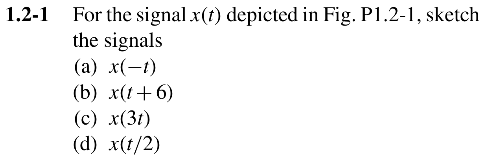{ .lathi-original loading="lazy" }](../../assets/lathi-boulet-batch-07/1.2-1_0.png)

[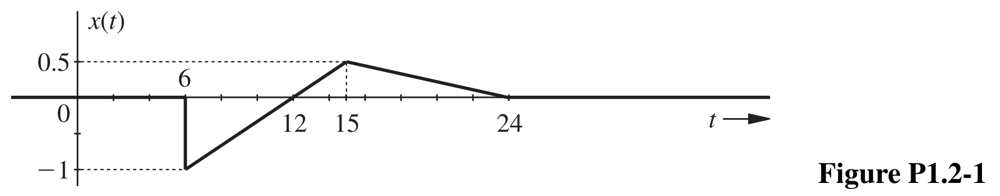{ .lathi-original loading="lazy" }](../../assets/lathi-boulet-batch-07/1.2-1_1.png)

### 03 · Lathi 1.5-2：奇偶分解后的时间变换 {#exercise-1-5-2}

**对应主题：** Boulet 第1章：Even and Odd Signals，p.23；Transformations of the Time Variable，p.4

Lathi 印刷页：142、143；原 PDF 页序：162、163

**阅读说明：** 原题跨页，(a)、(b)均已附。

[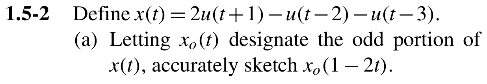{ .lathi-original loading="lazy" }](../../assets/lathi-boulet-batch-07/1.5-2_0.png)

[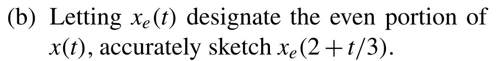{ .lathi-original loading="lazy" }](../../assets/lathi-boulet-batch-07/1.5-2_1.png)

### 04 · Lathi 1.7-5：延迟半波整流系统的基本性质 {#exercise-1-7-5}

**对应主题：** Boulet 第1章：System Models and Basic Properties，p.34

Lathi 印刷页：145；原 PDF 页序：165

**阅读说明：** 展开所引用1.7-4的要求：分别判断系统是否(a)BIBO稳定、(b)因果、(c)可逆、(d)线性、(e)无记忆、(f)时不变；每项回答是或否，并给出数学论证。

[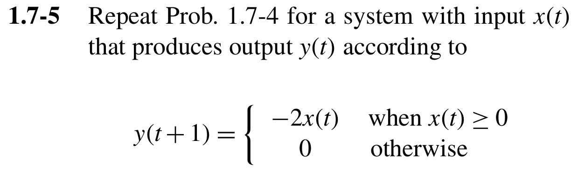{ .lathi-original loading="lazy" }](../../assets/lathi-boulet-batch-07/1.7-5_0.png)

### 05 · Lathi 3.3-3：用单位阶跃构造有限离散序列 {#exercise-3-3-3}

**对应主题：** Boulet 第1章：Discrete-Time Impulse and Step Signals，p.25

Lathi 印刷页：316；原 PDF 页序：336

[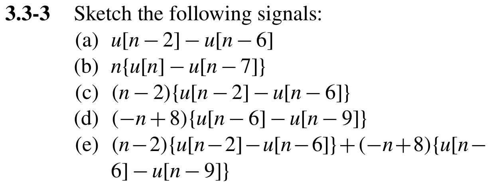{ .lathi-original loading="lazy" }](../../assets/lathi-boulet-batch-07/3.3-3_0.png)

## 第 2 章：线性时不变系统与卷积

### 06 · Lathi 2.4-3：正弦窗与分段常数信号卷积的极小值位置 {#exercise-2-4-3}

**对应主题：** Boulet 第2章：Continuous-Time LTI Systems: The Convolution Integral，p.67

Lathi 印刷页：225；原 PDF 页序：245

[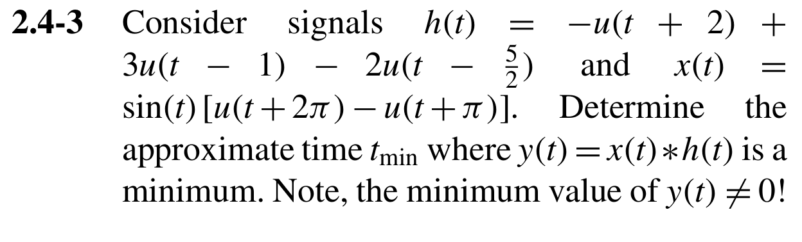{ .lathi-original loading="lazy" }](../../assets/lathi-boulet-batch-07/2.4-3_0.png)

### 07 · Lathi 2.4-22：由信号图直接判断卷积值并求完整响应 {#exercise-2-4-22}

**对应主题：** Boulet 第2章：Continuous-Time LTI Systems: The Convolution Integral，p.67

Lathi 印刷页：227、228；原 PDF 页序：247、248

**阅读说明：** 原题跨页，(a)、(b)及输入和冲激响应双图均已附。

[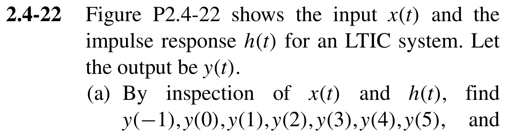{ .lathi-original loading="lazy" }](../../assets/lathi-boulet-batch-07/2.4-22_0.png)

[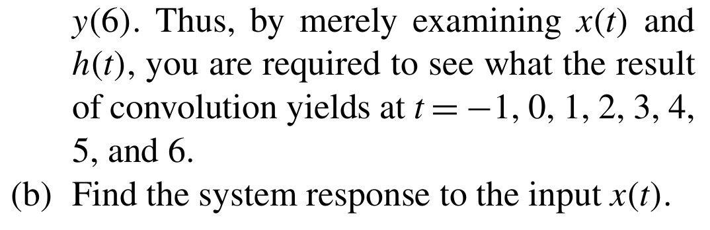{ .lathi-original loading="lazy" }](../../assets/lathi-boulet-batch-07/2.4-22_1.png)

[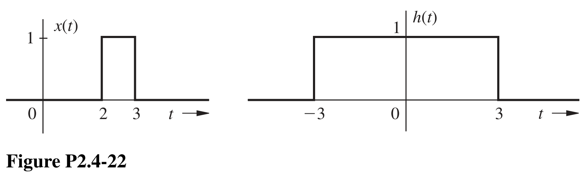{ .lathi-original loading="lazy" }](../../assets/lathi-boulet-batch-07/2.4-22_2.png)

### 08 · Lathi 2.4-31：两个连续LTI系统串联的指定时刻阶跃响应 {#exercise-2-4-31}

**对应主题：** Boulet 第2章：Properties of Linear Time-Invariant Systems，p.74；Continuous-Time LTI Systems: The Convolution Integral，p.67

Lathi 印刷页：228、230；原 PDF 页序：248、250

**阅读说明：** 所需原图 P2.4-31 的 h(t) 波形和串联框图均已附。

[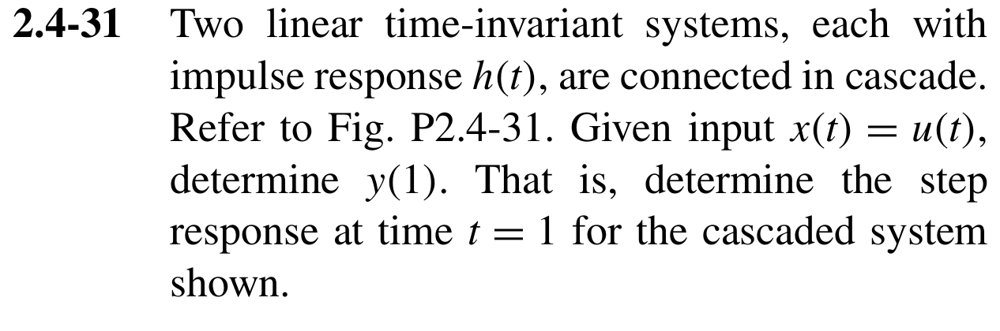{ .lathi-original loading="lazy" }](../../assets/lathi-boulet-batch-07/2.4-31_0.png)

[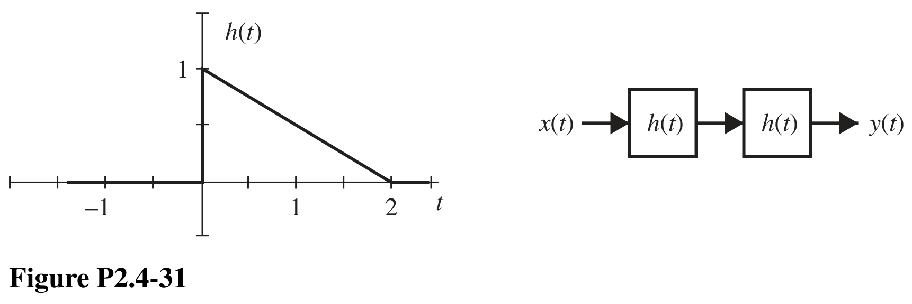{ .lathi-original loading="lazy" }](../../assets/lathi-boulet-batch-07/2.4-31_1.png)

### 09 · Lathi 3.8-3：周期截断离散冲激响应的卷积与特征根 {#exercise-3-8-3}

**对应主题：** Boulet 第2章：Discrete-Time LTI Systems: The Convolution Sum，p.54；兼及第3章 Characteristic Polynomials and Stability，p.112

Lathi 印刷页：321；原 PDF 页序：341

[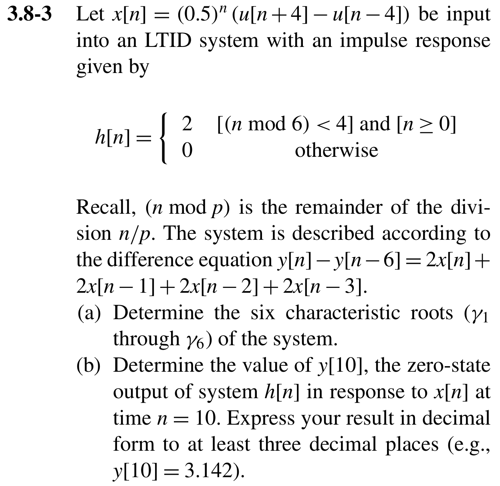{ .lathi-original loading="lazy" }](../../assets/lathi-boulet-batch-07/3.8-3_0.png)

### 10 · Lathi 3.8-19：单位阶跃响应与冲激响应的累积关系 {#exercise-3-8-19}

**对应主题：** Boulet 第2章：Discrete-Time LTI Systems: The Convolution Sum，p.54；Properties of Linear Time-Invariant Systems，p.74

Lathi 印刷页：323、296；原 PDF 页序：343、316

**阅读说明：** 所引用式(3.37)已附。其中 h[n] 是单位冲激响应，g[n] 是单位阶跃响应。

[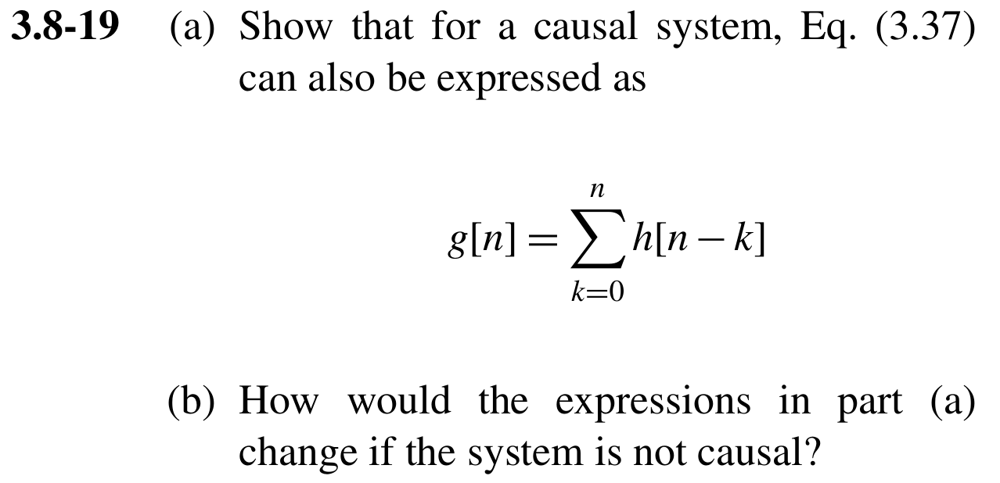{ .lathi-original loading="lazy" }](../../assets/lathi-boulet-batch-07/3.8-19_0.png)

[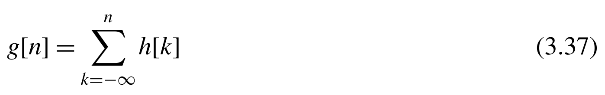{ .lathi-original loading="lazy" }](../../assets/lathi-boulet-batch-07/3.8-19_1.png)

## 第 3 章：微分方程、差分方程与系统响应

### 11 · Lathi 2.2-7：纯虚特征根连续系统的初值响应 {#exercise-2-2-7}

**对应主题：** Boulet 第3章：Causal LTI Systems Described by Differential Equations，p.92；Characteristic Polynomials and Stability，p.112

Lathi 印刷页：224；原 PDF 页序：244

**阅读说明：** 展开所引用2.2-4的要求：(a)求特征多项式、特征方程、特征根和特征模态；(b)按给定初值求 t>=0 的零输入响应。

[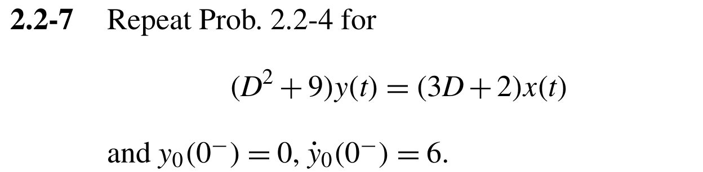{ .lathi-original loading="lazy" }](../../assets/lathi-boulet-batch-07/2.2-7_0.png)

### 12 · Lathi 2.2-12：运放RC电路的微分方程与储能初值响应 {#exercise-2-2-12}

**对应主题：** Boulet 第3章：Causal LTI Systems Described by Differential Equations，p.92

Lathi 印刷页：224；原 PDF 页序：244

**阅读说明：** 题干、元件符号与极性完整保留；本题先建模，再按给定初始电容电压求零输入响应。

[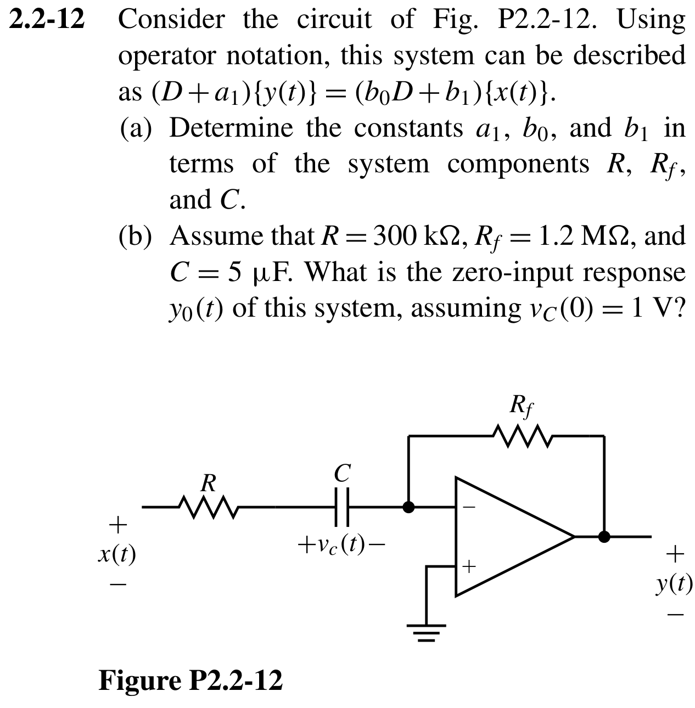{ .lathi-original loading="lazy" }](../../assets/lathi-boulet-batch-07/2.2-12_0.png)

### 13 · Lathi 3.5-6：二阶离散系统的前三项递推响应 {#exercise-3-5-6}

**对应主题：** Boulet 第3章：Causal LTI Systems Described by Difference Equations，p.96

Lathi 印刷页：320；原 PDF 页序：340

**阅读说明：** 展开所引用3.5-5的要求：按给定输入及初始条件递推求解，只求前三项。

[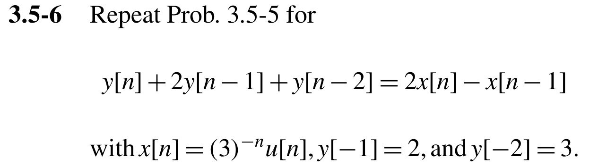{ .lathi-original loading="lazy" }](../../assets/lathi-boulet-batch-07/3.5-6_0.png)

### 14 · Lathi 3.6-3：重特征根齐次差分方程的初值解 {#exercise-3-6-3}

**对应主题：** Boulet 第3章：Causal LTI Systems Described by Difference Equations，p.96

Lathi 印刷页：320；原 PDF 页序：340

[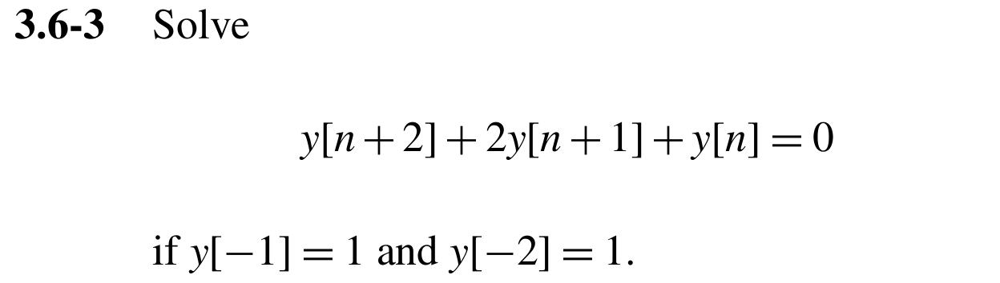{ .lathi-original loading="lazy" }](../../assets/lathi-boulet-batch-07/3.6-3_0.png)

### 15 · Lathi 3.7-1：一阶离散方程中下标位置与冲激响应 {#exercise-3-7-1}

**对应主题：** Boulet 第3章：Impulse Response of a Difference LTI System，p.109

Lathi 印刷页：320；原 PDF 页序：340

[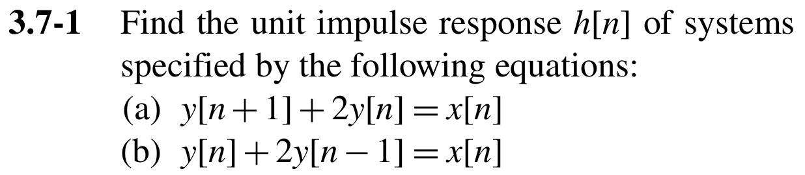{ .lathi-original loading="lazy" }](../../assets/lathi-boulet-batch-07/3.7-1_0.png)

## 第 4 章：连续时间傅里叶级数

### 16 · Lathi 6.1-2：周期指数波的时间反转与幅相谱 {#exercise-6-1-2}

**对应主题：** Boulet 第4章：求傅里叶级数，p.134；线谱，p.137；Time Reversal，p.140

Lathi 印刷页：669、670、599、600；原 PDF 页序：689、690、619、620

**阅读说明：** 题干(a)至(c)、原图P6.1-2、引用的图6.2(a)及例6.1已知级数均已附。参考信号x(t)在0<t<π时为exp(−t/2)，以π为周期延拓，基频为2 rad/s。参考级数中的0.504是2(1−exp(−π/2))/π的四舍五入值，精确计算可保留该表达式。所附参考级数是(b)的已知条件，不是本题y(t)的答案。

[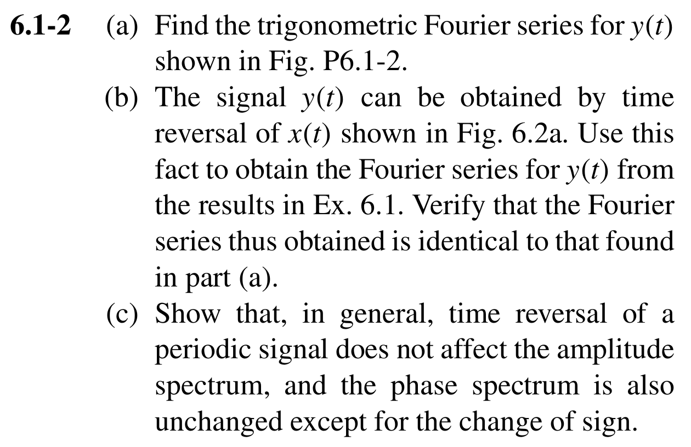{ .lathi-original loading="lazy" }](../../assets/lathi-boulet-batch-07/6.1-2_0.png)

[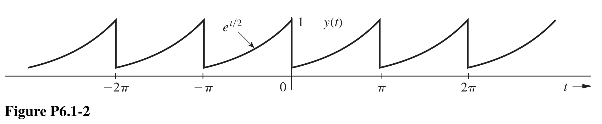{ .lathi-original loading="lazy" }](../../assets/lathi-boulet-batch-07/6.1-2_1.png)

[{ .lathi-original loading="lazy" }](../../assets/lathi-boulet-batch-07/6.1-2_2.png)

[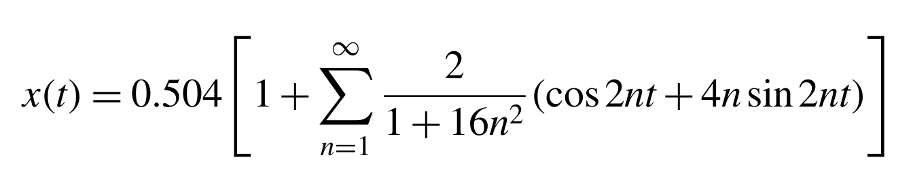{ .lathi-original loading="lazy" }](../../assets/lathi-boulet-batch-07/6.1-2_3.png)

### 17 · Lathi 6.1-3：周期指数波的时间压缩与频谱展宽 {#exercise-6-1-3}

**对应主题：** Boulet 第4章：求傅里叶级数，p.134；线谱，p.137；Time Scaling，p.140

Lathi 印刷页：669、671、599、600；原 PDF 页序：689、691、619、620

**阅读说明：** 题干(a)至(c)、原图P6.1-3、引用的图6.2(a)及例6.1已知级数均已附。参考信号x(t)在0<t<π时为exp(−t/2)，以π为周期延拓，基频为2 rad/s；题图y(t)在0<t<π/2时为exp(−t)，以π/2为周期延拓。参考级数中的0.504是2(1−exp(−π/2))/π的四舍五入值。所附参考级数是(b)的已知条件，不是本题y(t)的答案。

[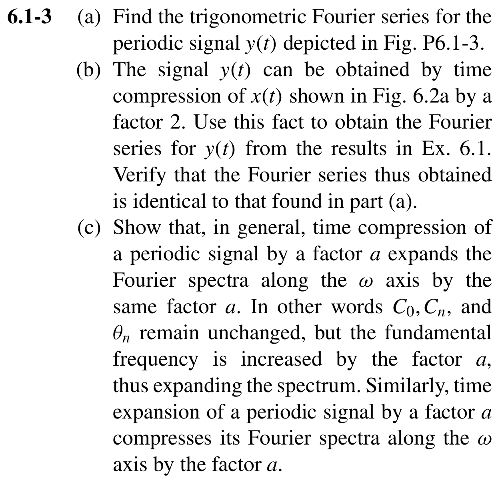{ .lathi-original loading="lazy" }](../../assets/lathi-boulet-batch-07/6.1-3_0.png)

[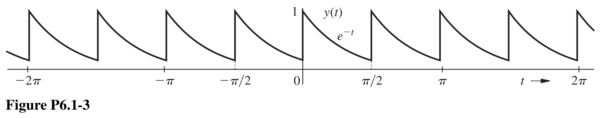{ .lathi-original loading="lazy" }](../../assets/lathi-boulet-batch-07/6.1-3_1.png)

[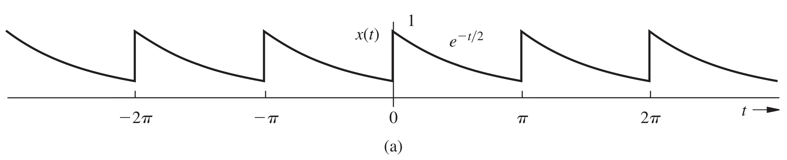{ .lathi-original loading="lazy" }](../../assets/lathi-boulet-batch-07/6.1-3_2.png)

[{ .lathi-original loading="lazy" }](../../assets/lathi-boulet-batch-07/6.1-3_3.png)

### 18 · Lathi 6.1-4：三角波的时移、偶对称性与傅里叶相位 {#exercise-6-1-4}

**对应主题：** Boulet 第4章：求傅里叶级数，p.134；Time Shifting，p.139；对称性，pp.140–141

Lathi 印刷页：669、671、602、603；原 PDF 页序：689、691、622、623

**阅读说明：** 原题跨栏，(a)至(c)均已附；另附P6.1-4、图6.4(a)和例6.2已知级数(6.12)。参考信号x(t)的周期为2：在−1/2<t<1/2时x(t)=2At，在1/2<t<3/2时x(t)=2A(1−t)，再作周期延拓；A为图示幅值。已知级数只用于(b)的时移推导，未附g(t)的解答。

[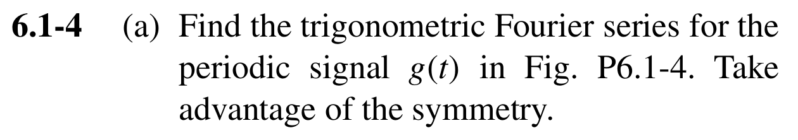{ .lathi-original loading="lazy" }](../../assets/lathi-boulet-batch-07/6.1-4_0.png)

[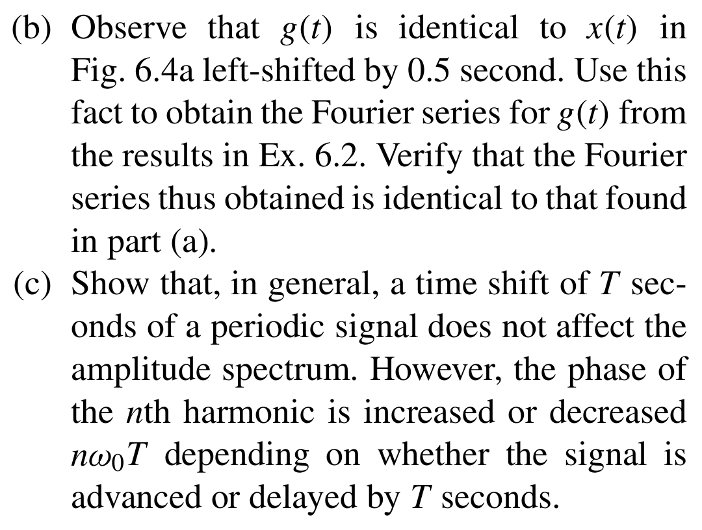{ .lathi-original loading="lazy" }](../../assets/lathi-boulet-batch-07/6.1-4_1.png)

[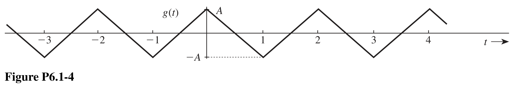{ .lathi-original loading="lazy" }](../../assets/lathi-boulet-batch-07/6.1-4_2.png)

[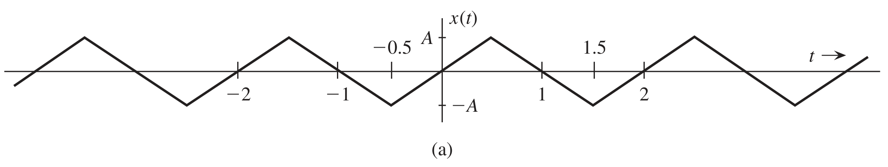{ .lathi-original loading="lazy" }](../../assets/lathi-boulet-batch-07/6.1-4_3.png)

[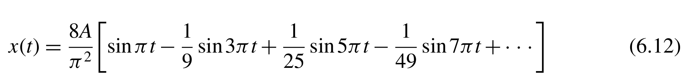{ .lathi-original loading="lazy" }](../../assets/lathi-boulet-batch-07/6.1-4_4.png)

### 19 · Lathi 6.3-11：周期抛物线波的Parseval验证与截断误差功率 {#exercise-6-3-11}

**对应主题：** Boulet 第4章：Optimality and Convergence of the Fourier Series，p.144；Parseval Theorem，p.150

Lathi 印刷页：674、609、608；原 PDF 页序：694、629、628

**阅读说明：** 完整题干(a)(b)、图6.7(a)及Drill6.1(a)给出的级数均已附。图示信号在−1<t<1时x(t)=t²，周期为2；其已知级数为1/3加上所附余弦和。所附级数是本题要求使用的已知条件，不含Parseval验证或所求截断项数的答案。原题以first N terms表述截断项数，作答时请说明是否把直流项计作一项。

[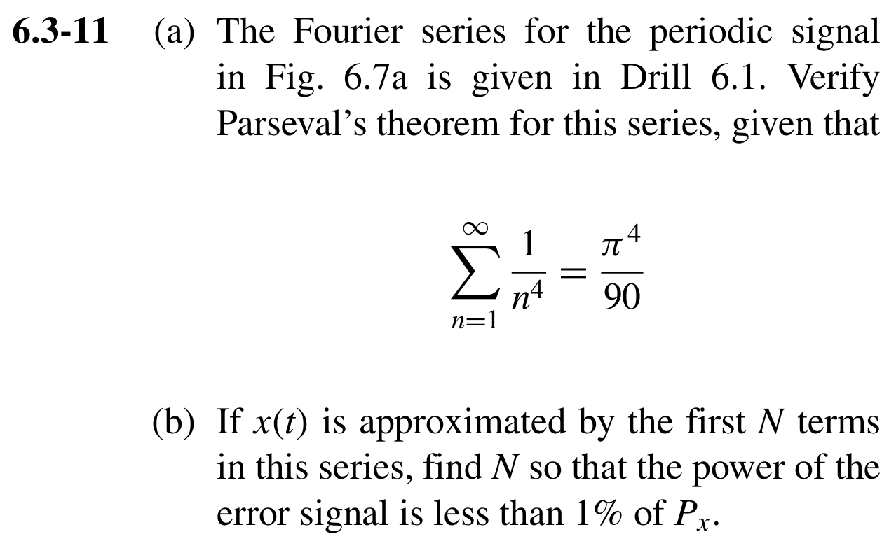{ .lathi-original loading="lazy" }](../../assets/lathi-boulet-batch-07/6.3-11_0.png)

[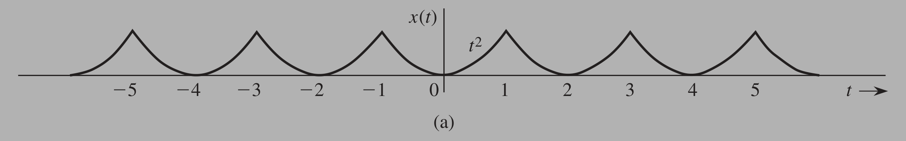{ .lathi-original loading="lazy" }](../../assets/lathi-boulet-batch-07/6.3-11_1.png)

[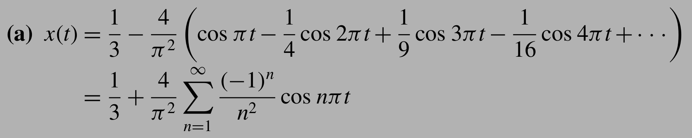{ .lathi-original loading="lazy" }](../../assets/lathi-boulet-batch-07/6.3-11_2.png)

### 20 · Lathi 6.3-12：周期锯齿波的Parseval验证与谐波截断误差 {#exercise-6-3-12}

**对应主题：** Boulet 第4章：Optimality and Convergence of the Fourier Series，p.144；Parseval Theorem，p.150

Lathi 印刷页：674、675、609、608；原 PDF 页序：694、695、629、628

**阅读说明：** 原题跨页，(a)(b)及给定的无穷级数恒等式完整附上；另附图6.7(b)及Drill6.1(b)给出的正弦式和等价紧凑三角式。图示信号在−1<t<1时x(t)=At，周期为2，A为图示幅值。所附傅里叶级数是本题的已知条件，未附功率验证或所求项数的答案。

[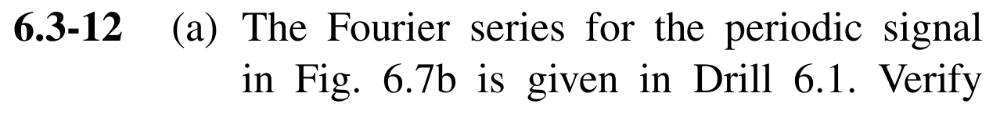{ .lathi-original loading="lazy" }](../../assets/lathi-boulet-batch-07/6.3-12_0.png)

[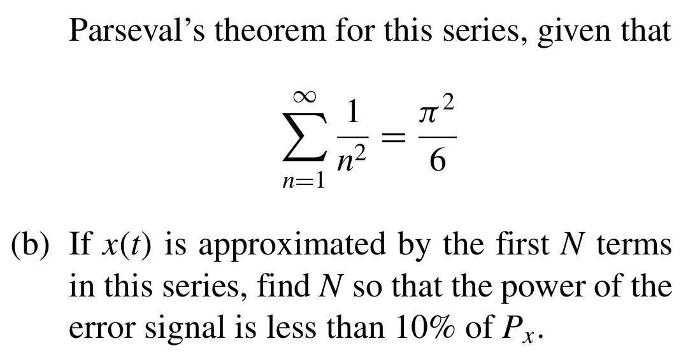{ .lathi-original loading="lazy" }](../../assets/lathi-boulet-batch-07/6.3-12_1.png)

[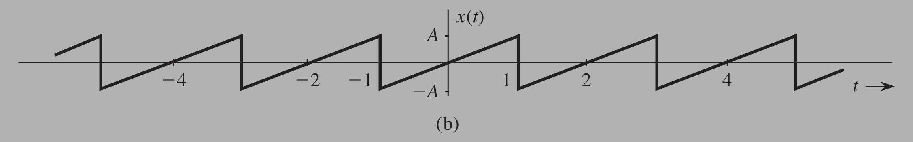{ .lathi-original loading="lazy" }](../../assets/lathi-boulet-batch-07/6.3-12_2.png)

[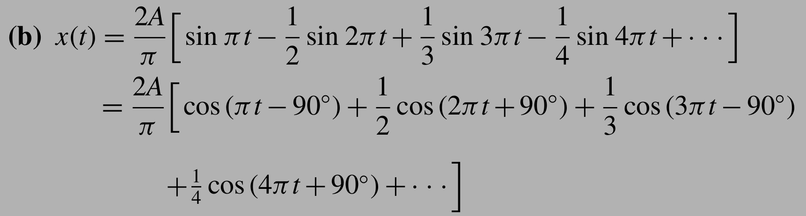{ .lathi-original loading="lazy" }](../../assets/lathi-boulet-batch-07/6.3-12_3.png)

## 来源与使用说明

- B. P. Lathi & R. A. Green, *Linear Systems and Signals*, Third Edition, Oxford University Press, 2018：题号、题干与所需附图按原 PDF 核对
- Benoit Boulet, *Fundamentals of Signals and Systems*：第 1–4 章的主题与印刷页码用于中文学习索引
- Lathi 原 PDF 页序比印刷页码大 20；页面同时列出两种页码，便于回查
- 原题中的必要引用或附图见各题阅读说明；本页与下载 PDF 均不含解答

[第 1 组 20 题](lathi-20-exercises.md) · [第 2 组 20 题](lathi-20-exercises-batch-02.md) · [第 3 组 20 题](lathi-20-exercises-batch-03.md) · [第 4 组 20 题](lathi-20-exercises-batch-04.md) · [第 5 组 20 题](lathi-20-exercises-batch-05.md) · [第 6 组 20 题](lathi-20-exercises-batch-06.md) · [Boulet 总览](index.md) · [前三章全部对应题号](lathi-exercise-map.md)
