# Boulet 前四章 × Lathi：第 8 组 20 道练习

**每章 5 题 · 16 道新题＋4 道复习题 · 原题与必要附图 · 无答案**

[下载第 8 组 PDF（21 页）](../../assets/lathi-boulet-batch-08/Lathi_20_Exercises_Boulet_Chapters_1-4_Batch_08_No_Solutions.pdf){ .md-button .md-button--primary download }

按 Boulet 前四章的知识主题选择 Lathi 第三版习题。本组含 16 道新题和 4 道复习题；复习题在索引、题目标题及来源处明确标注。下方保留原题图像，避免公式转写丢失；点击图片可打开原图放大查看。这里只按知识点匹配，不表示两书的习题一一等价。

[第 1 组 20 题](lathi-20-exercises.md) · [第 2 组 20 题](lathi-20-exercises-batch-02.md) · [第 3 组 20 题](lathi-20-exercises-batch-03.md) · [第 4 组 20 题](lathi-20-exercises-batch-04.md) · [第 5 组 20 题](lathi-20-exercises-batch-05.md) · [第 6 组 20 题](lathi-20-exercises-batch-06.md) · [第 7 组 20 题](lathi-20-exercises-batch-07.md) · [Boulet 总览](index.md)

## 快速索引

| Boulet 章节 | Lathi 题号 |
| --- | --- |
| 第 1 章：信号与系统基础 | [1.1-7](#exercise-1-1-7)、[1.2-2](#exercise-1-2-2)、[1.4-8](#exercise-1-4-8)、[1.5-4](#exercise-1-5-4)、[3.2-5](#exercise-3-2-5) |
| 第 2 章：线性时不变系统与卷积 | [2.4-4](#exercise-2-4-4)、[2.4-30](#exercise-2-4-30)、[2.4-33](#exercise-2-4-33)、[3.8-5](#exercise-3-8-5)、[3.8-17](#exercise-3-8-17) |
| 第 3 章：微分方程、差分方程与系统响应 | [2.2-8](#exercise-2-2-8)、[2.2-9](#exercise-2-2-9)、[3.4-3](#exercise-3-4-3)、[3.4-16](#exercise-3-4-16)、[3.6-7](#exercise-3-6-7) |
| 第 4 章：连续时间傅里叶级数 | [6.1-5](#exercise-6-1-5)（复习）、[6.3-2](#exercise-6-3-2)（复习）、[6.3-13](#exercise-6-3-13)、[6.4-3](#exercise-6-4-3)（复习）、[6.5-6](#exercise-6-5-6)（复习） |

## 第 1 章：信号与系统基础

### 01 · Lathi 1.1-7：半占空比周期锯齿脉冲的能量与功率 {#exercise-1-1-7}

**对应主题：** Boulet 第1章：Periodic Signals，p.8；Finite-Energy and Finite-Power Signals，p.21

Lathi 印刷页：137、138；原 PDF 页序：157、158

[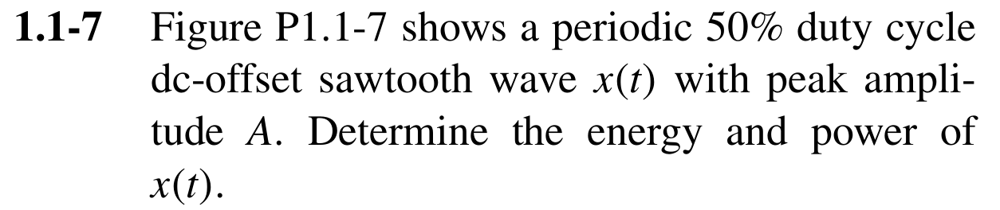{ .lathi-original loading="lazy" }](../../assets/lathi-boulet-batch-08/1.1-7_0.png)

[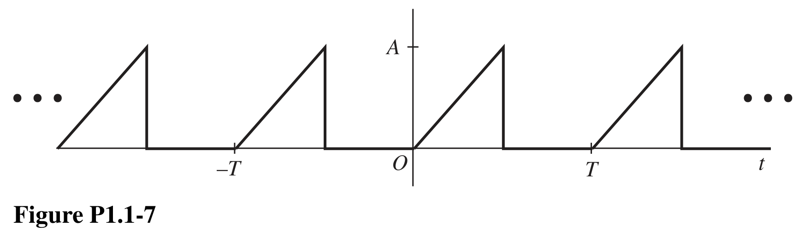{ .lathi-original loading="lazy" }](../../assets/lathi-boulet-batch-08/1.1-7_1.png)

### 02 · Lathi 1.2-2：分段线性波形的平移、反转与伸缩 {#exercise-1-2-2}

**对应主题：** Boulet 第1章：Transformations of the Time Variable，p.4

Lathi 印刷页：138、139；原 PDF 页序：158、159

[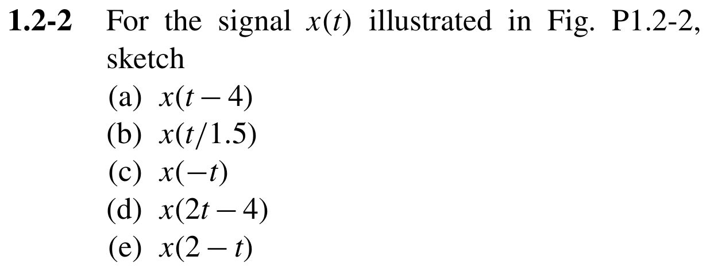{ .lathi-original loading="lazy" }](../../assets/lathi-boulet-batch-08/1.2-2_0.png)

[{ .lathi-original loading="lazy" }](../../assets/lathi-boulet-batch-08/1.2-2_1.png)

### 03 · Lathi 1.4-8：分段线性信号的广义一阶与二阶导数 {#exercise-1-4-8}

**对应主题：** Boulet 第1章：Generalized Functions，p.26

Lathi 印刷页：142、139、141；原 PDF 页序：162、159、161

**阅读说明：** 所需图P1.2-2和图P1.4-2(a)均已附，分别用于(a)、(b)。

[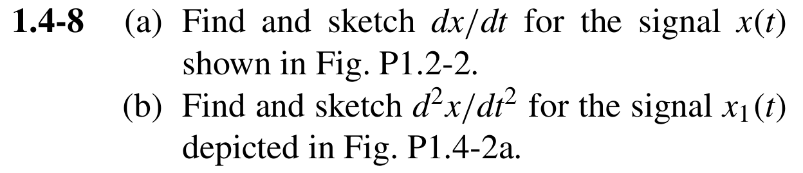{ .lathi-original loading="lazy" }](../../assets/lathi-boulet-batch-08/1.4-8_0.png)

[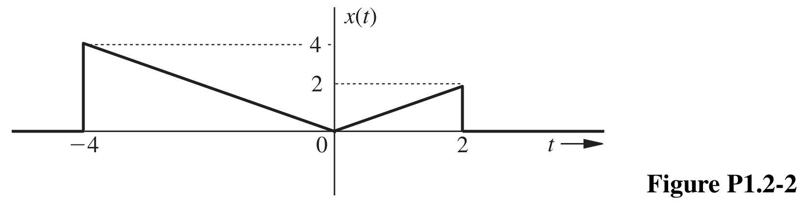{ .lathi-original loading="lazy" }](../../assets/lathi-boulet-batch-08/1.4-8_1.png)

[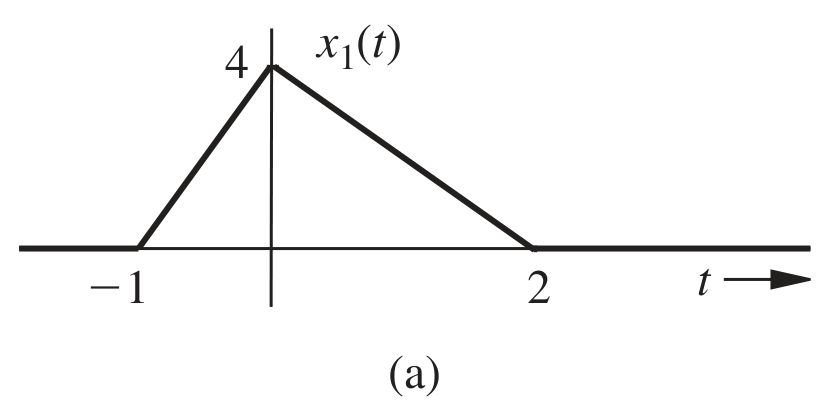{ .lathi-original loading="lazy" }](../../assets/lathi-boulet-batch-08/1.4-8_2.png)

### 04 · Lathi 1.5-4：奇偶分量的正交性与积分性质 {#exercise-1-5-4}

**对应主题：** Boulet 第1章：Even and Odd Signals，p.23

Lathi 印刷页：143；原 PDF 页序：163

[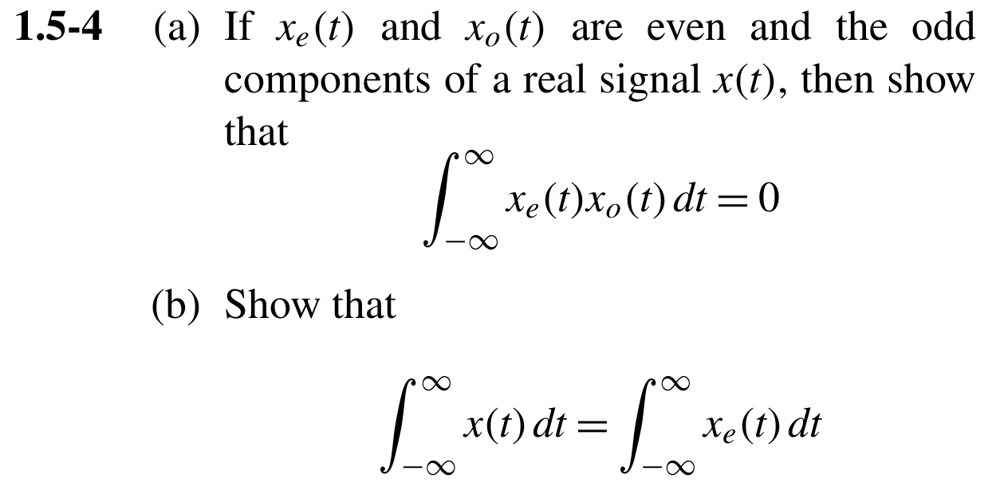{ .lathi-original loading="lazy" }](../../assets/lathi-boulet-batch-08/1.5-4_0.png)

### 05 · Lathi 3.2-5：周期离散序列变换后的能量与功率 {#exercise-3-2-5}

**对应主题：** Boulet 第1章：Transformations of the Time Variable，p.4；Periodic Signals，p.8；Finite-Energy and Finite-Power Signals，p.21

Lathi 印刷页：316；原 PDF 页序：336

**阅读说明：** 保留原书n=0箭头。(b)下标为2−n/3；按原书离散时间扩展约定，下标非整数的位置补零。

[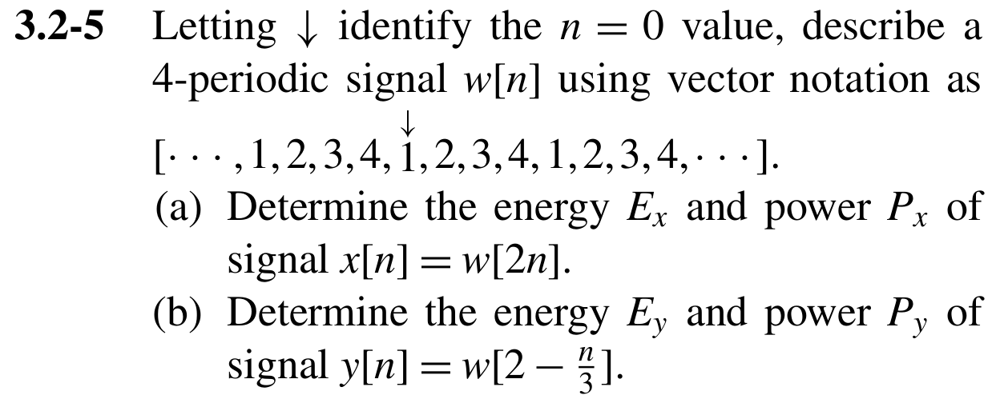{ .lathi-original loading="lazy" }](../../assets/lathi-boulet-batch-08/3.2-5_0.png)

## 第 2 章：线性时不变系统与卷积

### 06 · Lathi 2.4-4：阶跃冲激响应下分段脉冲的图解卷积 {#exercise-2-4-4}

**对应主题：** Boulet 第2章：Continuous-Time LTI Systems: The Convolution Integral，p.67

Lathi 印刷页：225、226；原 PDF 页序：245、246

**阅读说明：** 所需原图P2.4-4已附，保留负脉冲幅值与全部时间刻度。

[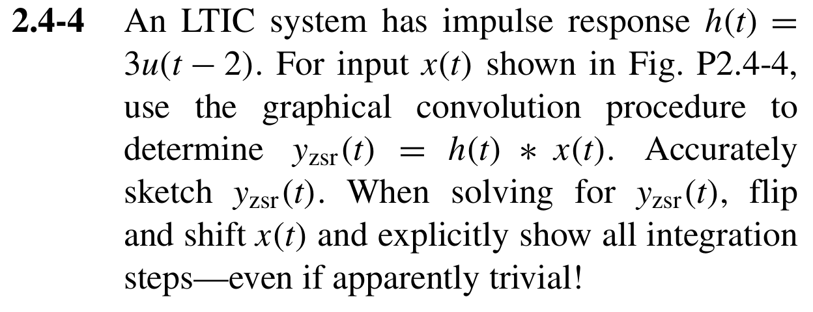{ .lathi-original loading="lazy" }](../../assets/lathi-boulet-batch-08/2.4-4_0.png)

[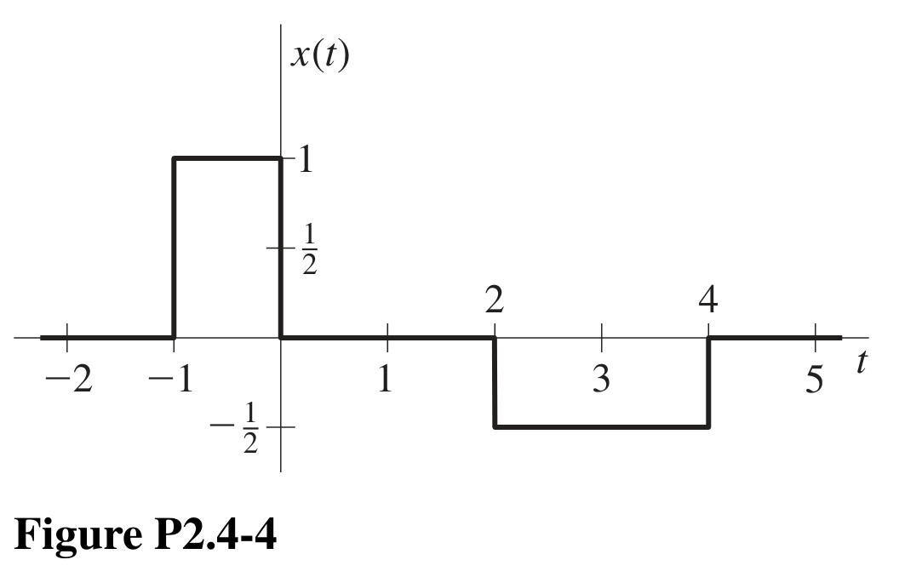{ .lathi-original loading="lazy" }](../../assets/lathi-boulet-batch-08/2.4-4_1.png)

### 07 · Lathi 2.4-30：阶跃输入与分段线性冲激响应的卷积 {#exercise-2-4-30}

**对应主题：** Boulet 第2章：Continuous-Time LTI Systems: The Convolution Integral，p.67

Lathi 印刷页：228、230；原 PDF 页序：248、250

[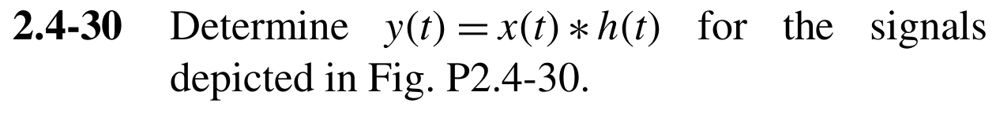{ .lathi-original loading="lazy" }](../../assets/lathi-boulet-batch-08/2.4-30_0.png)

[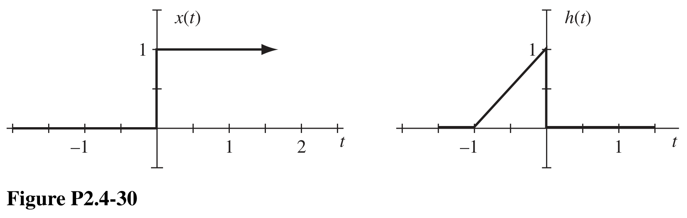{ .lathi-original loading="lazy" }](../../assets/lathi-boulet-batch-08/2.4-30_1.png)

### 08 · Lathi 2.4-33：连续LTI系统并联与串联的等效冲激响应 {#exercise-2-4-33}

**对应主题：** Boulet 第2章：Properties of Linear Time-Invariant Systems，p.74

Lathi 印刷页：230；原 PDF 页序：250

**阅读说明：** 题干(a)-(c)与原图P2.4-33(a)、(b)均完整附上。

[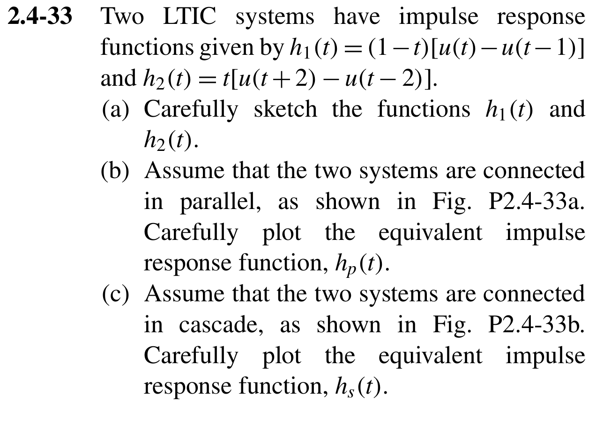{ .lathi-original loading="lazy" }](../../assets/lathi-boulet-batch-08/2.4-33_0.png)

[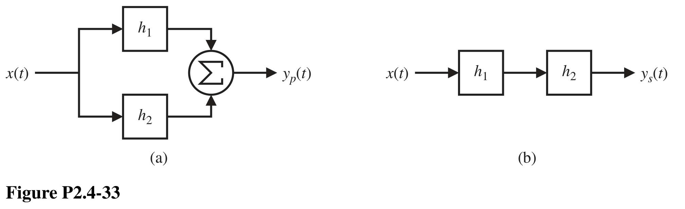{ .lathi-original loading="lazy" }](../../assets/lathi-boulet-batch-08/2.4-33_1.png)

### 09 · Lathi 3.8-5：带时移的离散指数卷积：求和与查表对照 {#exercise-3-8-5}

**对应主题：** Boulet 第2章：Discrete-Time LTI Systems: The Convolution Sum，p.54

Lathi 印刷页：322、285；原 PDF 页序：342、305

**阅读说明：** 原题要求分别用卷积和及表3.1求响应；附表3.1表头和本题所需第4行作为已知参考公式，未代入本题参数求解。

[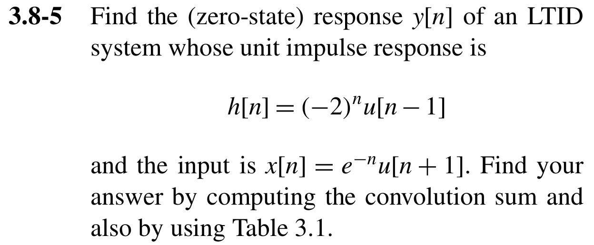{ .lathi-original loading="lazy" }](../../assets/lathi-boulet-batch-08/3.8-5_0.png)

[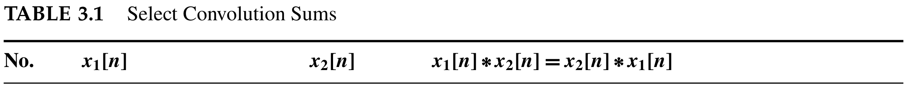{ .lathi-original loading="lazy" }](../../assets/lathi-boulet-batch-08/3.8-5_1.png)

[{ .lathi-original loading="lazy" }](../../assets/lathi-boulet-batch-08/3.8-5_2.png)

### 10 · Lathi 3.8-17：非递归离散系统的阶跃响应与初值需求 {#exercise-3-8-17}

**对应主题：** Boulet 第2章：Discrete-Time LTI Systems: The Convolution Sum，p.54；Properties of Linear Time-Invariant Systems，p.74

Lathi 印刷页：322；原 PDF 页序：342

[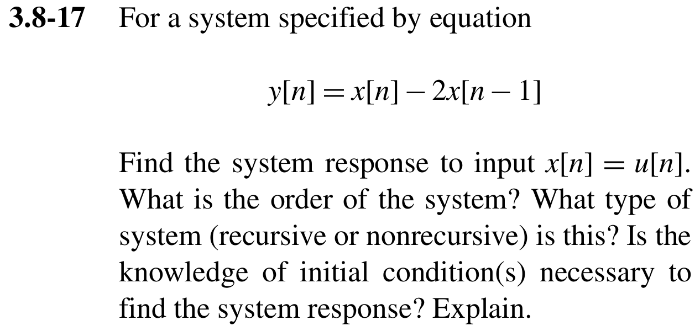{ .lathi-original loading="lazy" }](../../assets/lathi-boulet-batch-08/3.8-17_0.png)

## 第 3 章：微分方程、差分方程与系统响应

### 11 · Lathi 2.2-8：衰减振荡模态的连续系统零输入响应 {#exercise-2-2-8}

**对应主题：** Boulet 第3章：Causal LTI Systems Described by Differential Equations，p.92；Characteristic Polynomials and Stability，p.112

Lathi 印刷页：224；原 PDF 页序：244

**阅读说明：** 展开所引用2.2-4的要求：(a)求特征多项式、特征方程、特征根和特征模态；(b)按给定初值求 t>=0 的零输入响应。初始导数15.98按原书保留。

[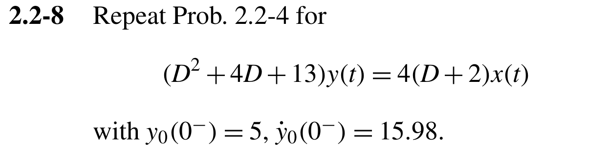{ .lathi-original loading="lazy" }](../../assets/lathi-boulet-batch-08/2.2-8_0.png)

### 12 · Lathi 2.2-9：含重复零特征根系统的初值响应 {#exercise-2-2-9}

**对应主题：** Boulet 第3章：Causal LTI Systems Described by Differential Equations，p.92；Characteristic Polynomials and Stability，p.112

Lathi 印刷页：224；原 PDF 页序：244

**阅读说明：** 展开所引用2.2-4的要求：(a)求特征多项式、特征方程、特征根和特征模态；(b)按给定三个初值求 t>=0 的零输入响应。

[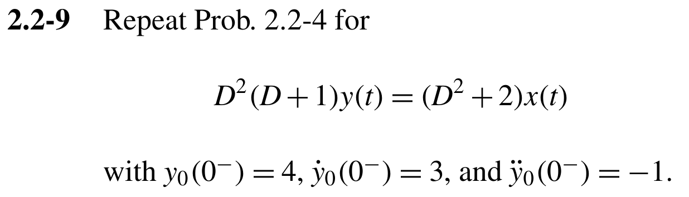{ .lathi-original loading="lazy" }](../../assets/lathi-boulet-batch-08/2.2-9_0.png)

### 13 · Lathi 3.4-3：五点移动平均的差分模型与延迟实现 {#exercise-3-4-3}

**对应主题：** Boulet 第3章：Causal LTI Systems Described by Difference Equations，p.96

Lathi 印刷页：317；原 PDF 页序：337

[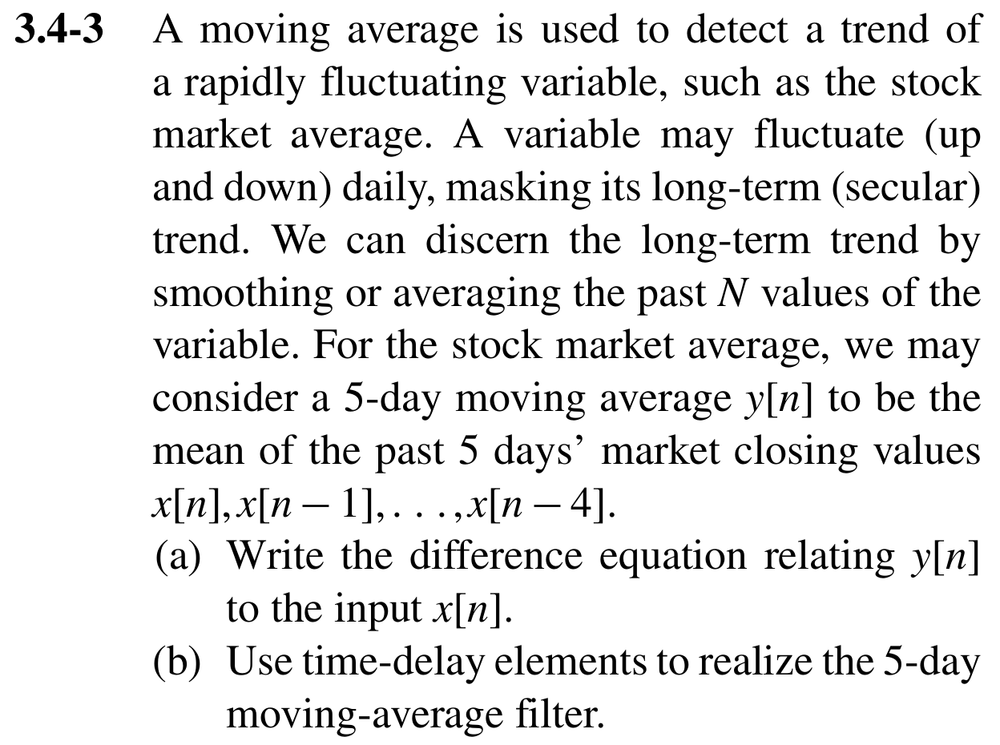{ .lathi-original loading="lazy" }](../../assets/lathi-boulet-batch-08/3.4-3_0.png)

### 14 · Lathi 3.4-16：由位置采样估计速度、加速度及冲激响应 {#exercise-3-4-16}

**对应主题：** Boulet 第3章：Causal LTI Systems Described by Difference Equations，p.96；Impulse Response of a Difference LTI System，p.109

Lathi 印刷页：319；原 PDF 页序：339

**阅读说明：** 原题同页跨栏，采样率、物理导数关系和(a)、(b)均完整附上。

[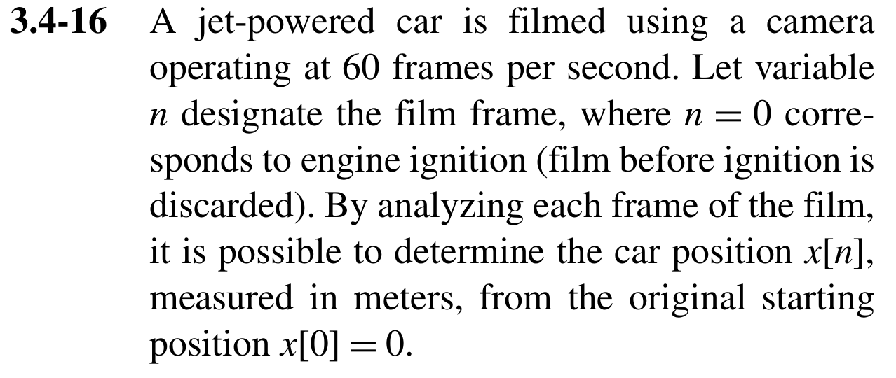{ .lathi-original loading="lazy" }](../../assets/lathi-boulet-batch-08/3.4-16_0.png)

[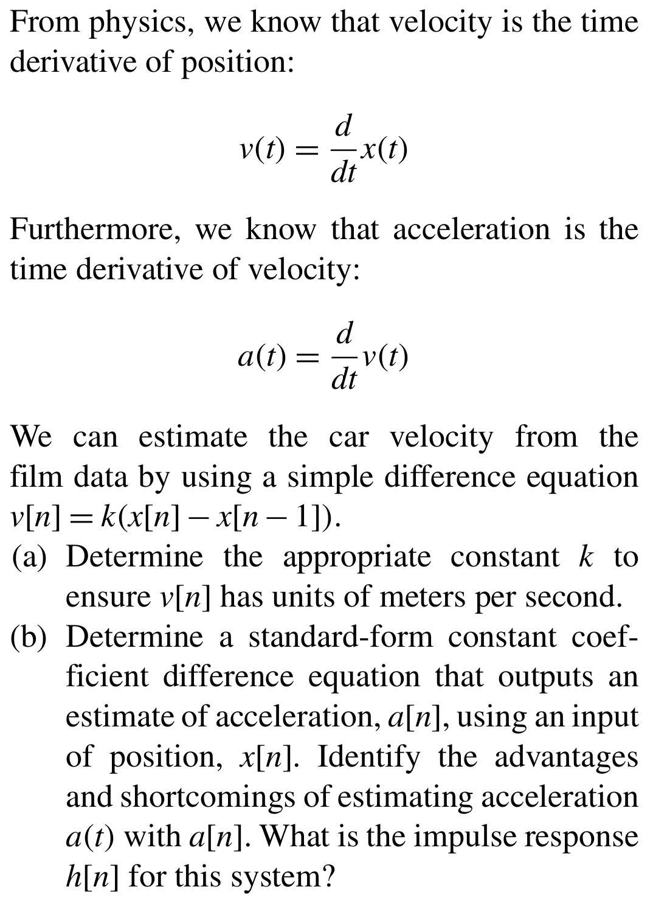{ .lathi-original loading="lazy" }](../../assets/lathi-boulet-batch-08/3.4-16_1.png)

### 15 · Lathi 3.6-7：电阻梯形网络的二阶差分边值问题 {#exercise-3-6-7}

**对应主题：** Boulet 第3章：Causal LTI Systems Described by Difference Equations，p.96；相关差分方程求解练习

Lathi 印刷页：320、318；原 PDF 页序：340、338

**阅读说明：** 所需原图P3.4-8及提示所引差分方程已附；节点编号n=0,1,...,N。本题边界条件在两端给定，并非通常的相邻时间初值。

[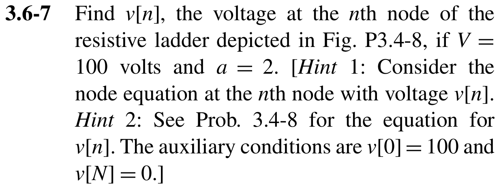{ .lathi-original loading="lazy" }](../../assets/lathi-boulet-batch-08/3.6-7_0.png)

[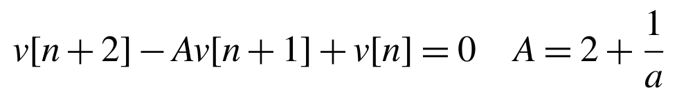{ .lathi-original loading="lazy" }](../../assets/lathi-boulet-batch-08/3.6-7_1.png)

[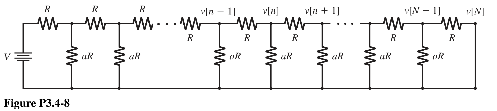{ .lathi-original loading="lazy" }](../../assets/lathi-boulet-batch-08/3.6-7_2.png)

## 第 4 章：连续时间傅里叶级数

### 16 · Lathi 6.1-5：谐波、基频与三角傅里叶级数系数〔复习〕 {#exercise-6-1-5}

**对应主题：** Boulet 第4章：Linear Combinations of Harmonically Related Complex Exponentials，p.132；Determination of the Fourier Series Representation，p.134

Lathi 印刷页：669；原 PDF 页序：689

**复习来源：** [第 1 组 · Lathi 6.1-5](lathi-20-exercises.md#exercise-6-1-5)，保留原题号用于回顾。

**阅读说明：** 复习第1批：本题无需积分，可集中检查基频识别、谐波编号与三角级数系数，为后续谱分析打好基础。已重新核对原书，(a)至(f)全部保留；(c)(d)为复值信号，三角级数系数也可以是复数。

[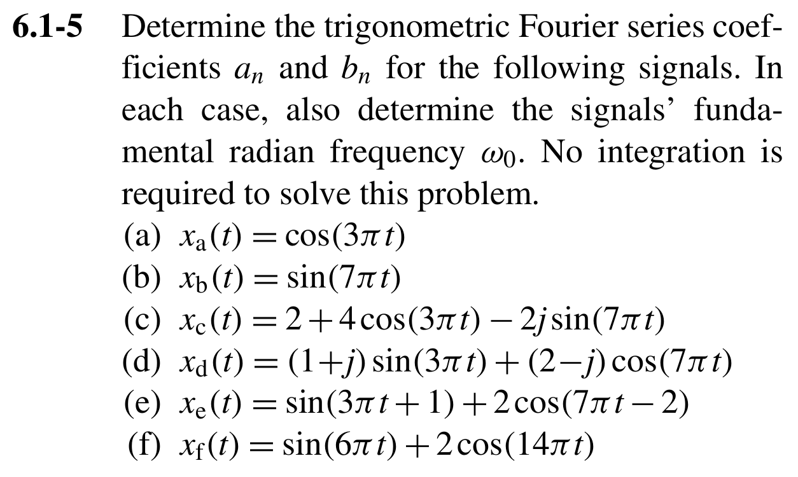{ .lathi-original loading="lazy" }](../../assets/lathi-boulet-batch-08/6.1-5_0.png)

### 17 · Lathi 6.3-2：分段周期信号的复指数傅里叶级数〔复习〕 {#exercise-6-3-2}

**对应主题：** Boulet 第4章：Determination of the Fourier Series Representation of a Continuous-Time Periodic Signal，p.134

Lathi 印刷页：672；原 PDF 页序：692

**复习来源：** [第 1 组 · Lathi 6.3-2](lathi-20-exercises.md#exercise-6-3-2)，保留原题号用于回顾。

**阅读说明：** 复习第1批：重练按一周期分段积分求复指数系数，尤其区分直流项与非零谐波。已重新核对原书，跨栏的题干、分段函数及要求证明的Dn公式均完整保留；所附Dn表达式本来就是原题的证明目标，不是另附解答。

[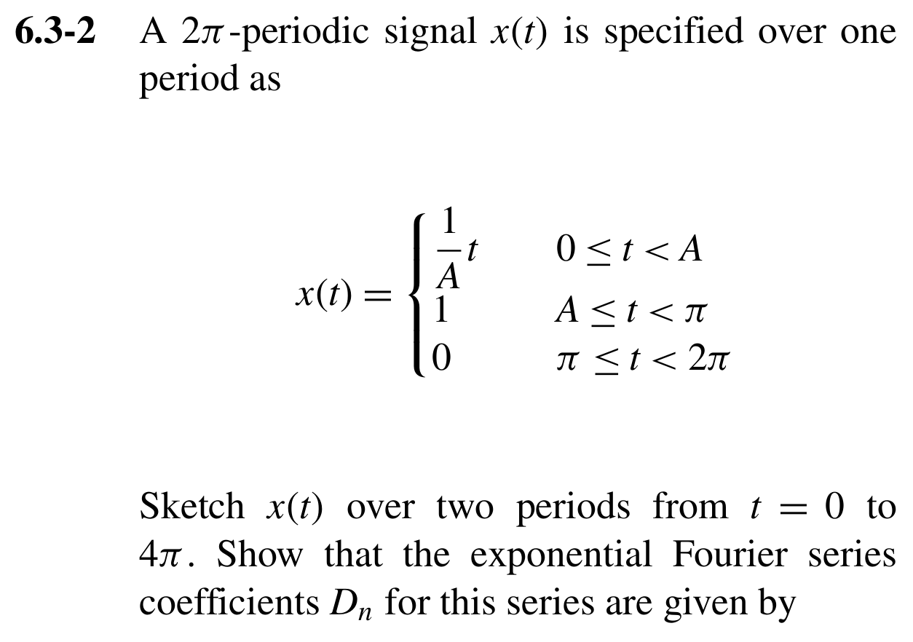{ .lathi-original loading="lazy" }](../../assets/lathi-boulet-batch-08/6.3-2_0.png)

[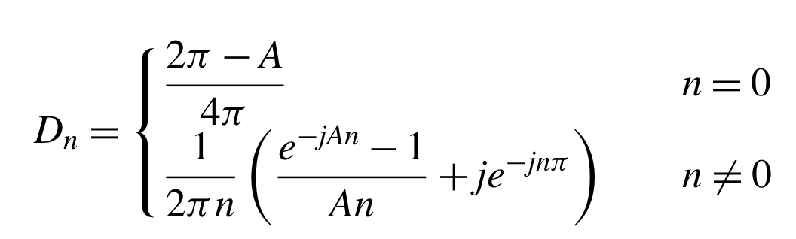{ .lathi-original loading="lazy" }](../../assets/lathi-boulet-batch-08/6.3-2_1.png)

### 18 · Lathi 6.3-13：全波整流正弦波的Parseval功率与谐波截断项数 {#exercise-6-3-13}

**对应主题：** Boulet 第4章：Optimality and Convergence of the Fourier Series，p.144；Parseval Theorem，p.150

Lathi 印刷页：675、631；原 PDF 页序：695、651

**阅读说明：** 本题为新题。完整题干、引用的图6.17及Drill6.5给出的已知指数傅里叶级数均已附。图示信号为x(t)=|sin t|，周期为π；所附已知级数的系数是Dn=2/[π(1−4n²)]。本题明确保留从n=−N至N的2N+1项，要求这些项的功率不低于原信号的99.75%；未附所求N或功率计算的答案。

[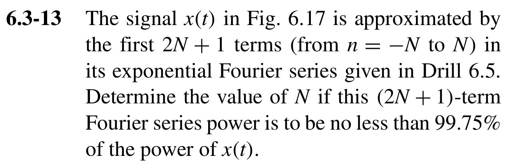{ .lathi-original loading="lazy" }](../../assets/lathi-boulet-batch-08/6.3-13_0.png)

[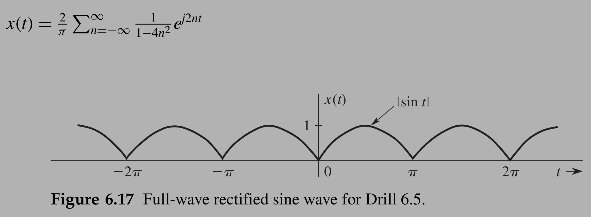{ .lathi-original loading="lazy" }](../../assets/lathi-boulet-batch-08/6.3-13_1.png)

### 19 · Lathi 6.4-3：周期抛物线波经过理想带通滤波器后的稳态输出〔复习〕 {#exercise-6-4-3}

**对应主题：** Boulet 第4章：Determination of the Fourier Series Representation，p.134；Steady-State Response of an LTI System to a Periodic Signal，p.155

Lathi 印刷页：675；原 PDF 页序：695

**复习来源：** [第 1 组 · Lathi 6.4-3](lathi-20-exercises.md#exercise-6-4-3)，保留原题号用于回顾。

**阅读说明：** 复习第1批：把周期波形的系数计算与LTI系统对各谐波的筛选连起来，覆盖Boulet第4章周期稳态响应。已重新核对完整分段定义及(a)至(c)。原题带通滤波器的通带宽度为1 Hz、中心频率为3 Hz，留意Hz与角频率单位的区别。

[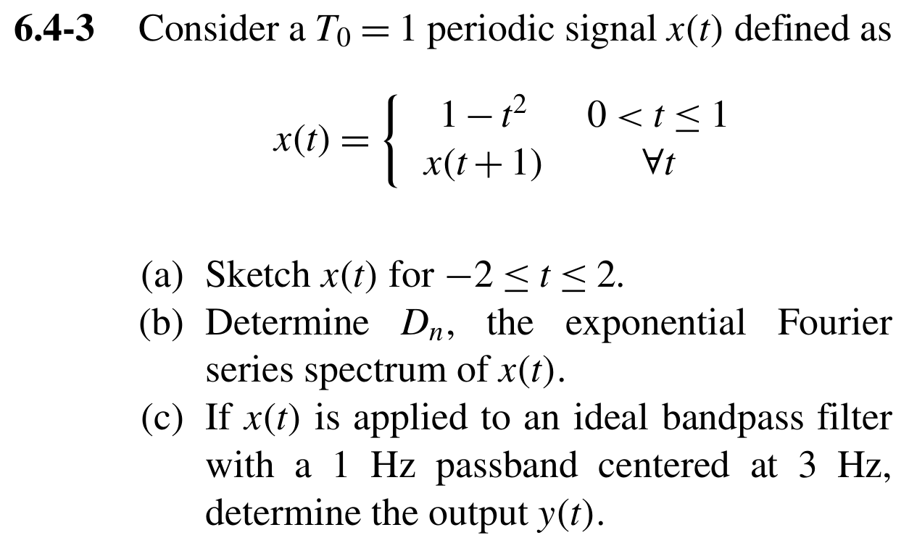{ .lathi-original loading="lazy" }](../../assets/lathi-boulet-batch-08/6.4-3_0.png)

### 20 · Lathi 6.5-6：斜坡信号的有限项傅里叶逼近与误差能量〔复习〕 {#exercise-6-5-6}

**对应主题：** Boulet 第4章：Optimality and Convergence of the Fourier Series，p.144；Parseval Theorem，p.150

Lathi 印刷页：677；原 PDF 页序：697

**复习来源：** [第 1 组 · Lathi 6.5-6](lathi-20-exercises.md#exercise-6-5-6)，保留原题号用于回顾。

**阅读说明：** 复习第1批：重练三角傅里叶级数的截断逼近，用误差能量衡量有限项表示的效果，与Boulet的最优性和Parseval内容直接对应。已重新核对原书并附所需图P6.5-4(a)；只使用该图(a)，不使用图(b)。本题在0<t<1上表示x(t)=t，指定基频为2π；原题first N terms未另行说明直流项是否计入，作答时请写明项数约定。

[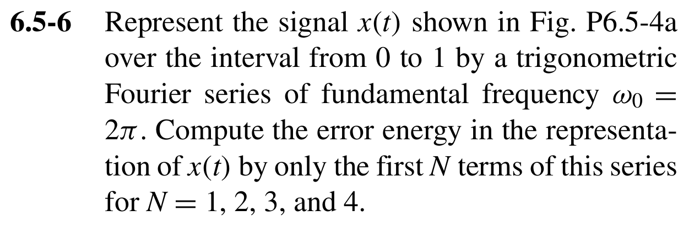{ .lathi-original loading="lazy" }](../../assets/lathi-boulet-batch-08/6.5-6_0.png)

[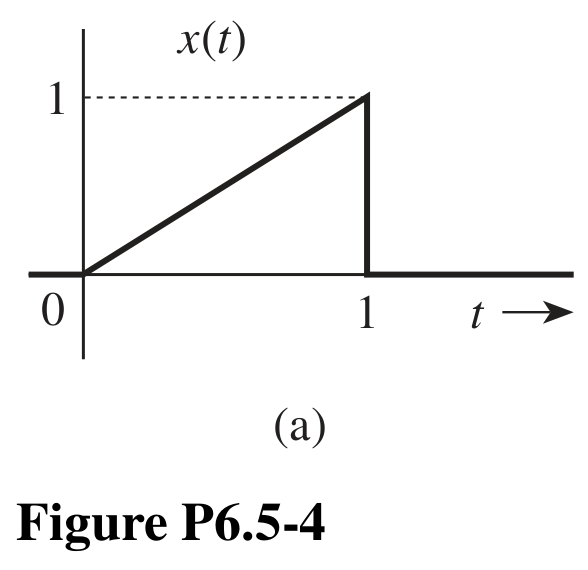{ .lathi-original loading="lazy" }](../../assets/lathi-boulet-batch-08/6.5-6_1.png)

## 来源与使用说明

- B. P. Lathi & R. A. Green, *Linear Systems and Signals*, Third Edition, Oxford University Press, 2018：题号、题干与所需附图按原 PDF 核对
- Benoit Boulet, *Fundamentals of Signals and Systems*：第 1–4 章的主题与印刷页码用于中文学习索引
- Lathi 原 PDF 页序比印刷页码大 20；页面同时列出两种页码，便于回查
- 原题中的必要引用或附图见各题阅读说明；本页与下载 PDF 均不含解答

[第 1 组 20 题](lathi-20-exercises.md) · [第 2 组 20 题](lathi-20-exercises-batch-02.md) · [第 3 组 20 题](lathi-20-exercises-batch-03.md) · [第 4 组 20 题](lathi-20-exercises-batch-04.md) · [第 5 组 20 题](lathi-20-exercises-batch-05.md) · [第 6 组 20 题](lathi-20-exercises-batch-06.md) · [第 7 组 20 题](lathi-20-exercises-batch-07.md) · [Boulet 总览](index.md) · [前三章全部对应题号](lathi-exercise-map.md)
