# Boulet 前四章 × Lathi：第 9 组 20 道练习

**每章 5 题 · 15 道新题＋5 道复习题 · 原题与必要附图 · 无答案**

[下载第 9 组 PDF（22 页）](../../assets/lathi-boulet-batch-09/Lathi_20_Exercises_Boulet_Chapters_1-4_Batch_09_No_Solutions.pdf){ .md-button .md-button--primary download }

按 Boulet 前四章的知识主题选择 Lathi 第三版习题。本组含 15 道新题和 5 道复习题；复习题在索引、题目标题及来源处明确标注。下方保留原题图像，避免公式转写丢失；点击图片可打开原图放大查看。这里只按知识点匹配，不表示两书的习题一一等价。

[第 1 组 20 题](lathi-20-exercises.md) · [第 2 组 20 题](lathi-20-exercises-batch-02.md) · [第 3 组 20 题](lathi-20-exercises-batch-03.md) · [第 4 组 20 题](lathi-20-exercises-batch-04.md) · [第 5 组 20 题](lathi-20-exercises-batch-05.md) · [第 6 组 20 题](lathi-20-exercises-batch-06.md) · [第 7 组 20 题](lathi-20-exercises-batch-07.md) · [第 8 组 20 题](lathi-20-exercises-batch-08.md) · [Boulet 总览](index.md)

## 快速索引

| Boulet 章节 | Lathi 题号 |
| --- | --- |
| 第 1 章：信号与系统基础 | [1.1-1](#exercise-1-1-1)、[1.4-9](#exercise-1-4-9)、[1.5-5](#exercise-1-5-5)、[1.7-6](#exercise-1-7-6)、[3.2-3](#exercise-3-2-3) |
| 第 2 章：线性时不变系统与卷积 | [2.4-35](#exercise-2-4-35)、[2.4-40](#exercise-2-4-40)、[2.4-42](#exercise-2-4-42)、[2.4-48](#exercise-2-4-48)、[3.8-9](#exercise-3-8-9) |
| 第 3 章：微分方程、差分方程与系统响应 | [2.2-10](#exercise-2-2-10)、[2.4-32](#exercise-2-4-32)、[3.4-2](#exercise-3-4-2)、[3.4-4](#exercise-3-4-4)、[3.10-2](#exercise-3-10-2) |
| 第 4 章：连续时间傅里叶级数 | [6.3-3](#exercise-6-3-3)（复习）、[6.3-5](#exercise-6-3-5)（复习）、[6.3-10](#exercise-6-3-10)（复习）、[6.4-2](#exercise-6-4-2)（复习）、[6.5-7](#exercise-6-5-7)（复习） |

## 第 1 章：信号与系统基础

### 01 · Lathi 1.1-1：脉冲信号的能量及幅度、时移影响 {#exercise-1-1-1}

**对应主题：** Boulet 第1章：Finite-Energy and Finite-Power Signals，p.21；Transformations of the Time Variable，p.4

Lathi 印刷页：136；原 PDF 页序：156

**阅读说明：** 原图P1.1-1(a)-(d)四个信号均已完整附上。

[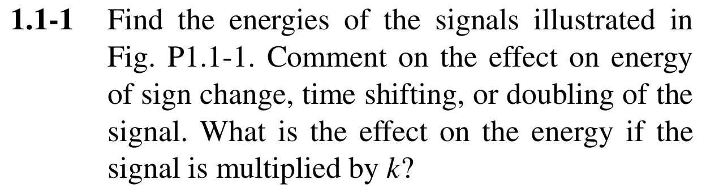{ .lathi-original loading="lazy" }](../../assets/lathi-boulet-batch-09/1.1-1_0.png)

[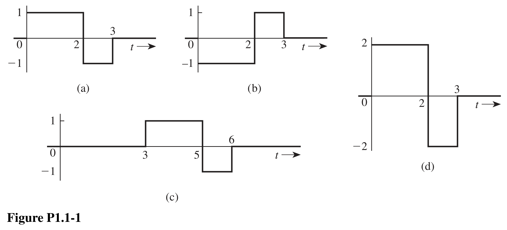{ .lathi-original loading="lazy" }](../../assets/lathi-boulet-batch-09/1.1-1_1.png)

### 02 · Lathi 1.4-9：含冲激的分段信号积分与作图 {#exercise-1-4-9}

**对应主题：** Boulet 第1章：Generalized Functions，p.26

Lathi 印刷页：142；原 PDF 页序：162

**阅读说明：** 原图P1.4-9(a)、(b)均已附，圆圈数字为冲激权重。

[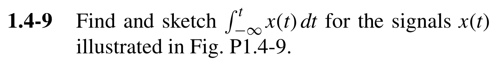{ .lathi-original loading="lazy" }](../../assets/lathi-boulet-batch-09/1.4-9_0.png)

[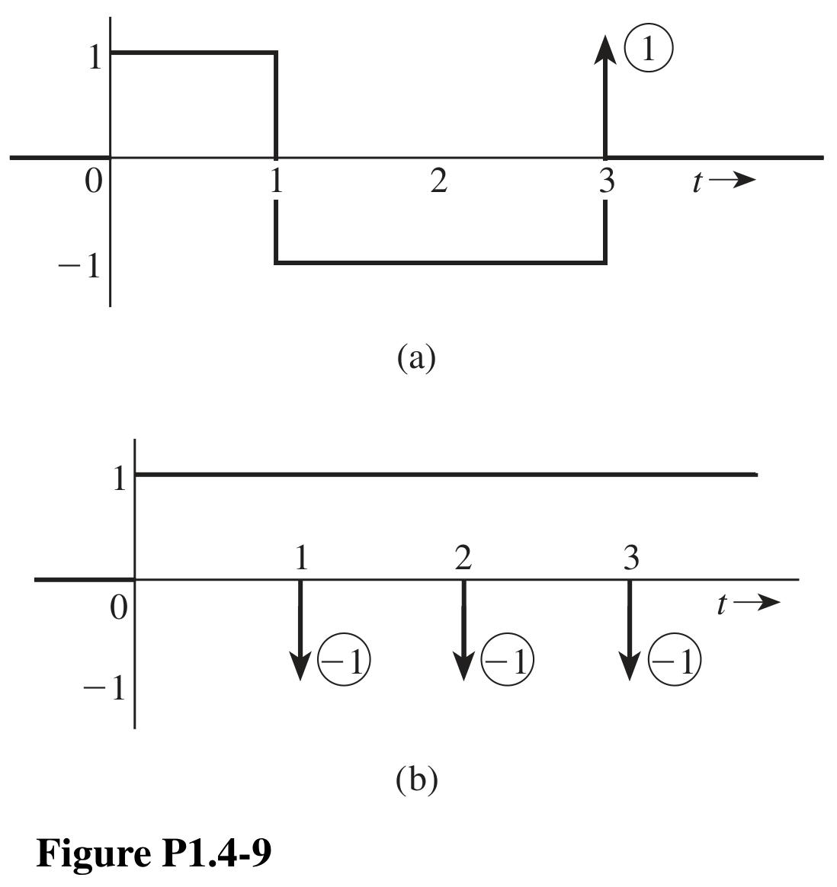{ .lathi-original loading="lazy" }](../../assets/lathi-boulet-batch-09/1.4-9_1.png)

### 03 · Lathi 1.5-5：非周期信号奇分量的周期性 {#exercise-1-5-5}

**对应主题：** Boulet 第1章：Even and Odd Signals，p.23；Periodic Signals，p.8

Lathi 印刷页：143；原 PDF 页序：163

[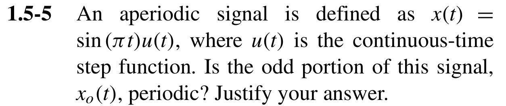{ .lathi-original loading="lazy" }](../../assets/lathi-boulet-batch-09/1.5-5_0.png)

### 04 · Lathi 1.7-6：由输入导数选择支路的系统性质 {#exercise-1-7-6}

**对应主题：** Boulet 第1章：System Models and Basic Properties，p.34

Lathi 印刷页：145；原 PDF 页序：165

**阅读说明：** 展开所引用1.7-4的要求：分别判断系统是否(a)BIBO稳定、(b)因果、(c)可逆、(d)线性、(e)无记忆、(f)时不变；每项回答是或否，并给出数学论证。

[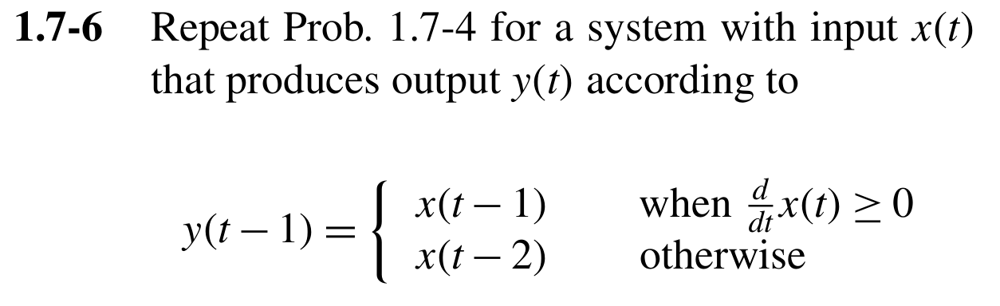{ .lathi-original loading="lazy" }](../../assets/lathi-boulet-batch-09/1.7-6_0.png)

### 05 · Lathi 3.2-3：离散序列的反转、压缩、扩展与原点定位 {#exercise-3-2-3}

**对应主题：** Boulet 第1章：Transformations of the Time Variable，p.4

Lathi 印刷页：316；原 PDF 页序：336

**阅读说明：** 保留原书换行处的n=0箭头；按原书离散时间扩展约定，下标非整数的位置补零。

[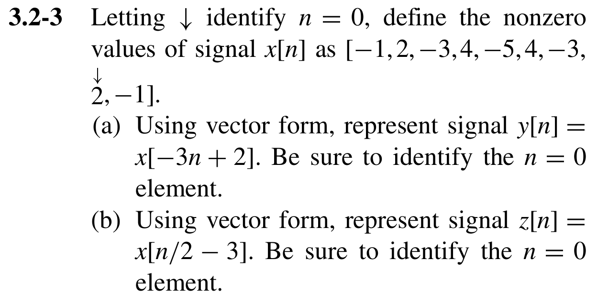{ .lathi-original loading="lazy" }](../../assets/lathi-boulet-batch-09/3.2-3_0.png)

## 第 2 章：线性时不变系统与卷积

### 06 · Lathi 2.4-35：斜坡脉冲与其压缩版本的卷积 {#exercise-2-4-35}

**对应主题：** Boulet 第2章：Continuous-Time LTI Systems: The Convolution Integral，p.67

Lathi 印刷页：231；原 PDF 页序：251

[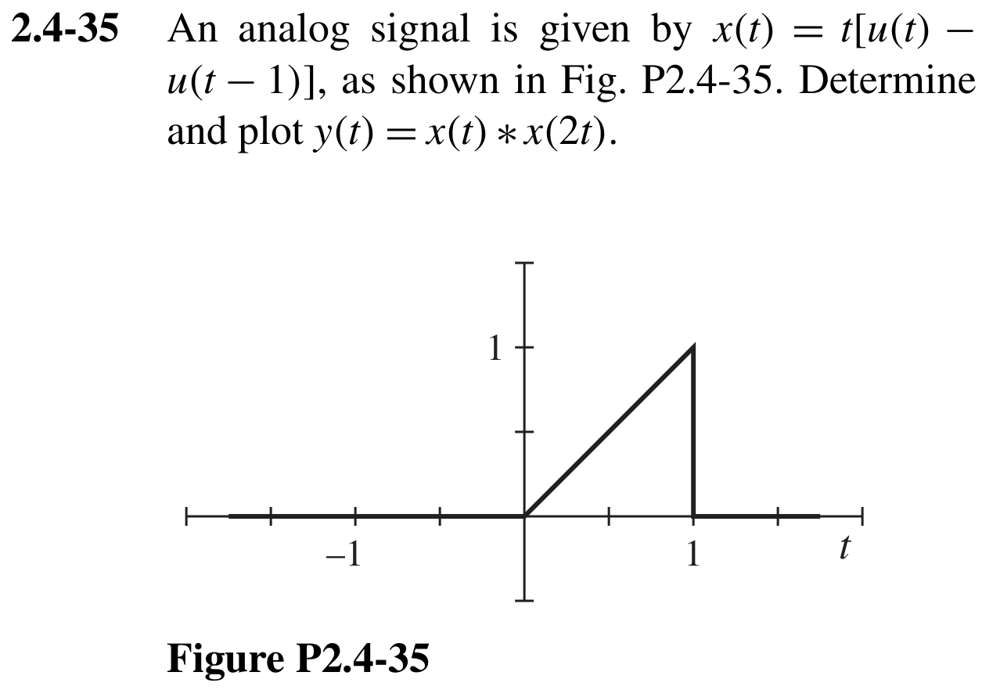{ .lathi-original loading="lazy" }](../../assets/lathi-boulet-batch-09/2.4-35_0.png)

### 07 · Lathi 2.4-40：双边指数冲激响应的因果性与输出 {#exercise-2-4-40}

**对应主题：** Boulet 第2章：Continuous-Time LTI Systems: The Convolution Integral，p.67；Properties of Linear Time-Invariant Systems，p.74

Lathi 印刷页：231；原 PDF 页序：251

[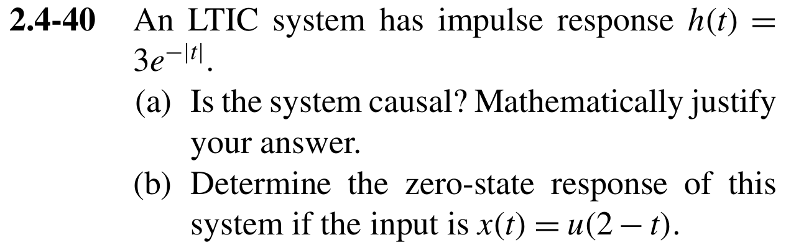{ .lathi-original loading="lazy" }](../../assets/lathi-boulet-batch-09/2.4-40_0.png)

### 08 · Lathi 2.4-42：积分器及其并联、串联冲激响应 {#exercise-2-4-42}

**对应主题：** Boulet 第2章：Properties of Linear Time-Invariant Systems，p.74

Lathi 印刷页：232；原 PDF 页序：252

[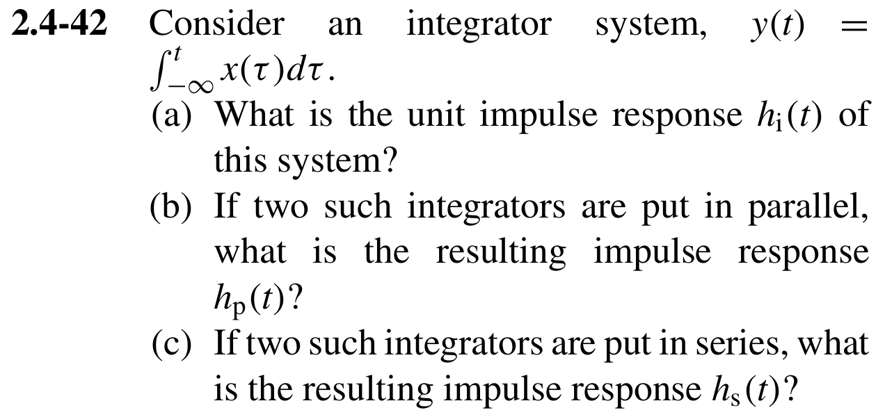{ .lathi-original loading="lazy" }](../../assets/lathi-boulet-batch-09/2.4-42_0.png)

### 09 · Lathi 2.4-48：复值LTI系统的卷积与叠加响应 {#exercise-2-4-48}

**对应主题：** Boulet 第2章：Continuous-Time LTI Systems: The Convolution Integral，p.67；Properties of Linear Time-Invariant Systems，p.74

Lathi 印刷页：233；原 PDF 页序：253

**阅读说明：** 原书(c)写引用part(a)，但(a)仅问因果性；结合题意，该处疑应指(b)所得y1，再利用线性与时不变性质。截图保留原文。

[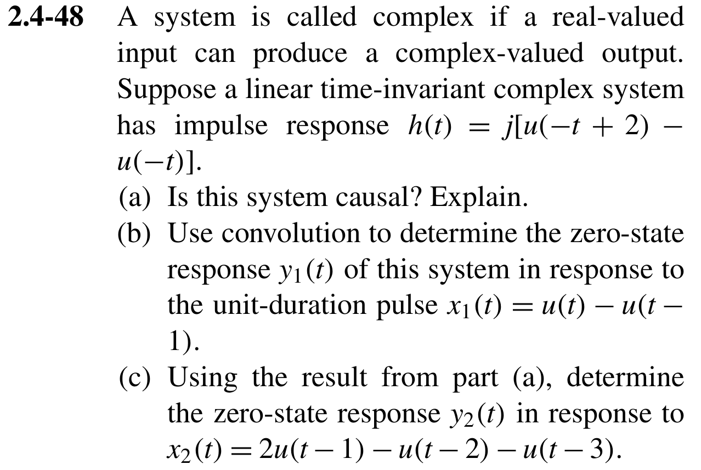{ .lathi-original loading="lazy" }](../../assets/lathi-boulet-batch-09/2.4-48_0.png)

### 10 · Lathi 3.8-9：指数正弦离散冲激响应的查表卷积 {#exercise-3-8-9}

**对应主题：** Boulet 第2章：Discrete-Time LTI Systems: The Convolution Sum，p.54

Lathi 印刷页：322、285；原 PDF 页序：342、305

**阅读说明：** 附原题要求使用的表3.1表头及第10行参考公式，未代入本题参数求解；表中相角phi应注意对应复数的象限。

[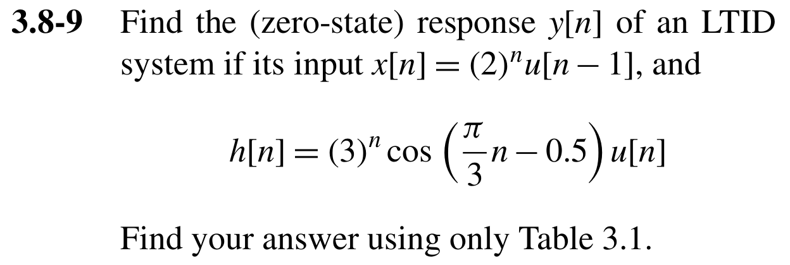{ .lathi-original loading="lazy" }](../../assets/lathi-boulet-batch-09/3.8-9_0.png)

[{ .lathi-original loading="lazy" }](../../assets/lathi-boulet-batch-09/3.8-9_1.png)

[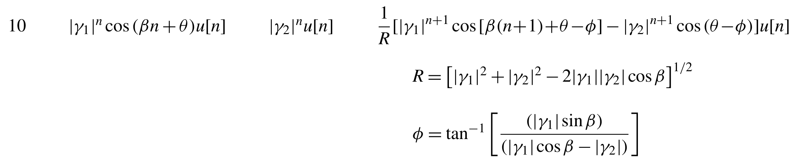{ .lathi-original loading="lazy" }](../../assets/lathi-boulet-batch-09/3.8-9_2.png)

## 第 3 章：微分方程、差分方程与系统响应

### 11 · Lathi 2.2-10：三阶连续系统的特征模态与初值响应 {#exercise-2-2-10}

**对应主题：** Boulet 第3章：Causal LTI Systems Described by Differential Equations，p.92；Characteristic Polynomials and Stability，p.112

Lathi 印刷页：224；原 PDF 页序：244

**阅读说明：** 展开所引用2.2-4的要求：(a)求特征多项式、特征方程、特征根和特征模态；(b)按给定三个初值求 t>=0 的零输入响应。

[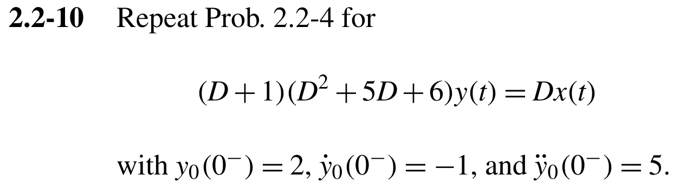{ .lathi-original loading="lazy" }](../../assets/lathi-boulet-batch-09/2.2-10_0.png)

### 12 · Lathi 2.4-32：LC电路的建模、自然模态与完整响应 {#exercise-2-4-32}

**对应主题：** Boulet 第3章：Causal LTI Systems Described by Differential Equations，p.92；Characteristic Polynomials and Stability，p.112

Lathi 印刷页：228、229、230；原 PDF 页序：248、249、250

**阅读说明：** 原题跨页，(a)-(e)及图P2.4-32均已附；(c)的一般参数与(e)给定L=C=1的条件分别按原题使用。

[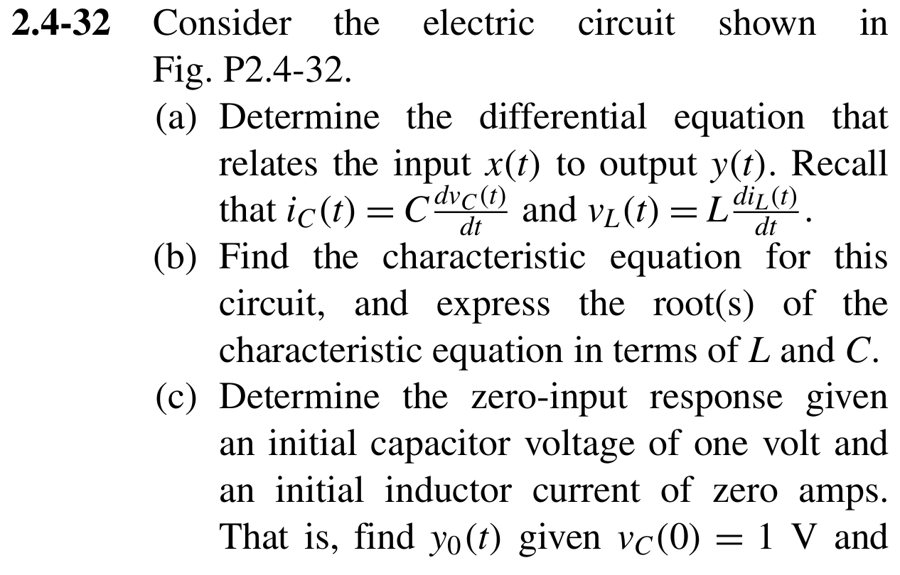{ .lathi-original loading="lazy" }](../../assets/lathi-boulet-batch-09/2.4-32_0.png)

[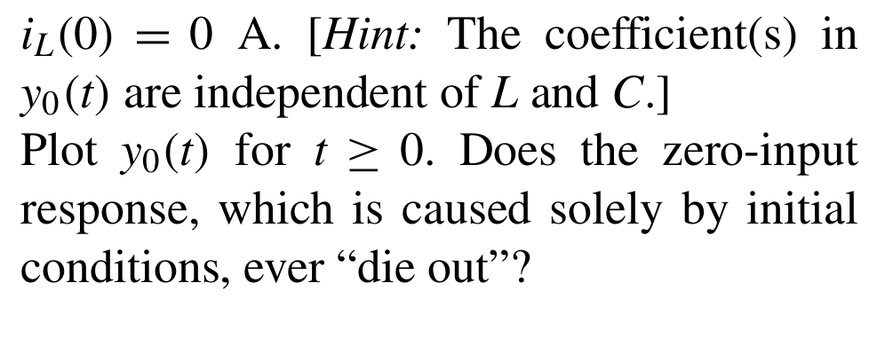{ .lathi-original loading="lazy" }](../../assets/lathi-boulet-batch-09/2.4-32_1.png)

[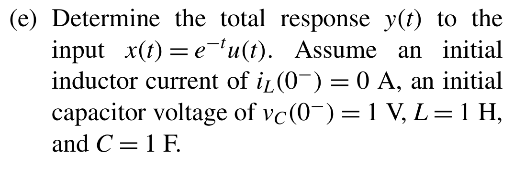{ .lathi-original loading="lazy" }](../../assets/lathi-boulet-batch-09/2.4-32_2.png)

[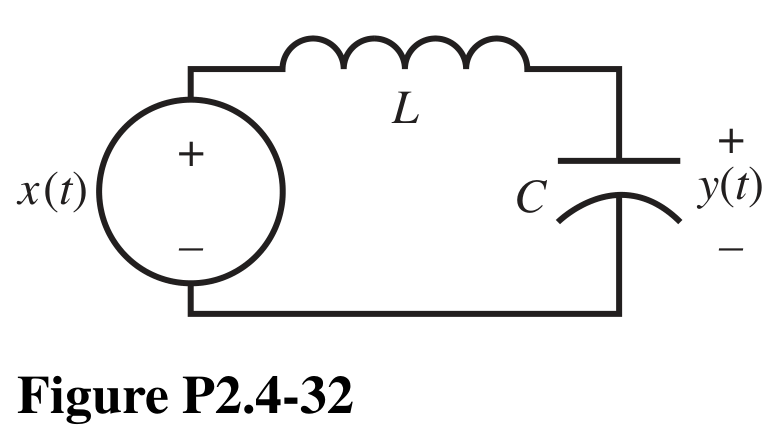{ .lathi-original loading="lazy" }](../../assets/lathi-boulet-batch-09/2.4-32_3.png)

### 13 · Lathi 3.4-2：含出生、死亡与移民的人口差分模型 {#exercise-3-4-2}

**对应主题：** Boulet 第3章：Causal LTI Systems Described by Difference Equations，p.96

Lathi 印刷页：317；原 PDF 页序：337

[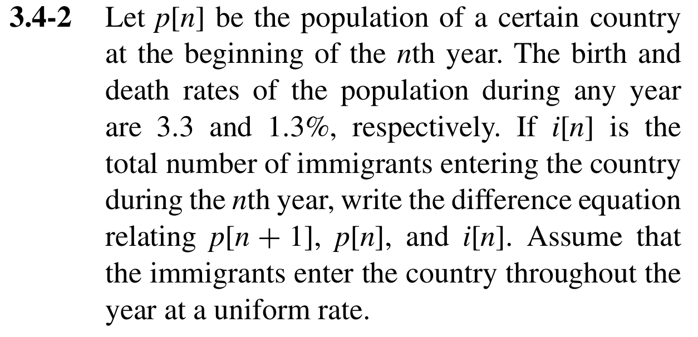{ .lathi-original loading="lazy" }](../../assets/lathi-boulet-batch-09/3.4-2_0.png)

### 14 · Lathi 3.4-4：数字积分器的阶跃响应及连续极限 {#exercise-3-4-4}

**对应主题：** Boulet 第3章：Causal LTI Systems Described by Difference Equations，p.96

Lathi 印刷页：317；原 PDF 页序：337

**阅读说明：** 所引用例3.9的系统方程已在原题中完整给出，无需另读例题演算。

[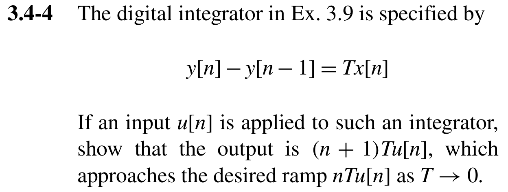{ .lathi-original loading="lazy" }](../../assets/lathi-boulet-batch-09/3.4-4_0.png)

### 15 · Lathi 3.10-2：离散系统的特征模态与实值共振输入 {#exercise-3-10-2}

**对应主题：** Boulet 第3章：Eigenfunctions of LTI Difference and Differential Systems，p.117；Characteristic Polynomials and Stability，p.112

Lathi 印刷页：327；原 PDF 页序：347

[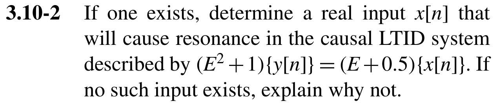{ .lathi-original loading="lazy" }](../../assets/lathi-boulet-batch-09/3.10-2_0.png)

## 第 4 章：连续时间傅里叶级数

### 16 · Lathi 6.3-3：三角与复指数傅里叶级数及幅相线谱转换〔复习〕 {#exercise-6-3-3}

**对应主题：** Boulet 第4章：Determination of the Fourier Series Representation of a Continuous-Time Periodic Signal，pp.134–136；Graph of the Fourier Series Coefficients: The Line Spectrum，p.137

Lathi 印刷页：672；原 PDF 页序：692

**复习来源：** [第 2 组 · Lathi 6.3-3](lathi-20-exercises-batch-02.md#exercise-6-3-3)，保留原题号用于回顾。

**阅读说明：** 复习第2批：重练同频三角项的合并、幅相线谱以及三角级数与复指数级数的互相转换。已重新核对Lathi原书，完整保留给定信号及(a)至(d)；原式三项均含相同的角频率，不能误读成不同谐波。无外部图或公式依赖。

[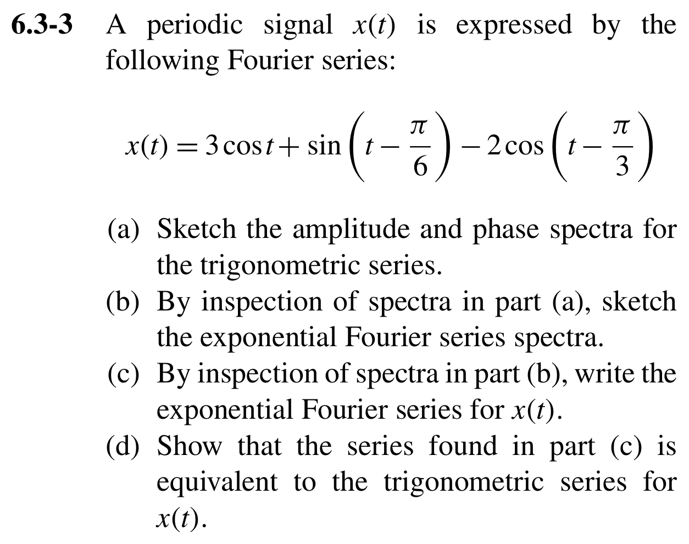{ .lathi-original loading="lazy" }](../../assets/lathi-boulet-batch-09/6.3-3_0.png)

### 17 · Lathi 6.3-5：由复指数傅里叶级数求三角线谱与带宽〔复习〕 {#exercise-6-3-5}

**对应主题：** Boulet 第4章：Determination of the Fourier Series Representation of a Continuous-Time Periodic Signal，pp.134–136；Graph of the Fourier Series Coefficients: The Line Spectrum，p.137

Lathi 印刷页：672、673；原 PDF 页序：692、693

**复习来源：** [第 2 组 · Lathi 6.3-5](lathi-20-exercises-batch-02.md#exercise-6-3-5)，保留原题号用于回顾。

**阅读说明：** 复习第2批：重练从复系数读出双边线谱，再转换为紧凑三角级数并判断带宽。已重新核对Lathi原书，保留p.672末尾的完整给定级数及p.673开头的(a)至(d)，避免跨页漏题；无需附加图。

[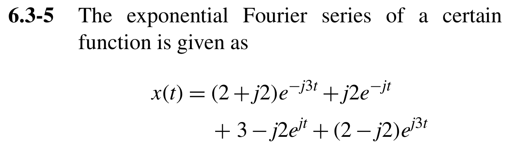{ .lathi-original loading="lazy" }](../../assets/lathi-boulet-batch-09/6.3-5_0.png)

[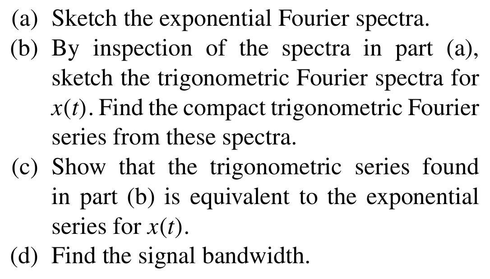{ .lathi-original loading="lazy" }](../../assets/lathi-boulet-batch-09/6.3-5_1.png)

### 18 · Lathi 6.3-10：周期信号时移与时间尺度变换的傅里叶级数性质〔复习〕 {#exercise-6-3-10}

**对应主题：** Boulet 第4章：Properties of Continuous-Time Fourier Series，pp.139–140（Time Shifting、Time Scaling）

Lathi 印刷页：674；原 PDF 页序：694

**复习来源：** [第 2 组 · Lathi 6.3-10](lathi-20-exercises-batch-02.md#exercise-6-3-10)，保留原题号用于回顾。

**阅读说明：** 复习第2批：重练时移与时间尺度变换对级数系数、幅相线谱及谐波频率位置的影响。已重新核对Lathi原书，完整保留左栏题干、(a)和右栏(b)及其直观解释要求；原题列出的关系式属于要求证明的结论，并非另附解答。图P6.3-9属于上一题，本题不依赖该图。

[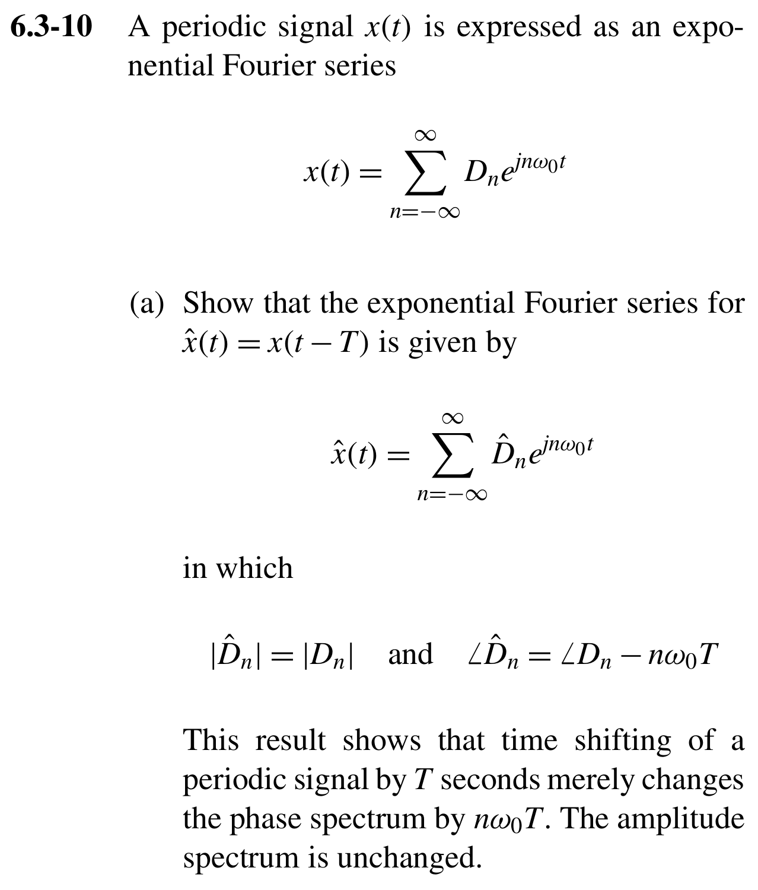{ .lathi-original loading="lazy" }](../../assets/lathi-boulet-batch-09/6.3-10_0.png)

[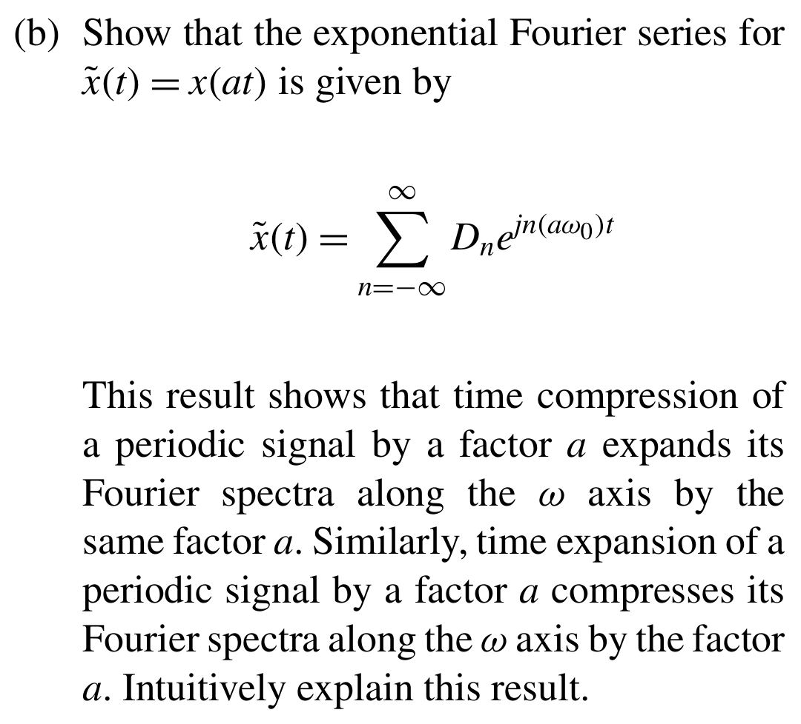{ .lathi-original loading="lazy" }](../../assets/lathi-boulet-batch-09/6.3-10_1.png)

### 19 · Lathi 6.4-2：周期输入经低通、高通、带通和带阻滤波器的稳态响应〔复习〕 {#exercise-6-4-2}

**对应主题：** Boulet 第4章：Steady-State Response of an LTI System to a Periodic Signal，pp.155–156（含Filtering）

Lathi 印刷页：675；原 PDF 页序：695

**复习来源：** [第 2 组 · Lathi 6.4-2](lathi-20-exercises-batch-02.md#exercise-6-4-2)，保留原题号用于回顾。

**阅读说明：** 复习第2批：把基频、傅里叶系数与各谐波经过滤波器后的稳态输出连起来。已重新核对Lathi原书，完整保留给定输入及(a)至(g)，包括最后按指定输出描述滤波器频率响应的要求。注意题目同时使用rad/s和Hz；带宽及中心频率均按原题保留。

[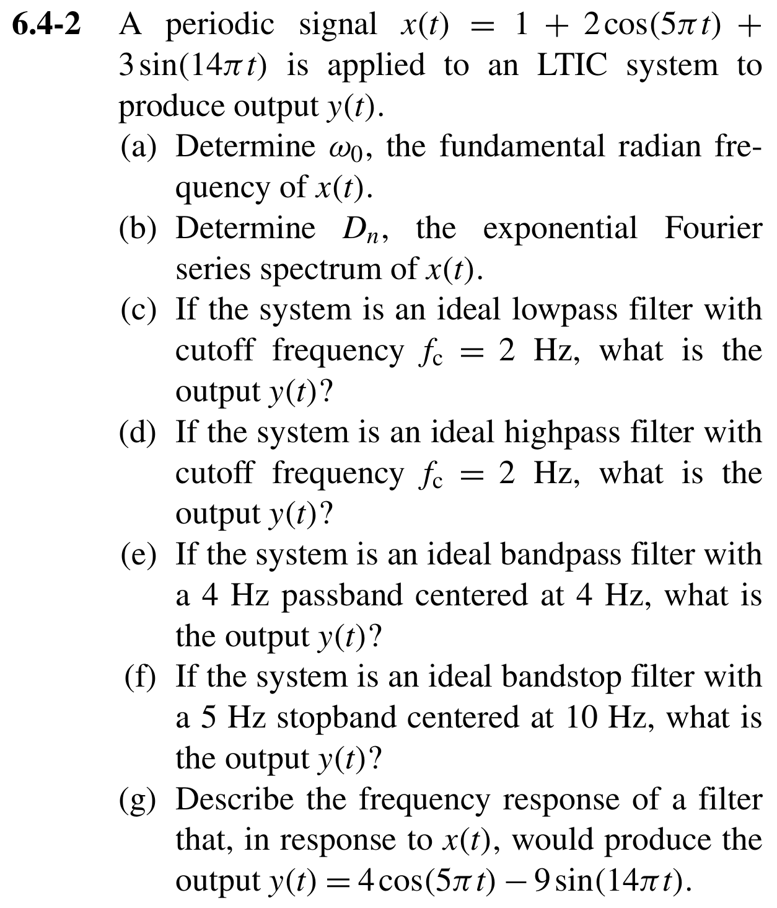{ .lathi-original loading="lazy" }](../../assets/lathi-boulet-batch-09/6.4-2_0.png)

### 20 · Lathi 6.5-7：同一有限区间信号的不同正弦与余弦傅里叶表示〔复习〕 {#exercise-6-5-7}

**对应主题：** Boulet 第4章：Determination of the Fourier Series Representation of a Continuous-Time Periodic Signal，pp.134–136；Properties of Continuous-Time Fourier Series，pp.139–140（对称性与时间反转）

Lathi 印刷页：677；原 PDF 页序：697

**复习来源：** [第 2 组 · Lathi 6.5-7](lathi-20-exercises-batch-02.md#exercise-6-5-7)，保留原题号用于回顾。

**阅读说明：** 复习第2批：重练在指定区间上，按不同周期延拓与正弦/余弦限制建立傅里叶级数。已重新核对Lathi原书，保留(a)至(c)的基频要求，以及必要时允许直流项的原文。题目自足，无需引用相邻题的图；仅涉及三角傅里叶级数，不扩展到Legendre或Walsh等广义正交函数。

[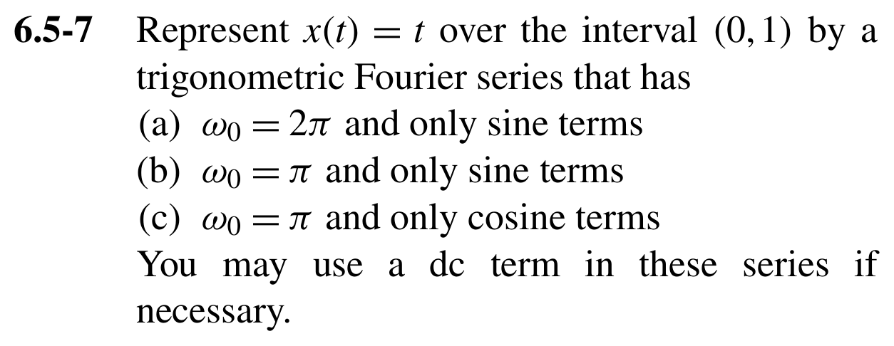{ .lathi-original loading="lazy" }](../../assets/lathi-boulet-batch-09/6.5-7_0.png)

## 来源与使用说明

- B. P. Lathi & R. A. Green, *Linear Systems and Signals*, Third Edition, Oxford University Press, 2018：题号、题干与所需附图按原 PDF 核对
- Benoit Boulet, *Fundamentals of Signals and Systems*：第 1–4 章的主题与印刷页码用于中文学习索引
- Lathi 原 PDF 页序比印刷页码大 20；页面同时列出两种页码，便于回查
- 原题中的必要引用或附图见各题阅读说明；本页与下载 PDF 均不含解答

[第 1 组 20 题](lathi-20-exercises.md) · [第 2 组 20 题](lathi-20-exercises-batch-02.md) · [第 3 组 20 题](lathi-20-exercises-batch-03.md) · [第 4 组 20 题](lathi-20-exercises-batch-04.md) · [第 5 组 20 题](lathi-20-exercises-batch-05.md) · [第 6 组 20 题](lathi-20-exercises-batch-06.md) · [第 7 组 20 题](lathi-20-exercises-batch-07.md) · [第 8 组 20 题](lathi-20-exercises-batch-08.md) · [Boulet 总览](index.md) · [前三章全部对应题号](lathi-exercise-map.md)
