# Boulet 前四章 × Lathi：第 10 组 20 道练习

**每章 5 题 · 15 道新题＋5 道复习题 · 原题与必要附图 · 无答案**

[下载第 10 组 PDF（21 页）](../../assets/lathi-boulet-batch-10/Lathi_20_Exercises_Boulet_Chapters_1-4_Batch_10_No_Solutions.pdf){ .md-button .md-button--primary download }

按 Boulet 前四章的知识主题选择 Lathi 第三版习题。本组含 15 道新题和 5 道复习题；复习题在索引、题目标题及来源处明确标注。下方保留原题图像，避免公式转写丢失；点击图片可打开原图放大查看。这里只按知识点匹配，不表示两书的习题一一等价。

[第 1 组 20 题](lathi-20-exercises.md) · [第 2 组 20 题](lathi-20-exercises-batch-02.md) · [第 3 组 20 题](lathi-20-exercises-batch-03.md) · [第 4 组 20 题](lathi-20-exercises-batch-04.md) · [第 5 组 20 题](lathi-20-exercises-batch-05.md) · [第 6 组 20 题](lathi-20-exercises-batch-06.md) · [第 7 组 20 题](lathi-20-exercises-batch-07.md) · [第 8 组 20 题](lathi-20-exercises-batch-08.md) · [第 9 组 20 题](lathi-20-exercises-batch-09.md) · [Boulet 总览](index.md)

## 快速索引

| Boulet 章节 | Lathi 题号 |
| --- | --- |
| 第 1 章：信号与系统基础 | [1.1-4](#exercise-1-1-4)、[1.3-2](#exercise-1-3-2)、[1.4-7](#exercise-1-4-7)、[1.7-7](#exercise-1-7-7)、[3.3-8](#exercise-3-3-8) |
| 第 2 章：线性时不变系统与卷积 | [2.4-38](#exercise-2-4-38)、[2.5-8](#exercise-2-5-8)、[3.8-26](#exercise-3-8-26)、[3.8-27](#exercise-3-8-27)、[3.8-31](#exercise-3-8-31) |
| 第 3 章：微分方程、差分方程与系统响应 | [2.4-34](#exercise-2-4-34)、[2.4-36](#exercise-2-4-36)、[3.4-5](#exercise-3-4-5)、[3.8-37](#exercise-3-8-37)、[3.8-38](#exercise-3-8-38) |
| 第 4 章：连续时间傅里叶级数 | [6.1-8](#exercise-6-1-8)（复习）、[6.3-14](#exercise-6-3-14)（复习）、[6.3-15](#exercise-6-3-15)（复习）、[6.4-4](#exercise-6-4-4)（复习）、[6.5-4](#exercise-6-5-4)（复习） |

## 第 1 章：信号与系统基础

### 01 · Lathi 1.1-4：周期三次波的功率、均方根值及幅度缩放 {#exercise-1-1-4}

**对应主题：** Boulet 第1章：Finite-Energy and Finite-Power Signals，p.21；Periodic Signals，p.8

Lathi 印刷页：136、137；原 PDF 页序：156、157

[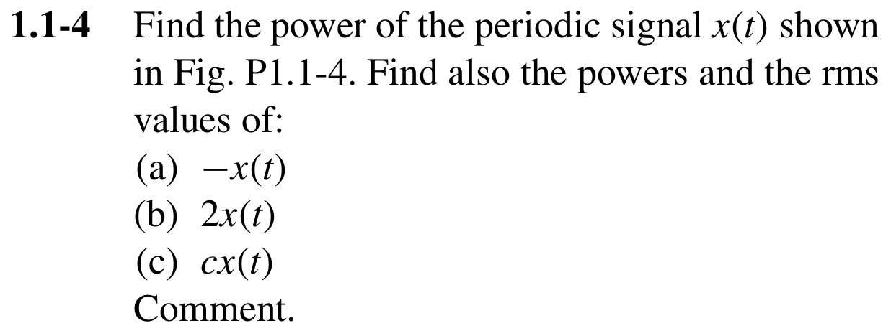{ .lathi-original loading="lazy" }](../../assets/lathi-boulet-batch-10/1.1-4_0.png)

[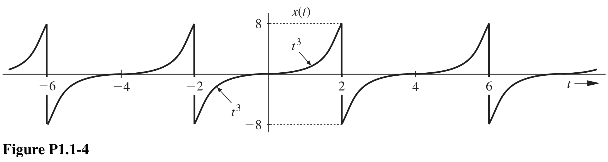{ .lathi-original loading="lazy" }](../../assets/lathi-boulet-batch-10/1.1-4_1.png)

### 02 · Lathi 1.3-2：信号反转平移与周期复制 {#exercise-1-3-2}

**对应主题：** Boulet 第1章：Transformations of the Time Variable，p.4；Periodic Signals，p.8

Lathi 印刷页：140；原 PDF 页序：160

[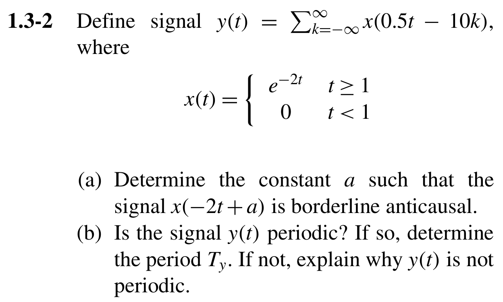{ .lathi-original loading="lazy" }](../../assets/lathi-boulet-batch-10/1.3-2_0.png)

### 03 · Lathi 1.4-7：冲激时间缩放后的全轴积分 {#exercise-1-4-7}

**对应主题：** Boulet 第1章：Generalized Functions，p.26

Lathi 印刷页：142；原 PDF 页序：162

[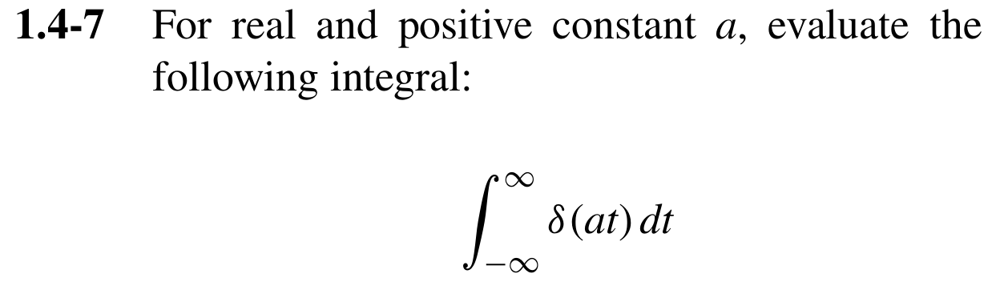{ .lathi-original loading="lazy" }](../../assets/lathi-boulet-batch-10/1.4-7_0.png)

### 04 · Lathi 1.7-7：斜坡乘法系统的基本性质 {#exercise-1-7-7}

**对应主题：** Boulet 第1章：System Models and Basic Properties，p.34

Lathi 印刷页：145；原 PDF 页序：165

**阅读说明：** 展开所引用1.7-4的要求：分别判断系统是否(a)BIBO稳定、(b)因果、(c)可逆、(d)线性、(e)无记忆、(f)时不变；每项回答是或否，并给出数学论证。

[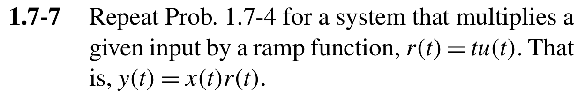{ .lathi-original loading="lazy" }](../../assets/lathi-boulet-batch-10/1.7-7_0.png)

### 05 · Lathi 3.3-8：复频率与离散指数底数的相互表示 {#exercise-3-3-8}

**对应主题：** Boulet 第1章：Exponential Signals，p.9；Periodic Complex Exponential and Sinusoidal Signals，p.17

Lathi 印刷页：317；原 PDF 页序：337

[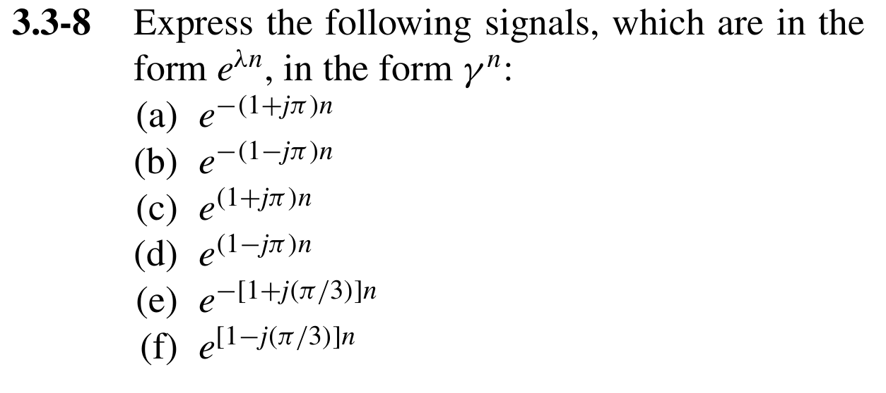{ .lathi-original loading="lazy" }](../../assets/lathi-boulet-batch-10/3.3-8_0.png)

## 第 2 章：线性时不变系统与卷积

### 06 · Lathi 2.4-38：周期矩形波经有限斜坡冲激响应的卷积 {#exercise-2-4-38}

**对应主题：** Boulet 第2章：Continuous-Time LTI Systems: The Convolution Integral，p.67

Lathi 印刷页：231；原 PDF 页序：251

**阅读说明：** 所需原图P2.4-38的周期输入x(t)及冲激响应h(t)均完整附上。

[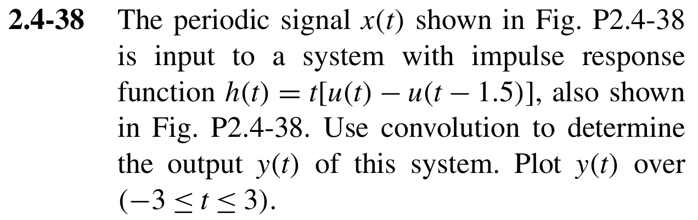{ .lathi-original loading="lazy" }](../../assets/lathi-boulet-batch-10/2.4-38_0.png)

[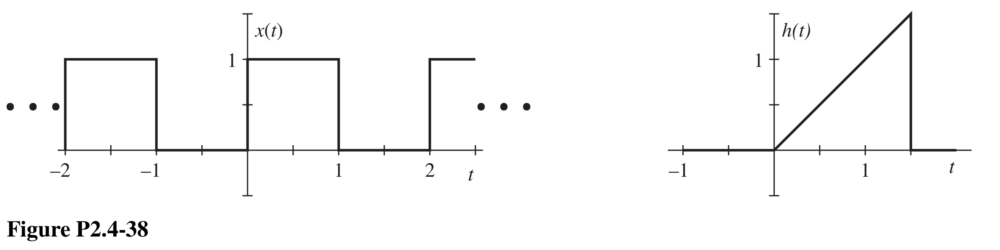{ .lathi-original loading="lazy" }](../../assets/lathi-boulet-batch-10/2.4-38_1.png)

### 07 · Lathi 2.5-8：有限斜坡输入的卷积输出、稳定性与因果性 {#exercise-2-5-8}

**对应主题：** Boulet 第2章：Continuous-Time LTI Systems: The Convolution Integral，p.67；Properties of Linear Time-Invariant Systems，p.74

Lathi 印刷页：233；原 PDF 页序：253

[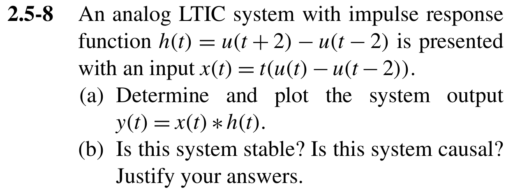{ .lathi-original loading="lazy" }](../../assets/lathi-boulet-batch-10/2.5-8_0.png)

### 08 · Lathi 3.8-26：有限序列的幅度缩放、时移与卷积索引 {#exercise-3-8-26}

**对应主题：** Boulet 第2章：Discrete-Time LTI Systems: The Convolution Sum，p.54；Properties of Linear Time-Invariant Systems，p.74

Lathi 印刷页：324；原 PDF 页序：344

**阅读说明：** 保留两组序列的n=0箭头；答案须标明最左侧非零样本的时间索引。

[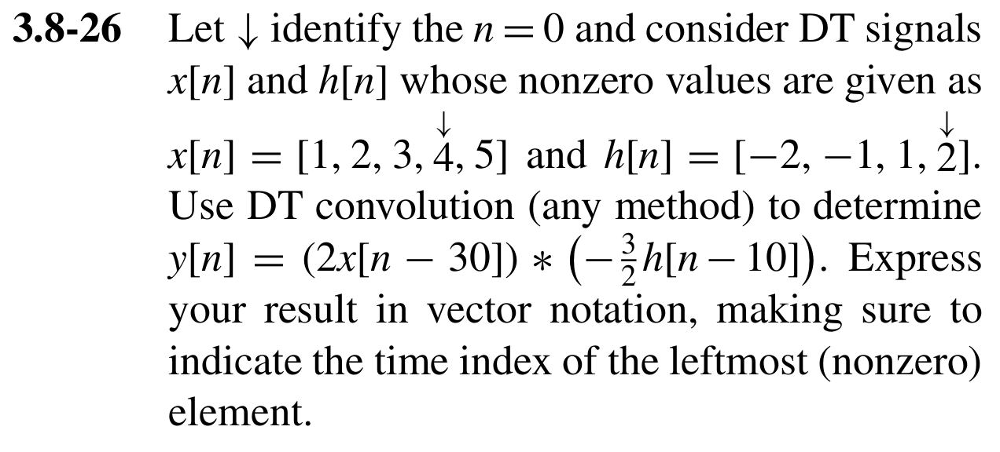{ .lathi-original loading="lazy" }](../../assets/lathi-boulet-batch-10/3.8-26_0.png)

### 09 · Lathi 3.8-27：用滑动序列法证明阶跃与矩形序列卷积 {#exercise-3-8-27}

**对应主题：** Boulet 第2章：Discrete-Time LTI Systems: The Convolution Sum，p.54

Lathi 印刷页：324；原 PDF 页序：344

**阅读说明：** 原题列出的等式是要求证明的目标，并非另附解答。

[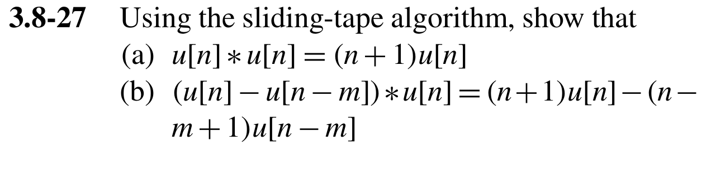{ .lathi-original loading="lazy" }](../../assets/lathi-boulet-batch-10/3.8-27_0.png)

### 10 · Lathi 3.8-31：由有限输入输出序列反求冲激响应 {#exercise-3-8-31}

**对应主题：** Boulet 第2章：Discrete-Time LTI Systems: The Convolution Sum，p.54

Lathi 印刷页：324；原 PDF 页序：344

**阅读说明：** 保留输入、输出两组序列的n=0箭头。

[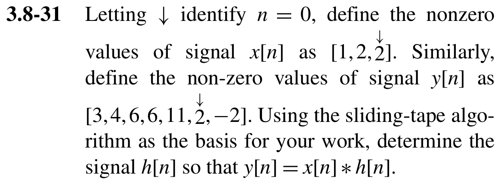{ .lathi-original loading="lazy" }](../../assets/lathi-boulet-batch-10/3.8-31_0.png)

## 第 3 章：微分方程、差分方程与系统响应

### 11 · Lathi 2.4-34：RC电路的阶跃响应与指定时刻初值设计 {#exercise-2-4-34}

**对应主题：** Boulet 第3章：Causal LTI Systems Described by Differential Equations，p.92；Time Constant and Natural Frequency of a First-Order LTI Differential System，p.116

Lathi 印刷页：230；原 PDF 页序：250

**阅读说明：** 题干(a)、(b)及图P2.4-34全部附上；R、C按原题保留为符号参数。

[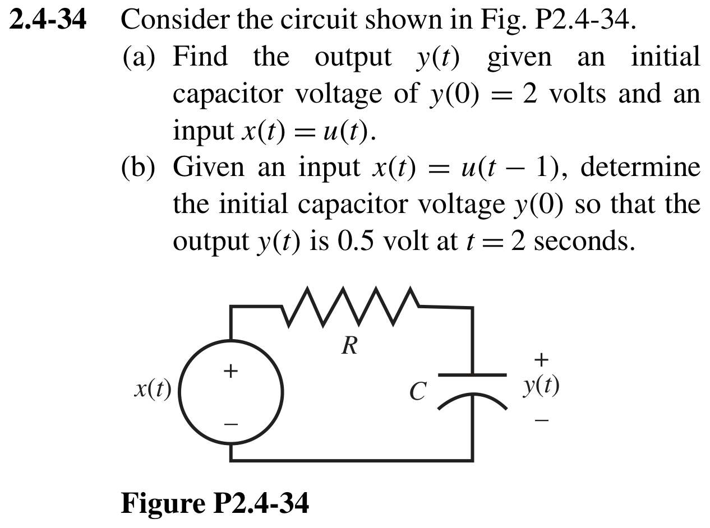{ .lathi-original loading="lazy" }](../../assets/lathi-boulet-batch-10/2.4-34_0.png)

### 12 · Lathi 2.4-36：电阻与双电感电路的微分模型和零输入响应 {#exercise-2-4-36}

**对应主题：** Boulet 第3章：Causal LTI Systems Described by Differential Equations，p.92；Characteristic Polynomials and Stability，p.112

Lathi 印刷页：231；原 PDF 页序：251

**阅读说明：** 题干(a)-(c)、电感关系和图P2.4-36完整附上；初始电流均为1 A。

[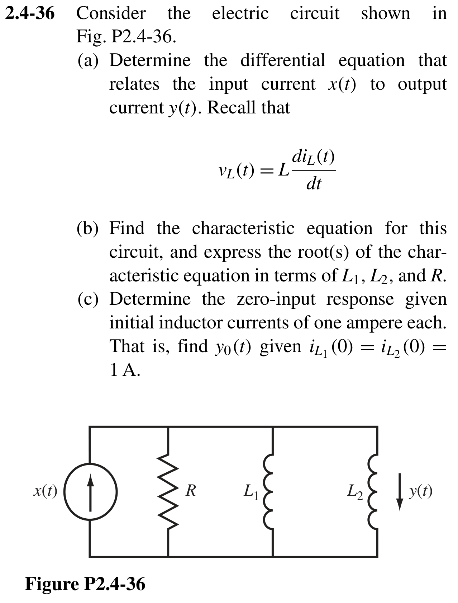{ .lathi-original loading="lazy" }](../../assets/lathi-boulet-batch-10/2.4-36_0.png)

### 13 · Lathi 3.4-5：由二阶微分方程建立差分近似模型 {#exercise-3-4-5}

**对应主题：** Boulet 第3章：Causal LTI Systems Described by Differential Equations，p.92；Causal LTI Systems Described by Difference Equations，p.96

Lathi 印刷页：317；原 PDF 页序：337

[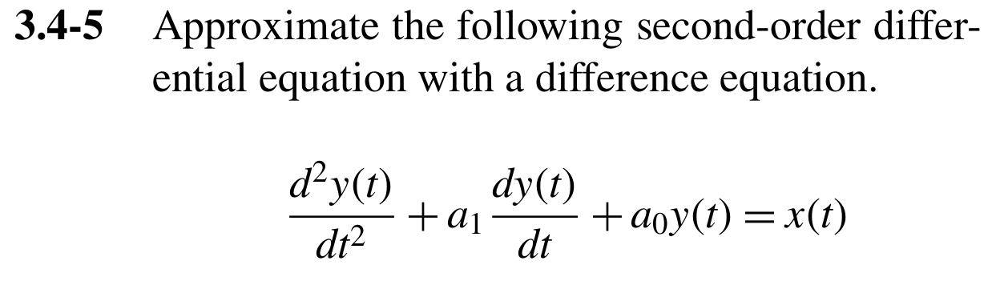{ .lathi-original loading="lazy" }](../../assets/lathi-boulet-batch-10/3.4-5_0.png)

### 14 · Lathi 3.8-37：复系数差分系统的冲激响应与总响应 {#exercise-3-8-37}

**对应主题：** Boulet 第3章：Causal LTI Systems Described by Difference Equations，p.96；Impulse Response of a Difference LTI System，p.109

Lathi 印刷页：326；原 PDF 页序：346

**阅读说明：** 记号说明：E是单位超前算子，即E x[n]=x[n+1]（Lathi p.269）；j为虚数单位。

[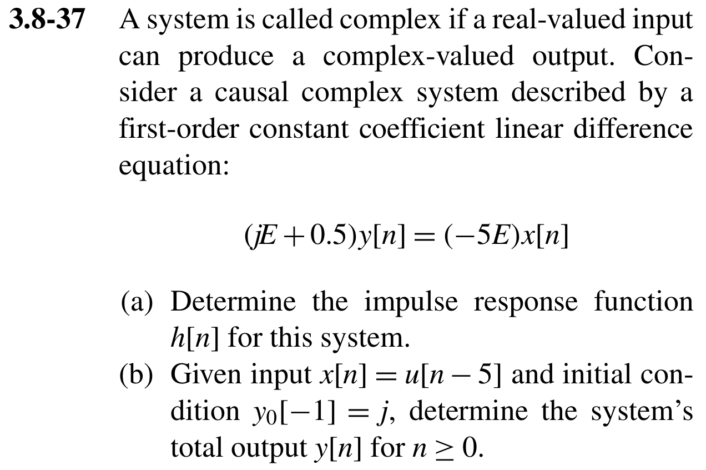{ .lathi-original loading="lazy" }](../../assets/lathi-boulet-batch-10/3.8-37_0.png)

### 15 · Lathi 3.8-38：由有限离散冲激响应建立差分方程 {#exercise-3-8-38}

**对应主题：** Boulet 第3章：Causal LTI Systems Described by Difference Equations，p.96；Impulse Response of a Difference LTI System，p.109

Lathi 印刷页：326；原 PDF 页序：346

[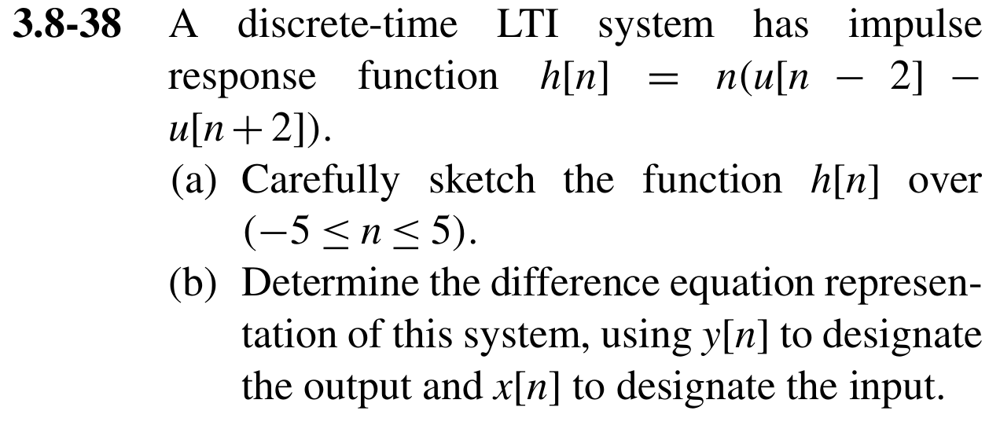{ .lathi-original loading="lazy" }](../../assets/lathi-boulet-batch-10/3.8-38_0.png)

## 第 4 章：连续时间傅里叶级数

### 16 · Lathi 6.1-8：周期性、基周期与谐波组成〔复习〕 {#exercise-6-1-8}

**对应主题：** Boulet 第4章：Linear Combinations of Harmonically Related Complex Exponentials，pp.132–134

Lathi 印刷页：672；原 PDF 页序：692

**复习来源：** [第 3 组 · Lathi 6.1-8](lathi-20-exercises-batch-03.md#exercise-6-1-8)，保留原题号用于回顾。

**阅读说明：** 复习第3批：重练周期性、基周期与谐波组成，注意有理频率比以及三角函数乘方展开后的频率。

[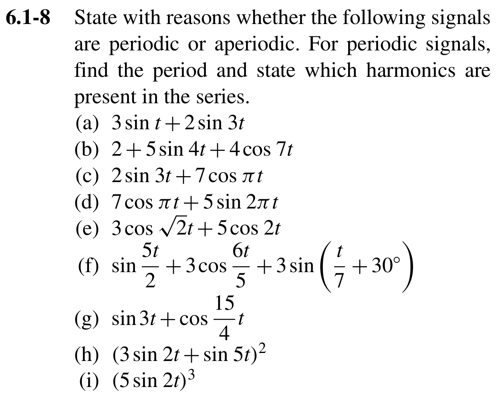{ .lathi-original loading="lazy" }](../../assets/lathi-boulet-batch-10/6.1-8_0.png)

### 17 · Lathi 6.3-14：反转、平移、调制与线性组合的级数系数〔复习〕 {#exercise-6-3-14}

**对应主题：** Boulet 第4章：Properties of Continuous-Time Fourier Series，pp.139–140（Linearity、Time Shifting、Time Reversal、Multiplication of Two Signals）

Lathi 印刷页：675；原 PDF 页序：695

**复习来源：** [第 3 组 · Lathi 6.3-14](lathi-20-exercises-batch-03.md#exercise-6-3-14)，保留原题号用于回顾。

**阅读说明：** 复习第3批：重练时间反转、时移、余弦调制及线性组合。原文先将输入谱记为D1[n]，后文又写X1[n]；两者均指同一输入x1(t)的傅里叶级数系数，作答时统一记号即可。

[{ .lathi-original loading="lazy" }](../../assets/lathi-boulet-batch-10/6.3-14_0.png)

### 18 · Lathi 6.3-15：分段二次周期信号的傅里叶级数与幅度谱〔复习〕 {#exercise-6-3-15}

**对应主题：** Boulet 第4章：Determination of the Fourier Series Representation of a Continuous-Time Periodic Signal，pp.134–136；Graph of the Fourier Series Coefficients: The Line Spectrum，p.137；Properties of Continuous-Time Fourier Series，pp.139–141

Lathi 印刷页：675；原 PDF 页序：695

**复习来源：** [第 3 组 · Lathi 6.3-15](lathi-20-exercises-batch-03.md#exercise-6-3-15)，保留原题号用于回顾。

**阅读说明：** 复习第3批：重练分段二次周期信号的级数、直流分量与幅度谱。原文引用例6.11仅作方法提示：(c)要求用级数性质而非直接积分求非直流系数；本题信号条件已全部给出，不依赖该例的数据或结果。

[{ .lathi-original loading="lazy" }](../../assets/lathi-boulet-batch-10/6.3-15_0.png)

### 19 · Lathi 6.4-4：正弦乘积的级数频谱与理想带通滤波〔复习〕 {#exercise-6-4-4}

**对应主题：** Boulet 第4章：Properties of Continuous-Time Fourier Series，pp.139–140；Graph of the Fourier Series Coefficients: The Line Spectrum，p.137；Steady-State Response of an LTI System to a Periodic Signal，pp.155–156

Lathi 印刷页：675、676；原 PDF 页序：695、696

**复习来源：** [第 3 组 · Lathi 6.4-4](lathi-20-exercises-batch-03.md#exercise-6-4-4)，保留原题号用于回顾。

**阅读说明：** 复习第3批：将正弦乘积的级数、线谱与理想带通滤波后的稳态响应连起来。原输入为cos(5t)sin(3t)；下方续接原书下一页的(c)与所需带通图。

[{ .lathi-original loading="lazy" }](../../assets/lathi-boulet-batch-10/6.4-4_0.png)

[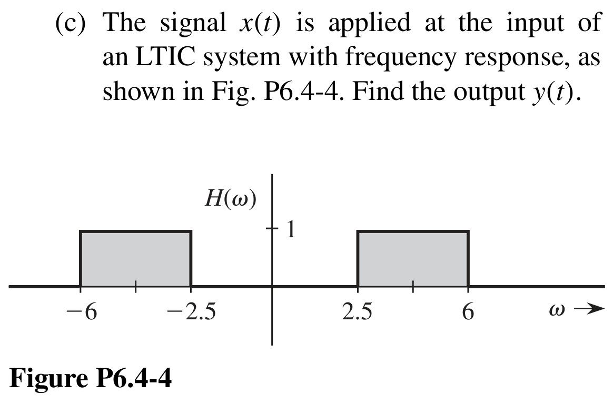{ .lathi-original loading="lazy" }](../../assets/lathi-boulet-batch-10/6.4-4_1.png)

### 20 · Lathi 6.5-4：信号的最优投影、误差能量与正交性〔复习〕 {#exercise-6-5-4}

**对应主题：** Boulet 第4章：Optimality and Convergence of the Fourier Series，pp.144–145；Parseval Theorem，p.150（正交分量的能量可加性）

Lathi 印刷页：677；原 PDF 页序：697

**复习来源：** [第 3 组 · Lathi 6.5-4](lathi-20-exercises-batch-03.md#exercise-6-5-4)，保留原题号用于回顾。

**阅读说明：** 复习第3批：重练最小误差能量近似、投影系数、误差正交性与能量分解，巩固傅里叶级数最优近似的基础。题中要求验证的能量关系属于原题。

[{ .lathi-original loading="lazy" }](../../assets/lathi-boulet-batch-10/6.5-4_0.png)

## 来源与使用说明

- B. P. Lathi & R. A. Green, *Linear Systems and Signals*, Third Edition, Oxford University Press, 2018：题号、题干与所需附图按原 PDF 核对
- Benoit Boulet, *Fundamentals of Signals and Systems*：第 1–4 章的主题与印刷页码用于中文学习索引
- Lathi 原 PDF 页序比印刷页码大 20；页面同时列出两种页码，便于回查
- 原题中的必要引用或附图见各题阅读说明；本页与下载 PDF 均不含解答

[第 1 组 20 题](lathi-20-exercises.md) · [第 2 组 20 题](lathi-20-exercises-batch-02.md) · [第 3 组 20 题](lathi-20-exercises-batch-03.md) · [第 4 组 20 题](lathi-20-exercises-batch-04.md) · [第 5 组 20 题](lathi-20-exercises-batch-05.md) · [第 6 组 20 题](lathi-20-exercises-batch-06.md) · [第 7 组 20 题](lathi-20-exercises-batch-07.md) · [第 8 组 20 题](lathi-20-exercises-batch-08.md) · [第 9 组 20 题](lathi-20-exercises-batch-09.md) · [Boulet 总览](index.md) · [前三章全部对应题号](lathi-exercise-map.md)
