# Boulet 前四章 × Lathi：第 11 组 20 道练习

**每章 5 题 · 15 道新题＋5 道复习题 · 原题与必要附图 · 无答案**

[下载第 11 组 PDF（22 页）](../../assets/lathi-boulet-batch-11/Lathi_20_Exercises_Boulet_Chapters_1-4_Batch_11_No_Solutions.pdf){ .md-button .md-button--primary download }

按 Boulet 前四章的知识主题选择 Lathi 第三版习题。本组含 15 道新题和 5 道复习题；复习题在索引、题目标题及来源处明确标注。下方保留原题图像，避免公式转写丢失；点击图片可打开原图放大查看。这里只按知识点匹配，不表示两书的习题一一等价。

[第 1 组 20 题](lathi-20-exercises.md) · [第 2 组 20 题](lathi-20-exercises-batch-02.md) · [第 3 组 20 题](lathi-20-exercises-batch-03.md) · [第 4 组 20 题](lathi-20-exercises-batch-04.md) · [第 5 组 20 题](lathi-20-exercises-batch-05.md) · [第 6 组 20 题](lathi-20-exercises-batch-06.md) · [第 7 组 20 题](lathi-20-exercises-batch-07.md) · [第 8 组 20 题](lathi-20-exercises-batch-08.md) · [第 9 组 20 题](lathi-20-exercises-batch-09.md) · [第 10 组 20 题](lathi-20-exercises-batch-10.md) · [Boulet 总览](index.md)

## 快速索引

| Boulet 章节 | Lathi 题号 |
| --- | --- |
| 第 1 章：信号与系统基础 | [1.1-12](#exercise-1-1-12)、[1.3-3](#exercise-1-3-3)、[1.5-8](#exercise-1-5-8)、[1.7-8](#exercise-1-7-8)、[3.2-9](#exercise-3-2-9) |
| 第 2 章：线性时不变系统与卷积 | [2.4-37](#exercise-2-4-37)、[2.5-3](#exercise-2-5-3)、[3.8-28](#exercise-3-8-28)、[3.8-34](#exercise-3-8-34)、[3.8-35](#exercise-3-8-35) |
| 第 3 章：微分方程、差分方程与系统响应 | [2.4-39](#exercise-2-4-39)、[2.4-44](#exercise-2-4-44)、[3.4-6](#exercise-3-4-6)、[3.5-4](#exercise-3-5-4)、[3.8-36](#exercise-3-8-36) |
| 第 4 章：连续时间傅里叶级数 | [6.3-4](#exercise-6-3-4)（复习）、[6.3-6](#exercise-6-3-6)（复习）、[6.3-16](#exercise-6-3-16)（复习）、[6.4-5](#exercise-6-4-5)（复习）、[6.5-3](#exercise-6-5-3)（复习） |

## 第 1 章：信号与系统基础

### 01 · Lathi 1.1-12：开关间隔递增的二进制信号：能量与功率 {#exercise-1-1-12}

**对应主题：** Boulet 第1章：Finite-Energy and Finite-Power Signals，pp.21–23

Lathi 印刷页：138、139；原 PDF 页序：158、159

[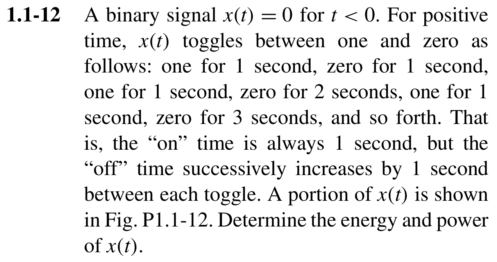{ .lathi-original loading="lazy" }](../../assets/lathi-boulet-batch-11/1.1-12_0.png)

[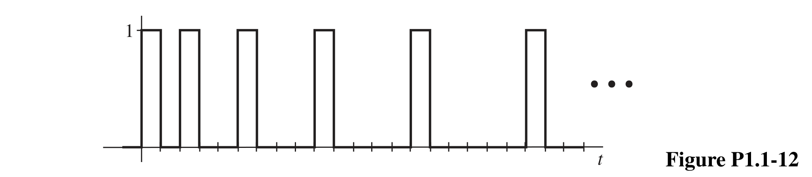{ .lathi-original loading="lazy" }](../../assets/lathi-boulet-batch-11/1.1-12_1.png)

### 02 · Lathi 1.3-3：信号分类、能量功率与周期性的判断 {#exercise-1-3-3}

**对应主题：** Boulet 第1章：Functions of Time as Signals，pp.2–4；Periodic Signals，p.8；Finite-Energy and Finite-Power Signals，pp.21–23

Lathi 印刷页：140；原 PDF 页序：160

[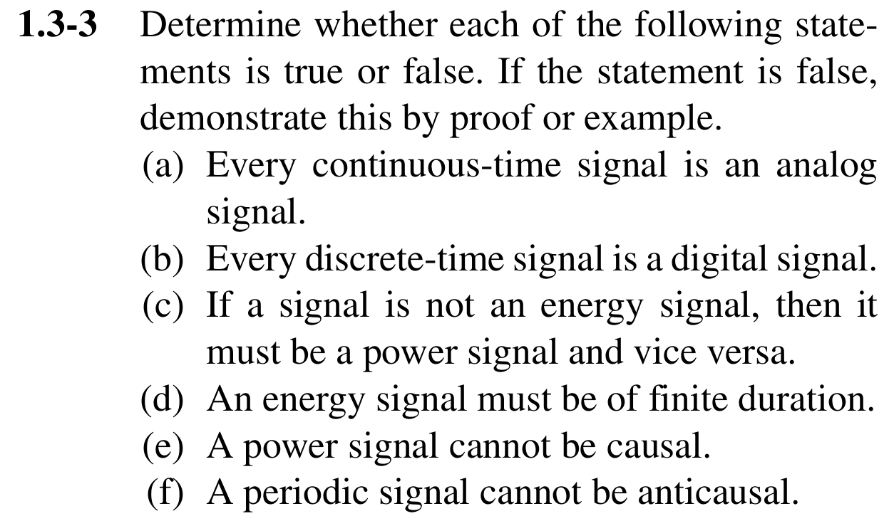{ .lathi-original loading="lazy" }](../../assets/lathi-boulet-batch-11/1.3-3_0.png)

### 03 · Lathi 1.5-8：由变换后图形恢复信号及奇分量 {#exercise-1-5-8}

**对应主题：** Boulet 第1章：Transformations of the Time Variable，pp.4–8；Even and Odd Signals，pp.23–25

Lathi 印刷页：143；原 PDF 页序：163

**阅读说明：** 题干在原书左栏底部，图P1.5-8及(a)、(b)续接右栏，均已合并附上。

[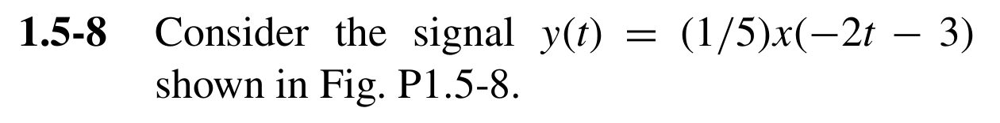{ .lathi-original loading="lazy" }](../../assets/lathi-boulet-batch-11/1.5-8_0.png)

[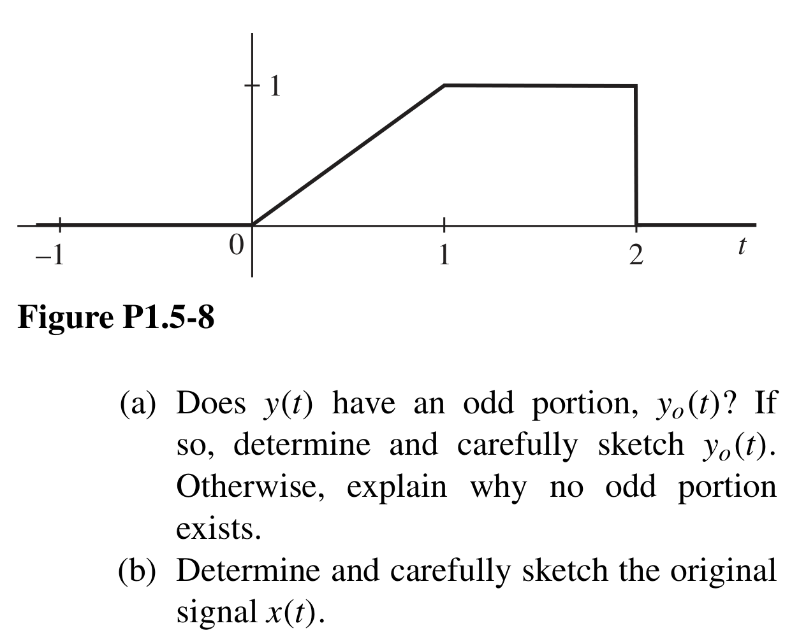{ .lathi-original loading="lazy" }](../../assets/lathi-boulet-batch-11/1.5-8_1.png)

### 04 · Lathi 1.7-8：延时微分系统的基本性质 {#exercise-1-7-8}

**对应主题：** Boulet 第1章：System Models and Basic Properties，pp.34–42

Lathi 印刷页：145；原 PDF 页序：165

**阅读说明：** 展开所引用1.7-4的要求：分别判断系统是否(a)BIBO稳定、(b)因果、(c)可逆、(d)线性、(e)无记忆、(f)时不变；每项回答是或否，并给出数学论证。

[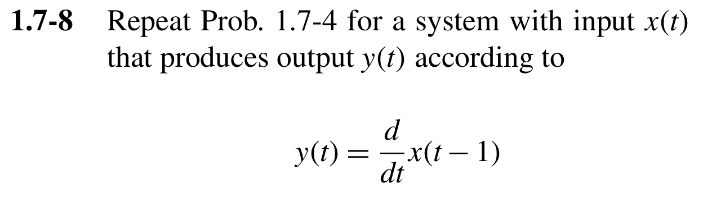{ .lathi-original loading="lazy" }](../../assets/lathi-boulet-batch-11/1.7-8_0.png)

### 05 · Lathi 3.2-9：有限离散序列的反转、压缩与扩展 {#exercise-3-2-9}

**对应主题：** Boulet 第1章：Transformations of the Time Variable，pp.4–8

Lathi 印刷页：316；原 PDF 页序：336

**阅读说明：** 原题用向下箭头指定n=0样本；两幅变换图均须覆盖-5 <= n <= 4。

[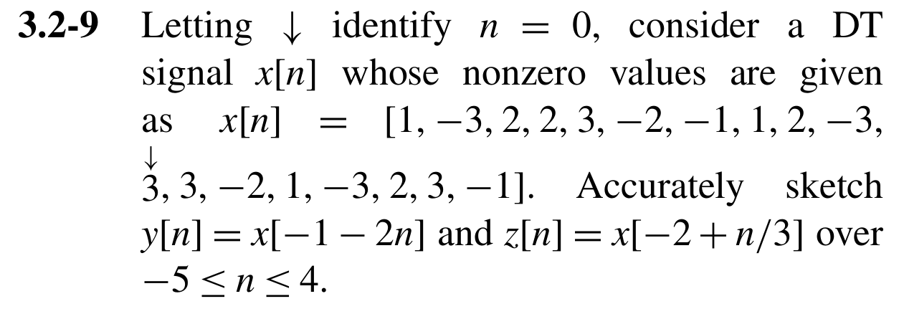{ .lathi-original loading="lazy" }](../../assets/lathi-boulet-batch-11/3.2-9_0.png)

## 第 2 章：线性时不变系统与卷积

### 06 · Lathi 2.4-37：从阶跃响应求移位冲激与阶跃组合的输出 {#exercise-2-4-37}

**对应主题：** Boulet 第2章：Continuous-Time LTI Systems: The Convolution Integral，pp.67–74；Properties of Linear Time-Invariant Systems: Step Response，pp.79–80

Lathi 印刷页：231；原 PDF 页序：251

**阅读说明：** 输入中的cos(sqrt(3))是与时间无关的常数，按原题保留。

[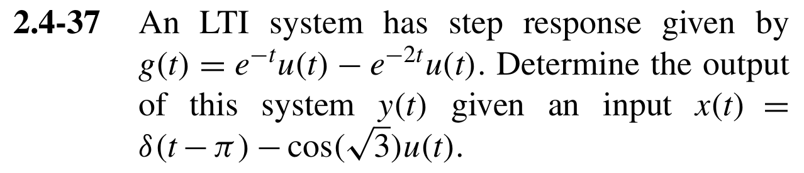{ .lathi-original loading="lazy" }](../../assets/lathi-boulet-batch-11/2.4-37_0.png)

### 07 · Lathi 2.5-3：左侧截断冲激响应的BIBO稳定性 {#exercise-2-5-3}

**对应主题：** Boulet 第2章：Stability，pp.78–79

Lathi 印刷页：233；原 PDF 页序：253

[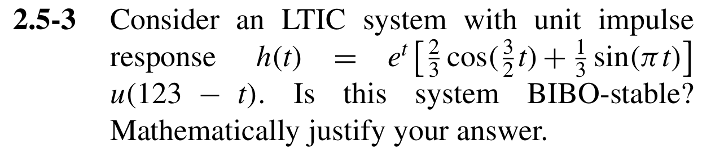{ .lathi-original loading="lazy" }](../../assets/lathi-boulet-batch-11/2.5-3_0.png)

### 08 · Lathi 3.8-28：图示有限离散序列的滑动卷积 {#exercise-3-8-28}

**对应主题：** Boulet 第2章：Discrete-Time LTI Systems: The Convolution Sum，pp.54–66

Lathi 印刷页：324；原 PDF 页序：344

[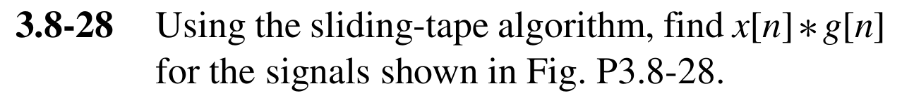{ .lathi-original loading="lazy" }](../../assets/lathi-boulet-batch-11/3.8-28_0.png)

[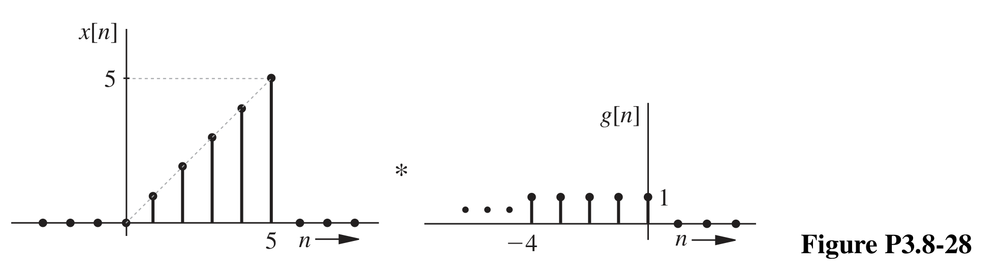{ .lathi-original loading="lazy" }](../../assets/lathi-boulet-batch-11/3.8-28_1.png)

### 09 · Lathi 3.8-34：并联与级联系统的离散冲激响应 {#exercise-3-8-34}

**对应主题：** Boulet 第2章：Properties of Linear Time-Invariant Systems，pp.74–80；Discrete-Time LTI Systems: The Convolution Sum，pp.54–66

Lathi 印刷页：325；原 PDF 页序：345

**阅读说明：** 完整附图P3.8-34的并联(a)与级联(b)连接方式。

[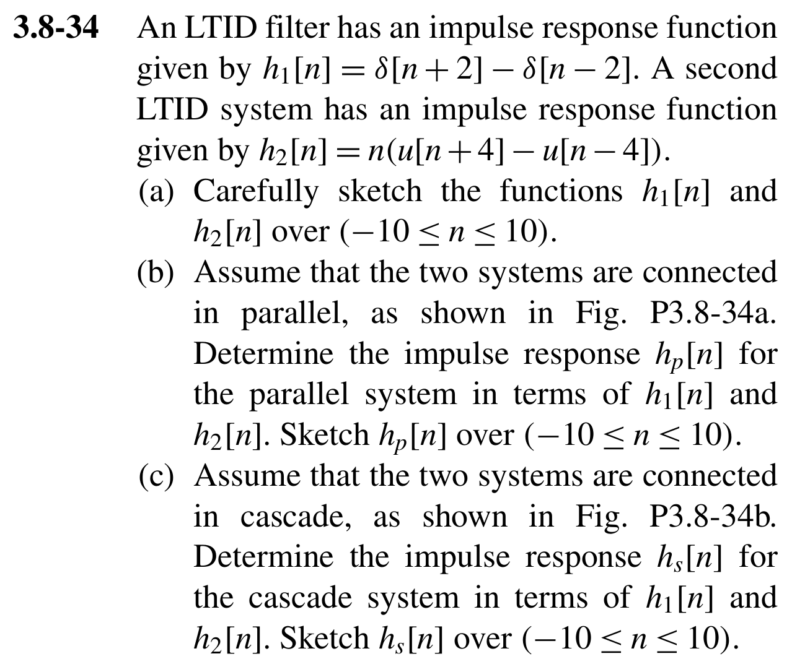{ .lathi-original loading="lazy" }](../../assets/lathi-boulet-batch-11/3.8-34_0.png)

[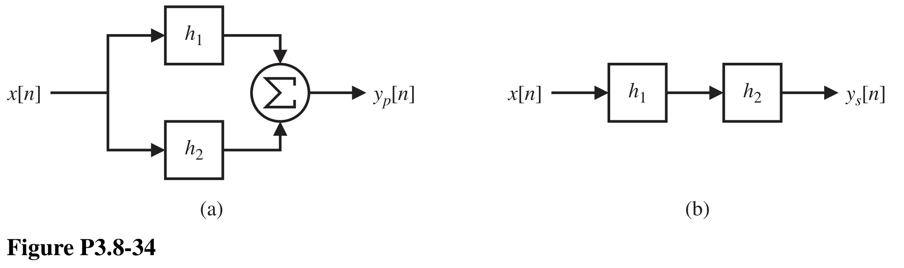{ .lathi-original loading="lazy" }](../../assets/lathi-boulet-batch-11/3.8-34_1.png)

### 10 · Lathi 3.8-35：离散卷积在多项式系数展开中的应用 {#exercise-3-8-35}

**对应主题：** Boulet 第2章：Discrete-Time LTI Systems: The Convolution Sum，pp.54–66

Lathi 印刷页：325；原 PDF 页序：345

**阅读说明：** 本题是有限序列卷积的代数应用；展开式为原题要求，未附结果。

[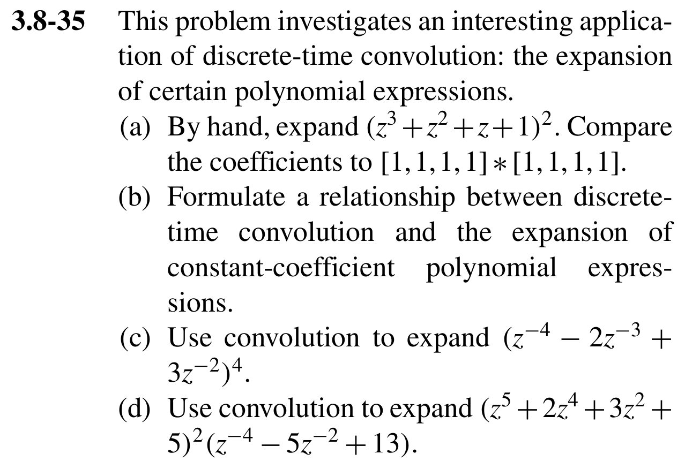{ .lathi-original loading="lazy" }](../../assets/lathi-boulet-batch-11/3.8-35_0.png)

## 第 3 章：微分方程、差分方程与系统响应

### 11 · Lathi 2.4-39：双电容电路的微分模型与非零初值响应 {#exercise-2-4-39}

**对应主题：** Boulet 第3章：Causal LTI Systems Described by Differential Equations，pp.92–96

Lathi 印刷页：231；原 PDF 页序：251

**阅读说明：** 原题元件数值、两只电容的初始电压及图P2.4-39全部保留。

[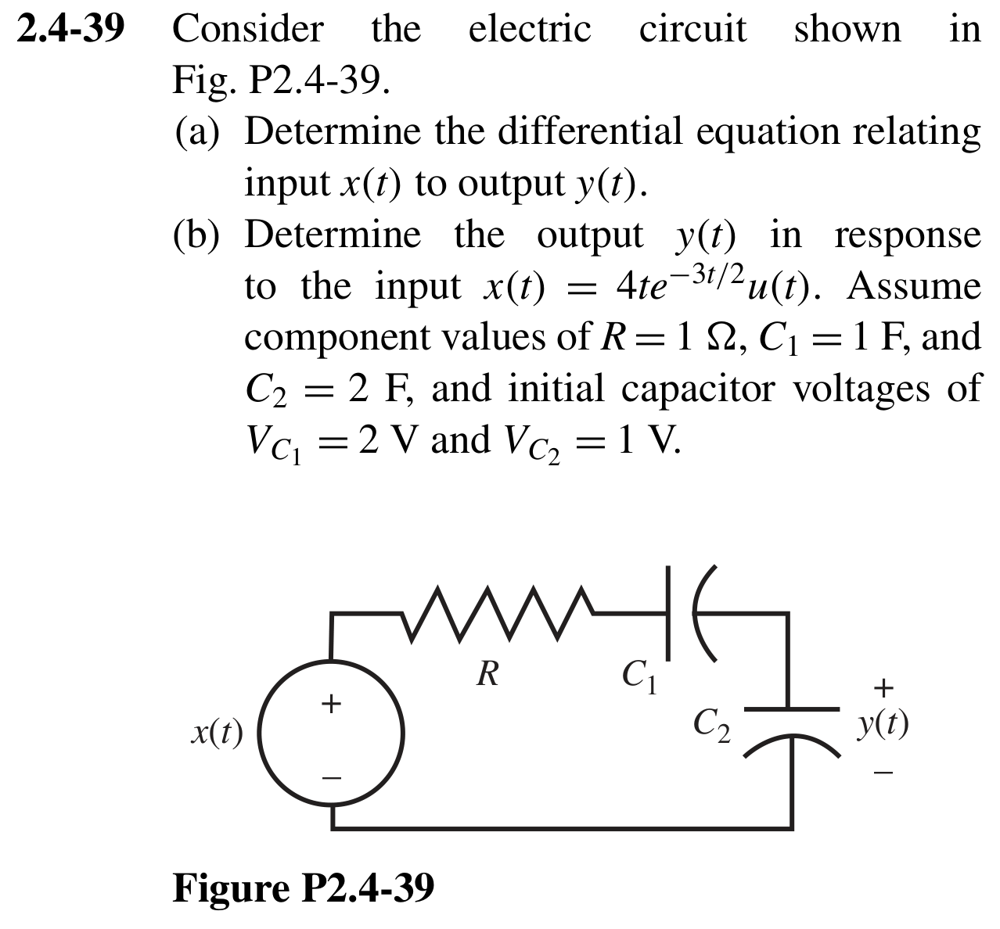{ .lathi-original loading="lazy" }](../../assets/lathi-boulet-batch-11/2.4-39_0.png)

### 12 · Lathi 2.4-44：理想运放积分电路的微分模型与阶跃响应 {#exercise-2-4-44}

**对应主题：** Boulet 第3章：Causal LTI Systems Described by Differential Equations，pp.92–96；Characteristic Polynomials and Stability，pp.112–116

Lathi 印刷页：232；原 PDF 页序：252

[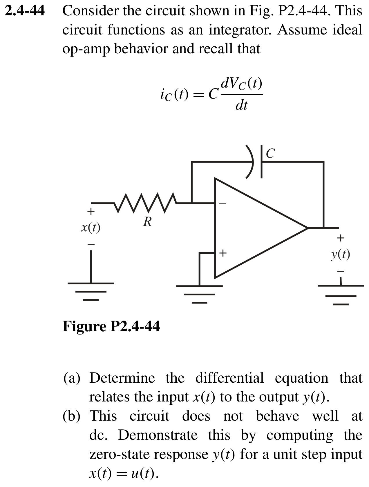{ .lathi-original loading="lazy" }](../../assets/lathi-boulet-batch-11/2.4-44_0.png)

### 13 · Lathi 3.4-6：由离散冲激响应构造差分方程并判断性质 {#exercise-3-4-6}

**对应主题：** Boulet 第3章：Causal LTI Systems Described by Difference Equations，pp.96–101；Impulse Response of a Difference LTI System，pp.109–112；结合第1章系统性质

Lathi 印刷页：317；原 PDF 页序：337

**阅读说明：** 保留原序列的n=0箭头及(a)至(f)全部要求。

[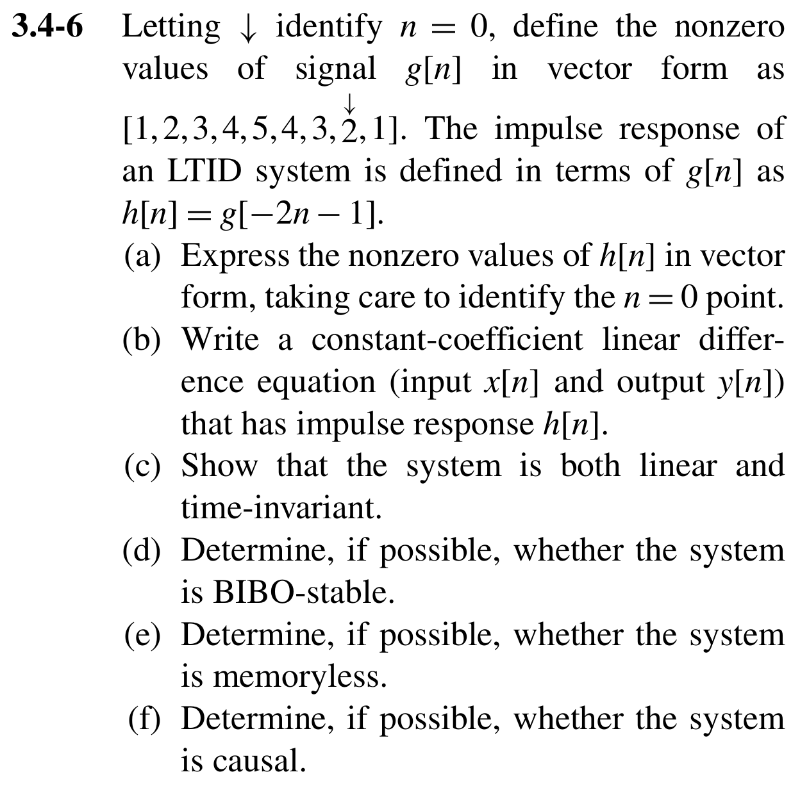{ .lathi-original loading="lazy" }](../../assets/lathi-boulet-batch-11/3.4-6_0.png)

### 14 · Lathi 3.5-4：二阶销售估计差分方程的递推求解 {#exercise-3-5-4}

**对应主题：** Boulet 第3章：Causal LTI Systems Described by Difference Equations，pp.96–101

Lathi 印刷页：319、255；原 PDF 页序：339、275

**阅读说明：** 附上原题引用的式(3.6)，仅作为已知方程；求前三项，初值和输入按原题给定，不附例题解答。

[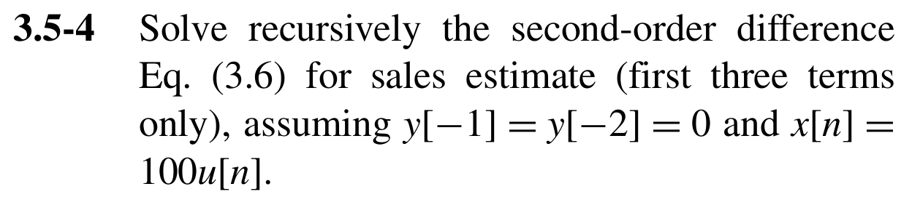{ .lathi-original loading="lazy" }](../../assets/lathi-boulet-batch-11/3.5-4_0.png)

[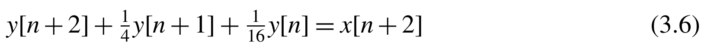{ .lathi-original loading="lazy" }](../../assets/lathi-boulet-batch-11/3.5-4_1.png)

### 15 · Lathi 3.8-36：咖啡补充过程的差分模型、总响应与稳态 {#exercise-3-8-36}

**对应主题：** Boulet 第3章：Causal LTI Systems Described by Difference Equations，pp.96–101；Characteristic Polynomials and Stability，pp.112–116

Lathi 印刷页：325、326；原 PDF 页序：345、346

**阅读说明：** 原题跨页叙述与(a)至(d)全部接续，初始干净杯条件及最后的输入改进要求完整保留。

[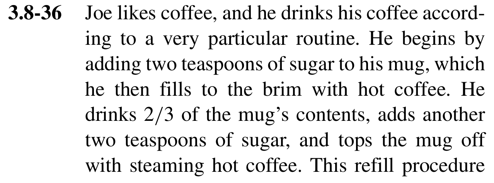{ .lathi-original loading="lazy" }](../../assets/lathi-boulet-batch-11/3.8-36_0.png)

[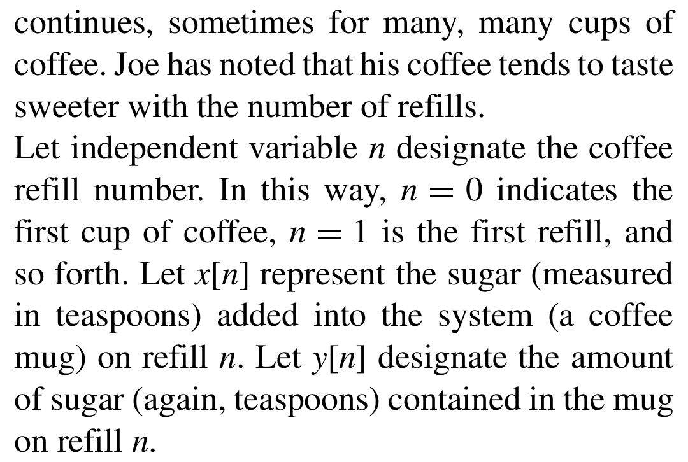{ .lathi-original loading="lazy" }](../../assets/lathi-boulet-batch-11/3.8-36_1.png)

[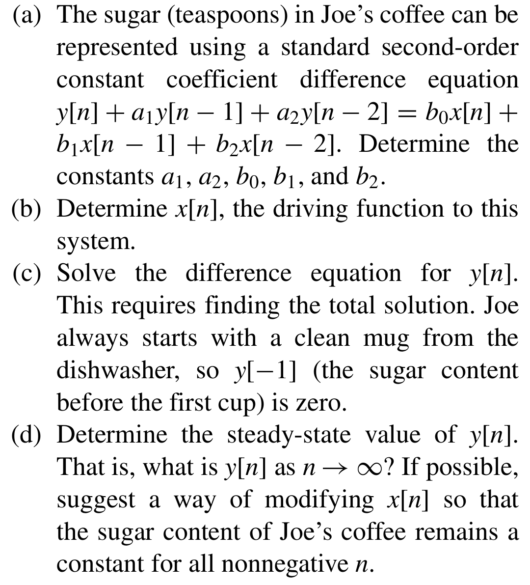{ .lathi-original loading="lazy" }](../../assets/lathi-boulet-batch-11/3.8-36_2.png)

## 第 4 章：连续时间傅里叶级数

### 16 · Lathi 6.3-4：多谐波三角级数与复指数频谱〔复习〕 {#exercise-6-3-4}

**对应主题：** Boulet 第4章：Determination of the Fourier Series Representation，pp.134–136；Graph of the Fourier Series Coefficients: The Line Spectrum，pp.137–138

Lathi 印刷页：672；原 PDF 页序：692

**复习来源：** [第 4 组 · Lathi 6.3-4](lathi-20-exercises-batch-04.md#exercise-6-3-4)，保留原题号用于回顾。

**阅读说明：** 复习第4批：重练三角式、幅相谱与复指数式的相互转换，特别留意直流项、负系数和相位；(a)–(d)完整保留。

[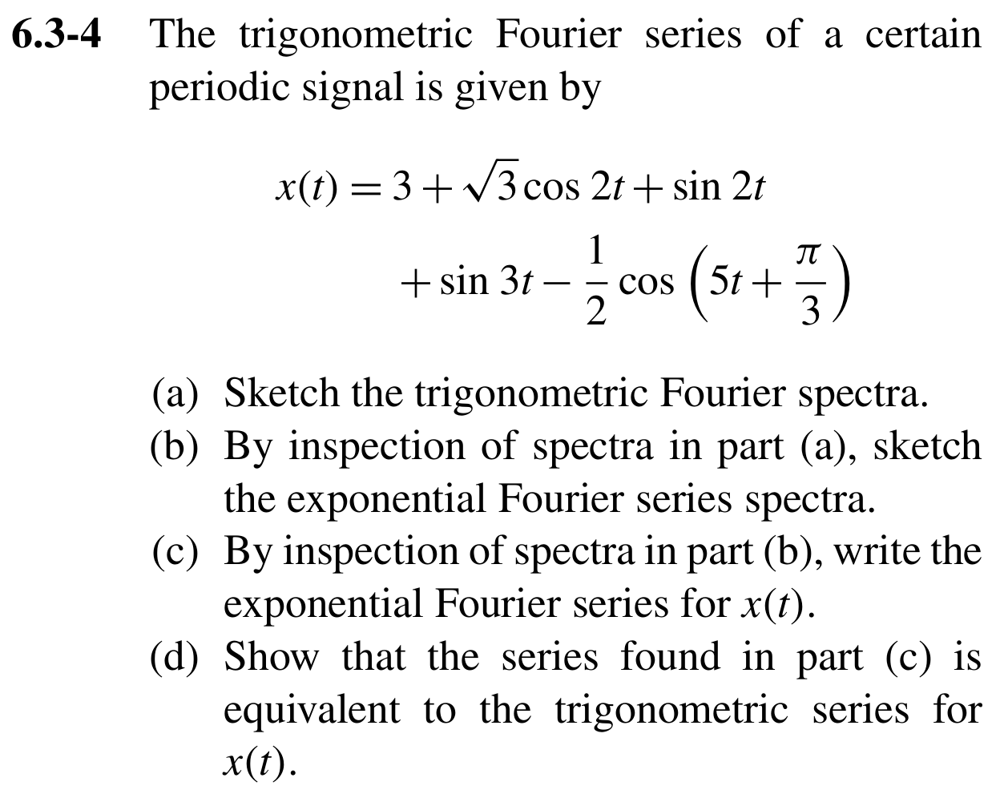{ .lathi-original loading="lazy" }](../../assets/lathi-boulet-batch-11/6.3-4_0.png)

### 17 · Lathi 6.3-6：由三角幅相谱重建信号并转为复指数谱〔复习〕 {#exercise-6-3-6}

**对应主题：** Boulet 第4章：Determination of the Fourier Series Representation，pp.135–136；Graph of the Fourier Series Coefficients: The Line Spectrum，pp.137–138

Lathi 印刷页：673；原 PDF 页序：693

**复习来源：** [第 4 组 · Lathi 6.3-6](lathi-20-exercises-batch-04.md#exercise-6-3-6)，保留原题号用于回顾。

**阅读说明：** 复习第4批：重练读谱及两种傅里叶级数之间的转换。原图 P6.3-6 的幅度谱、相位谱、坐标标记与(a)(b)标签均已附。

[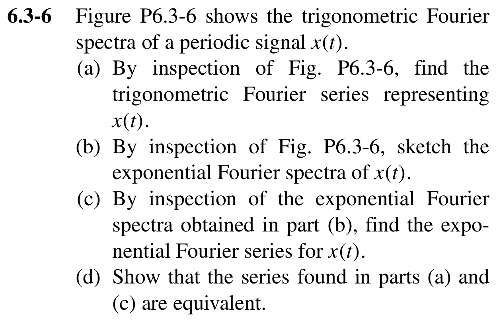{ .lathi-original loading="lazy" }](../../assets/lathi-boulet-batch-11/6.3-6_0.png)

[{ .lathi-original loading="lazy" }](../../assets/lathi-boulet-batch-11/6.3-6_1.png)

### 18 · Lathi 6.3-16：分段绝对值周期信号的傅里叶级数〔复习〕 {#exercise-6-3-16}

**对应主题：** Boulet 第4章：Determination of the Fourier Series Representation，pp.134–135；Properties of Continuous-Time Fourier Series，pp.139–140（性质法拓展）

Lathi 印刷页：675、635；原 PDF 页序：695、655

**复习来源：** [第 4 组 · Lathi 6.3-16](lathi-20-exercises-batch-04.md#exercise-6-3-16)，保留原题号用于回顾。

**阅读说明：** 复习第4批：重练分段周期信号的表示、直流项与性质法。题目同页跨栏，(a)–(d)均已附；例6.11仅为方法参考，补附原书表6.2供查性质，不附例题解答。

[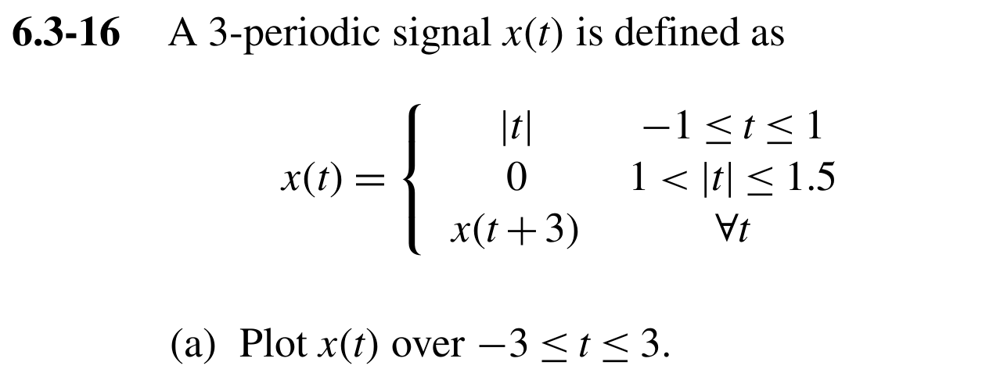{ .lathi-original loading="lazy" }](../../assets/lathi-boulet-batch-11/6.3-16_0.png)

[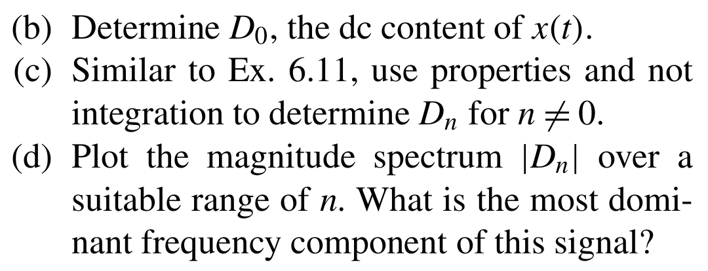{ .lathi-original loading="lazy" }](../../assets/lathi-boulet-batch-11/6.3-16_1.png)

[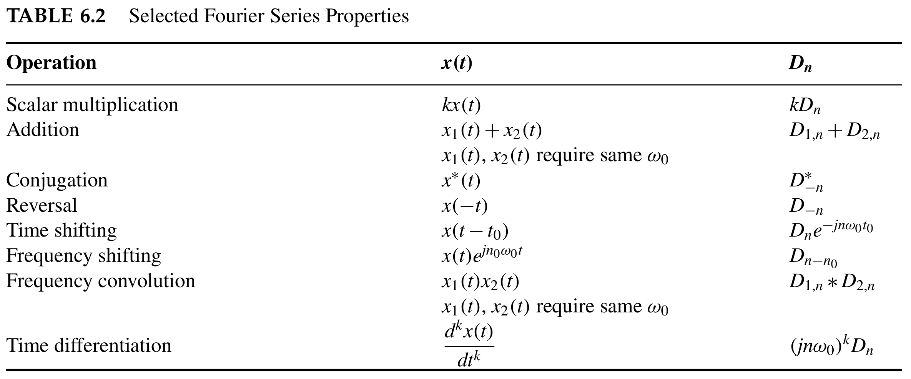{ .lathi-original loading="lazy" }](../../assets/lathi-boulet-batch-11/6.3-16_2.png)

### 19 · Lathi 6.4-5：周期指数输入经过RC系统的稳态响应〔复习〕 {#exercise-6-4-5}

**对应主题：** Boulet 第4章：Steady-State Response of an LTI System to a Periodic Signal，pp.155–156

Lathi 印刷页：676；原 PDF 页序：696

**复习来源：** [第 4 组 · Lathi 6.4-5](lathi-20-exercises-batch-04.md#exercise-6-4-5)，保留原题号用于回顾。

**阅读说明：** 复习第4批：重练由周期输入的傅里叶级数求系统稳态响应。原图 P6.4-5(a)的输入和(b)的RC电路均已附；核对输入、输出端与元件位置，图中 C=1 F、R=1 Ω。

[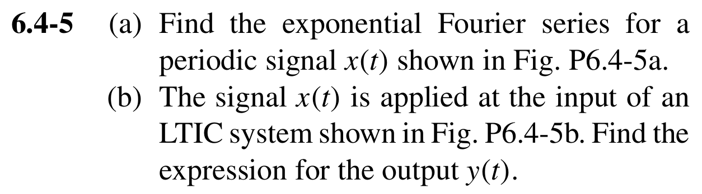{ .lathi-original loading="lazy" }](../../assets/lathi-boulet-batch-11/6.4-5_0.png)

[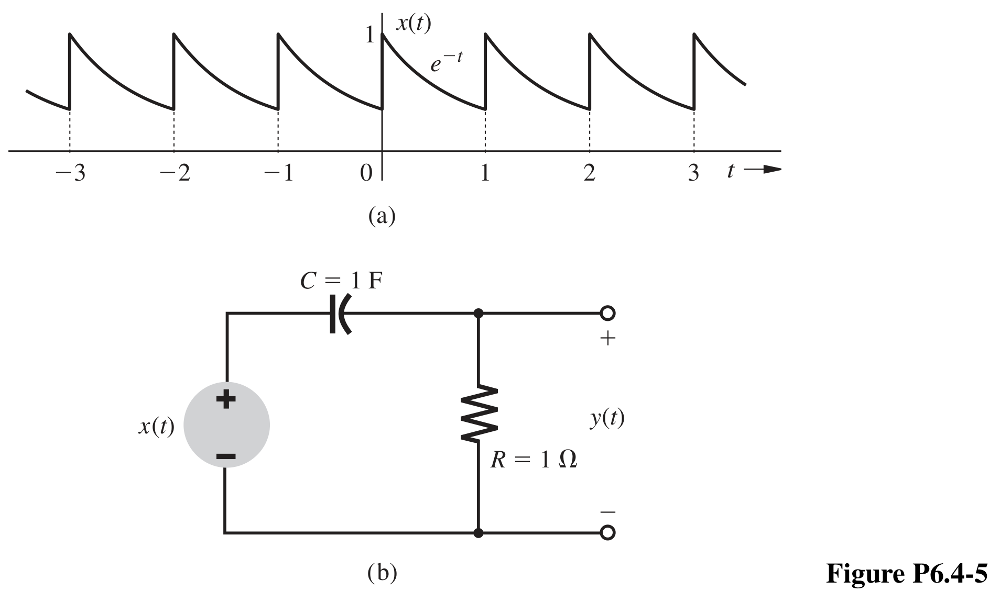{ .lathi-original loading="lazy" }](../../assets/lathi-boulet-batch-11/6.4-5_1.png)

### 20 · Lathi 6.5-3：正交信号的能量可加性与向量类比〔复习〕 {#exercise-6-5-3}

**对应主题：** Boulet 第4章：Optimality and Convergence of the Fourier Series，pp.144–145；Parseval Theorem，p.150（正交分量的能量可加性）

Lathi 印刷页：677；原 PDF 页序：697

**复习来源：** [第 4 组 · Lathi 6.5-3](lathi-20-exercises-batch-04.md#exercise-6-5-3)，保留原题号用于回顾。

**阅读说明：** 复习第4批：重练正交性、能量分解与向量类比，巩固傅里叶级数正交展开的基础；题中的能量等式是原题要求证明的结论。

[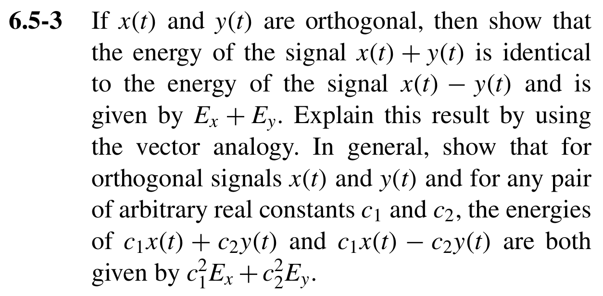{ .lathi-original loading="lazy" }](../../assets/lathi-boulet-batch-11/6.5-3_0.png)

## 来源与使用说明

- B. P. Lathi & R. A. Green, *Linear Systems and Signals*, Third Edition, Oxford University Press, 2018：题号、题干与所需附图按原 PDF 核对
- Benoit Boulet, *Fundamentals of Signals and Systems*：第 1–4 章的主题与印刷页码用于中文学习索引
- Lathi 原 PDF 页序比印刷页码大 20；页面同时列出两种页码，便于回查
- 原题中的必要引用或附图见各题阅读说明；本页与下载 PDF 均不含解答

[第 1 组 20 题](lathi-20-exercises.md) · [第 2 组 20 题](lathi-20-exercises-batch-02.md) · [第 3 组 20 题](lathi-20-exercises-batch-03.md) · [第 4 组 20 题](lathi-20-exercises-batch-04.md) · [第 5 组 20 题](lathi-20-exercises-batch-05.md) · [第 6 组 20 题](lathi-20-exercises-batch-06.md) · [第 7 组 20 题](lathi-20-exercises-batch-07.md) · [第 8 组 20 题](lathi-20-exercises-batch-08.md) · [第 9 组 20 题](lathi-20-exercises-batch-09.md) · [第 10 组 20 题](lathi-20-exercises-batch-10.md) · [Boulet 总览](index.md) · [前三章全部对应题号](lathi-exercise-map.md)
