# Boulet 前四章 × Lathi：20 道练习

**每次一道题 · 共 20 题 · 原题与必要附图**

[下载完整 PDF（21 页）](../../assets/lathi-boulet-20/Lathi_20_Exercises_Boulet_Chapters_1-4_No_Solutions.pdf){ .md-button .md-button--primary download }

点击「下一题 》」切换题目，也可展开题号直接跳转。每题下方保留独立的「我的解答与订正」区。发来题号和手写截图、PDF 或文字解答后，对应题目的解答、错误位置与订正会更新在这里。尚未提交解答的题目不预放答案。

原题和附图全部保留，点击图片可放大。页面会在当前浏览器记住上次看到的题目；键盘 ← / → 也可切题。

  

    <button type="button" data-exam-prev aria-label="上一题">《 上一题</button>
    第 1 / 20 题
    <button type="button" data-exam-next aria-label="下一题">下一题 》</button>
  

  <progress value="1" max="20" aria-label="当前题目位置"></progress>
  

    
题号导航 · 跳到指定题目

    

  

<noscript>启用 JavaScript 可逐题切换；当前显示完整题目列表。</noscript>

## 第 1 章：信号与系统基础

### 01 · Lathi 1.1-6：信号平均功率与均方根 {#exercise-1-1-6}

**对应主题：** Boulet 第1章：Finite-Energy and Finite-Power Signals，p.21

Lathi 印刷页：137；原 PDF 页序：157

[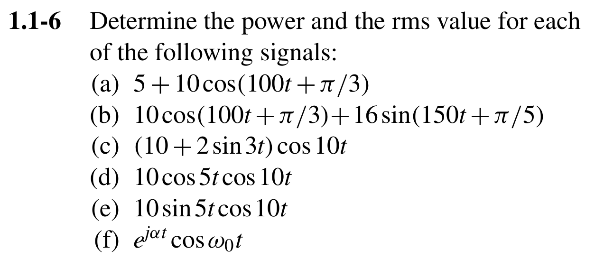{ .lathi-original loading="lazy" }](../../assets/lathi-boulet-20/1.1-6_0.png)

#### 我的解答与订正 {#review-1-1-6}

<!-- review:1.1-6:start -->

尚未添加你的解答。发送 **Lathi 1.1-6** 的解答后，这里会保留你的作答、指出错误并补充订正。

<!-- review:1.1-6:end -->

### 02 · Lathi 1.2-6：时间反转、平移与尺度变换 {#exercise-1-2-6}

**对应主题：** Boulet 第1章：Transformations of the Time Variable，p.4

Lathi 印刷页：139；原 PDF 页序：159

[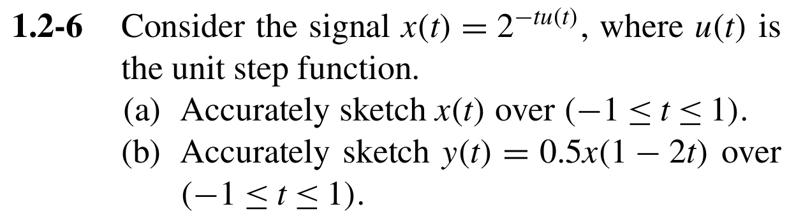{ .lathi-original loading="lazy" }](../../assets/lathi-boulet-20/1.2-6_0.png)

#### 我的解答与订正 {#review-1-2-6}

<!-- review:1.2-6:start -->

尚未添加你的解答。发送 **Lathi 1.2-6** 的解答后，这里会保留你的作答、指出错误并补充订正。

<!-- review:1.2-6:end -->

### 03 · Lathi 1.3-5：周期、非周期与叠加信号的功率 {#exercise-1-3-5}

**对应主题：** Boulet 第1章：Periodic Signals，p.8；Finite-Energy and Finite-Power Signals，p.21

Lathi 印刷页：140；原 PDF 页序：160

[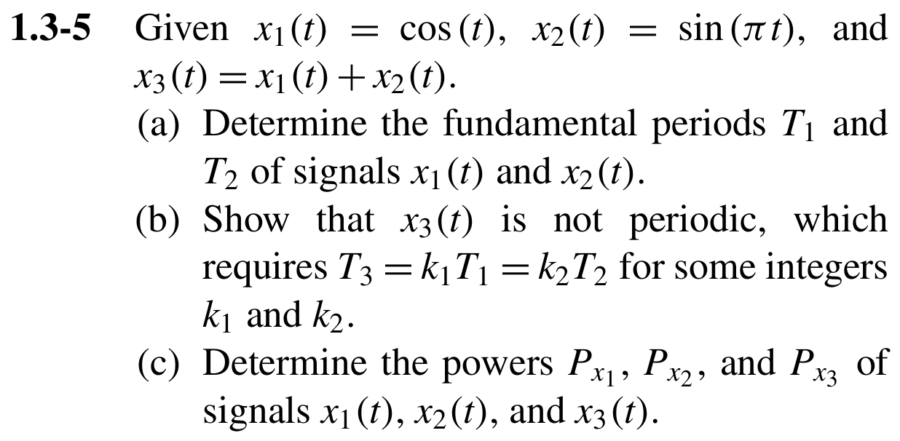{ .lathi-original loading="lazy" }](../../assets/lathi-boulet-20/1.3-5_0.png)

#### 我的解答与订正 {#review-1-3-5}

<!-- review:1.3-5:start -->

尚未添加你的解答。发送 **Lathi 1.3-5** 的解答后，这里会保留你的作答、指出错误并补充订正。

<!-- review:1.3-5:end -->

### 04 · Lathi 1.4-6：冲激函数的筛选与缩放性质 {#exercise-1-4-6}

**对应主题：** Boulet 第1章：Generalized Functions，p.26

Lathi 印刷页：142；原 PDF 页序：162

[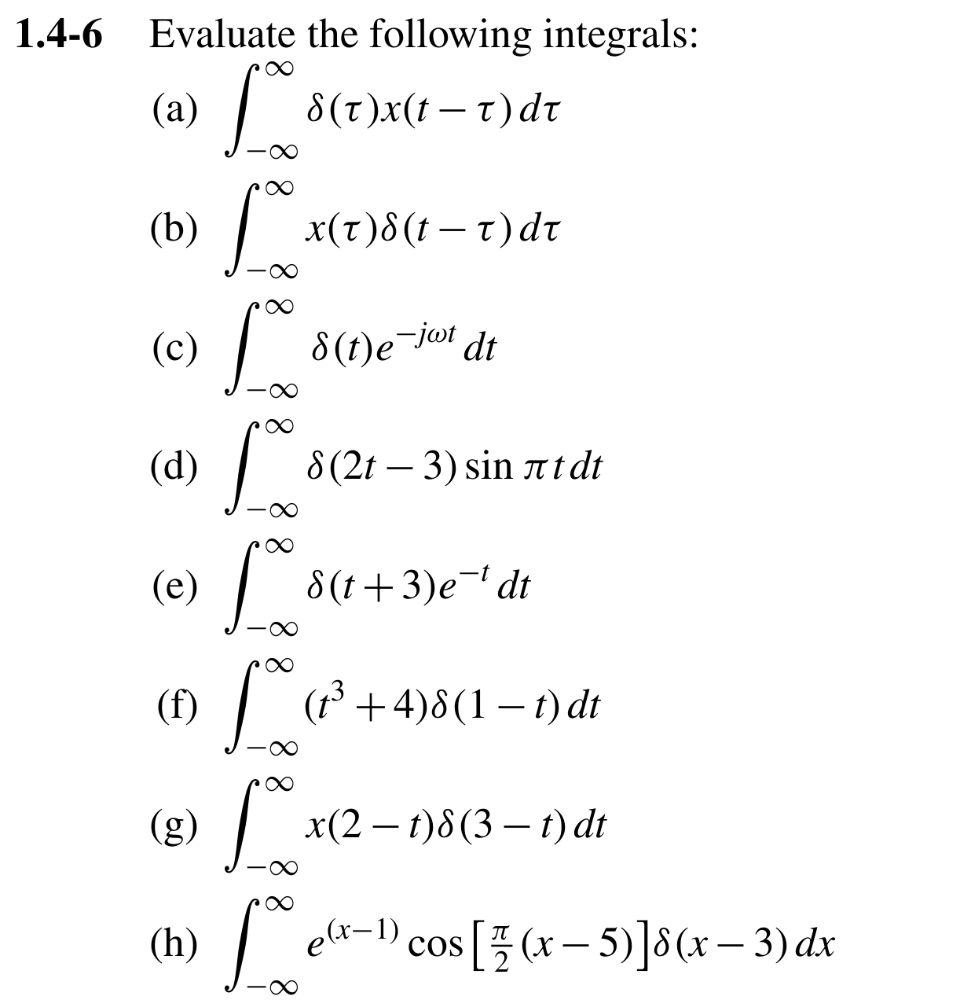{ .lathi-original loading="lazy" }](../../assets/lathi-boulet-20/1.4-6_0.png)

#### 我的解答与订正 {#review-1-4-6}

<!-- review:1.4-6:start -->

尚未添加你的解答。发送 **Lathi 1.4-6** 的解答后，这里会保留你的作答、指出错误并补充订正。

<!-- review:1.4-6:end -->

### 05 · Lathi 1.7-1：线性系统与非线性系统的判断 {#exercise-1-7-1}

**对应主题：** Boulet 第1章：System Models and Basic Properties，p.34

Lathi 印刷页：144；原 PDF 页序：164

[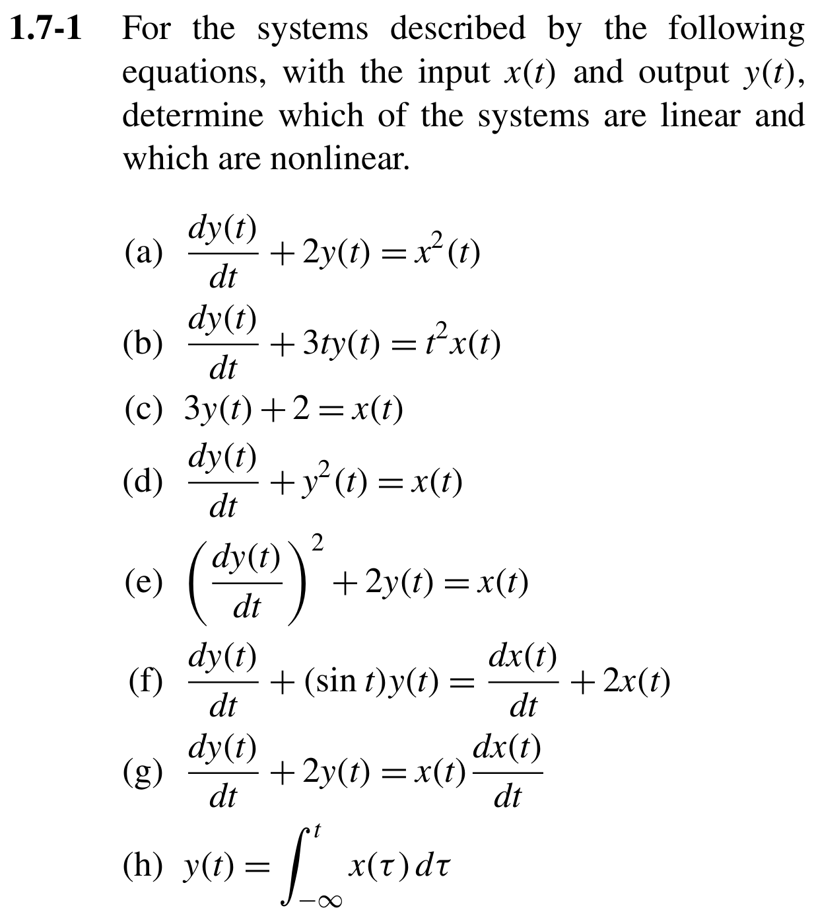{ .lathi-original loading="lazy" }](../../assets/lathi-boulet-20/1.7-1_0.png)

#### 我的解答与订正 {#review-1-7-1}

<!-- review:1.7-1:start -->

尚未添加你的解答。发送 **Lathi 1.7-1** 的解答后，这里会保留你的作答、指出错误并补充订正。

<!-- review:1.7-1:end -->

## 第 2 章：线性时不变系统与卷积

### 06 · Lathi 2.4-10：卷积的时间尺度变换性质 {#exercise-2-4-10}

**对应主题：** Boulet 第2章：Continuous-Time LTI Systems: The Convolution Integral，p.67；Properties of Linear Time-Invariant Systems，p.74

Lathi 印刷页：227；原 PDF 页序：247

[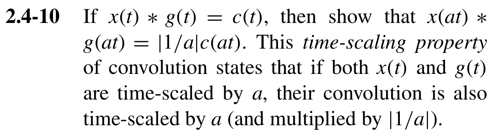{ .lathi-original loading="lazy" }](../../assets/lathi-boulet-20/2.4-10_0.png)

#### 我的解答与订正 {#review-2-4-10}

<!-- review:2.4-10:start -->

尚未添加你的解答。发送 **Lathi 2.4-10** 的解答后，这里会保留你的作答、指出错误并补充订正。

<!-- review:2.4-10:end -->

### 07 · Lathi 2.4-12：连续时间图解卷积与分段积分 {#exercise-2-4-12}

**对应主题：** Boulet 第2章：Continuous-Time LTI Systems: The Convolution Integral，p.67

Lathi 印刷页：227；原 PDF 页序：247

[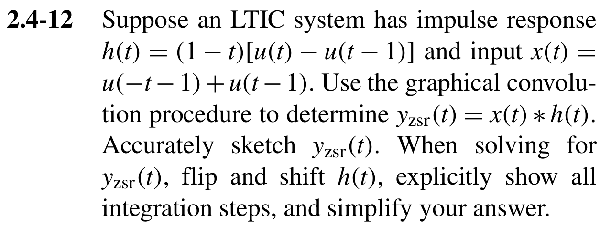{ .lathi-original loading="lazy" }](../../assets/lathi-boulet-20/2.4-12_0.png)

#### 我的解答与订正 {#review-2-4-12}

<!-- review:2.4-12:start -->

尚未添加你的解答。发送 **Lathi 2.4-12** 的解答后，这里会保留你的作答、指出错误并补充订正。

<!-- review:2.4-12:end -->

### 08 · Lathi 2.4-13：因果指数信号的卷积 {#exercise-2-4-13}

**对应主题：** Boulet 第2章：Continuous-Time LTI Systems: The Convolution Integral，p.67

Lathi 印刷页：227；原 PDF 页序：247

[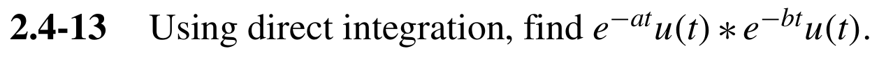{ .lathi-original loading="lazy" }](../../assets/lathi-boulet-20/2.4-13_0.png)

#### 我的解答与订正 {#review-2-4-13}

<!-- review:2.4-13:start -->

尚未添加你的解答。发送 **Lathi 2.4-13** 的解答后，这里会保留你的作答、指出错误并补充订正。

<!-- review:2.4-13:end -->

### 09 · Lathi 3.8-7：离散时间卷积和与时间平移 {#exercise-3-8-7}

**对应主题：** Boulet 第2章：Discrete-Time LTI Systems: The Convolution Sum，p.54

Lathi 印刷页：322；原 PDF 页序：342

[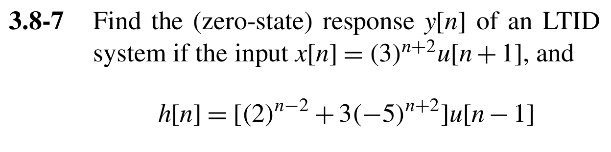{ .lathi-original loading="lazy" }](../../assets/lathi-boulet-20/3.8-7_0.png)

#### 我的解答与订正 {#review-3-8-7}

<!-- review:3.8-7:start -->

尚未添加你的解答。发送 **Lathi 3.8-7** 的解答后，这里会保留你的作答、指出错误并补充订正。

<!-- review:3.8-7:end -->

### 10 · Lathi 3.9-5：离散LTI系统的因果性、稳定性与零状态响应 {#exercise-3-9-5}

**对应主题：** Boulet 第2章：Discrete-Time LTI Systems: The Convolution Sum，p.54；Properties of Linear Time-Invariant Systems，p.74

Lathi 印刷页：327；原 PDF 页序：347

[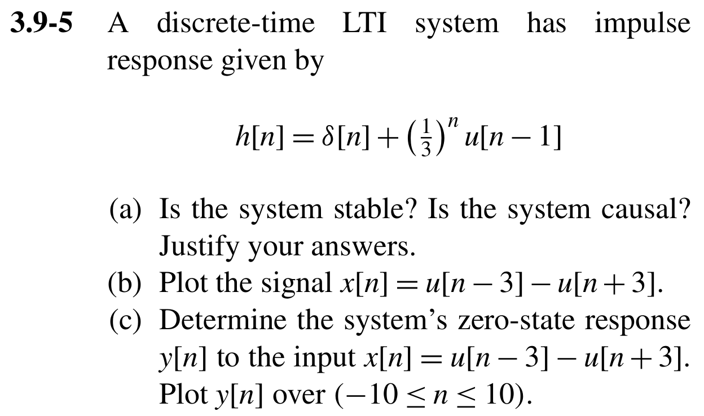{ .lathi-original loading="lazy" }](../../assets/lathi-boulet-20/3.9-5_0.png)

#### 我的解答与订正 {#review-3-9-5}

<!-- review:3.9-5:start -->

尚未添加你的解答。发送 **Lathi 3.9-5** 的解答后，这里会保留你的作答、指出错误并补充订正。

<!-- review:3.9-5:end -->

## 第 3 章：微分方程、差分方程与系统响应

### 11 · Lathi 2.3-1：连续系统的特征方程、模态与冲激响应 {#exercise-2-3-1}

**对应主题：** Boulet 第3章：Impulse Response of a Differential LTI System，p.101；Characteristic Polynomials and Stability，p.112

Lathi 印刷页：224、225；原 PDF 页序：244、245

[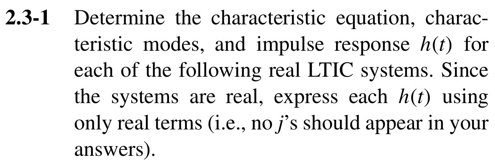{ .lathi-original loading="lazy" }](../../assets/lathi-boulet-20/2.3-1_0.png)

[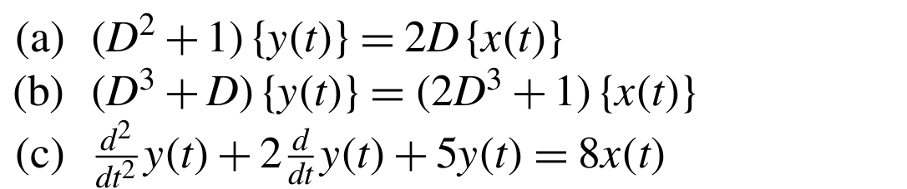{ .lathi-original loading="lazy" }](../../assets/lathi-boulet-20/2.3-1_1.png)

#### 我的解答与订正 {#review-2-3-1}

<!-- review:2.3-1:start -->

尚未添加你的解答。发送 **Lathi 2.3-1** 的解答后，这里会保留你的作答、指出错误并补充订正。

[另页查看 (a)–(c) 完整解答与 SymPy / WASM 运行器](lathi-2-3-1-sympy.md)

<!-- review:2.3-1:end -->

### 12 · Lathi 2.3-4：含输入导数的一阶系统冲激响应 {#exercise-2-3-4}

**对应主题：** Boulet 第3章：Impulse Response of a Differential LTI System，p.101

Lathi 印刷页：225；原 PDF 页序：245

**阅读说明：** 原题引用2.3-2的作答要求：求方程所描述系统的单位冲激响应 h(t)。这只是展开引用，不是追加一道题。

[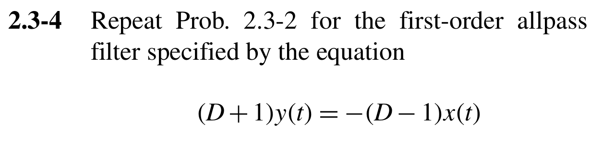{ .lathi-original loading="lazy" }](../../assets/lathi-boulet-20/2.3-4_0.png)

#### 我的解答与订正 {#review-2-3-4}

<!-- review:2.3-4:start -->

尚未添加你的解答。发送 **Lathi 2.3-4** 的解答后，这里会保留你的作答、指出错误并补充订正。

<!-- review:2.3-4:end -->

### 13 · Lathi 3.5-1：差分方程的递推解：冲激、阶跃与零输入响应 {#exercise-3-5-1}

**对应主题：** Boulet 第3章：Causal LTI Systems Described by Difference Equations，p.96

Lathi 印刷页：319；原 PDF 页序：339

[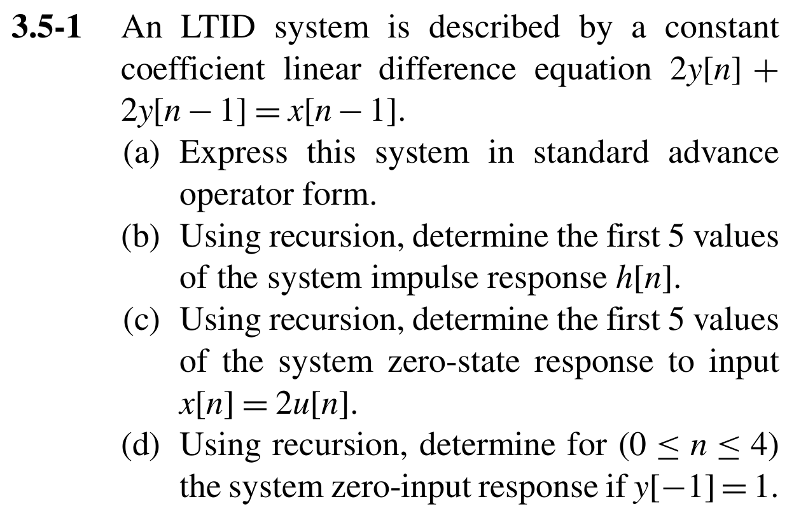{ .lathi-original loading="lazy" }](../../assets/lathi-boulet-20/3.5-1_0.png)

#### 我的解答与订正 {#review-3-5-1}

<!-- review:3.5-1:start -->

尚未添加你的解答。发送 **Lathi 3.5-1** 的解答后，这里会保留你的作答、指出错误并补充订正。

<!-- review:3.5-1:end -->

### 14 · Lathi 3.7-3：离散系统的阶数、特征模态与冲激响应 {#exercise-3-7-3}

**对应主题：** Boulet 第3章：Impulse Response of a Difference LTI System，p.109

Lathi 印刷页：321；原 PDF 页序：341

[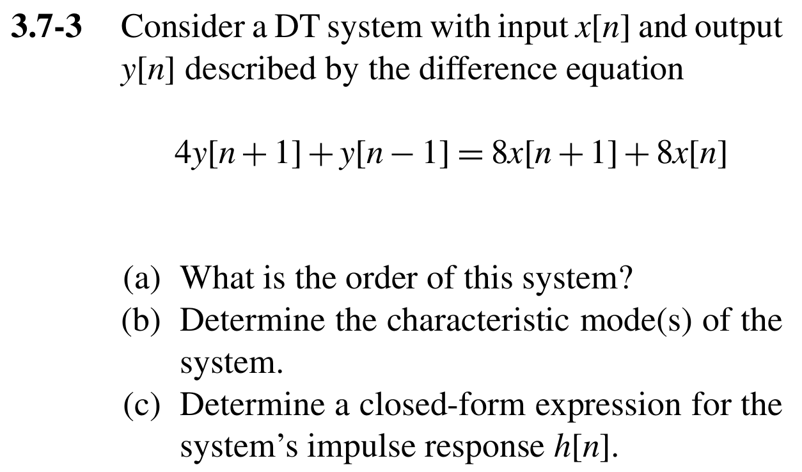{ .lathi-original loading="lazy" }](../../assets/lathi-boulet-20/3.7-3_0.png)

#### 我的解答与订正 {#review-3-7-3}

<!-- review:3.7-3:start -->

尚未添加你的解答。发送 **Lathi 3.7-3** 的解答后，这里会保留你的作答、指出错误并补充订正。

<!-- review:3.7-3:end -->

### 15 · Lathi 2.5-1：特征多项式与系统稳定性 {#exercise-2-5-1}

**对应主题：** Boulet 第3章：Characteristic Polynomials and Stability of Differential and Difference Systems，p.112

Lathi 印刷页：233；原 PDF 页序：253

[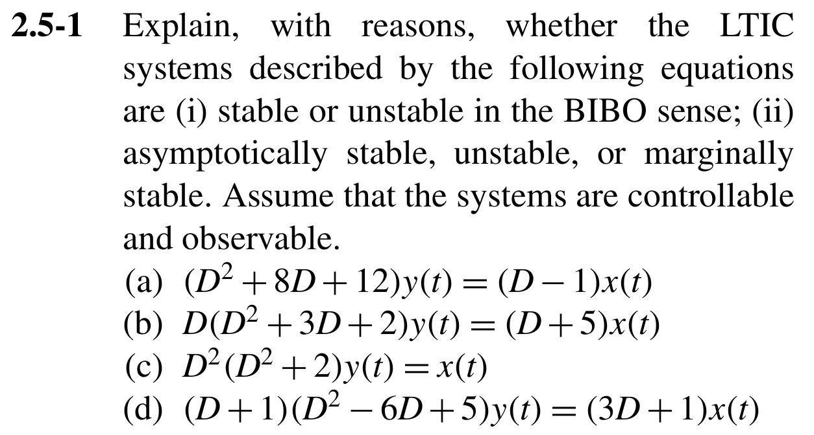{ .lathi-original loading="lazy" }](../../assets/lathi-boulet-20/2.5-1_0.png)

#### 我的解答与订正 {#review-2-5-1}

<!-- review:2.5-1:start -->

尚未添加你的解答。发送 **Lathi 2.5-1** 的解答后，这里会保留你的作答、指出错误并补充订正。

<!-- review:2.5-1:end -->

## 第 4 章：连续时间傅里叶级数

### 16 · Lathi 6.1-5：谐波、基频与三角傅里叶级数系数 {#exercise-6-1-5}

**对应主题：** Boulet 第4章：Linear Combinations of Harmonically Related Complex Exponentials，p.132；Determination of the Fourier Series Representation，p.134

Lathi 印刷页：669；原 PDF 页序：689

[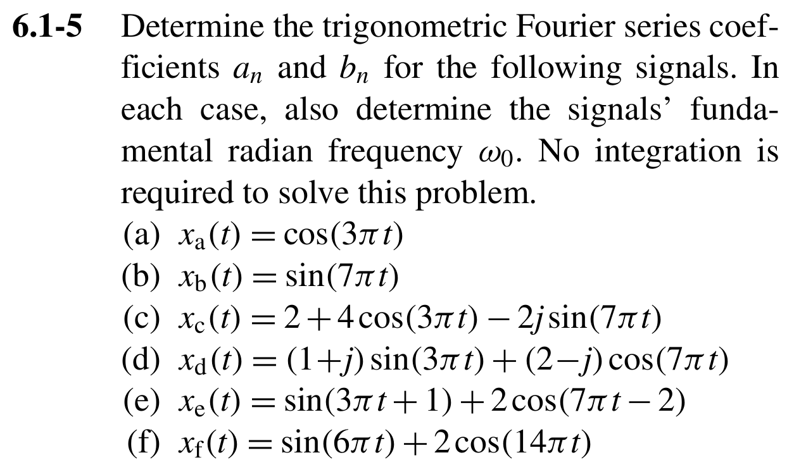{ .lathi-original loading="lazy" }](../../assets/lathi-boulet-20/6.1-5_0.png)

#### 我的解答与订正 {#review-6-1-5}

<!-- review:6.1-5:start -->

尚未添加你的解答。发送 **Lathi 6.1-5** 的解答后，这里会保留你的作答、指出错误并补充订正。

<!-- review:6.1-5:end -->

### 17 · Lathi 6.3-2：分段周期信号的复指数傅里叶级数 {#exercise-6-3-2}

**对应主题：** Boulet 第4章：Determination of the Fourier Series Representation of a Continuous-Time Periodic Signal，p.134

Lathi 印刷页：672；原 PDF 页序：692

[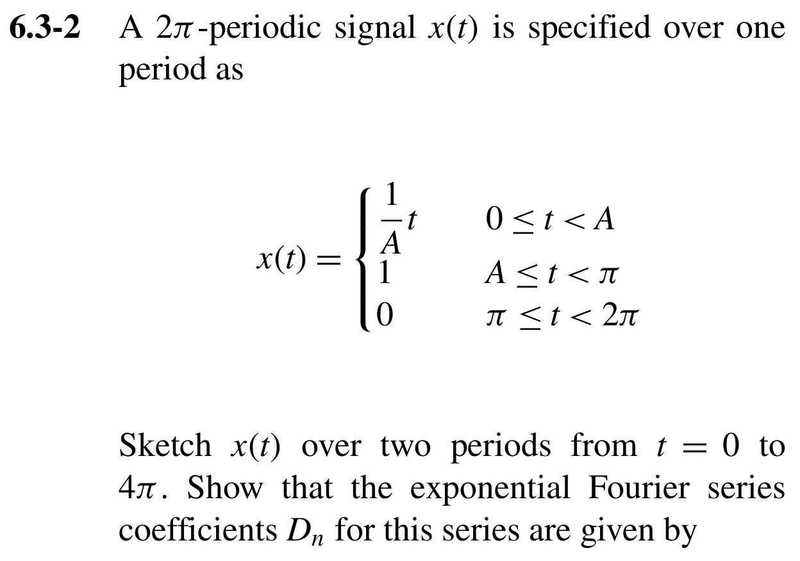{ .lathi-original loading="lazy" }](../../assets/lathi-boulet-20/6.3-2_0.png)

[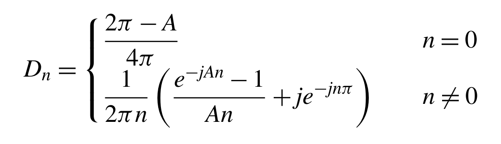{ .lathi-original loading="lazy" }](../../assets/lathi-boulet-20/6.3-2_1.png)

#### 我的解答与订正 {#review-6-3-2}

<!-- review:6.3-2:start -->

尚未添加你的解答。发送 **Lathi 6.3-2** 的解答后，这里会保留你的作答、指出错误并补充订正。

<!-- review:6.3-2:end -->

### 18 · Lathi 6.3-8：傅里叶级数的奇偶与共轭对称性质 {#exercise-6-3-8}

**对应主题：** Boulet 第4章：Properties of Continuous-Time Fourier Series，p.139

Lathi 印刷页：673；原 PDF 页序：693

[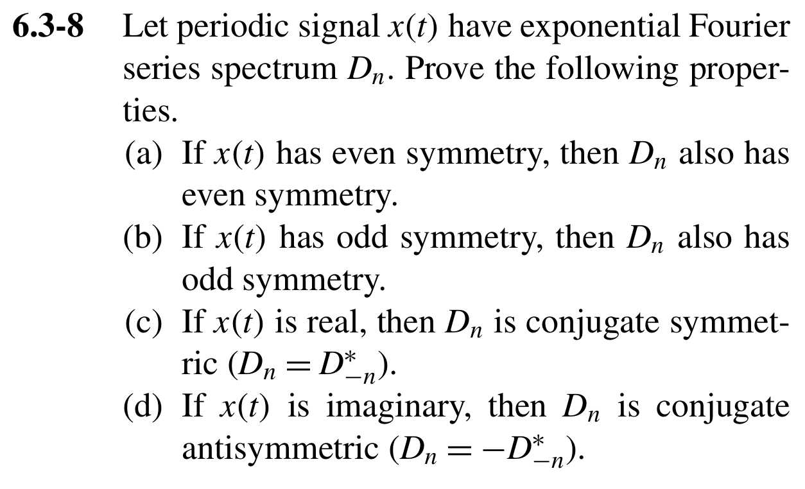{ .lathi-original loading="lazy" }](../../assets/lathi-boulet-20/6.3-8_0.png)

#### 我的解答与订正 {#review-6-3-8}

<!-- review:6.3-8:start -->

尚未添加你的解答。发送 **Lathi 6.3-8** 的解答后，这里会保留你的作答、指出错误并补充订正。

<!-- review:6.3-8:end -->

### 19 · Lathi 6.4-3：周期输入经过LTI滤波系统后的输出 {#exercise-6-4-3}

**对应主题：** Boulet 第4章：Steady-State Response of an LTI System to a Periodic Signal，p.155

Lathi 印刷页：675；原 PDF 页序：695

[{ .lathi-original loading="lazy" }](../../assets/lathi-boulet-20/6.4-3_0.png)

#### 我的解答与订正 {#review-6-4-3}

<!-- review:6.4-3:start -->

尚未添加你的解答。发送 **Lathi 6.4-3** 的解答后，这里会保留你的作答、指出错误并补充订正。

<!-- review:6.4-3:end -->

### 20 · Lathi 6.5-6：傅里叶级数的有限项近似与误差能量 {#exercise-6-5-6}

**对应主题：** Boulet 第4章：Optimality and Convergence of the Fourier Series，p.144；Parseval Theorem，p.150

Lathi 印刷页：677；原 PDF 页序：697

**阅读说明：** 所需原图 P6.5-4(a) 已附在题干下方；本题只使用图(a)，不使用图(b)。

[{ .lathi-original loading="lazy" }](../../assets/lathi-boulet-20/6.5-6_0.png)

[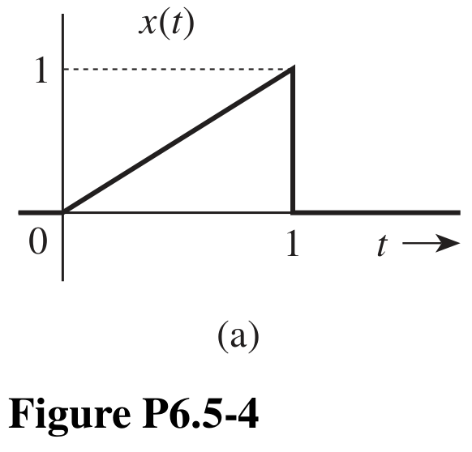{ .lathi-original loading="lazy" }](../../assets/lathi-boulet-20/6.5-6_1.png)

#### 我的解答与订正 {#review-6-5-6}

<!-- review:6.5-6:start -->

尚未添加你的解答。发送 **Lathi 6.5-6** 的解答后，这里会保留你的作答、指出错误并补充订正。

<!-- review:6.5-6:end -->

## 来源与使用说明

- B. P. Lathi & R. A. Green, *Linear Systems and Signals*, Third Edition, Oxford University Press, 2018：题号、题干、跨页内容和所需原图均按原 PDF 核对
- Benoit Boulet, *Fundamentals of Signals and Systems*：第 1–4 章的主题与印刷页码用于中文学习索引
- Lathi 原 PDF 页序比印刷页码大 20；页面同时列出两种页码，便于回查
- 2.3-1 的跨页小题、6.3-2 的系数公式、6.5-6 的 P6.5-4(a) 图均已纳入；2.3-4 的引用指令已在中文说明中展开
- 下载 PDF 保持原题版本；网页订正区在收到你的解答后按题号更新。Lathi 2.3-1 的既有解答链接保留在该题下方。

[Boulet 总览](index.md) · [前三章全部对应题号](lathi-exercise-map.md) · [优先对应习题](lathi-priority-map.md)

